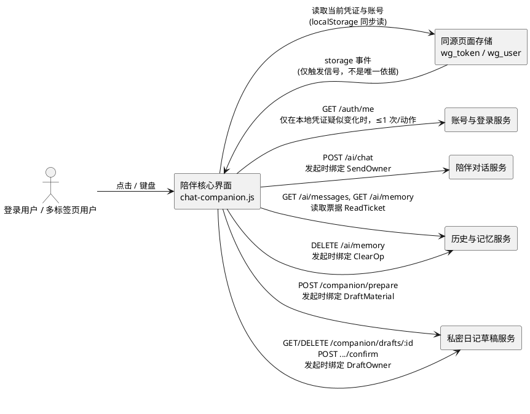
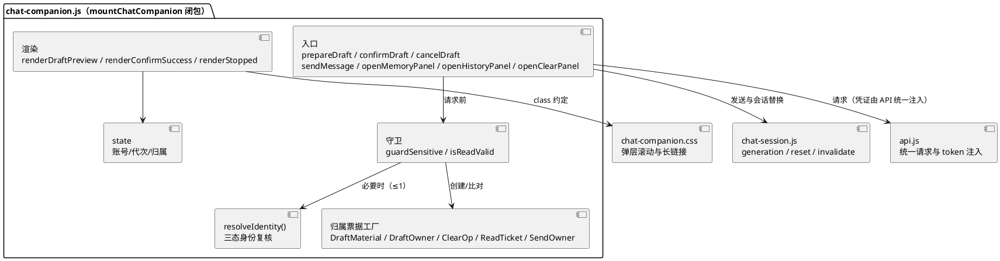
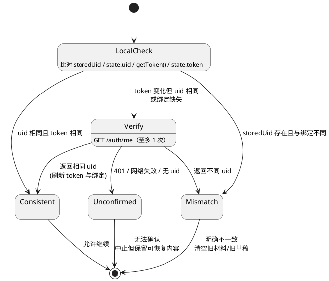
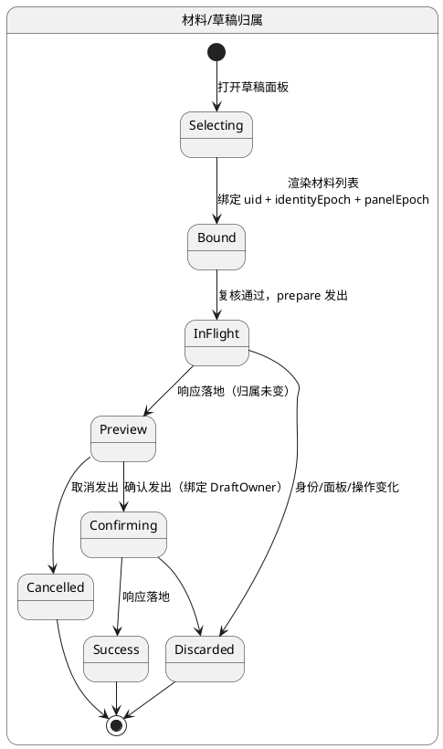
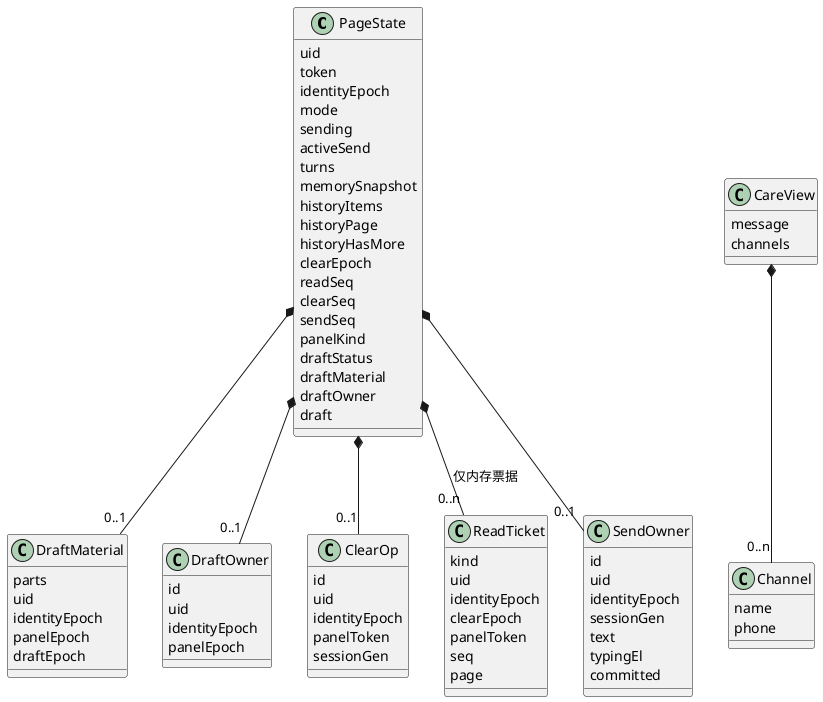

# 一、需求与存量功能关系分析

> 本章核对依据：`.codeartsdoer/specs/ab_edge_hardening/spec.md`（696 行）、`docs/给CodeArts的返修收尾指令.md`、`docs/CodeArts返修复验与下一步.md`、`docs/codearts_proof/2026-11-13-任务AB返修.md`、`docs/review/2026-11-13-codearts-repair-check/` 下三份复现脚本与结果、以及 `D:\微光同行\Glimmer` 当前源码。
>
> 所有代码位置均相对 Glimmer 仓库根目录，行号以本次核对为准。本文件只定义“怎么做”，不改动任何业务代码、测试代码或配置文件。

## 1.0 实际状态与基线核对

| 核对项 | 实际值 | 说明 |
|---|---|---|
| 规格文件 | `.codeartsdoer/specs/ab_edge_hardening/spec.md`，696 行 | 已存在，含 R1–R6、DFX、术语、追溯表与 8 个待确认点 |
| 设计目标文件 | `.codeartsdoer/specs/ab_edge_hardening/design.md` | 本文件，与 `spec.md` 同目录 |
| 工作目录 | `D:\微光同行\Glimmer` | 前端在 `前端参考/`，后端在 `后端源码/`；命令需在对应目录执行 |
| 前端编排文件 | `前端参考/chat-companion.js`，1194 行 | 本轮唯一必改业务文件 |
| 前端会话 helper | `前端参考/chat-session.js`，77 行 | 已具备 `generation` / `invalidate` / `reset` / `isStale`，本轮只读不改 |
| 请求封装 | `前端参考/api.js`，123 行 | `rawFetch()` 每次从 storage 取当前 token；**不支持按请求指定凭证**，本轮只读不改 |
| 专用样式 | `前端参考/chat-companion.css`，260 行 | `cc-sheet-body` 已有 `overflow-y:auto`；393×852 仍需真实浏览器确认 |
| 现有回归文件 | `后端源码/scripts/test-chat-companion-repair.test.js`，483 行，12 条用例 | 已在 `test:competition` 的 `node --test` 列表内 |
| 测试命令 | `后端源码/package.json:14-15` | `test:competition`、`test:merge24`；默认可不修改该文件 |
| 复现脚本 | `A-remaining-repro.cjs`、`B-remaining-repro.test.mjs`、`B-extra-checks.test.mjs` | 三份脚本的“退出 0”表示缺陷存在，不是通过 |
| 既有复验结论 | 两套完整回归曾退出 0；六项边界仍可复现 | 来源 `docs/CodeArts返修复验与下一步.md:5-7,24-36` |
| 上次记录的前端哈希 | `D919B8385E8E13A36B2F0CCA85CCE2597595CBD71C76DE6DD10A7BAD7E726993` | 仅来自既有复验文档，本轮未重新计算；实施前必须重新记录 |
| 服务状态 | 本设计阶段未启动、未探测 | 8081 / 3000 / 3307 的实际监听与实例身份留待验收阶段核对 |
| 模型状态 | `configured=false`（既有复验记录） | 本轮不得把本地规则结果表述为真实大模型效果 |
| 仓库状态 | 工作区含未提交修改与既有证据 | 不覆盖 `docs/交接说明.md`、`docs/review/**`、`docs/codearts_proof/` 既有三份记录 |

## 1.1 需求功能与存量功能对比

### 1.1.1 已实现功能

本表只列“完全匹配、本轮必须保留”的能力。判定依据是对应代码路径在当前实现中已覆盖需求，且既有回归用例正在保护它。

| 需求功能 | 存量功能 | 代码位置 | 匹配度 |
|---|---|---|---|
| 草稿准备/确认乱序保护 | `draftEpoch` + `panelEpoch` 双重校验，旧响应直接丢弃 | `前端参考/chat-companion.js:705-706`、`:724`、`:886-887`、`:903`、`:910`、`:943`、`:950`、`:973-974`、`:987` | 100% |
| 关闭面板后迟到确认不回填 | `closePanel()` 递增面板/草稿代次并清空 `activeDraftControls` | `前端参考/chat-companion.js:400-410` | 100% |
| 取消终态禁止确认 | `draftStatus='cancelled'`，`setDraftBusy()` 按终态禁用确认/取消/正文 | `前端参考/chat-companion.js:747-756`、`:964-971`、`:999-1002` | 100% |
| 确认结果不明时同 ID 幂等恢复 | `resolveUnknownDraft()` 先同 ID 重试 confirm，再 GET 查状态，不重新 prepare | `前端参考/chat-companion.js:905-960` | 100% |
| 关怀正文纯文本、电话字符白名单、仅 `tel:` | `showCare()` / `appendCareFull()` 使用 `textContent` 与 `[^\d+()-]` 清洗 | `前端参考/chat-companion.js:222-237`、`:425-439` | 100% |
| 清除成功后同账号上下文清理 | 成功回调替换会话并清空气泡、turns、历史、分页、摘要、背景关怀 | `前端参考/chat-companion.js:593-600` | 100% |
| 清除面板文案的代次保护 | 只有 `token === panelEpoch` 才写“已清除 N 条” | `前端参考/chat-companion.js:602-605` | 75% |
| 清除失败保留内容 | 失败分支不推进任何清理，保留摘要缓存并提示 | `前端参考/chat-companion.js:582-591`、`:449-462` | 100% |
| 保存开关竞态保护 | `modeEpoch` 意图令牌 + `/auth/me` 后复核 | `前端参考/chat-companion.js:1055-1097` | 100% |
| 初始化恢复的身份复核 | 恢复前 `fetchMe()`，核对代次、`expectedUid`、token 未变 | `前端参考/chat-companion.js:338-356`、`:1155-1174` | 75% |
| 发送响应的会话代次丢弃 | 响应前后比较 `state.session` 与 `session.generation` | `前端参考/chat-companion.js:1026-1030`、`:1037-1039`；`前端参考/chat-session.js:47-53` | 100% |
| helper 清除后旧回复不写回上下文 | `reset()` 递增代次，`send()` 写回前复核代次 | `前端参考/chat-session.js:22-53` | 100% |
| 错误码到提示的区分（取消/冲突/过期/已删除） | `mapDraftError()` | `前端参考/chat-companion.js:95-119` | 100% |
| 关怀在 prepare 停止分支已进入弹层 | `appendCareFull()` 在 `draft:null` 分支调用 | `前端参考/chat-companion.js:733-737` | 75% |
| 双门、互关/粉丝、其他私信、未读、群聊、举报、审核 | 相关页面与脚本 | 本轮不触碰 | 100% |

### 1.1.2 需要扩展的功能

| 需求功能 | 存量功能 | 差异说明 | 扩展方向 |
|---|---|---|---|
| R1 草稿材料与请求的身份绑定 | 材料只从 `state.turns` 与面板 checkbox 读取，请求无身份前置条件 | 输入差异：材料缺少账号/身份代次/面板代次归属；请求前无复核。边界差异：身份变化后旧材料仍可一键提交 | 增加材料归属对象与敏感动作统一复核；`prepareDraft` / `confirmDraft` / `cancelDraft` 三个入口前置校验 |
| R1 草稿响应落地复核 | prepare/confirm/cancel 响应只校验 `draftEpoch` + `panelEpoch` | 业务差异：换号但未触发 storage 时，面板代次不变，旧响应仍会落地 | 响应落地前追加 `identityEpoch` + 当前账号核对 |
| R2 清除成功后读取失效 | 记忆读取只校验 `panelEpoch`；历史读取只校验会话代次 | 缺少“清除影响代次”和“读取代次”；清除成功后迟到 GET 可重写 `memorySnapshot` | 新增 `clearEpoch` 与读取票据快照，回调统一四维校验 |
| R2 清除成功后面板影响域 | 清除成功只按面板代次决定是否写成功文案 | 缺少“同账号必清后台上下文、面板按类型分别处理”的显式规则 | 把上下文清理与面板文案拆成两条独立判定 |
| R3 清除响应归属 | 回调只校验 `panelEpoch`，随后无条件清理当前页面 | 缺少发起账号、清除操作代次、发起时会话代次；跨账号会误清 B 页面 | 增加 `ClearOp` 发起归属与最新操作判定 |
| R4 发送锁归属 | 单一 `state.sending` 布尔；锁在 `await` 之后才置位；`finally` 无条件解锁 | 同账号跨会话/跨请求无法区分归属；await 期间可重复进入；旧请求可解开新锁 | 引入 `SendOwner`，同步占位，只由拥有者收尾 |
| R5 确认成功后关怀可见性 | `confirmDraft` 成功只调用背景 `showCare()`，`renderConfirmSuccess()` 无 care 参数 | 幂等恢复成功同样遗漏；普通编辑后触发 care 的分支未覆盖 | `renderConfirmSuccess(data, care)` 内复用 `appendCareFull()` |
| R6 停止生成终态 | `draft:null + care` 只追加关怀与文案，按钮已被提前解锁 | 缺 `stopped` 状态；面板可重复提交 prepare、重复追加关怀；无显式返回入口 | 引入 `draftStatus='stopped'` 与专用停止视图 |
| 正式回归覆盖 | 现有 12 条用例覆盖保存、清除、乱序、幂等、取消与 prepare 关怀 | 缺少 R1–R6 六项边界的正确行为断言 | 追加到现有 repair 测试文件，纳入既有 `test:competition` |

### 1.1.3 需要新增的功能或接口

本轮不新增后端接口、不新增页面、不新增框架能力；新增均在前端模块内部的函数契约与状态字段。

**A. 身份归属基础设施（供 R1/R3/R4/R6 复用）**

| 功能点 | 输入 | 输出 | 核心逻辑 | 依赖 |
|---|---|---|---|---|
| 身份代次 | 账号变化、退出登录、身份校验失败 | 单调递增的 `identityEpoch` | 只在身份生命周期边界推进；与保存开关意图、面板代次严格分离 | 现有 `state.uid/token`、`resetAccountView` |
| 敏感动作复核 | 动作类型、材料/草稿/清除/发送归属 | `consistent` / `mismatch` / `unconfirmed` 三态 | 先本地比对账号与凭证；不一致才调用至多 1 次 `/auth/me` | `fetchMe()`、`getToken()`、`getStoredUser()` |
| 归属快照 | 发起时的账号、代次、面板、会话 | 只读票据对象 | 响应落地前逐项比对，任一不符即丢弃 | 现有代次字段 |

**B. R1 草稿身份绑定**

| 功能点 | 输入 | 输出 | 核心逻辑 | 依赖 |
|---|---|---|---|---|
| 材料归属 | 勾选内容、选择面板 | `DraftMaterial` | 绑定账号、身份代次、面板代次与操作代次；不改变 1–2000 字校验 | `buildDraftMaterial` |
| 草稿归属 | 服务端草稿、发起上下文 | `DraftOwner` | 确认/取消/重试前核对账号与身份代次 | prepare 响应 |
| 复核结果分支 | 三态复核结果 | 继续 / 清空中止 / 保留可恢复 | 明确不一致才清空；无法确认只中止并保留 | 材料/草稿归属 |

**C. R2 清除影响域**

| 功能点 | 输入 | 输出 | 核心逻辑 | 依赖 |
|---|---|---|---|---|
| 清除影响代次 | 清除成功事件 | `clearEpoch` 前进 | 只由“同账号清除成功”推进；失败不推进 | 清除回调 |
| 读取票据 | 打开记忆/历史、加载更早 | `ReadTicket` | 发起时快照账号、身份、清除、面板、读取代次 | 现有 `openMemoryPanel` / `loadHistory` |
| 面板影响域裁决 | 当前面板类型 | 上下文清理 + 面板动作 | 上下文清理与面板文案互不为条件 | 现有面板代次 |

**D. R3 清除响应归属**

| 功能点 | 输入 | 输出 | 核心逻辑 | 依赖 |
|---|---|---|---|---|
| 清除操作归属 | 确认清除动作 | `ClearOp` | 记录账号、身份代次、面板代次、会话代次、操作序号 | 清除面板 |
| 回调裁决 | 成功/失败响应 + `ClearOp` | 丢弃 / 仅清上下文 / 清上下文并更新面板 | 跨账号完全丢弃；同账号必清上下文；面板文案只在原面板 | `replaceSession` |

**E. R4 发送归属**

| 功能点 | 输入 | 输出 | 核心逻辑 | 依赖 |
|---|---|---|---|---|
| 同步占位 | 点击发送或 Enter | `SendOwner` 或拒绝 | 在任何 `await` 之前占位；占位失败直接返回 | `state.sending` 兼容字段 |
| 拥有者收尾 | 响应/异常/超时 | 只清理自己的提示与锁 | 非拥有者不得改 `sending`、按钮或输入框 | `session.generation` |
| 输入回填守卫 | 失败文本 + 归属 | 回填或丢弃 | 仅当归属仍是当前、账号未变、输入框为空 | 输入框 |

**F. R5/R6 展示终态**

| 功能点 | 输入 | 输出 | 核心逻辑 | 依赖 |
|---|---|---|---|---|
| 成功弹层关怀 | confirm 成功响应 `data.care` | 弹层内正文 + 渠道 + `tel:` | 复用 `appendCareFull()`；背景 `showCare()` 仅作补充 | 现有 care 渲染 |
| 停止生成终态 | prepare `draft:null + care` | `stopped` 视图 | 禁用生成入口、只追加一次关怀、提供关闭与返回聊天 | `setDraftBusy` |

## 1.2 存量功能详细分析

### 1.2.1 身份与凭证契约

- **接口契约**：`getToken()` 优先调用全局 `getToken`，否则读 `localStorage.wg_token`（`前端参考/chat-companion.js:204-207`）；`getStoredUser()` 同理读 `wg_user`（`:209-212`）。页面启动时把二者复制到 `state.uid` / `state.token`（`:1134-1137`）。
- **请求侧事实**：`rawFetch()` 在每次请求时重新读取当前 token 并写入 `Authorization`（`前端参考/api.js:57-60`）；`api()` 只接受 `method` / `body` / `silent401`（`:82-83`），**没有按请求传入凭证的能力**。
- **约束**：因此“请求一定使用发起账号的凭证”无法在 `api.js` 不改的前提下实现。本方案采用“请求前复核 + 请求后归属校验”，并明确记录复核完成到请求发出之间的极短残余窗口（见 2.9）。
- **副作用约束**：`ensureCurrentAccount()` 发现本地 uid 变化时会调用 `switchAccount()`，后者执行 `resetAccountView()` 并关闭面板（`前端参考/chat-companion.js:358-366`、`:305-336`）。草稿入口若直接复用该函数，会把“身份不一致”的表现变成“面板被关闭且提示语是保存模式文案”。因此草稿需要独立的复核函数，不能直接套用发送路径的副作用。

### 1.2.2 现有代次体系与职责缺口

| 代次/字段 | 当前职责 | 推进时机 | 缺口 |
|---|---|---|---|
| `modeEpoch`（`:199`） | 保存开关的用户意图序号 | 开关变更、恢复、换号 | 被高频开关操作推进，不能代表身份；不可作为响应归属依据 |
| `panelEpoch`（`:200`） | 当前弹层有效期 | 打开/关闭/换号 | 换号但不触发 storage 时不变；不能单独判定账号 |
| `draftEpoch`（`:201`） | 草稿操作有效期 | 准备/确认/取消/返回/关闭 | 只覆盖操作，不覆盖身份 |
| `state.session.generation`（`chat-session.js:16-24`） | 会话上下文有效期 | `invalidate` / `reset` / 清除 / 换号 | 只覆盖会话与发送，不覆盖弹层与账号 |
| `state.sending`（`:185`） | 单一发送锁布尔 | 请求发出后置真、finally 置假 | 无归属；await 前不置位；finally 无条件解锁 |
| `state.uid` / `state.token`（`:183-184`） | 页面绑定的账号与凭证 | 启动、保存开关、恢复、换号 | 没有代次，无法区分“同账号凭证更新”和“换号” |

**结论**：现有体系是“按用途分代次”，缺少“身份”这一公共维度，也缺少“清除影响”和“发送归属”。本轮新增字段必须复用现有命名风格，避免引入状态管理库。

### 1.2.3 现有回归测试保护的公开契约

`后端源码/scripts/test-chat-companion-repair.test.js` 的 483 行、12 条用例直接读写 `ui.state`，以下语义属于**受测试保护的契约**，本轮不得改变：

1. `state.uid`、`state.mode`、`state.turns`、`state.sending`、`state.memorySnapshot`、`state.draft`、`state.draftStatus` 的字段名与类型保持。
2. 换号后首次点击发送被拒绝、第二次点击才发出请求（`P1-07`，`:255-276`）。发送占位不得改变“第一次拒绝、第二次成功”的可观察顺序。
3. 清除成功后立即发送不被旧请求阻塞（`P1-06`，`:230-253`）。`replaceSession()` 必须在清除成功时解除旧锁，同时作废旧发送归属。
4. 清除失败保留 turns 与摘要（`P1-05`、`P2-03`，`:207-228`、`:449-462`）。
5. prepare 乱序只保留新草稿（`B2`，`:329-352`）；关闭面板后迟到响应不落地（`P2-02`，`:319-327`）。
6. 幂等恢复用同一 ID 重试且只 prepare 1 次（`B1`，`:383-409`）。
7. 按钮文案是测试定位依据：`生成草稿`、`确认保存为私密日记`、`取消草稿`、`返回修改选择`、`确认清除`、`取消`、`关闭`、`再整理一段`。新增按钮应使用新文案（如 `返回聊天`），避免与既有定位冲突。

### 1.2.4 R1–R6 缺陷根因定位

| 需求 | 触发路径 | 根因（代码位置） | 本轮判定 |
|---|---|---|---|
| R1 草稿发送前身份绑定 | A 选材料 → 凭证换 B（storage 未处理）→ 点击生成 | `prepareDraft()` 直接 `selectedTurns()` 组正文并请求（`:693-720`），全程无账号/凭证复核；材料只存在于无归属的 `state.turns` 与 DOM checkbox（`:614-622`）；`api.js` 请求时才取当前 token（`api.js:57-60`） | 需改：新增材料归属 + 前置复核 + 响应身份校验 |
| R1 确认/取消/恢复跨账号 | A 的草稿在 B 凭证下继续操作 | `confirmDraft()` / `cancelDraft()` 只校验 `draftEpoch` 与 `panelEpoch`（`:886-903`、`:973-987`）；`resolveUnknownDraft()` 同样只校验这两项（`:943`、`:950`）；恢复路径已有 token/uid 校验（`:342`、`:1160-1167`） | 部分已实现（恢复）需保留；确认/取消需扩展 |
| R2 清除中读取失效 | DELETE 在途 → 打开记忆发 GET → DELETE 成功 → GET 迟到 | `openMemoryPanel()` 只校验 `panelEpoch`（`:542`），随后无条件写 `state.memorySnapshot`（`:551`）；清除成功不推进任何“清除影响代次”（`:593-600`）；`loadHistory()` 只校验会话代次（`:456`） | 需改：新增 `clearEpoch` + 读取票据 |
| R2 无关草稿面板保护 | 清除成功时正在编辑草稿 | 清除成功只按 `token === panelEpoch` 决定写文案（`:602`），不重绘面板；但“不重绘”是隐式副作用，不是显式规则 | 现状基本正确，需固化为显式裁决并加回归 |
| R3 旧账号清除响应隔离 | A 的 DELETE 在途 → 换 B 并聊天 → A 成功回调到达 | 清除成功回调在 `await` 之后没有账号/操作归属校验，直接 `replaceSession()`、清 `chatEl`/`turns`/`history`，并无条件 `showNotice` + `addBubble`（`:593-607`） | 需改：新增 `ClearOp` |
| R3 同账号关闭面板清理 | A 关闭清除面板后 DELETE 成功 | 上下文清理本身不依赖面板（`:593-600`），但 `showNotice` 无面板条件（`:606`），且无“最新清除操作”判定 | 部分正确需保留；补操作代次与文案边界 |
| R4 发送锁归属 | 旧请求 → 清除 → 新请求 pending → 旧返回 → 发第三条 | `sendMessage()` 只在入口同步检查 `state.sending`（`:1006`），却在 `await ensureCurrentAccount()`（`:1013`）之后才置锁（`:1021`）；`finally` 无条件置 `sending=false`、启用按钮（`:1047-1051`） | 需改：同步占位 + `SendOwner` |
| R4 重复点击 | 身份复核 await 期间连点两次 | 同上：await 前无占位，两个调用都能通过 `state.sending` 检查并发送 | 需改 |
| R5 确认后关怀可见性 | 编辑普通草稿 → confirm 返回 care | 成功分支只 `showCare()` 背景（`:928`），`renderConfirmSuccess(res.data)` 未传 care（`:929`），渲染函数本身无 care 参数（`:840-867`）；幂等恢复同样回到该分支（`:905-908`） | 需改：扩展成功渲染 |
| R5 关怀内容来源 | care 正文/渠道/电话 | 后端 `confirmResult()` 确实返回 `care`（`后端源码/src/utils/companion.js:97-99`，只读依据）；前端 `appendCareFull()` 已具备完整安全渲染（`:425-439`） | 后端不改，前端复用 |
| R6 停止生成终态 | prepare 返回 care + `draft:null` | 分支前已执行 `buttonEl.disabled = false`（`:725`），分支只追加关怀与文案（`:733-737`），无终态标记；`renderDraftSelection()` 每次重建都重置 `draftStatus=''`（`:626`） | 需改：新增 `stopped` 状态与视图 |
| R6 网络失败误判 | prepare 返回非零 | 现有错误分支（`:726-731`）与停止分支（`:733`）已分离 | 现状正确，需加防回归 |

**根因归纳**：六项问题都不是“缺少功能”，而是**异步回调缺少归属维度**——现有代码只回答“是哪个面板/哪个草稿操作”，没有回答“是哪个账号、哪次清除、哪次发送”。因此本轮方案的核心不是重写流程，而是给现有回调补一个统一的归属判定层。
# 二、增量设计方案

## 2.0 设计原则与总体取舍

1. **只补归属，不重写流程。** 现有 prepare/confirm/cancel/clear/send 的请求顺序、接口参数与状态机保持不变；新增判定全部放在“请求前”和“响应落地前”两个切面。
2. **不引入框架与状态库。** 归属对象是模块内闭包字段，沿用 `state` 命名风格；不新增全局变量，不引入发布订阅或代理。
3. **不改接口契约。** 后端请求/响应结构、状态码与确认语义不变；本方案只改变“什么时候允许发请求、什么时候允许把响应写进页面”。
4. **正常路径零额外请求。** 本地身份与绑定一致时不调用 `/auth/me`；只有本地凭证疑似变化时才复核，且每个动作至多 1 次。
5. **可观察契约优先。** 既有测试直接读 `state.uid` / `sending` / `turns` / `draftStatus`，新增字段只增不改；既有按钮文案与可观察顺序保持不变。
6. **安全边界复用。** care 的纯文本渲染、电话字符白名单、`tel:` 协议、站内链接白名单全部复用现有函数，不新增第二套渲染逻辑。

## 2.1 实现模型

### 2.1.1 上下文视图



通信频率约束：`/auth/me` 只在本地凭证与绑定不一致时调用；其余接口的调用时机与次数与现状一致，不新增轮询、定时器或预取。

### 2.1.2 服务/组件总体架构



职责划分：

| 组件 | 职责 | 不负责 |
|---|---|---|
| `state` | 当前账号、身份代次、各业务代次、归属对象、面板类型 | 不保存 DOM 引用以外的跨账号数据 |
| `resolveIdentity()` | 三态身份判定；同账号凭证更新时刷新绑定 | 不直接改面板、不清材料（由调用方按结果处理） |
| 守卫函数 | 请求前快照、响应落地前逐项比对 | 不发起业务请求 |
| 渲染函数 | 按归属结果渲染面板；care 复用既有安全渲染 | 不改后端语义、不伪造内容 |
| 入口函数 | 组织一次动作的顺序：占位 → 复核 → 请求 → 收尾 | 不重复实现归属判定 |

### 2.1.3 身份归属模型

**四层归属，互不替代：**

| 层级 | 字段 | 回答的问题 | 推进时机 | 失效后果 |
|---|---|---|---|---|
| 身份层 | `state.identityEpoch` | 现在是哪个账号的连续有效期 | 账号变化、退出登录、身份校验失败、初始化换号 | 旧身份的在途响应一律丢弃 |
| 会话层 | `state.session.generation` | 这段对话上下文是否已被替换 | 清除成功、换号、模式切换 | 旧回复不写入新会话、不写回 helper history |
| 面板层 | `state.panelEpoch` + `state.panelKind` | 当前弹层是哪一次、哪种类型 | 打开/关闭/切换/换号 | 旧面板结果不落地 |
| 操作层 | `state.draftEpoch` / `state.clearSeq` / `state.sendSeq` / `state.readSeq` | 这是同类的第几次用户动作 | 每次准备/确认/取消/清除/发送/读取 | 旧操作不覆盖新操作 |

**与现有字段的关系（只增不改）：**

- `state.uid` / `state.token` 继续表示“页面绑定的账号与凭证”，作为身份层的可观察值；`identityEpoch` 是其单调代次。
- `state.sending` 继续作为“当前是否存在进行中发送”的可观察布尔，与 `state.activeSend` 同步维护；既有测试断言 `state.sending` 仍然成立。
- `state.draftStatus` 取值扩展为 `pending` / `confirmed` / `cancelled` / `expired` / `stopped`；`stopped` 仅前端本轮终止，不上报服务端。
- `modeEpoch` 保持“保存开关意图”语义，**不再被用作身份判定**；这是本轮的关键纠正。

**身份代次推进规则：**

1. `resetAccountView()`（换号/退出）推进一步，并同时推进面板、草稿代次、会话代次。
2. `resolveIdentity()` 返回明确 `mismatch` 时，由既有 `switchAccount()` 完成状态清理；因此身份代次只推进一次，不重复推进。
3. `resolveIdentity()` 返回 `unconfirmed`（401/网络失败）时推进一步，使在途响应失效，但**不清空面板内容**；用户重试时重新复核并按同账号规则刷新材料/草稿归属。
4. 同账号凭证更新（uid 相同、token 字符串变化）不推进身份代次，只更新 `state.token` 与相关归属中的凭证快照。

### 2.1.4 身份复核状态机



三态语义：

| 结果 | 判定依据 | 调用方行为 |
|---|---|---|
| `consistent` | 本地 uid/token 与归属一致；或 `/auth/me` 返回同 uid | 允许请求；同账号 token 更新时刷新绑定后再请求 |
| `mismatch` | 本地账号标识已变；或 `/auth/me` 返回不同 uid | **不发出请求**；清空旧材料/旧草稿；提示“账号或登录状态已变化，请重新选择” |
| `unconfirmed` | `/auth/me` 401、超时、网络失败、返回无 uid | **不发出请求**；保留面板内容与输入；提示可恢复；按钮恢复可用 |

### 2.1.5 四类归属的生命周期



清除、读取、发送的归属生命周期在 2.4.2–2.4.4 分述；共同规则是：**票据在动作发起时创建，落地前逐项比对，任一不符即丢弃，且丢弃不得伴随任何 DOM 写入。**

## 2.2 接口设计

### 2.2.1 总体设计

本轮不新增对外 HTTP 接口，只新增模块内部函数契约。内部接口按“归属判定”“票据构造”“渲染终态”三类组织，均为 `mountChatCompanion` 闭包内函数，不导出到全局，避免扩大公开面。

| 分类 | 接口 | 稳定性 | 说明 |
|---|---|---|---|
| 身份 | `resolveIdentity` | 稳定（内部） | 三态复核，供草稿、清除、发送复用 |
| 草稿 | `bindDraftMaterial`、`createDraftOwner`、`isDraftResponseCurrent` | 稳定（内部） | 材料与草稿归属 |
| 清除 | `createClearOp`、`judgeClearResponse` | 稳定（内部） | 发起归属与回调裁决 |
| 读取 | `createReadTicket`、`isReadValid` | 稳定（内部） | 记忆/历史读取票据 |
| 发送 | `beginSend`、`settleSend`、`isSendCurrent` | 稳定（内部） | 同步占位与拥有者收尾 |
| 渲染 | `renderStopped`、`renderConfirmSuccess(data, care)`、`renderPanelEmpty(kind)` | 稳定（内部） | 终态与空态 |

变更策略：这些接口只在 `chat-companion.js` 内部使用；若后续需要测试直连，可在返回对象中追加引用，但不得改变既有导出字段。

### 2.2.2 接口清单

#### （1）resolveIdentity

```javascript
/**
 * @typedef {'consistent'|'mismatch'|'unconfirmed'} IdentityStatus
 * @typedef {Object} IdentityOwner
 * @property {string} uid                       // 发起动作时绑定的账号标识
 * @property {number} identityEpoch             // 发起动作时的身份代次
 *
 * @typedef {Object} IdentityResult
 * @property {IdentityStatus} status
 * @property {string} uid                       // consistent 时为已确认账号
 * @property {string} nextUid                   // mismatch 时为当前存储账号，供 switchAccount 使用
 * @property {boolean} viaNetwork               // 是否调用了 /auth/me
 */
async function resolveIdentity(owner, options)
```

- **入参**：`owner: IdentityOwner`；`options = { allowNetwork: boolean }`，默认 `true`。
- **业务说明**：敏感动作发请求前的统一身份判定；同账号 token 刷新时刷新绑定。
- **前置条件**：`owner.uid` 与 `owner.identityEpoch` 来自动作发起时的快照。
- **后置条件**：`consistent` 时保证 `state.uid` / `state.token` 与当前凭证一致；`mismatch` 时调用方负责清理；`unconfirmed` 时调用方保留内容。
- **异常映射**：`/auth/me` 401 / 网络失败 / 无 uid 一律归为 `unconfirmed`，不抛出。
- **调用示例**：

```javascript
const id = await resolveIdentity({ uid: owner.uid, identityEpoch: owner.identityEpoch }, { allowNetwork: true });
if (id.status !== 'consistent') return handleIdentityFailure(id);
```

#### （2）bindDraftMaterial

```javascript
/**
 * @typedef {Object} DraftMaterial
 * @property {string[]} parts
 * @property {string} uid
 * @property {number} identityEpoch
 * @property {number} panelEpoch
 * @property {number} draftEpoch
 */
function bindDraftMaterial(parts, panelToken, opToken)
```

- **前置条件**：已在草稿选择面板内渲染材料列表（`renderDraftSelection` 完成）。
- **后置条件**：返回不可变快照；面板重绘、关闭、返回修改都会产生新快照，旧快照不再被读取。
- **异常映射**：`buildDraftMaterial` 的 `EMPTY` / `TOO_LONG` 仍在入口处原样返回，不进入归属层。

#### （3）isDraftResponseCurrent

```javascript
/**
 * @param {Object} owner  { uid, identityEpoch, panelToken, opToken }
 * @returns {boolean}
 */
function isDraftResponseCurrent(owner)
```

- **判定项**：`owner.identityEpoch === state.identityEpoch`、`owner.panelToken === panelEpoch`、`owner.opToken === draftEpoch`、`owner.uid === (state.uid || currentUid())`。
- **后置条件**：返回 `false` 时调用方直接返回，不得写预览、状态文案或关怀。

#### （4）createClearOp / judgeClearResponse

```javascript
/**
 * @typedef {Object} ClearOp
 * @property {number} id
 * @property {string} uid
 * @property {number} identityEpoch
 * @property {number} panelToken
 * @property {number} sessionGen
 */

/**
 * @returns {'discard'|'context-only'|'context-and-panel'}
 */
function judgeClearResponse(op, outcome)
```

- **判定顺序**：先比 `op.id === state.clearSeq`（旧操作丢弃）→ 再比 `currentUid() === op.uid`（跨账号丢弃）→ 再比 `op.identityEpoch === state.identityEpoch` → 最后比 `op.panelToken === panelEpoch && state.panelKind === 'clear'` 决定是否写面板文案。
- **后置条件**：`context-only` 与 `context-and-panel` 都必须执行同账号上下文清理；两者只差面板文案。

#### （5）createReadTicket / isReadValid

```javascript
/**
 * @typedef {Object} ReadTicket
 * @property {'memory'|'history'} kind
 * @property {string} uid
 * @property {number} identityEpoch
 * @property {number} clearEpoch
 * @property {number} panelToken
 * @property {number} seq
 * @property {number} page
 */
function isReadValid(ticket)
```

- **判定项**：身份代次、账号、`clearEpoch`、面板代次、同类型最新读取代次。
- **后置条件**：`true` 时才允许写 `state.memorySnapshot` / `state.historyItems` / 面板 DOM。

#### （6）beginSend / settleSend / isSendCurrent

```javascript
/**
 * @typedef {Object} SendOwner
 * @property {number} id
 * @property {string} uid
 * @property {number} identityEpoch
 * @property {Object} session
 * @property {number} sessionGen
 * @property {string} text
 * @property {Object|null} typingEl
 * @property {boolean} committed
 */
function beginSend()          // 同步，返回 SendOwner | null
function settleSend(owner)
function isSendCurrent(owner) // 响应落地判定
```

- **前置条件**：`beginSend` 在输入校验后、任何 `await` 之前调用。
- **后置条件**：同一时刻最多一个 `state.activeSend`；`state.sending` 与其同步。
- **异常映射**：`settleSend` 对非拥有者只移除自己的 typing 节点，不修改锁、按钮、焦点。

#### （7）渲染接口

```javascript
function renderConfirmSuccess(data, care) // care 为 null 时不渲染关怀
function renderStopped(care, opToken)     // 停止生成终态视图
function renderPanelEmpty(kind)           // 清除成功后的记忆/历史空态
```

- **前置条件**：仅在归属判定通过后调用。
- **后置条件**：`renderConfirmSuccess` 内部通过 `appendCareFull(care)` 渲染一次关怀；`renderStopped` 通过 `panelBodyEl.replaceChildren()` 保证同一轮只出现一份关怀。

### 2.3 数据模型

#### 2.3.1 设计目标

1. 覆盖 R1–R6 需要的“账号 + 身份 + 面板 + 操作 + 会话”五维归属，且不改变既有字段语义。
2. 所有新增字段只存在于页面内存，随页面生命周期结束而消失；不写 localStorage、不发后端、不落库。
3. 允许既有测试继续直接读写 `state.uid` / `state.sending` / `state.turns` / `state.draftStatus`。

#### 2.3.2 模型实现



生命周期与不变量：

| 对象 | 创建 | 失效 | 不变量 |
|---|---|---|---|
| `DraftMaterial` | 渲染材料列表时 | 面板重绘/关闭/返回修改/换号 | 不得跨面板代次复用；`parts` 只来自当前 `state.turns` |
| `DraftOwner` | prepare 成功后 | 取消、确认成功、返回修改、关闭、换号、停止态 | 确认/取消前必须与当前账号一致 |
| `ClearOp` | 点击“确认清除”时 | 新清除操作发起、换号、响应裁决完成 | 只有最新操作可改状态 |
| `ReadTicket` | 打开记忆/历史、加载更早时 | 清除成功、换面板、换号、同类型新读取 | 清除成功使全部在途票据失效 |
| `SendOwner` | 同步占位时 | 自己的 `finally`、会话替换、换号 | 只有拥有者能释放锁 |
| `CareView` | 响应携带 care 时 | 面板重绘、换号、清除成功 | 同一轮只渲染一次，内容不拼接、不虚构 |

## 2.4 逐项设计

### 2.4.1 R1 · 草稿材料与请求的身份绑定

**触发路径**：材料选择 → 生成草稿 →（响应）预览；预览 → 确认/取消/恢复；页面初始化恢复。

**拦截点与改动位置：**

| 切面 | 位置 | 最小改动 |
|---|---|---|
| 材料绑定 | `renderDraftSelection()`（`:624-691`） | 渲染完成后写入 `state.draftMaterial = bindDraftMaterial(selectedTurns 的可用来源, panelEpoch, draftEpoch)`；材料来源固定为当前 `state.turns` 快照，不读取其他账号残留 |
| 准备前复核 | `prepareDraft()`（`:693`） | 在任何 `await` 与请求之前先 `resolveIdentity({uid: material.uid, identityEpoch: material.identityEpoch})`；`mismatch` → 清空材料、关闭/重绘为空选择、提示；`unconfirmed` → 保留面板，提示可恢复，按钮恢复；`consistent` → 同账号凭证更新时刷新材料归属后继续 |
| 准备响应落地 | `prepareDraft()`（`:724-744`） | 用 `isDraftResponseCurrent()` 替换现有 `op/panel` 判断；通过后写入 `state.draftOwner` |
| 确认/取消前复核 | `confirmDraft()`（`:869`）、`cancelDraft()`（`:962`） | 请求前用 `resolveIdentity` 核对 `state.draftOwner.uid`；不一致不发请求 |
| 确认/取消响应落地 | `:903`、`:910`、`:987` | 在现有 `panel/op` 判断后追加 `identityEpoch` 与账号核对 |
| 恢复路径 | `restoreSavedForAccount()`（`:338`）、初始化恢复（`:1155-1174`） | 保留现有代次/token/uid 复核；追加 `clearEpoch` 与读取票据校验（与 R2 共用） |

**状态变更**：

- `consistent`：`state.uid`、`state.token` 可能被刷新为 `/auth/me` 返回值；`draftMaterial.identityEpoch` 同步更新；不推进身份代次。
- `mismatch`：调用既有 `switchAccount(nextUid)` → `resetAccountView()` 清空 `turns`、`draft`、`draftMaterial`、`draftOwner` 并关闭面板；随后 `showNotice('账号或登录状态已变化，请重新选择')`；如用户重新打开草稿入口，看到的是新账号的空材料列表。
- `unconfirmed`：`identityEpoch += 1`（使在途响应失效），但保留 `turns`、面板、`draftOwner` 与编辑正文；`showNotice('登录状态暂时无法确认，材料未提交，请重新登录后再试')`。

**UI 行为**：

- 身份不一致时**不显示**草稿预览、不显示“正在生成草稿…”之外的任何旧账号内容。
- 身份无法确认时显示可恢复提示，按钮恢复可用，正文不丢。
- 停止生成与取消终态不受影响（见 R6）。

**迟到响应处理**：

- prepare 在途换号（无论 storage 是否触发）：`isDraftResponseCurrent` 因 `identityEpoch` 或 `uid` 不符返回 `false`，不渲染预览、不写 `state.draft`。
- confirm/cancel 在途换号：响应不落地；**不**用旧正文补写新账号的草稿。

**最小修改边界**：不改变 `buildDraftMaterial` 的 2000 字校验、不改变 `draftTextIssue` 的 5000 字校验、不改变三类请求的 URL/方法/body 字段。

### 2.4.2 R2 · 清除成功后的读取失效与面板影响域

**触发路径**：确认清除（DELETE 在途）→ 关闭清除面板 → 打开记忆/历史 → DELETE 成功 → GET 迟到返回；或清除成功时草稿面板正打开。

**拦截点与改动位置：**

| 切面 | 位置 | 最小改动 |
|---|---|---|
| 新增清除影响代次 | `state`（`:180-197`）、清除成功分支（`:593`） | 新增 `state.clearEpoch = 0`；仅同账号清除成功时 `+1`，失败不推进 |
| 记忆读取票据 | `openMemoryPanel()`（`:535-563`） | 发起时创建 `ReadTicket`（kind=memory、uid、identityEpoch、clearEpoch、panelToken、seq）；落地前 `isReadValid` 通过才写 `state.memorySnapshot` 与 DOM |
| 历史读取票据 | `loadHistory()`（`:445-465`） | 发起时创建 `ReadTicket`（含目标 `page`）；落地前校验；清除成功后重置分页 |
| 面板类型 | `openPanel()`（`:389-398`） | 新增可选 `kind` 参数并写入 `state.panelKind`；`closePanel()` 重置为空 |
| 清除成功的影响域裁决 | 清除成功分支（`:593-607`） | 上下文清理无条件执行；面板按 `panelKind` 分别处理：`memory` → 空态、`history` → 空态并重置分页、`draft` → 不改 DOM、`clear` → 成功文案、已关闭 → 不动 DOM |
| 失效推进 | 清除成功分支 | `clearEpoch += 1`、`readSeq += 1`、`memorySnapshot = null`，使全部在途读取票据失效 |

**状态变更**：

- 成功：会话替换、气泡清空、`turns=[]`、`historyItems=[]`、`historyPage=1`、`historyHasMore=false`、`memorySnapshot=null`、背景关怀隐藏。
- 失败：以上均不变，`clearEpoch` 不推进，期间返回的读取仍可正常展示（保留既有 P2-03 行为）。

**UI 行为**：

- 当前是记忆面板：显示“还没有聊天记录。”，不显示旧摘要正文；即使旧 GET 在清除后才返回也不覆盖。
- 当前是历史面板：显示“还没有已保存的聊天记录。”，分页状态归零。
- 当前是草稿选择/预览/确认编辑面板：正文、textarea 值、编辑状态、面板可见性均不变；只清后台上下文。
- 当前是清除面板：在 `op.panelToken === panelEpoch` 时显示“已清除 N 条聊天记录和摘要。”。

**迟到响应处理**：`isReadValid` 四维校验（账号、身份、清除影响、面板）+ 同类型读取代次；任一不符直接返回，不写面板、不写缓存。

**最小修改边界**：不改变 `/ai/memory` 与 `/ai/messages` 的请求结构；不改变清除失败分支的“摘要仍然保留”提示；不把面板代次当作清理上下文的唯一条件。

### 2.4.3 R3 · 清除响应的账号与操作归属

**触发路径**：A 点击确认清除 → DELETE 在途 → 换 B 并聊天 → A 的响应到达；或 A 关闭清除面板后响应到达。

**拦截点与改动位置：**

| 切面 | 位置 | 最小改动 |
|---|---|---|
| 创建清除归属 | `openClearPanel()` 的 `confirm.onclick`（`:575`） | 请求前创建 `ClearOp`：`id=++clearSeq`、`uid=currentUid()||state.uid`、`identityEpoch`、`panelToken`、`sessionGen` |
| 成功回调裁决 | `:593-607` | 先 `judgeClearResponse(op,'success')`：`discard` → 直接返回；`context-only` → 只清上下文；`context-and-panel` → 清上下文 + 面板文案 |
| 失败回调裁决 | `:582-591` | 先判操作归属与账号；跨账号或旧操作 → 丢弃；同账号且原面板 → 显示失败 |
| 上下文清理 | `:593-600` | 抽出为“同账号上下文清理”步骤，不依赖 `panelEpoch`；`replaceSession()` 内同时作废旧 `activeSend` |
| 提示边界 | `:602-607` | 面板成功文案只在原清除面板；`#cc-save-state` 的同账号成功提示保留；跨账号不写任何提示 |

**状态变更**：

- 跨账号：不改 `state.uid`、`state.turns`、`state.session`、`state.memorySnapshot`、`state.token`，不写提示，不新增气泡。
- 同账号：清理上下文；若原面板仍在则写成功文案；若已关闭/切换则只清上下文。
- 同账号连续两次清除：旧 `op.id` 不等于最新 `clearSeq` 时丢弃，不回滚新操作状态。

**UI 行为**：

- B 页面在 A 的迟到响应到达后，气泡、临时上下文、输入框、保存提示、面板内容全部保持原样。
- A 关闭面板后成功：重新打开记忆/历史时看到空态；不会在已关闭面板或新面板里出现“已清除 N 条”。

**迟到响应处理**：`judgeClearResponse` 的判定顺序保证“先操作、后账号、再面板”；任何一步不符都不进入渲染分支。

**最小修改边界**：不改变 DELETE 的 URL/方法；不改变成功文案内容与 `deleted` 数量来源；不改变同账号清除后立即发送的能力。

### 2.4.4 R4 · 发送锁归属与重复提交防护

**触发路径**：点击发送或 Enter；连续快速点击；旧请求 → 清除 → 新请求 pending → 旧请求返回 → 第三次点击。

**拦截点与改动位置：**

| 切面 | 位置 | 最小改动 |
|---|---|---|
| 同步占位 | `sendMessage()` 入口（`:1005-1013`） | 读取文本并校验后立即 `beginSend()`；返回 `null` 直接退出；占位在任何 `await` 之前完成 |
| 身份复核 | `:1013` | 改为 `resolveIdentity` + 既有 `switchAccount` 语义；`mismatch` 时释放占位、保留输入、提示；`unconfirmed` 时释放占位、保留输入、提示 |
| 输入一致性 | `:1021-1025` | 发起前记录 `owner.text`；复核返回后若输入框已被用户改写，则释放占位、不发送，避免把旧文本发给新状态 |
| 响应落地 | `:1028-1046` | 用 `isSendCurrent(owner)` 替换单一会话判断：会话、会话代次、身份代次、账号全部一致才渲染 |
| 收尾 | `:1047-1051` | 改为 `settleSend(owner)`：总是移除自己的 typing；仅当 `state.activeSend === owner` 才解锁、恢复按钮、聚焦 |
| 会话替换 | `replaceSession()`（`:270-279`） | 追加 `state.activeSend = null`，作废旧发送归属；保留 `sending=false` 与按钮恢复以支持“清除后立即发送” |
| 换号清理 | `resetAccountView()`（`:305-336`） | 追加 `state.activeSend = null`，防止旧 finally 影响新账号 |

**状态变更**：

- 占位：`activeSend = owner`、`sending = true`、`send.disabled = true`；此时**尚未**新增气泡。
- 实际发送：`committed = true`、清空输入、新增用户气泡与 typing。
- 收尾：拥有者清锁；非拥有者不动锁。

**UI 行为**：

- 新请求 pending 期间，旧请求返回不会把按钮变回可用，也不会移除新请求的“正在回应…”。
- 第三次点击被同步拦截：不新增气泡、不调用 `/ai/chat`、不显示新的“正在回复”。
- 旧失败不覆盖新账号输入框；仅在归属仍是当前且输入为空时回填。

**迟到响应处理**：`isSendCurrent` 同时核对 `state.activeSend`、`state.session`、`session.generation`、`identityEpoch`、当前账号；任一不符丢弃页面更新，但 `settleSend` 仍清理自己的 typing。

**最小修改边界**：不改变 `/ai/chat` 请求体（`remember` 与 `history` 由 helper 维护）；不改变 `chat-session.js` 的 `pending` 语义；不改变 Enter 的中文输入法保护。

### 2.4.5 R5 · 确认成功后的关怀可见性

**触发路径**：编辑草稿正文 → 确认保存 → 后端返回 `data.care`；或首次 confirm 返回 `code:-1` → 同 ID 重试成功并返回 care。

**拦截点与改动位置：**

| 切面 | 位置 | 最小改动 |
|---|---|---|
| 成功渲染签名 | `renderConfirmSuccess()`（`:840-867`） | 增加 `care` 参数；成功信息与日记链接之后调用 `appendCareFull(care)`；care 为空时不渲染 |
| 成功分支 | `confirmDraft()`（`:928-929`） | 移除单独的背景 `showCare()`，改为 `renderConfirmSuccess(res.data, responseCare(res))`；背景关怀由 `appendCareFull` 内部统一处理 |
| 幂等恢复 | `resolveUnknownDraft()`（`:905-960`） | 不改恢复逻辑；恢复成功仍回到同一成功分支，因此自动获得完整关怀 |
| 失败分支 | `:912-926` | 保持现状：背景关怀 + 面板正文提示；**不**新增 `tel:` 链接（见 2.10 决策 3） |
| 样式 | `chat-companion.css` | 仅在真实 393×852 实测出现裁切时追加：`.cc-sheet-body { min-height: 0; }`、`.cc-care a { word-break: break-word; }`；不改变既有配色与布局 |

**状态变更**：不新增业务状态；`state.draftStatus` 仍由服务端结果决定，care 不影响成功事实。

**UI 行为**：

- 当前成功弹层内出现：关怀正文 1 次、每个渠道名称、可点击的 `tel:` 链接；数量与后端 `care.lines` 一致。
- 日记编号、日期、可见性、站内链接仍来自服务端返回值，不被 care 覆盖。
- 背景 `#care` 可作为补充，但不再是唯一展示位置。

**迟到响应处理**：成功渲染仍受 `panel/op/identity` 归属判定约束；关闭面板后的迟到确认不渲染，也不会追加关怀。

**最小修改边界**：不改变 confirm 请求次数（渲染 care 不触发额外请求）；不伪造 care；`tel:` 清洗规则复用现有正则。

### 2.4.6 R6 · 停止生成的终态

**触发路径**：选择危机相关材料 → 生成草稿 → `prepare` 返回 `code:0`、`draft:null`、`care`。

**拦截点与改动位置：**

| 切面 | 位置 | 最小改动 |
|---|---|---|
| 终态判定 | `prepareDraft()` 的 `:733-737` | 进入分支后设置 `state.draftStatus='stopped'`、`state.draft=null`、记录 `stoppedRound=op`；**不执行** `buttonEl.disabled=false` |
| 入口拦截 | `prepareDraft()` 首行（`:693-694`） | 若 `state.draftStatus==='stopped'` 直接返回并保留现有提示，不构造材料、不发请求 |
| 生成入口收敛 | `renderDraftSelection()`（`:675-677`） | 停止态不使用该视图；新轮次重新进入时才创建并启用“生成草稿” |
| 终态视图 | 新增 `renderStopped(care, opToken)` | `replaceChildren()` 后一次性渲染：说明文案、`appendCareFull(care)`、`返回聊天` 按钮；面板头部关闭按钮保持可用 |
| 换号清理 | `resetAccountView()`（`:305-336`） | 追加 `draftStatus=''`、`stoppedRound=0`；面板关闭、关怀清空（现有行为已覆盖大部分） |
| 网络失败分支 | `:726-731` | 保持现状：显示错误、允许重试、不进入 `stopped` |

**状态变更**：

- `pending` → `stopped`：仅由 `draft:null + care` 触发；不调用取消/确认接口，不写日记。
- 停止态下重复进入：入口拦截，`prepare` 次数保持 1，关怀块保持 1。
- 关闭后重新打开草稿入口：`renderDraftSelection()` 重置 `draftStatus=''`，进入新一轮，重新校验身份与材料。

**UI 行为**：

- “生成草稿”按钮不再存在或处于禁用；原表单不可再次提交。
- 关怀正文、渠道与 `tel:` 链接可见；`返回聊天` 与面板关闭都可聚焦、可点击。
- 文案是“已停止生成”，不写成“草稿已取消”。

**迟到响应处理**：停止态渲染同样受 `isDraftResponseCurrent` 约束；换号后旧停止态不进入新账号页面。

**最小修改边界**：不改变后端 `prepare` 语义；不改变 `mapDraftError`；不改变取消终态与确认成功的既有路径。

## 2.5 修改文件清单

### 2.5.1 必改

| 文件 | 改动意图 | 约束 |
|---|---|---|
| `前端参考/chat-companion.js` | 新增身份代次与三类归属；补 R1–R6 的前置复核、响应归属、清除影响代次、发送占位、success care、stopped 视图 | 只增字段与内部函数；不改既有导出、按钮文案、请求体与错误文案语义 |
| `后端源码/scripts/test-chat-companion-repair.test.js` | 追加 R1–R6 正确行为用例（19 条） | 只 append，不修改现有 12 条的任何断言与期望 |
| `docs/codearts_proof/2026-11-13-AB边界收尾.md`（新增） | 本轮真实命令、结果、截图与未验收事项 | 只新增，不覆盖既有三份记录 |
| `docs/codearts_proof/logs/2026-11-13-ab-edge-*.log`（新增） | 修复前红色日志、修复后绿色日志、两套回归日志 | 日志不得包含 token、Authorization、真实个人信息 |

### 2.5.2 可能改

| 文件 | 触发条件 | 改动意图 |
|---|---|---|
| `前端参考/chat-companion.css` | 真实 393×852 出现裁切或长链接溢出 | 仅追加 `.cc-sheet-body` 收缩、`.cc-care` 换行、小屏安全区规则 |
| `docs/codearts_proof/screenshots/2026-11-13-ab-edge/`（新增） | 执行真实页面验收 | 保存双标签、清除、发送、关怀弹层截图 |
| `docs/README.md` | 需要登记新证据文档 | 追加一行索引，不改既有条目 |
| `后端源码/package.json` | 仅当新增独立测试文件时 | 在 `test:competition` 追加文件名；默认不触发 |

### 2.5.3 只读不改

| 文件/目录 | 原因 |
|---|---|
| `前端参考/api.js` | 统一请求封装；本方案通过前置复核与后置校验补偿，不改凭证注入方式 |
| `前端参考/chat-session.js` | 会话代次与 `pending` 已满足需要；R4 在页面层解决 |
| `前端参考/chat.html`、`index.html`、`diary*.html` | 停止态按钮由 JS 动态创建，无需改 HTML |
| `后端源码/src/**`、`sql/**`、`.env` | 非目标；接口契约与数据库结构不变 |
| 双门、互关/粉丝、其他私信、未读、群聊、举报、审核页面与脚本 | 保护既有增量 |
| `docs/交接说明.md`、`docs/review/**`、既有 `docs/codearts_proof/` 三份记录 | 不覆盖未提交交接与历史证据 |
| `docs/给CodeArts的返修收尾指令.md`、`docs/CodeArts返修复验与下一步.md` | 本轮输入文档，只读引用 |

## 2.6 测试策略

### 2.6.1 落点与纳入方式

- 全部追加到 `后端源码/scripts/test-chat-companion-repair.test.js`，复用现有 `El`、`deferred`、`flush`、`setup`、`findButton`，不复制一套 harness。
- 该文件已出现在 `后端源码/package.json:14` 的 `node --test` 列表中，**默认不修改 `package.json`**。
- 用例统一以 `EDGE-R1-01` 形式命名，便于审计新增范围。

### 2.6.2 用例设计（先断言正确行为）

| 用例 | 场景 | 修复前预期 | 关键断言 |
|---|---|---|---|
| `EDGE-R1-01` | A 选材料，凭证换 B，不触发 storage，点击生成 | **失败** | `/companion/prepare` 调用数为 0；面板不出现可提交的 A 材料；提示含“账号或登录状态已变化” |
| `EDGE-R1-02` | 同账号 token 刷新，`/auth/me` 返回 A | 通过（防回归） | prepare 发出 1 次；`body.message` 含 A 材料；`state.token` 已更新 |
| `EDGE-R1-03` | A 的草稿预览，换 B 后点击确认 | **失败** | confirm 调用数 0；无“已保存为私密日记”；面板保留可恢复提示 |
| `EDGE-R1-04` | prepare 在途，仅 `setAccount` 不触发 storage，响应迟到 | **失败** | `state.draft` 仍为 `null`；面板无 A 的预览正文 |
| `EDGE-R2-01` | DELETE 在途 → 打开记忆 → DELETE 成功 → 记忆 GET 迟到 | **失败** | 面板无旧摘要；`state.memorySnapshot` 为 `null`；面板显示空态 |
| `EDGE-R2-02` | DELETE 在途 → 打开记忆 → 记忆 GET 先返回旧摘要并渲染 → DELETE 成功 | **失败** | 清除成功后面板不再显示旧摘要，改为空态；`memorySnapshot===null`；`historyPage===1`、`historyHasMore===false` |
| `EDGE-R2-03` | 清除成功时草稿编辑面板打开 | 通过（防回归） | textarea 值与面板文本不变；未出现“已清除 N 条” |
| `EDGE-R3-01` | A 的 DELETE 迟到，B 已聊天 | **失败** | B 的 `uid`、`turns`、聊天气泡、保存提示不变；无“已清除本人” |
| `EDGE-R3-02` | 同账号关闭清除面板后 DELETE 成功 | 通过（防回归） | 旧气泡与摘要被清；面板不出现清除文案 |
| `EDGE-R3-03` | A 的清除失败响应在 B 页面到达 | 通过（防回归） | B 页面无 A 的失败提示 |
| `EDGE-R4-01` | 旧请求 → 清除 → 新请求 pending → 旧返回 → 第三次点击 | **失败** | 旧返回后 `sending===true`、按钮仍禁用；第三次不新增气泡、`/ai/chat` 次数不变 |
| `EDGE-R4-02` | 身份复核 await 期间连续两次点击 | **失败** | `/ai/chat` 调用 1 次；用户气泡 1 个 |
| `EDGE-R4-03` | A 的发送失败在 B 页面到达 | 通过（防回归） | B 输入框不被 A 文本覆盖；无 A 的错误提示 |
| `EDGE-R5-01` | confirm 成功带 care | **失败** | 面板含正文、渠道名、电话、`tel:` 链接；confirm 次数 1；care 正文出现 1 次 |
| `EDGE-R5-02` | 首次 confirm `-1`，同 ID 重试成功带 care | **失败** | 面板同样完整；prepare 次数 1；日记编号为服务端值 |
| `EDGE-R5-03` | confirm 成功但 `data.care` 为空 | 通过（防回归） | 不出现关怀块、不出现虚构电话 |
| `EDGE-R6-01` | prepare 返回 `draft:null + care` | **失败** | “生成草稿”`disabled===true`；prepare 次数 1；关怀块 1；存在“返回聊天”与关闭入口；无 confirm/DELETE |
| `EDGE-R6-02` | prepare 返回 `code:-1` | 通过（防回归） | 不出现“已停止生成”；按钮可用、可重试 |
| `EDGE-R6-03` | 停止态下换号 | 通过（防回归） | 面板关闭、旧关怀不进入新账号 |

**说明**：标为“通过（防回归）”的 8 条用例在修复前也可能通过，它们用于锁定规格要求，不作为“观察修复前失败”的对象；标为“失败”的 11 条必须先在修复前运行并保存非 0 退出日志，再实施修改。

### 2.6.3 防作弊与可审计要求

1. **只追加不修改**：不编辑现有 12 条用例的任何一行；实施后核对文件新增行区间与总行数。
2. **先红后绿**：修复前执行 `node --test scripts/test-chat-companion-repair.test.js`，保存完整 TAP 输出与退出码到 `docs/codearts_proof/logs/2026-11-13-ab-edge-red.log`；修复后用同一命令保存 green 日志。
3. **不改期望**：若新增用例因设计变更需要调整，必须在证据文档中逐条说明原因，禁止为了让用例通过而放宽断言。
4. **旧脚本不替代**：`A-remaining-repro.cjs` / `B-remaining-repro.test.mjs` / `B-extra-checks.test.mjs` 的退出 0 只表示缺陷存在，不能写成本轮通过。
5. **计数透明**：记录修复前/后 `test:competition` 的 Node 用例数变化（预计新增约 19 条，具体以 TAP 输出为准），不把预计值写成实际值。

## 2.7 验收步骤

### 2.7.1 自动化回归（在后端源码目录执行）

| 步骤 | 命令 | 保存物 |
|---|---|---|
| 1. 基线确认 | `npm run test:competition` | `logs/2026-11-13-ab-edge-baseline-competition.log` + 退出码 |
| 2. 新增用例红色 | `node --test scripts/test-chat-companion-repair.test.js` | `logs/2026-11-13-ab-edge-red.log` + 退出码（预期非 0） |
| 3. 修复后完整回归 | `npm run test:competition` | `logs/2026-11-13-ab-edge-competition.log` + 退出码（预期 0） |
| 4. 合并回归 | `npm run test:merge24` | `logs/2026-11-13-ab-edge-merge24.log` + 退出码（预期 0） |
| 5. 哈希留痕 | 记录 `前端参考/chat-companion.js`、`chat-companion.css`、测试文件修改前后 SHA-256 | 写入证据文档 |

### 2.7.2 真实页面验收（8081 / 3000 / 3307）

前置核对（缺一不可）：

1. 8081 托管的目录是本工作区 `前端参考/`，页面文件哈希与磁盘一致。
2. 3000 是本工作区 `后端源码` 启动的实例；`GET /api/health` 返回 `db.connected=true`，`ai.configured=false`。
3. 3307 是本机 MySQL；不切换 3306、不重建库、不执行 `initdb`/`DROP`/`TRUNCATE`/`ALTER`。
4. 使用两个合成账号 A/B（来源与清理见 2.10 决策 8）。

| 检查项 | 操作 | 响应来源标注 | 观察点 |
|---|---|---|---|
| 双标签换号 | 标签 1 登录 A，标签 2 登录 B；标签 1 观察 storage 后状态 | **真实服务** | A 的旧气泡、草稿、摘要不进入 B；B 首次发送按临时模式 |
| 清除与刷新 | A 清除后刷新页面 | **真实服务** | 历史/记忆为空态；刷新后不恢复旧摘要；日记与草稿未被删除 |
| 请求乱序 | 清除进行中打开记忆；发送在途时清除 | **控制响应**（DevTools 离线/限速或本机可控代理） | 旧摘要不重写；旧 finally 不解锁新请求 |
| 连续发送 | 快速连续点击发送/Enter | **真实服务** | 只产生 1 条用户气泡、1 次请求；按钮保持禁用直到回复 |
| 确认/取消 | 正常确认、取消后禁止确认 | **真实服务** | 成功弹层含真实日记编号与链接；取消后不能确认 |
| 冲突/过期/恢复 | 同日已有日记、草稿过期、首次确认超时 | **控制响应** | 提示可区分；恢复仍用同一 ID，不产生第二篇日记 |
| 393×852 关怀弹层 | DevTools 设备模拟 + 合成危机文本 | **真实服务 + 设备模拟** | 正文、渠道、`tel:`、关闭/返回在可滚动区域可见可点 |

**边界声明**：以上表格中标注“控制响应”的检查项，其结论只能写入“可控响应验证”，不得写成“真实端到端通过”；单元测试通过同样不能替代浏览器验收。

## 2.8 证据与回滚

### 2.8.1 新增证据文档结构

`docs/codearts_proof/2026-11-13-AB边界收尾.md` 固定包含以下章节：

1. **基本信息**：日期、时区、操作者（CodeArts 代理）、工作区、输入基线、输入文档。
2. **修改文件清单**：必改/可能改/只读，逐文件一句改动意图，附修改前后 SHA-256。
3. **修复前红色证据**：命令原文、退出码、失败用例名与关键失败断言；明确“红是预期”。
4. **逐项 R1–R6**：根因行号、改动要点、对应新增用例、修复后结果。
5. **完整回归结果表**：`test:competition`、`test:merge24` 的命令、退出码、用例计数、日志路径。
6. **真实页面验收表**：检查项、账号、响应来源（真实/控制/设备模拟）、结果、截图路径。
7. **状态清单**：`已修复-待人工复核` / `未修复` / `未验收` 三态，逐项标注。
8. **安全与约束**：未改后端、未重建库、未打印 token/Authorization/真实个人信息。
9. **遗留与复验指引**：未验证范围、复跑命令、已知风险。

### 2.8.2 状态更新方式

- 只在**新增**的证据文档中更新本轮状态；既有 `2026-11-13-任务AB返修.md` 等三份记录保持原样，不修改其结论。
- 修复但未做真实页面验收的项，一律标记“已修复-待人工复核”，不写“验收通过”。
- 失败或未执行的项保留原文与日志路径，不删除、不改写为通过。

### 2.8.3 回滚策略

1. 实施前备份 `前端参考/chat-companion.js`、`前端参考/chat-companion.css`、`后端源码/scripts/test-chat-companion-repair.test.js` 到 `docs/codearts_proof/backup/2026-11-13/`，并记录 SHA-256。
2. 若某项修改导致既有回归失败且无法在最小范围内修复，按备份文件还原该文件，并在证据文档记录还原原因与时间。
3. 不执行 `git reset --hard` / `git checkout .`，避免破坏工作区中未提交的交接文档与历史证据。
4. 回滚后重新运行 `node --test scripts/test-chat-companion-repair.test.js` 与 `npm run test:competition`，确认回到修复前基线。

## 2.9 风险与未验证范围

| 风险/未验证项 | 说明 | 处置 |
|---|---|---|
| 模型未配置 | `configured=false`；本地规则不是真实大模型效果 | 文案继续显示“本地支持回复，未使用大模型”；验收记录不宣称模型能力 |
| 复核到请求的残余窗口 | `api.js` 不支持按请求指定凭证；复核与请求之间 token 仍可能变化 | 采用前置复核 + 响应归属双重防护；在证据文档明确残余风险，不宣称“零窗口” |
| 手写 DOM harness 的局限 | 不验证真实 CSS、滚动、焦点、移动端软键盘 | 393×852 必须真实浏览器 + 设备模拟；单测只证明状态与 DOM 文本 |
| 浏览器乱序难以纯真实复现 | 网络延迟不可控 | 使用 DevTools 离线/限速或本机可控代理，并逐项标注“控制响应” |
| MySQL 3307 可用性 | 历史记录中出现过沙箱 `ENETUNREACH 127.0.0.1:3307` | 验收前先核对 `/api/health`；被拦截时记录为“环境阻塞”，不写成断言失败 |
| 面板类型遗漏 | 新增 `panelKind` 需覆盖所有 `openPanel` 调用点 | 逐个入口设置；关闭时重置；用 R2/R3 用例覆盖五个面板 |
| 清除后草稿仍可确认 | 材料来源已清除，但草稿正文在服务端 | 规格允许（5.2.1.4、决策 2）；验收中记录，不视为缺陷 |
| 数据库层一致性 | 本轮不验证后端事务与跨端一致性 | 明确列为未验证；不修改后端、不做数据库迁移 |
| 跨浏览器兼容 | 未在 Chrome 之外验证 | 列为未验证；不宣称兼容性结论 |

## 2.10 八个待确认点的默认决策

| # | 待确认点 | 默认决策 | 理由 |
|---|---|---|---|
| 1 | 同账号 token 刷新是否视为身份变化 | **不视为身份变化**。本地 uid 相同、token 变化时调用 1 次 `/auth/me`；确认同账号则更新绑定并继续，确认不同或失败则中止 | 对齐 spec 5.1.1.7；避免 token 续期导致用户材料被误清；同时满足 DFX 4.1.2“至多 1 次复核” |
| 2 | 清除成功后已打开草稿面板是否保留可确认、是否加提示 | **保留面板与可确认状态，不追加面板内提示**；仅在背景 `#cc-save-state` 显示同账号清除成功 | spec 5.2.1.4 要求不清空、不重绘；草稿正文与草稿 ID 来自服务端，不依赖已清除聊天记录；额外提示会与“无关面板不受影响”冲突且无验收要求 |
| 3 | confirm 失败返回 care 时是否完整展示 `tel:` | **不新增完整展示**。失败路径保留“背景关怀 + 面板正文”，不加渠道链接 | 本轮验收明确限定“确认成功（含幂等恢复成功）”；失败语义应突出错误原因，完整渠道会抢占信息层级；如需统一，另列后续任务 |
| 4 | 停止生成终态只需可关闭，还是必须显式返回入口 | **两者都提供**：面板头部“关闭” + 终态视图内“返回聊天”；不提供“重新生成” | spec 5.6.1.4 要求保留关闭入口并提供返回/结束入口；显式按钮可被测试断言，避免只依赖 Escape 或遮罩点击 |
| 5 | 清除成功时停在历史面板显示“已清除”还是空态 | **显示空态**（“还没有已保存的聊天记录。”/“还没有聊天记录。”），成功数量只在原清除面板展示；背景状态区保留“已清除” | spec 5.2.1.3 允许任一准确状态；空态与重新读取的真实结果一致，且避免把清除面板文案写到其他面板（5.3.1.4） |
| 6 | 正常路径是否允许跳过 `/auth/me` | **允许跳过**。本地 uid/token 与绑定一致时不发 `/auth/me`；仅本地凭证疑似变化或绑定缺失时复核 1 次 | DFX 4.1.1 禁止正常路径新增固定请求；R1.2 要求“不能仅依赖 storage 事件”，本地凭证比对 + 变化时复核已满足；storage 事件只作触发信号 |
| 7 | 正式回归追加还是新增独立文件 | **追加到** `后端源码/scripts/test-chat-companion-repair.test.js`，默认不改 `package.json` | spec A.3.3 优先追加；该文件已在 `test:competition` 列表；减少脚本改动面；若后续用例规模超出维护范围，再评估独立文件（需同步改脚本） |
| 8 | 真实页面验收的合成账号来源、清理范围与证据位置 | **优先复用项目既有合成/seed 账号**；不可用时在 3307 本地库新建 `ab_edge_a_*` / `ab_edge_b_*` 两个账号。清理前导出这两个账号的 `users`/`ai_messages`/`ai_diary_drafts`/`diaries` 记录 ID，再逐条删除；不执行 `DROP`/`TRUNCATE`/`ALTER`，不触碰其他账号。证据写入 `docs/codearts_proof/2026-11-13-AB边界收尾.md`、`logs/2026-11-13-ab-edge-*.log`、`screenshots/2026-11-13-ab-edge/` | 合成数据可控、可精确清理；逐条删除避免误删真实数据；证据与既有三份记录并列存放，不覆盖历史 |

---

**设计结论**：本轮不新增功能、不改接口、不引入框架，只在 `前端参考/chat-companion.js` 内补齐“身份 / 会话 / 面板 / 操作”四层归属，并把清除影响代次、发送归属、成功关怀与停止终态四类回调纳入同一判定模型。所有行为均可在现有 Node 测试 harness 中先红后绿验证，真实浏览器部分按“真实 / 控制响应 / 设备模拟”逐项标注，不以单元测试替代浏览器验收。