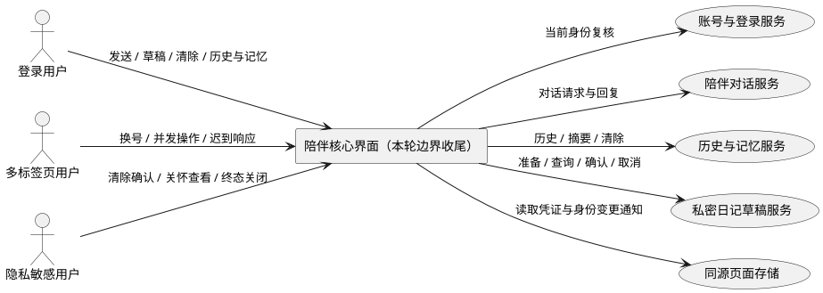
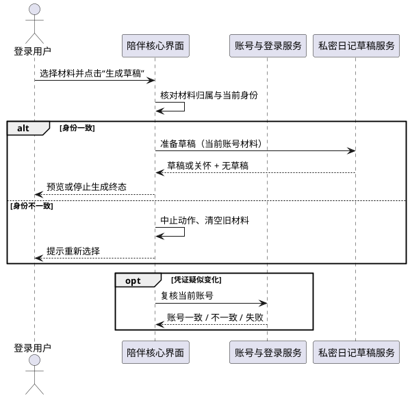
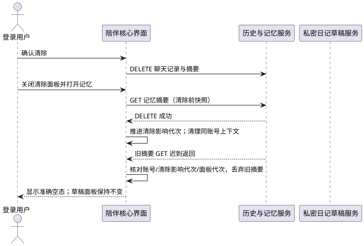
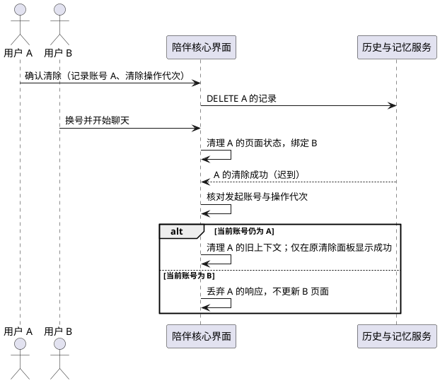
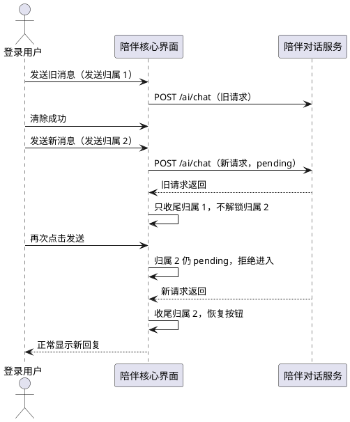
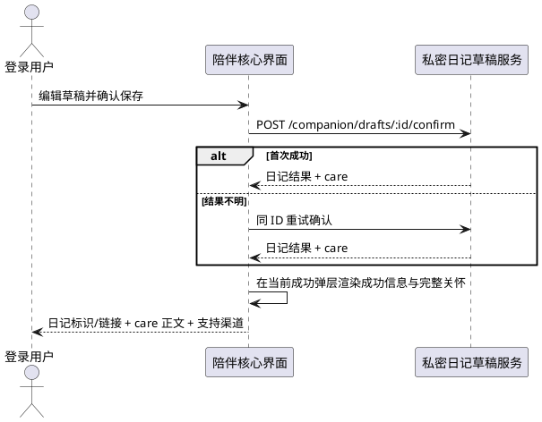
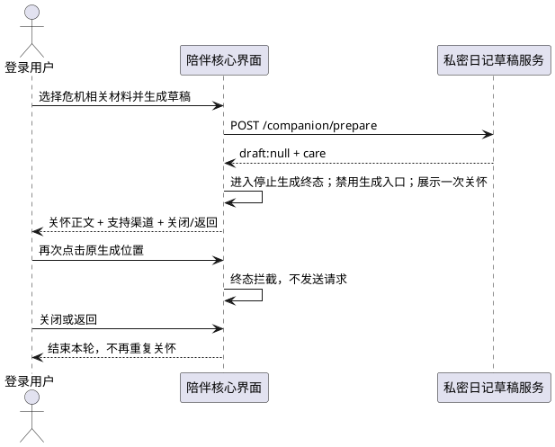

# A/B 边界收尾需求规格（ab_edge_hardening）

> 文档类型：增量需求规格（EARS）
> 适用范围：陪伴核心界面 A/B 最后一轮边界收尾
> 关联基线：`3086f72` + 当前未提交修改；既有需求见 `.codeartsdoer/specs/ai_companion_ui/spec.md`
> 需求来源：`docs/给CodeArts的返修收尾指令.md`、`docs/CodeArts返修复验与下一步.md`（R1–R6）
> 状态：待用户评审；本文件只定义“做什么”，不定义实现方案
> 说明：本文件不替代、不覆盖既有 `ai_companion_ui` 规格与历史证据；仅补充本轮六项边界行为

# 1. 组件定位

## 1.1 核心职责

本组件负责陪伴对话与私密日记草稿的异步状态归属，确保换号、清除、乱序与终态下只更新所属账号和所属操作。

## 1.2 核心输入

1. 当前登录身份：同源存储中的账号标识、凭证、账号显示信息，以及同源其他页面产生的身份变更通知。
2. 草稿材料选择：用户勾选的聊天内容、目标日记日期、是否参考近期日记的授权。
3. 草稿操作指令：生成草稿、确认保存、取消草稿、返回修改选择、关闭面板。
4. 清除操作指令：打开清除确认、确认清除、取消清除、关闭面板。
5. 历史与记忆读取指令：打开历史对话、打开“你记得我什么”、加载更早历史、清除后重新读取。
6. 对话发送指令：点击发送按钮、按 Enter 发送、连续发送、发送过程中切换账号或清除。
7. 后端异步响应：`/auth/me`、`/ai/chat`、`/ai/messages`、`/ai/memory`（GET/DELETE）、`/companion/prepare`、`/companion/drafts/:id`（GET/DELETE）、`/companion/drafts/:id/confirm` 的成功、失败、超时与迟到响应。

## 1.3 核心输出

1. 当前账号的对话气泡、临时上下文、历史列表与记忆摘要。
2. 草稿选择、草稿预览、确认成功、取消终态、停止生成终态与对应提示。
3. 关怀提示：关怀正文、支持渠道名称、可拨打的电话链接、关闭/返回入口。
4. 发送进行中状态、按钮可用状态、输入框内容与错误提示。
5. 身份变化、清除成功、清除失败、操作过期或冲突的可理解提示。
6. 不产生跨账号输出：旧账号的材料、正文、草稿标识、摘要、清除结果不得出现在新账号页面。

## 1.4 职责边界与非目标

**本组件负责：**

1. 前端异步操作的账号归属、操作归属与迟到响应隔离。
2. 草稿流程在发送前、确认前、取消前、恢复前的身份复核。
3. 清除成功对同账号历史/记忆读取的失效处理，以及对当前面板影响范围的界定。
4. 发送锁的归属、重复提交防护与旧请求收尾隔离。
5. 确认成功后关怀在当前弹层的完整可见性，以及停止生成终态的入口收敛。
6. 对应的正式回归测试与真实页面验收证据。

**本组件不负责（本轮非目标）：**

1. 不重写后端，不修改 `后端源码/src/**`、`sql/**`、`.env`，不改变任何接口契约、状态码或确认语义。
2. 不重建数据库，不切换数据库端口，不改回 3306，不执行 `initdb`、`DROP`、`TRUNCATE`、`ALTER`。
3. 不引入前端框架、构建工具或新的状态管理库；不改变原生 HTML/JS/CSS 形态。
4. 不扩展新功能：不新增对话能力、记忆算法、日记能力、社交能力或审核能力。
5. 不重做已经有效的正常路径：保存开关、helper history 清除、草稿幂等恢复、取消终态、既有乱序保护保持原实现。
6. 不修改双门入口、互关/粉丝、其他私信、未读汇总、群聊、站内链接白名单、举报权限与审核增量。
7. 不覆盖未提交的交接文档、历史独立检查报告、既有 `docs/codearts_proof/` 证据与失败记录。
8. 不把本地规则结果描述为真实大模型效果；当前 `configured=false` 的事实不得被文案掩盖。
9. 不在日志、提示、截图、测试输出中打印密钥、token、Authorization 或真实个人信息。
10. 不把单元测试、模拟响应或旧复现脚本退出 0 写成浏览器端到端验收通过。

# 2. 领域术语

**身份代次**
: 表示页面当前绑定账号身份的一次连续有效期。账号变化、退出登录或身份校验失败时进入新代次；同一代次内的异步响应才允许更新页面。

**操作代次**
: 表示同一业务流程中一次用户动作的序号。新的准备、确认、取消、清除、读取或发送动作产生新代次，旧代次的响应不得覆盖新动作。

**面板代次**
: 表示当前弹层从打开到关闭的一次连续有效期。面板关闭、重新打开或切换面板后，旧面板代次失效。

**清除影响代次**
: 表示一次清除成功对同账号读取操作的失效边界。清除发起前和清除期间发出的历史/记忆读取，在清除成功后不得再写入页面。

**材料归属**
: 草稿材料在选择时绑定的账号标识与身份代次。材料归属与请求时的凭证不一致时，材料不得被提交。

**发送归属**
: 一次发送操作对发送锁、进行中提示、按钮状态和错误回填的所有权。只有锁的拥有者可以释放锁和更新对应提示。

**停止生成终态**
: 草稿准备返回“关怀 + 无草稿”后，本轮生成被明确终止的状态。该状态不再提供可重复提交的生成入口，只保留关怀与关闭/返回入口。

**迟到响应**
: 在身份、面板、清除、发送或草稿操作已经变化之后才返回的异步结果。迟到响应必须被丢弃或仅用于其所属账号与所属操作。

**幂等恢复成功**
: 确认结果不明时，使用同一草稿标识重试确认或查询状态后得到的成功结果。该结果与首次确认成功具有相同的展示要求。

**临时上下文**
: 仅属于当前页面、当前账号、当前会话代次的对话上下文。清除成功、换号或会话替换后，旧临时上下文不得继续展示或被新请求复用。

# 3. 角色与边界

## 3.1 核心角色

登录用户：在陪伴对话页发送消息、查看历史与记忆、清除本人聊天记录和摘要、准备/编辑/确认/取消私密日记草稿。

多标签页用户：在同一浏览器的多个标签页中使用不同账号，或在其中一个标签页切换账号，另一个标签页需要及时隔离旧账号状态。

隐私敏感用户：需要明确知道当前操作属于哪个账号、清除是否成功、哪些内容已失效，以及关怀信息是否完整可见。

## 3.2 外部系统

陪伴对话服务：接收 `/ai/chat` 请求，返回回复、保存状态、模型/降级状态与关怀信息。

历史与记忆服务：接收 `/ai/messages`、`/ai/memory` GET/DELETE，返回历史列表、摘要、统计与清除结果。

私密日记草稿服务：接收 `/companion/prepare`、`/companion/drafts/:id` GET/DELETE、`/companion/drafts/:id/confirm`，返回草稿、状态、日记结果与关怀信息。

账号与登录服务：接收 `/auth/me`，返回当前凭证对应的账号身份。

同源页面存储：提供当前凭证与账号信息，并在其他标签页变更时发出通知。该通知只作为触发信号，不作为唯一身份依据。

## 3.3 交互上下文

# 4. DFX约束

## 4.1 性能

1. 身份未变化时，发送消息、准备草稿、确认草稿、取消草稿的正常路径不得新增固定轮询、定时器或额外网络请求；界面不得因此出现可见的额外等待。
2. 凭证疑似变化时，允许在敏感操作前发起至多 1 次 `/auth/me` 身份复核；同一操作不得重复发起身份复核。
3. 请求进行中，同一操作的重复提交次数必须为 0；重复点击不得增加请求数、不得新增用户气泡、不得重复追加关怀块。
4. 清除成功、身份变化、发送收尾后的界面状态更新必须在响应处理完成后立即发生，不得依赖延时器或轮询。
5. 393×852 视口下，关怀弹层内容必须可滚动查看，正文、渠道名称、电话链接和关闭/返回入口不得被裁切。

## 4.2 可靠性

1. 迟到响应改写当前账号页面的次数必须为 0；其中跨账号改写次数必须为 0。
2. 清除成功后，清除前或清除期间发出的同账号历史/记忆读取重新展示旧内容的次数必须为 0。
3. 旧发送请求的收尾释放新发送请求锁的次数必须为 0；新请求 pending 期间第三条消息进入气泡的次数必须为 0。
4. 停止生成终态下重复请求准备接口的次数必须为 0；同一轮重复追加关怀块的次数必须为 0。
5. 确认成功（含幂等恢复成功）返回 care 时，当前弹层未展示 care 正文或支持链接的次数必须为 0。
6. 清除失败、确认失败、取消失败、发送失败时必须保留原有可恢复内容，不得呈现假成功，不得清空无关面板。

## 4.3 安全性

1. 草稿材料、草稿正文、草稿标识、确认/取消请求必须与发起账号和身份代次绑定；跨账号提交次数必须为 0。
2. 清除响应只能更新发起账号的页面；对当前其他账号的气泡、临时上下文、历史、摘要和提示的改写次数必须为 0。
3. 历史/记忆读取必须同时核对所属账号、清除影响代次与面板代次；任一不符时不得写入页面。
4. 关怀正文、渠道名称以纯文本渲染；电话链接只允许 `tel:` 协议，电话号码只保留数字、`+`、`-`、`()` 字符，不得把用户文字或模型输出拼接为可执行链接或 HTML。
5. 身份复核失败、凭证失效或账号不一致时，必须中止当前敏感动作，不得使用新凭证提交旧内容。
6. 不得在日志、提示、测试输出或截图中打印 token、Authorization、密钥或真实个人信息。

## 4.4 可维护性

1. 每类异步回调必须能判断“响应属于哪个账号、哪个操作、哪个面板、哪个会话或哪个发送”，不得只依赖单一全局布尔值或单一面板代次。
2. 错误提示必须可区分：身份变化、清除成功、清除失败、草稿停止生成、草稿取消、草稿已确认、草稿过期、网络失败。
3. 新增测试必须先断言正确行为，并能在修复前稳定失败；不得删除断言、修改期望或把旧缺陷复现脚本的退出 0 当作修复通过。
4. 新增测试必须可由 Node 直接执行，并纳入既有 `npm run test:competition` 范围；不得引入新测试框架。
5. 优先只修改 `前端参考/chat-companion.js`、必要的 `前端参考/chat-companion.css` 与测试文件；如需新增测试文件，必须同步纳入既有测试脚本。

## 4.5 兼容性与可访问性

1. 不改变 `/companion/prepare`、`/companion/drafts/:id`、`/companion/drafts/:id/confirm`、`/ai/memory`、`/ai/chat` 的请求/响应结构与状态码语义。
2. 必须保留既有保存开关行为、helper history 清除、草稿幂等恢复、取消终态、prepare/confirm 乱序保护与双门、社交、未读、举报、审核增量。
3. `npm run test:competition` 与 `npm run test:merge24` 在本轮完成后必须退出 0；新增边界用例不得破坏既有 86 项 Node、18 组草稿集成、71 项审核、66 项机器人检查、23 项合并回归、13 组社交、3 组禁言检查。
4. 关怀弹层必须保留键盘可聚焦的关闭入口；Escape 关闭面板的既有行为不得被破坏。
5. 当前模型未配置时，界面必须继续显示本地规则/未使用大模型状态，不得把本地规则结果标注为真实大模型效果。

# 5. 核心能力

## 5.1 草稿材料与请求的身份绑定（R1）

### 5.1.1 业务规则

1. **材料选择时绑定归属**：While 用户处于草稿材料选择阶段，the system shall 将已选材料与选择时的账号标识、身份代次和面板代次绑定，不得把材料只保存在无归属的页面数组中。
   a. 验收条件：[账号 A 选择本人材料后，未发生换号] → [材料归属为 A，生成草稿请求正文只来自 A 的已选材料]。
2. **发请求前复核身份**：When 用户点击“生成草稿”，the system shall 在发出 `POST /companion/prepare` 之前复核当前凭证对应的账号与材料归属账号一致，不得仅依赖 storage 事件已经到达。
   a. 验收条件：[A 已选材料，当前凭证已换成 B，页面尚未处理 storage 事件] → [不发出 prepare 请求；请求正文不包含 A 的材料]。
3. **身份变化中止旧动作**：If 复核发现当前账号或身份代次与材料归属不一致，then the system shall 中止本次草稿动作、清空旧账号材料与旧选择、提示身份已变化，并要求新账号重新选择。
   a. 验收条件：[A 的材料遇到 B 的凭证] → [prepare 请求数为 0；旧材料不再出现在可选列表；提示“账号或登录状态已变化，请重新选择”]。
4. **迟到响应隔离**：If 草稿请求已经发出，但在响应返回前身份代次或操作代次发生变化，then the system shall 丢弃该响应，不得写入草稿预览、成功提示或关怀区域。
   a. 验收条件：[prepare 在途时换号] → [旧 prepare 返回后不出现草稿预览；新账号页面无 A 的草稿内容]。
5. **全部草稿请求复核**：When 用户执行确认、取消、结果不明重试、草稿状态查询或页面恢复，the system shall 在请求前核对草稿/正文所属账号与当前凭证一致，并在响应落地前再次核对身份代次与操作代次。
   a. 验收条件：[A 的草稿在 B 的凭证下执行确认/取消/查询/重试] → [请求被中止或响应被丢弃；不把 A 的正文提交给 B 的账号]。
6. **恢复请求不跨账号**：While 页面初始化或恢复保存对话历史，the system shall 只在恢复目标账号与当前凭证一致时使用恢复结果，不得把旧账号的草稿正文、材料或草稿标识带入新账号。
   a. 验收条件：[页面初始化恢复期间凭证换号] → [旧恢复结果被丢弃；新账号按自身偏好重新初始化]。
7. **同账号凭证更新**：Where 当前账号标识未变但凭证字符串发生变化，the system shall 在 `/auth/me` 确认账号一致后更新绑定凭证并允许继续；无法确认账号一致时必须中止。
   a. 验收条件：[账号 A 的 token 续期，`/auth/me` 仍返回 A] → [允许继续当前动作，不误判为换号]。
8. **身份复核失败处理**：If 身份复核请求失败、超时或返回未登录，then the system shall 中止当前敏感动作并提示重新登录或重新选择，不得使用未知身份的凭证发送材料。
   a. 验收条件：[`/auth/me` 返回 401 或网络失败] → [prepare/confirm/cancel 请求不发出；页面保留可恢复提示]。
9. **禁止项**：禁止在身份复核完成前把材料放入请求正文；禁止把“storage 事件已处理”当作唯一身份校验；禁止在身份变化后保留旧账号材料供新账号一键提交。
   a. 验收条件：[身份变化后重新打开草稿面板] → [不出现 A 的材料勾选项，不出现可直接提交 A 材料的按钮]。

### 5.1.2 交互流程

### 5.1.3 异常场景

1. **换号后立即点击生成**
   a. 触发条件：A 已选材料，凭证换成 B，storage 通知尚未处理。
   b. 系统行为：请求前复核身份，发现不一致，中止 prepare 并清空 A 的材料归属。
   c. 用户感知：显示身份变化提示，草稿选择列表不包含 A 的材料。
2. **prepare 在途时换号**
   a. 触发条件：prepare 已发出，响应返回前切换到 B。
   b. 系统行为：身份代次失效，丢弃 prepare 响应，不渲染预览。
   c. 用户感知：B 的页面保持干净，不出现 A 的草稿。
3. **确认/取消使用旧草稿**
   a. 触发条件：A 的草稿页面在 B 的凭证下继续操作。
   b. 系统行为：确认/取消前复核身份，身份不一致时不发请求。
   c. 用户感知：提示重新登录或重新准备，不显示保存成功。
4. **身份复核失败**
   a. 触发条件：`/auth/me` 失败或超时。
   b. 系统行为：不发送敏感请求，保留当前可恢复状态。
   c. 用户感知：显示网络或登录提示，材料不会被误提交。

## 5.2 清除成功后的读取失效与面板影响域（R2）

### 5.2.1 业务规则

1. **清除成功建立失效边界**：When 清除请求成功，the system shall 使同账号在清除发起前和清除期间发出的历史/记忆读取全部失效，即使这些读取的响应在清除成功之后才返回。
   a. 验收条件：[DELETE 在途时打开记忆并发出 GET，DELETE 先成功，GET 后返回] → [旧摘要不写入页面，不进入记忆快照]。
2. **读取回调多重校验**：When 历史或记忆读取响应返回，the system shall 同时核对响应所属账号、清除影响代次和当前面板代次；任一不符时不得写入面板或缓存。
   a. 验收条件：[读取所属账号为 A，当前账号为 A，但清除影响代次已前进] → [响应被丢弃]。
3. **当前记忆面板显示准确状态**：If 清除成功时当前面板仍是记忆面板，then the system shall 显示与清除结果一致的状态（已清除或空态），不得显示清除前的摘要。
   a. 验收条件：[清除成功时记忆面板已打开] → [面板显示“已清除”或“还没有聊天记录”，不显示旧摘要正文]。
4. **无关草稿面板不被覆盖**：If 清除成功时当前面板是草稿选择、草稿预览或确认编辑面板，then the system shall 不替换该面板的 DOM、不清空草稿正文、不关闭该面板，只清理后台的同账号会话与摘要缓存。
   a. 验收条件：[用户在草稿编辑面板时清除成功] → [正文与编辑状态保持不变；面板不被重绘为清除结果]。
5. **历史读取同样失效**：When 清除成功，the system shall 使清除前发出的历史分页/历史列表读取失效，并在用户重新打开历史时读取清除后的真实状态。
   a. 验收条件：[清除期间发出历史 GET，清除成功后返回] → [旧历史列表不拼接、不展示；重新打开历史得到空态或最新状态]。
6. **清除失败不得误报**：If 清除请求失败，then the system shall 保留已有历史与摘要，不得使读取失效，不得显示“已清除”。
   a. 验收条件：[DELETE 返回失败] → [期间返回的摘要仍可展示；页面提示清除失败、内容保留]。
7. **同账号上下文清理**：When 清除成功且当前账号仍是发起账号，the system shall 清空该账号的页面气泡、临时上下文、历史列表、分页状态、记忆快照与背景关怀；该清理不得依赖清除面板是否仍打开。
   a. 验收条件：[清除成功时面板已关闭或已切换] → [同账号旧气泡与旧摘要仍被清理；不残留旧临时上下文]。
8. **禁止项**：禁止用面板代次作为跳过同账号上下文清理的唯一条件；禁止在清除成功后把旧摘要重新写入缓存；禁止为了清理记忆而粗暴清空无关草稿面板。
   a. 验收条件：[清除成功且当前为草稿面板] → [旧摘要被清理，草稿面板内容未被替换]。

### 5.2.2 交互流程

### 5.2.3 异常场景

1. **清除期间读取记忆**
   a. 触发条件：DELETE 未完成时打开记忆并发出 GET。
   b. 系统行为：清除成功后使该 GET 失效，不写入摘要快照。
   c. 用户感知：记忆面板显示已清除/空态，旧摘要不再出现。
2. **清除期间读取历史**
   a. 触发条件：DELETE 未完成时打开历史或加载更早。
   b. 系统行为：清除成功后丢弃旧历史响应，重新打开时读取最新状态。
   c. 用户感知：历史列表不出现清除前内容。
3. **清除成功时正在编辑草稿**
   a. 触发条件：用户已切到草稿编辑面板，清除在后台成功。
   b. 系统行为：只清理后台会话与摘要，不重绘草稿面板。
   c. 用户感知：草稿正文仍可查看/编辑，不被清除结果覆盖。
4. **清除失败但有读取返回**
   a. 触发条件：DELETE 失败，期间发出的 GET 返回旧摘要。
   b. 系统行为：不推进清除影响代次，允许展示旧摘要，并提示清除失败。
   c. 用户感知：看到“清除失败，内容保留”，摘要仍是原内容。

## 5.3 清除响应的账号与代次归属（R3）

### 5.3.1 业务规则

1. **清除绑定发起账号与操作代次**：When 用户确认清除，the system shall 记录本次清除的发起账号、操作代次、发起面板代次和发起时会话代次，后续回调必须按这些归属判断是否更新页面。
   a. 验收条件：[A 发起清除] → [成功/失败回调携带 A 的发起归属，不依赖回调时的当前全局账号]。
2. **身份变化后隔离**：If 清除响应返回时当前账号已不是发起账号，then the system shall 不更新当前账号的气泡、临时上下文、历史、摘要、保存提示和面板内容。
   a. 验收条件：[A 的 DELETE 在途时换成 B 并聊天，A 的成功回调后到达] → [B 的气泡、turns、uid 保持不变；不出现“已清除本人聊天记录和摘要”]。
3. **同账号关闭面板仍清理上下文**：If 清除成功时账号仍是发起账号但清除面板已关闭或已切换，then the system shall 仍然清理该账号的旧会话、气泡、历史、分页和摘要缓存；只跳过面板文案更新。
   a. 验收条件：[A 发起清除后关闭面板，DELETE 成功] → [A 的旧气泡与旧摘要被清理；不向已关闭/新面板写入清除结果]。
4. **面板文案只在原面板更新**：When 清除成功且原清除面板仍打开，the system shall 在该面板显示清除成功与数量；否则不得在其他面板显示该提示。
   a. 验收条件：[清除面板仍为发起面板] → [面板显示“已清除 N 条聊天记录和摘要”]；[已切到记忆/草稿面板] → [不在该面板显示清除成功文案]。
5. **旧操作不覆盖新操作**：If 同一账号存在更新的一次清除操作，then the system shall 只允许最新操作更新面板提示与上下文，旧操作的迟到响应不得回滚新状态。
   a. 验收条件：[同一账号连续两次清除，第一次响应后到达] → [第一次响应不覆盖第二次的进行中/成功状态]。
6. **清除失败同样隔离**：When 清除失败响应返回，the system shall 只在发起账号且原清除面板仍打开时显示失败原因；身份已变化时不得把失败提示写到新账号页面。
   a. 验收条件：[A 的清除失败响应在 B 页面到达] → [B 页面无 A 的失败提示]。
7. **禁止项**：禁止在清除成功回调中无条件替换当前会话；禁止在身份变化后清空当前账号聊天区；禁止仅凭面板代次匹配就跳过同账号上下文清理。
   a. 验收条件：[A 的清除响应在 B 页面到达] → [B 的聊天区、临时上下文、输入框与保存提示均保持不变]。

### 5.3.2 交互流程

### 5.3.3 异常场景

1. **A 的清除成功在 B 页面到达**
   a. 触发条件：A 发起 DELETE 后换成 B 并聊天。
   b. 系统行为：核对发起账号失败，丢弃响应；不清理 B 的上下文。
   c. 用户感知：B 的聊天和临时上下文保持，不出现 A 的清除提示。
2. **A 关闭清除面板后 DELETE 成功**
   a. 触发条件：A 保持账号不变，但关闭了清除面板。
   b. 系统行为：清理 A 的旧上下文，不向已关闭面板写入文案。
   c. 用户感知：重新打开记忆时显示已清除/空态。
3. **清除成功时已打开其他面板**
   a. 触发条件：A 在清除进行中打开历史或记忆面板。
   b. 系统行为：清理后台上下文；面板只在归属允许时更新为准确状态。
   c. 用户感知：不出现旧摘要或错位成功提示。
4. **清除失败响应迟到**
   a. 触发条件：A 的清除失败响应在换号后到达。
   b. 系统行为：丢弃响应，不写入 B 的提示区域。
   c. 用户感知：B 页面无 A 的错误信息。

## 5.4 发送锁归属与重复提交防护（R4）

### 5.4.1 业务规则

1. **发送操作归属**：When 用户发起一次发送，the system shall 为本次发送建立操作标识，并把发送锁、按钮禁用、进行中提示和错误回填绑定到该标识和发起账号。
   a. 验收条件：[旧请求与新请求同时存在] → [两者拥有不同的发送归属，互不释放对方的锁]。
2. **旧请求只收尾自己**：When 旧发送请求成功、失败或超时，the system shall 只移除自己的进行中提示、只释放自己持有的锁、只恢复自己的按钮状态；不得解锁后来仍在等待的请求。
   a. 验收条件：[旧请求 → 清除 → 新请求仍 pending → 旧请求先返回] → [新请求仍显示进行中；发送按钮保持禁用；不出现可发送的假空闲状态]。
3. **pending 期间禁止第三次进入**：While 新请求仍在等待响应，the system shall 拒绝第三次发送进入发送路径，不得新增用户气泡、不得调用发送接口、不得显示新的“正在回复”。
   a. 验收条件：[新请求 pending 时点击发送] → [用户气泡数量不增加；`/ai/chat` 请求数不增加]。
4. **同步占位先于 await**：When 用户点击发送或按 Enter，the system shall 在任何异步身份复核之前同步取得本次发送的占位；复核返回后必须确认占位仍属于自己，否则放弃本次发送。
   a. 验收条件：[连续快速点击两次发送] → [只产生 1 次有效发送；第二次不新增气泡、不发出请求]。
5. **旧失败不回填新页面**：If 旧发送请求失败且页面已换号或已有新发送，then the system shall 不把旧输入文本回填到新账号或新操作的输入框，不在新页面显示旧错误。
   a. 验收条件：[A 的发送失败响应在 B 页面到达] → [B 的输入框不被 A 的文本覆盖；B 页面无 A 的错误提示]。
6. **清除后旧发送失效**：When 清除成功替换会话，the system shall 使清除前发出的发送响应失效，但旧请求的收尾仍只作用于自己的发送归属。
   a. 验收条件：[发送在途中清除成功] → [旧回复不写入新会话；旧 finally 不解新请求的锁]。
7. **身份复核失败释放自己的占位**：If 发送前的身份复核失败或发现账号变化，then the system shall 释放本次发送占位、保留可恢复输入并提示，不得留下永久发送锁。
   a. 验收条件：[发送前身份复核失败] → [发送按钮恢复可用；输入内容可恢复；无请求发出]。
8. **禁止项**：禁止使用单一全局布尔值表示所有发送的锁归属；禁止在未实际发出请求时渲染用户气泡；禁止用旧请求的 finally 无条件解锁。
   a. 验收条件：[旧请求返回时新请求 pending] → [不出现“第三条进入气泡但未发送”的状态]。

### 5.4.2 交互流程

### 5.4.3 异常场景

1. **旧请求先于新请求返回**
   a. 触发条件：旧请求 → 清除 → 新请求 pending → 旧请求返回。
   b. 系统行为：只清理旧请求的提示和锁归属，新请求保持 pending。
   c. 用户感知：发送按钮仍不可用，不出现“正在回复”与可点击按钮并存的假状态。
2. **连续快速点击发送**
   a. 触发条件：用户在身份复核 await 期间重复点击。
   b. 系统行为：同步占位使第二次点击被拒绝。
   c. 用户感知：只出现一条用户消息，只发出一个请求。
3. **发送在途时清除**
   a. 触发条件：聊天请求未返回时清除成功。
   b. 系统行为：旧响应失效，不写回新会话；旧 finally 不影响新发送。
   c. 用户感知：清除后的页面不出现旧回复。
4. **旧请求失败迟到**
   a. 触发条件：旧请求失败响应在新账号页面到达。
   b. 系统行为：丢弃错误提示，不回填旧文本。
   c. 用户感知：新账号输入框和聊天区不被旧内容污染。

## 5.5 确认成功后的关怀可见性（R5）

### 5.5.1 业务规则

1. **成功弹层内完整展示关怀**：When 确认草稿成功且响应包含 care，the system shall 在当前成功弹层内展示 care 正文、每个支持渠道的名称和可拨打的 `tel:` 链接，不得只把关怀放在弹层背景。
   a. 验收条件：[confirm 返回 `code:0` 且 `data.care` 含正文和热线] → [当前弹层文本包含关怀正文、渠道名和电话；存在 `tel:` 链接]。
2. **幂等恢复成功一致**：When 确认结果不明后通过同一草稿标识重试或查询后成功，the system shall 使用与首次确认成功相同的弹层展示关怀，不得因走了恢复路径而遗漏。
   a. 验收条件：[首次 confirm 返回 `code:-1`，同 ID 重试成功并返回 care] → [成功弹层包含完整关怀；不重新 prepare；不产生第二篇日记]。
3. **普通草稿编辑后的 care 同样覆盖**：When 用户编辑普通草稿正文后确认，后端基于最终提交正文返回 care，the system shall 按同一规则在当前弹层展示，不得假设只有 prepare 危机会返回 care。
   a. 验收条件：[普通草稿编辑后 confirm 返回 care] → [成功弹层展示关怀正文与支持链接]。
4. **不改变后端确认语义**：When 展示 care，the system shall 保留“已保存为私密日记”的成功事实、真实日记标识、日期、可见性和站内链接；不得因 care 改写为失败、取消或重新准备。
   a. 验收条件：[confirm 成功且带 care] → [同时显示保存成功信息与关怀；日记标识/链接仍为服务端返回值]。
5. **不伪造关怀内容**：If 响应未返回 care，then the system shall 不生成、不拼接、不猜测关怀正文或电话号码。
   a. 验收条件：[confirm 成功但 `data.care` 为空] → [不显示关怀块；不出现虚构热线]。
6. **同一弹层只展示一次**：While 成功弹层已渲染，the system shall 不重复追加同一份关怀块，不把背景关怀与弹层关怀重复堆叠。
   a. 验收条件：[成功弹层渲染完成] → [关怀正文出现 1 次；电话链接数量与后端渠道数量一致]。
7. **小屏可见可操作**：While 视口为 393×852，the system shall 使关怀正文、渠道链接和关闭/返回入口在可滚动区域内可见、可聚焦、可点击，不得被裁切或遮挡。
   a. 验收条件：[393×852 视口打开成功弹层] → [可滚动看到完整关怀；关闭/返回按钮可点击]。
8. **禁止项**：禁止只在背景 `#care` 区域显示 care 而成功弹层为空；禁止把 care 电话拼接为用户文字或模型输出；禁止为展示 care 而重复调用确认接口。
   a. 验收条件：[confirm 成功带 care] → [弹层内可见 care；confirm 请求次数不因展示而增加]。

### 5.5.2 交互流程

### 5.5.3 异常场景

1. **普通草稿编辑后触发危机**
   a. 触发条件：用户编辑普通草稿正文，确认时后端返回 care。
   b. 系统行为：在成功弹层展示 care 全文与链接。
   c. 用户感知：保存成功与关怀同时可见。
2. **幂等恢复成功**
   a. 触发条件：首次确认超时，同 ID 重试成功并返回 care。
   b. 系统行为：走同一成功展示路径，不遗漏关怀。
   c. 用户感知：看到真实日记标识和完整关怀，不产生第二篇日记。
3. **care 为空**
   a. 触发条件：确认成功但后端未返回 care。
   b. 系统行为：只显示保存成功信息，不伪造关怀。
   c. 用户感知：无虚构热线或支持内容。
4. **小屏内容过长**
   a. 触发条件：393×852 视口，关怀正文和多条渠道超出屏幕。
   b. 系统行为：弹层内容可滚动，关闭/返回入口保持可用。
   c. 用户感知：可以滚动查看全部关怀并关闭弹层。

## 5.6 停止生成的终态（R6）

### 5.6.1 业务规则

1. **停止终态判定**：When `POST /companion/prepare` 返回成功但没有草稿且包含 care，the system shall 把本轮草稿流程置为“停止生成”终态，而不是普通失败或可重试状态。
   a. 验收条件：[prepare 返回 `draft:null` + care] → [面板显示停止生成说明与关怀；本轮状态为 stopped]。
2. **生成入口收敛**：While 处于停止生成终态，the system shall 禁用“生成草稿”按钮，并使原选择表单中可再次提交准备的入口不可用。
   a. 验收条件：[停止终态下查看按钮] → [“生成草稿”处于禁用状态或不可见；再次点击不产生 prepare 请求]。
3. **关怀只追加一次**：While 处于停止生成终态，the system shall 不重复追加相同关怀块；重复触发不得使关怀正文或渠道链接数量增加。
   a. 验收条件：[停止终态下重复点击/重复进入同一轮] → [prepare 请求数仍为 1；关怀块数量为 1]。
4. **保留关闭/返回入口**：When 进入停止生成终态，the system shall 保留面板关闭入口，并提供返回聊天或结束本轮操作的入口；返回后不得复用旧停止态自动重复准备。
   a. 验收条件：[停止终态] → [关闭按钮可用；返回入口可点击；返回后不自动发出 prepare]。
5. **停止不是取消或确认**：When 进入停止生成终态，the system shall 不调用草稿取消或确认接口，不把停止描述为“草稿已取消”，不写入日记。
   a. 验收条件：[停止终态] → [无 DELETE confirm 请求；无日记写入；文案为停止生成而非取消成功]。
6. **新轮次重新校验**：If 用户关闭停止态后重新进入草稿流程，then the system shall 视为新一轮操作，重新校验身份与材料归属，不复用旧停止态作为新轮次的终态。
   a. 验收条件：[关闭后重新打开草稿] → [出现新的材料选择；身份变化时按 R1 中止]。
7. **网络失败不进入停止终态**：If prepare 因网络失败、未登录或服务错误返回，then the system shall 保持可重试状态，不得误判为停止生成。
   a. 验收条件：[prepare 返回 `code:-1` 或非零错误] → [显示错误并允许重试；不显示“已停止生成”]。
8. **禁止项**：禁止在停止终态重新启用生成按钮；禁止在停止终态再次发出 prepare；禁止用停止态追加多份关怀。
   a. 验收条件：[停止终态下再次点击原生成位置] → [无请求、无重复关怀、无草稿预览]。

### 5.6.2 交互流程

### 5.6.3 异常场景

1. **重复点击生成**
   a. 触发条件：停止终态下用户再次点击“生成草稿”。
   b. 系统行为：按钮已禁用，入口拦截，不发出 prepare。
   c. 用户感知：关怀保持不变，不出现重复关怀块。
2. **停止后关闭再进入**
   a. 触发条件：用户关闭停止态后重新打开草稿。
   b. 系统行为：进入新一轮选择，重新校验身份与材料。
   c. 用户感知：可重新选择，不自动重复上一轮请求。
3. **prepare 网络失败**
   a. 触发条件：prepare 请求失败或超时。
   b. 系统行为：保持可重试状态，不进入停止终态。
   c. 用户感知：显示错误与重试入口。
4. **停止态下切换账号**
   a. 触发条件：停止态显示期间换号。
   b. 系统行为：按身份变化清理旧材料与关怀，关闭旧面板内容。
   c. 用户感知：新账号不继承旧账号的停止态与关怀。

# 6. 数据约束

> 本章字段为业务逻辑对象约束，不限定实现变量名、存储方式或数据库结构。

## 6.1 页面身份上下文

1. **账号标识**：非空字符串时表示页面已绑定账号；为空表示未登录或身份未知。
2. **凭证标识**：必须与账号标识成对出现；不得在提示、日志或测试输出中明文打印。
3. **身份代次**：单调递增；账号变化、退出登录、身份校验失败时前进；旧代次不得写页面。
4. **绑定时刻**：记录本次身份绑定对应的操作起点；用于判断材料、草稿和发送是否属于当前绑定。
5. **保存偏好归属**：必须按账号分别读取；换号后不得沿用前账号的保存偏好。

## 6.2 草稿材料选择

1. **材料项**：每项必须来自当前账号当前会话的聊天内容；不得包含其他账号或其他会话的内容。
2. **材料归属账号**：必填；与材料项来源账号一致。
3. **材料身份代次**：必填；与选择时的页面身份代次一致。
4. **选择面板代次**：必填；面板关闭或重新打开后旧材料不得直接提交。
5. **材料长度**：去空白后必须为 1–2000 个 UTF-16 单元；超出时不得静默截断。
6. **跨账号复用**：禁止；材料归属与当前凭证不一致时必须清空或拒绝提交。

## 6.3 草稿操作

1. **草稿标识**：必须来自服务端返回；禁止用本地构造的空标识或占位标识提交确认。
2. **草稿状态**：取值必须为 `pending`、`confirmed`、`cancelled`、`expired`、`stopped` 之一；`stopped` 仅表示前端本轮生成终止，不代表服务端草稿状态。
3. **操作代次**：每次准备、确认、取消、重试、查询都必须前进；旧代次响应不得覆盖新代次。
4. **发起账号**：必填；确认/取消/重试前必须与当前凭证账号一致。
5. **发起面板代次**：必填；面板关闭后不得向旧面板写入结果。
6. **提交正文**：只能来自当前草稿的编辑框；长度不超过 5000 个 UTF-16 单元；不得把旧账号正文带入新账号确认。

## 6.4 清除操作

1. **清除操作代次**：每次确认清除必须前进；同一账号只允许最新操作更新状态。
2. **发起账号**：必填；成功/失败回调必须核对当前账号是否仍为发起账号。
3. **发起面板代次**：必填；仅用于判断是否更新原清除面板文案，不得作为是否清理上下文的唯一条件。
4. **发起时会话代次**：必填；清除成功后使旧会话及其在途发送失效。
5. **影响范围**：必须明确为“本人聊天记录与长期摘要”，不得包含日记、草稿或其他账号数据。
6. **清除成功标志**：只有服务端返回成功才可置为成功；网络失败、401、非零业务码不得置为成功。

## 6.5 历史与记忆读取

1. **读取代次**：每次打开历史/记忆或加载更早必须前进；旧读取不得覆盖新读取。
2. **所属账号**：必填；与发起读取时的页面账号一致。
3. **清除影响代次快照**：读取发起时必须记录；响应返回时若清除影响代次已前进，则该读取失效。
4. **面板代次**：读取发起时必须记录；响应返回时面板已关闭、切换或重新打开则不写入。
5. **摘要快照**：只能在读取有效且清除未成功时更新；清除成功后必须清空，不得被迟到响应重新写入。
6. **历史分页**：清除成功后必须重置页码与“有更早记录”状态；旧分页响应不得拼接。

## 6.6 发送操作

1. **发送操作标识**：每次有效发送必须唯一；锁、按钮、进行中提示和错误回填均归属该标识。
2. **锁拥有者**：同一时刻最多一个发送归属持有锁；只有拥有者可以释放锁。
3. **所属账号**：必填；响应返回时必须与当前账号一致，否则丢弃页面更新。
4. **会话代次**：发送发起时记录；会话替换或清除成功后旧发送失效。
5. **用户气泡引用**：仅在实际进入发送路径后创建；未发出请求时不得创建。
6. **进行中提示引用**：每个发送归属只移除自己的提示；不得移除后来请求的提示。
7. **输入回填**：仅允许在仍属于同一发送归属且输入框为空时回填；不得覆盖新账号或新操作的输入。

## 6.7 关怀信息

1. **正文**：来自后端 `care.message`；非空时按纯文本展示；前端不得编造。
2. **渠道列表**：来自后端 `care.lines`；每项可包含名称与电话。
3. **渠道名称**：纯文本展示；缺省时使用“支持渠道”。
4. **联系电话**：只保留数字、`+`、`-`、`()` 字符；清洗后为空则不展示该渠道。
5. **链接协议**：只允许 `tel:`；不得使用 `javascript:`、`data:` 或用户拼接的 URL。
6. **展示位置**：确认成功时必须在当前成功弹层内展示；停止生成时必须在当前草稿面板内展示；背景关怀区域可作为补充，但不得替代弹层内容。
7. **去重**：同一轮同一来源的关怀只追加一次；不同轮次可按新响应重新展示。

# 附录 A 验收追溯与回归策略

## A.1 需求与复现、正式回归的对应关系

| 需求 | 缺陷复现（仅证明缺陷存在） | 正式回归应断言的正确行为 | 关键观察点 |
|---|---|---|---|
| R1 草稿身份绑定 | `docs/review/2026-11-13-codearts-repair-check/B-remaining-repro.test.mjs` 第 2 例 | 凭证换为 B 后点击生成草稿，prepare 请求数为 0，请求正文不含 A 材料，旧材料被清空 | `/companion/prepare` 调用次数与 body.message；页面 uid；材料列表 |
| R2 清除中读取失效 | `A-remaining-repro.cjs` 第 2 段 | DELETE 成功使期间发出的记忆 GET 失效；旧摘要不进入页面与快照 | 清除成功后 `cc-panel-body` 文本、`memorySnapshot` |
| R2 无关草稿面板保护 | 需新增正式用例 | 清除成功时草稿面板正文与编辑状态不被替换 | 草稿 textarea 值、面板内容、面板可见性 |
| R3 清除响应隔离 | `A-remaining-repro.cjs` 第 1 段 | A 的迟到清除成功不改写 B 的 uid、turns、气泡与提示 | B 的聊天文本、turns 长度、保存提示 |
| R3 同账号关闭面板清理 | 需新增正式用例 | 同账号关闭清除面板后，成功响应仍清理旧上下文 | 旧气泡、旧摘要、页码状态 |
| R4 发送锁归属 | `A-remaining-repro.cjs` 第 3 段 | 旧请求返回后新请求仍 pending，第三次点击不进入气泡、不发请求 | `sending`、按钮 disabled、`/ai/chat` 次数、气泡数 |
| R4 重复点击 | 需新增正式用例 | 身份复核 await 期间连续点击只产生 1 次发送 | 请求数、用户气泡数 |
| R5 确认后关怀 | `B-remaining-repro.test.mjs` 第 1 例 | confirm 成功带 care 时，当前弹层包含正文、渠道名、电话与 `tel:` 链接 | `cc-panel-body` 文本与链接 |
| R5 幂等恢复关怀 | 需新增正式用例 | 同 ID 重试成功带 care 时，成功弹层同样完整展示 | confirm 次数、弹层内容、日记标识 |
| R6 停止生成终态 | `B-remaining-repro.test.mjs` 第 3 例；`B-extra-checks.test.mjs` B4 | prepare 返回 care + draft:null 后按钮禁用、prepare 次数为 1、关怀块为 1、关闭/返回可用 | 按钮 disabled、prepare 次数、关怀块数量 |

## A.2 回归实施顺序

1. 先把上表“正式回归应断言的正确行为”写成测试，复用现有最小 DOM harness 与可控响应；不得复制旧缺陷断言。
2. 在修复前运行新增测试，确认其失败点与对应需求一致，并保存失败日志与退出码。
3. 只做最小修改，使新增测试与既有测试同时通过；不得删除断言、放宽期望或跳过用例。
4. 新增测试必须纳入 `npm run test:competition`；如果新增独立测试文件，必须同步更新该脚本。
5. 完成修改后执行：
   - 后端目录 `npm run test:competition`，保存完整日志与退出码；
   - 后端目录 `npm run test:merge24`，保存完整日志与退出码。
6. 单元测试通过不能替代真实页面验收；真实页面验收至少覆盖：双标签换号、清除与刷新、请求乱序、连续发送、确认/取消/冲突/过期/恢复、393×852 关怀弹层。
7. 真实页面验收记录必须逐项标明“控制响应”或“真实服务”，不得把模拟响应写成浏览器端到端通过。

## A.3 建议修改边界

1. 主要修改：`前端参考/chat-companion.js`。
2. 必要样式：`前端参考/chat-companion.css`，仅追加关怀弹层换行、滚动、小屏可访问性相关规则。
3. 测试：优先追加到 `后端源码/scripts/test-chat-companion-repair.test.js`；若新增独立文件，必须加入 `后端源码/package.json` 的 `test:competition`。
4. 不改：`后端源码/src/**`、`sql/**`、`.env`、`前端参考/api.js`、双门/社交/未读/举报/审核页面与脚本、数据库结构与数据。
5. 不覆盖：未提交的交接文档、历史独立检查报告、`docs/codearts_proof/` 既有记录与失败证据。

# 附录 B 非目标与既有能力保护清单

## B.1 非目标

1. 不新增对话、记忆、日记、社交、审核功能。
2. 不调整后端接口契约、状态码、确认语义与关怀内容生成规则。
3. 不重写前端架构，不引入框架、构建链或第三方状态库。
4. 不重做已有效的保存开关、history 清除、幂等恢复、取消终态与既有乱序保护。
5. 不进行数据库迁移、重建、端口切换或 schema 变更。
6. 不验证或宣称真实大模型效果；当前模型未配置。
7. 不把单元测试、模拟响应、旧脚本退出 0 记为浏览器验收通过。
8. 不扩展到公开资料手机号、匿名瓶兼容接口、空库初始化等无关历史问题。

## B.2 既有能力保护清单

1. 保存对话开关：关闭保存不删除已存记录；旧认证结果不得重新开启保存。
2. helper history：清除后旧回复不得写回临时 history。
3. 草稿幂等恢复：确认结果不明时使用同一草稿标识重试，不构造空日记编号/链接。
4. 取消终态：取消后禁止确认，取消不删除日记。
5. 准备/确认乱序保护：较早请求不得覆盖较新操作；关闭面板后的迟到确认不得回填。
6. 双门入口：日记页左右门与跳转保持可用。
7. 社交与未读：互关、粉丝、其他私信、群聊、未读汇总保持可用。
8. 举报与审核增量：举报权限、审核页面与既有审核用例保持通过。
9. 纯文本渲染、Enter 输入法保护、2000/5000 字上限、关怀电话字符清洗。
10. 393×852 视口下的弹层可滚动与关闭入口可用。

# 附录 C 待确认问题

1. **同账号 token 刷新的判定**：账号标识不变但 token 字符串变化时，是否允许在 `/auth/me` 确认同账号后继续当前动作？本规格默认允许；若要求一律中止并清空材料，需要明确。
2. **清除成功后已打开草稿面板的处理**：本规格要求不清空草稿编辑面板；但草稿材料可能来自已清除的聊天记录。是否需要在草稿面板额外提示“聊天记录已清除，已暂存草稿仍可确认”？
3. **confirm 失败返回 care 的展示范围**：本轮任务明确要求成功与幂等恢复成功；失败路径目前只展示正文、不含渠道链接。是否也要求失败路径完整展示 `tel:` 链接？
4. **停止生成终态的返回入口**：任务要求“保留关怀和关闭/返回入口”。是仅保留面板关闭，还是必须提供显式“返回聊天/重新选择”按钮？本规格默认提供显式入口，但需要确认文案与落点。
5. **清除成功时当前为历史面板的展示**：应显示“已清除”成功提示，还是直接显示“还没有聊天记录”的空态？本规格允许任一准确状态，但实现前需统一。
6. **身份复核频率**：正常路径是否允许完全跳过 `/auth/me`，仅比较本地账号标识与凭证标识？本规格要求“不能仅依赖 storage 事件”，但未强制每次请求都调用 `/auth/me`；需确认安全与性能取舍。
7. **正式回归落点**：追加到现有 `test-chat-companion-repair.test.js`，还是新增独立边界测试文件并加入 `test:competition`？本规格优先建议追加，减少脚本改动。
8. **真实页面验收的合成账号与清理责任**：双标签换号与清除/刷新需要至少两个合成账号；需确认账号来源、数据清理范围与证据保存位置，避免触碰真实用户数据。