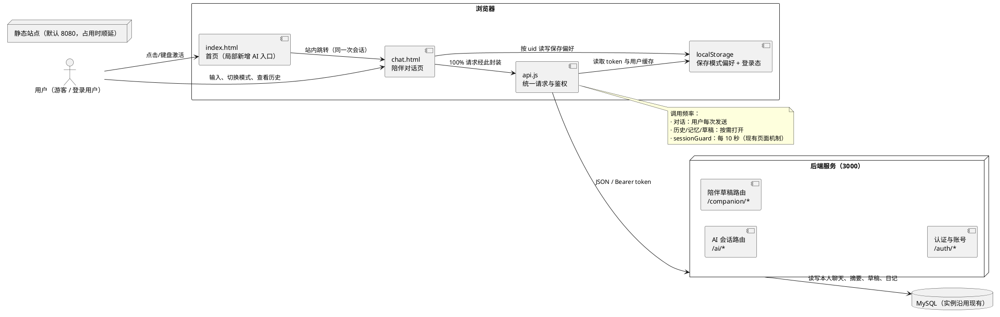
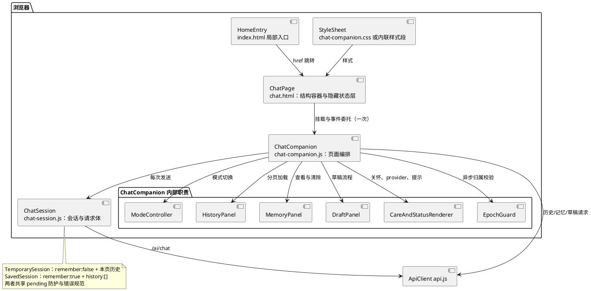
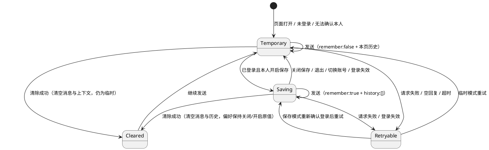
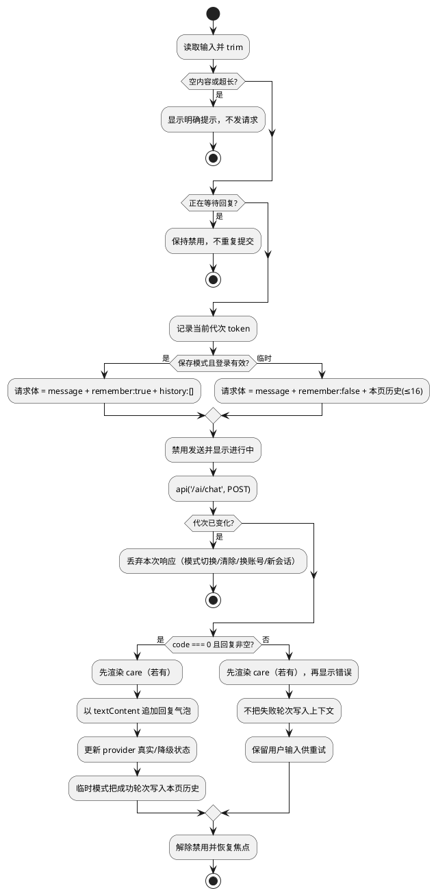
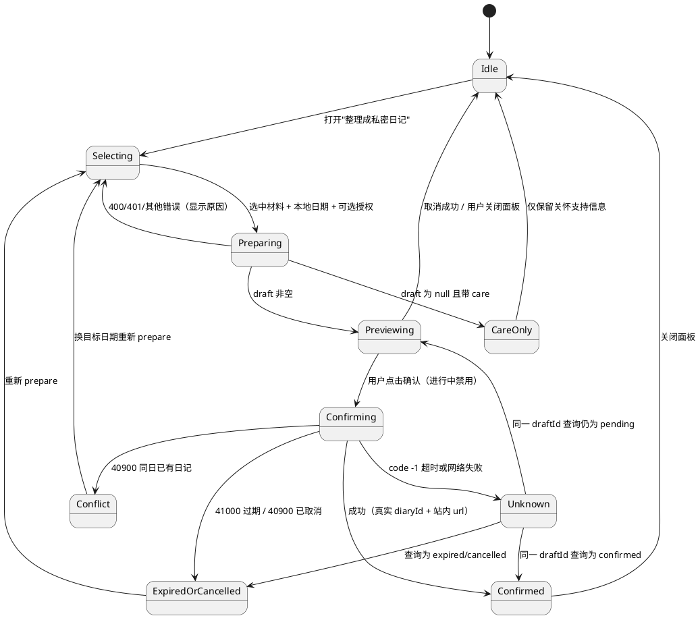
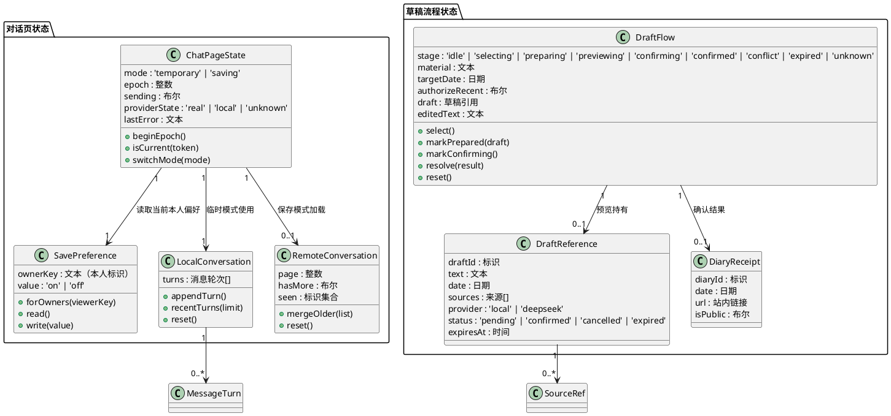
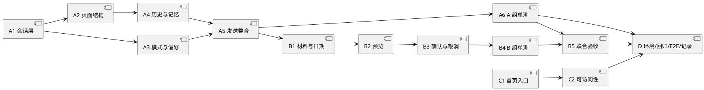

# 一、需求与存量功能关系分析

> 本章核对依据：`spec.md`（606 行，2026-11-13）、`docs/码道开始前必读.md`、`docs/码道核心功能接入任务.md`、`docs/陪伴核心接口契约.md`、`docs/24稿合并说明.md`，以及 Glimmer 仓库当前源码。所有代码位置均相对 Glimmer 仓库根目录，行号以本次核对为准。
>
> 本阶段只产出设计，不改动任何业务代码。

## 1.0 实际状态与基线核对

| 核对项 | 实际值 | 说明 |
|---|---|---|
| 会话工作目录 | `D:\微光同行` | 不是仓库根，命令需在 `Glimmer/` 或 `Glimmer/后端源码` 下执行 |
| 开发仓库根 | `D:\微光同行\Glimmer` | 二十四稿合并版，前端在 `前端参考/`，后端在 `后端源码/` |
| 规格目录 | `Glimmer\.codeartsdoer\specs\ai_companion_ui\` | 已存在 `spec.md`，本文件写入同目录 |
| Git 基线 | 提交 `3086f72` | 另有 8 个 docs/README 文件的未提交修改，以及未跟踪的 `.codeartsdoer/`、`docs/码道开始前必读.md`；实施前须再次记录 `git status` 实际值 |
| 必读文档 | 4 份均存在 | `码道开始前必读.md`、`码道核心功能接入任务.md`、`陪伴核心接口契约.md`、`24稿合并说明.md` |
| 后端 AI 接口 | 已存在 | `src/routes/ai.js` 已提供 status/messages/memory/chat/greeting |
| 后端草稿接口 | 已存在 | `src/routes/companion.js` 提供 prepare/get/confirm/cancel |
| 对话页基线 | 235 行，仅临时模式 | 无保存开关、无历史、无记忆、无草稿入口 |
| 会话 helper 基线 | 44 行，仅 `createTemporaryChat` | 固定 `remember:false`，只有 `send()`，**没有 reset** |
| 请求封装基线 | `前端参考/api.js` 123 行 | 统一 `/api` 前缀、token、401 处理与候选地址 |
| 首页基线 | `index.html` 1676 行 | 首页仅有"微光同行"横幅与 4 个群聊入口，**没有 AI 主入口** |
| 合并版保留能力 | 代码内已具备 | 双门、互关/粉丝、其他私信、未读、站内链接白名单、举报、审核与禁言 |
| 验收命令 | `package.json` 第 14、15 行 | `test:competition`、`test:merge24` 均存在，尚未在本次会话中运行 |
| 运行服务 | 设计阶段未启动 | 实施阶段必须先核对浏览器与后端是否运行本工作区版本，再执行验收 |
| 工作区约束 | 生效 | 不打印密钥、不重建数据库、不修改真实用户内容、不从旧 24稿 包整包覆盖 |

关键基线事实（直接影响设计，不可假定）：

1. `chat-session.js` 当前只有 `createTemporaryChat(request)`，返回对象只有 `send(value)`；临时历史存在闭包变量 `history` 中，靠清空 DOM 无法清除下一次请求上下文（`前端参考/chat-session.js:6-40`）。
2. `后端源码/scripts/test-chat-session.test.js:5` 直接 `require('../../前端参考/chat-session.js')`，第 18 行对首个请求体做精确 `deepEqual`。因此临时会话的导出名、参数顺序与请求体形态属于**受测试保护的公开契约**。
3. 后端为兼容旧客户端，"已登录且省略 remember" 仍会保存（`src/routes/ai.js:258`），所以新界面必须每次显式发送布尔 `remember`，不能依赖省略（`docs/陪伴核心接口契约.md:20`）。
4. `hasMemory:false` 只代表尚未形成摘要，可与 `totalMessages>0` 并存（`src/routes/ai.js:188-213`）；界面不得把"暂无摘要"写成"没有聊天记录"。
5. 草稿 `prepare` 的 `provider` 是字符串（`local`/`deepseek`），对话的 `provider` 是对象；两者不能共用字段判断（`src/utils/companion.js:88`、`src/routes/ai.js:271-277`）。
6. 草稿确认的 409/410 在 JSON 中对应 `code:40900/41000`，`api()` 不返回 HTTP Response 对象，不能比较 `code===409`（`src/utils/response.js` 的错误码换算 + `docs/陪伴核心接口契约.md:7,65`）。
7. `test:merge24` 的 `test-merge24-frontend.test.js` 从 `index.html` 中按字符串锚点抽取 `friendRow`、`renderFollowedUsers`、`sendGroup`、`// ===== 补一刀`、`dmUnreadBadge` 段落（`后端源码/scripts/test-merge24-frontend.test.js:6,36,68-69`）。首页任何改动都必须保留这些锚点。

## 1.1 需求功能与存量功能对比

### 1.1.1 已实现功能

| 需求功能 | 存量功能 | 代码位置 | 匹配度 |
|---|---|---|---|
| 显式不保存的临时对话 | `POST /ai/chat` 按 `remember:false` 只使用请求内历史，不读写账号记录与摘要 | `后端源码/src/routes/ai.js:239-313`（关键 258、265-269、311-312） | 100% |
| 临时上下文最多 16 条、每条不超 2000、不截断代理对 | helper 裁剪历史、超长回复按 2000 截断并剔除尾随代理高位 | `前端参考/chat-session.js:29-33` | 100% |
| 临时页交互：纯文本气泡、中文输入法 Enter 不误发、进行中禁用发送 | 现有 `chat.html` 的发送逻辑与 `keydown` 判断 | `前端参考/chat.html:148-183` | 100% |
| 关怀提示先展示、电话仅电话字符 | `showCare()` 用 `textContent`，电话正则白名单 | `前端参考/chat.html:131-146` | 100% |
| 真实模型/降级状态展示的读取能力 | `/ai/status` 返回 provider 信息，页面已有状态行 | `前端参考/chat.html:97,125-129,185-188` | 100% |
| 对话回复中的 provider/degraded/care/saved 字段 | `POST /ai/chat` 响应结构 | `后端源码/src/routes/ai.js:301-309`；契约 `docs/陪伴核心接口契约.md:22` | 100% |
| 历史对话分页（最近 30 条、页内正序、hasMore） | `GET /ai/messages` | `后端源码/src/routes/ai.js:152-178` | 100% |
| 记忆查看（摘要、hasMemory、totalMessages、pendingMessages、lastChat） | `GET /ai/memory` | `后端源码/src/routes/ai.js:188-213` | 100% |
| 清除聊天记录与摘要、不删日记草稿 | `DELETE /ai/memory` 事务清空并推进会话版本 | `后端源码/src/routes/ai.js:218-232` | 100% |
| 私密草稿准备：材料校验、严格授权、危机停止、不写日记 | `prepareDraft()` | `后端源码/src/utils/companion.js:54-89`；路由 `src/routes/companion.js:15` | 100% |
| 草稿查询与"不存在/他人"统一 404 | `getDraft()` | `后端源码/src/utils/companion.js:47-52` | 100% |
| 草稿确认：事务私密写入、同日冲突不覆盖、重复确认幂等、过期/取消返回 | `confirmDraft()` | `后端源码/src/utils/companion.js:102-130` | 100% |
| 草稿取消仅改状态、重复取消幂等 | `cancelDraft()` | `后端源码/src/utils/companion.js:132-142` | 100% |
| 双门日记入口与原图、左右门跳转 | `diary.html` 的门热区与标签 | `前端参考/diary.html:52-63,114-125` | 100% |
| 首页群聊房间、互关/粉丝、其他私信、未读角标 | 首页结构、`friendRow`、`dmUnreadBadge` | `前端参考/index.html:176-228,286-406,1576-1676` | 100% |
| 通知站内链接白名单 | `message-links.js` | `前端参考/message-links.js` | 100% |
| 统一请求封装（`/api`、token、候选地址、401 处理、silent401） | `api()` | `前端参考/api.js:82-118` | 100% |
| 两套后端回归入口 | `test:competition`、`test:merge24` | `后端源码/package.json:14-15` | 100% |

### 1.1.2 需要扩展的功能

| 需求功能 | 存量功能 | 差异说明 | 扩展方向 |
|---|---|---|---|
| 保存对话开关与"按用户"偏好 | 无任何保存模式前端入口 | 输入输出差异：需在页面表达意图并在每次请求显式发送 `remember`；偏好需绑定当前用户标识，退出/换账号回到临时 | 扩展 `chat-session.js` 增加保存会话能力；页面新增开关与说明；偏好按 `uid` 存 localStorage，不新增后端接口 |
| 临时会话可重置 | `createTemporaryChat` 只有 `send()`，上下文在闭包内 | 业务差异：切换模式、清除记忆、新建会话、换账号后必须真正清空下一次请求的历史，清 DOM 不够 | 为 helper 增加 `reset()` 与版本令牌；保留旧导出、旧请求体与既有断言（`test-chat-session.test.js:18`） |
| 对话页承载历史、记忆、草稿 | `chat.html` 只有消息区与输入区 | 边界差异：需要新的页面区块与状态，不允许替换整页、不允许引入框架 | 在 `chat.html` 局部增加模式栏、工具入口、抽屉与草稿面板；编排逻辑放独立 JS 文件 |
| 首页 AI 主入口 | 首页只有群聊与好友/未读 | 位置差异：入口需在群聊卡片组上方，且保留全部社交元素 | 在 `#page-home` 的 `.grid` 之前局部插入一个可聚焦链接，不修改 grid 行模板，不改群聊/未读逻辑 |
| 前端会话回归覆盖保存模式 | `test-chat-session.test.js` 只覆盖临时模式 | 覆盖差异：缺少保存请求体、reset、代次丢弃、草稿流程的断言 | 新增独立测试文件并纳入 `test:competition` 命令；保留原测试文件与全部断言 |
| 前端自检脚本对当前目录/全局 `api()` 的检查 | `check-frontend.js` 默认路径为旧机器绝对路径；`check-pages-runtime.js` 同样 | 已知工程问题，且本次改动会增加页面脚本 | 本次不作为验收命令，只作为可选辅助；修复旧路径列入后续独立任务，避免扩大范围 |

### 1.1.3 需要新增的功能或接口

**A. 会话与记忆界面（任务 A）**

| 功能点 | 输入 | 输出 | 核心逻辑 | 依赖 |
|---|---|---|---|---|
| 保存模式开关 | 用户点击、当前登录态、当前用户标识 | 开关状态、说明文案、临时/保存模式 | 未登录点击只提示不请求；偏好仅按本人 `uid` 读取；确认不到本人身份即回临时 | `api.js`、`localStorage`、`/auth/me`（可选校验） |
| 保存式对话请求 | 消息文本 | 回复、saved、provider、degraded、care | 每次显式 `remember:true`，不发送客户端历史（传空数组），由服务端取历史与摘要 | `POST /ai/chat` |
| 历史对话抽屉 | 打开动作、页码 | 消息列表、hasMore、错误态 | 第一页 30 条正序；更早页向前拼接并按 id 去重；失败保留现有内容 | `GET /ai/messages` |
| 记忆抽屉 | 打开动作 | summary、hasMemory、totalMessages、pendingMessages、lastChat | 区分"暂无摘要"与"历史为空"；空摘要时提示仍有记录 | `GET /ai/memory` |
| 清除确认与结果 | 确认动作 | deleted 数量、成功/失败提示 | 先展示影响范围（只清聊天与摘要，不删日记草稿）；成功后才清页面与上下文；失败保留数据 | `DELETE /ai/memory` |
| 迟到响应丢弃 | 模式切换/清除/换账号/新会话 | 界面不被旧响应回填 | 页面维护单调递增代次，回调校验归属，不匹配即丢弃 | 页面状态机 |
| 真实状态与关怀展示 | 对话响应 | 状态行、关怀块 | 关怀优先于错误；本地/降级不得标成大模型；纯文本渲染 | 现有 `showCare` 模式扩展 |

**B. 私密日记草稿界面（任务 B）**

| 功能点 | 输入 | 输出 | 核心逻辑 | 依赖 |
|---|---|---|---|---|
| 材料选择与日期 | 选中的聊天内容、目标本地日期 | 待整理材料、YYYY-MM-DD | 只发送用户选中内容；长度 1–2000；本地日期拼接，不用 UTC | 页面消息列表、本地日期工具 |
| 参考日记授权 | 勾选状态 | `includeRecentDiaries` 严格布尔 | 未勾选不读取；勾选才传 `true` | `POST /companion/prepare` |
| 草稿预览 | prepare 响应 | 可编辑正文、日期、私密标识、来源、执行步骤、provider | 明确"尚未保存为日记"；预览不调用任何日记保存接口；正文编辑上限 5000 | 页面草稿面板 |
| 确认 | 编辑后的正文 | diaryId、url、status、isPublic、care | 只提交编辑文本；显示真实标识与站内链接；重复点击进行中禁用 | `POST /companion/drafts/:id/confirm` |
| 取消 | 取消动作 | 草稿状态 | 只改草稿状态，不删除日记；失败显示原因 | `DELETE /companion/drafts/:id` |
| 冲突/过期/取消态 | confirm 结果 | 冲突提示、过期提示、重新准备入口 | 40900 不覆盖；41000 提示过期；同日冲突允许换日期重新 prepare | 错误码映射 |
| 确认超时恢复 | 超时/网络失败 | 当前草稿状态 | 用同一 draftId 查询状态，不自动重新 prepare，避免第二篇日记 | `GET /companion/drafts/:id` |
| 危机停止 | prepare 返回 `draft:null` + care | 仅关怀提示 | 不显示确认按钮，不继续生成或保存 | 现有 care 渲染 |

**C. 首页陪伴入口**

| 功能点 | 输入 | 输出 | 核心逻辑 | 依赖 |
|---|---|---|---|---|
| 群聊卡片上方入口 | 首页加载 | 可聚焦链接 | 局部插入在 `.grid` 之前；标题"和小陪聊聊"与一句用途说明；Enter 可激活 | `index.html` 局部结构 |
| 保留社交元素 | 首页加载 | 群聊、好友、其他私信、未读 | 不改动群聊 cell、`friendRow`、`dmUnreadBadge`、`sendGroup` 等锚点 | 现有首页脚本 |

**D. 测试与过程证据**

| 功能点 | 输入 | 输出 | 核心逻辑 | 依赖 |
|---|---|---|---|---|
| 前端会话单测 | helper 与流程纯函数 | 断言结果 | 覆盖保存请求体、reset、代次、日期键、错误码映射、URL 白名单 | `node:test` + `require` 前端 JS |
| 两套后端回归 | 已迁移 MySQL 与 `.env` | 真实结果与退出码 | 原命令原样执行，保留全部既有断言 | `后端源码` 目录 |
| 端到端验收记录 | 浏览器操作 | 用例结果与截图 | 记录编辑目录、启动目录、地址、命令、退出码、时间 | 浏览器 + 静态服务 + 后端 |
| 过程记录文档 | 模板 | 三份任务记录 | 区分基线已有代码、码道本次改动、人工复核 | `docs/码道交互记录模板.md` |

## 1.2 存量功能详细分析

### 1.2.1 `api()` 统一封装

- **接口契约**：全局 `api(path, { method, body, silent401 })` 返回解析后的 `{code,msg,data}`；路径不带 `/api` 前缀；网络失败返回 `code:-1`；`silent401:false` 时 401 会清 token 并跳登录页（`前端参考/api.js:82-118`）。
- **业务规则**：候选地址按同源、`localhost:3000`、`127.0.0.1:3000` 依次尝试，成功即记忆；非 JSON 响应视为地址错误。
- **扩展点**：无。本次**不修改** `api.js`。
- **约束**：本页需要自行处理登录失效时使用 `silent401:true`，此时仍会返回 payload，页面必须自行显示登录要求并切回临时模式；不得在页面内另建 `fetch` 或复制 token 逻辑。

### 1.2.2 `createTemporaryChat()`

- **接口契约**：`createTemporaryChat(request)` 返回 `{ send(value) }`；`send` 校验空值与 2000 长度，拒绝并发，成功返回 `data`，失败抛出带 `care` 的 `Error`（`前端参考/chat-session.js:6-40`）。
- **业务规则**：请求体固定 `{message, remember:false, history: history.slice(-16)}`；只把**成功**轮次写入历史；回复超过 2000 时仅上下文截断，展示仍用原文。
- **扩展点**：闭包 `history`、`pending` 可被新增方法（`reset()`、`invalidate()`）安全操作；不改变 `send` 的请求体构造即可保持旧断言。
- **约束**：`test-chat-session.test.js` 第 18 行对首个请求体做 `deepEqual`，第 54-57 行断言第 10 轮的 `history` 长度与首项内容，第 60-73 行断言长回复上下文不破坏代理对。任何扩展必须让这些断言原样通过。

### 1.2.3 `POST /ai/chat`

- **接口契约**：`{message, remember?, history?}`；`message` 非空且 ≤2000；`remember` 若出现必须是布尔；`history` 最多 16 条、仅 user/assistant、每条 1–2000；响应 `data` 含 `userMessage`、`reply`、`saved`、`provider`（对象）、`degraded`、`care`、`memoryUpdated`（`后端源码/src/routes/ai.js:239-313`）。
- **业务规则**：`saved = Boolean(uid) && remember !== false`；保存模式从本人数据库取最近 16 条与摘要作为上下文，客户端 history 不参与生成但仍先校验；临时模式完全不读写记忆与摘要。
- **扩展点**：无后端扩展。前端通过显式 `remember` 与空 `history` 表达保存模式。
- **约束**：`remember:true` 未登录返回 401；保存模式下若传入非法 `history`，即使不使用也会先报 400，因此保存模式必须传 `[]` 或不传（本设计选择 `[]`，语义更显式）。

### 1.2.4 `GET /ai/messages`、`GET /ai/memory`、`DELETE /ai/memory`

- **接口契约**：messages 接受 `page`/`size`（默认 30，上限 100），返回 `list`（页内时间正序）、`total`、`hasMore`、`provider`；memory 返回 `summary`、`hasMemory`、`summaryUntilId`、`totalMessages`、`pendingMessages`、`keepRecent`、`lastChat`、`lastChatTime`；DELETE 返回 `deleted`。
- **业务规则**：清空在事务内进行并推进进程内会话版本，使在途摘要失效；日记与草稿不受影响（`后端源码/src/routes/ai.js:218-232`）。
- **扩展点**：无。分页拼接与去重由前端完成。
- **约束**：三个接口均要求登录；`hasMemory` 与 `totalMessages` 必须分开判断；`lastChat` 可能为空；清除失败时不得先清页面。

### 1.2.5 `/companion/*` 草稿族

- **接口契约**：`prepare` 请求 `{message,date,includeRecentDiaries}`，返回 `data.draft`（`id/date/text/sources/provider/status/expiresAt`）、`trace`、`provider`（字符串）、`care`；`GET /drafts/:id` 返回 `{draft}`；`confirm` 接受 `{text?}`，返回 `{draftId,diaryId,date,url,status,isPublic,care}`；`DELETE` 返回 `{draft}`（`前端参考` 无调用方，路由见 `src/routes/companion.js:15-18`）。
- **业务规则**：授权严格等于 `true` 才读本人目标日期前 7 天内最多 3 篇日记；危机时 `draft:null` 且不建草稿；确认在事务内 `FOR UPDATE` 锁草稿与用户，写私密日记，同日已有日记返回 409；重复确认返回同一 `diaryId`；取消幂等；过期 410（`后端源码/src/utils/companion.js:54-142`）。
- **扩展点**：无后端扩展。前端通过 `trace.step` 展示公开步骤摘要，不描述为模型内部推理。
- **约束**：`url` 只能是服务端返回的 `diary-write.html?date=...`；前端不得改写 `isPublic`；编辑内容只在 confirm 提交，GET 不保存编辑；日期修改必须重新 prepare 并重新授权。

### 1.2.6 页面渲染与测试锚点约束

- 现对话页的所有动态文本使用 `textContent`（`前端参考/chat.html:116-123,131-146`）；新界面必须沿用，不得拼 `innerHTML`。
- 现对话页的 Enter 处理已判断 `event.isComposing`，进行中通过 `sending` 与按钮禁用双重阻断（`前端参考/chat.html:148-183`）；新界面不得用全局事件覆盖该逻辑。
- `index.html` 中 `friendRow`（286）、`renderFollowedUsers`（327）、`sendGroup`（750）、`// ===== 补一刀`（787）、`dmUnreadBadge`（1588）是 `test:merge24` 的字符串锚点；改动首页只能在这之外新增内容或在其内部保持可抽取的段落形状。
- `diary.html`、`message-links.js`、`friend-chat.html`、举报相关页面与后端社交/审核代码本次**只验证不修改**。
# 二、增量设计方案

## 2.1 实现模型

### 2.1.1 上下文视图

上下文约束：

1. 浏览器不直接访问 MySQL，也不持有模型密钥。
2. `/ai/*` 与 `/companion/*` 的调用必须经 `api.js`，路径不带 `/api` 前缀。
3. 静态站点托管目录必须是 `Glimmer/前端参考`，后端必须由 `Glimmer/后端源码` 启动；两者一致性在验收前单独核对（见 2.6.1）。

### 2.1.2 服务/组件总体架构

组件职责与依赖：

| 组件 | 职责 | 不做什么 | 依赖 |
|---|---|---|---|
| `chat.html` | 原有气泡区与输入区保持不动；新增模式栏、工具入口、抽屉容器、草稿面板容器；挂载一次控制器 | 不承载业务状态机、不发请求 | `api.js`、`chat-session.js`、`chat-companion.js`、样式 |
| `chat-session.js` | 临时/保存会话的请求体、并发防护、重置与代次令牌 | 不渲染 DOM、不读偏好 | `request` 注入（页面传 `api`） |
| `chat-companion.js` | 模式、历史、记忆、清除、草稿、关怀与状态的全部编排 | 不直接 `fetch`、不拼 HTML、不写 token | `api()`、会话实例、DOM 容器 |
| 样式 | 沿用现有米色/浅绿配色，新增面板在窄屏可滚动 | 不引入框架与构建 | 现有 `ui.css` 变量风格 |
| `index.html` 入口 | 局部新增一个链接卡片 | 不改群聊/好友/未读脚本 | 现有首页脚本 |

调用频率与性能约束：对话每次发送 1 次请求；历史与记忆按打开动作各 1 次；清除确认后 1 次；草稿 prepare/confirm/cancel 各 1 次；不使用轮询新增请求；首屏不加载历史与记忆（用户点击后才请求），保证首屏可交互 ≤1 秒。

### 2.1.3 实现设计文档

#### 对话模式与页面状态

分支规则：

| 分支 | 触发条件 | 处理策略 |
|---|---|---|
| 默认临时 | 首次打开、无 token、无本人标识、偏好读取异常 | 显示"临时对话，刷新后本页清空"，开关关闭 |
| 未登录开保存 | 点击开关时无有效 token | 不发请求，提示"登录后才能保存对话记忆"，保持临时 |
| 本人偏好 | token 与 `wg_user` 的 `uid` 一致 | 读取 `wg_ai_save_mode_<uid>`；值非 `'on'` 一律按关闭 |
| 换账号 | `uid` 与偏好键不一致或无法确认 | 强制临时，不继承他人选择 |
| 保存模式发送 | 已登录且开关开启 | `remember:true`，`history:[]`，不携带本页临时上下文 |
| 登录失效 | 响应 `code:40100` 或调用 `silent401:true` 后的 401 payload | 停止保存式请求，切回临时，保留页面可见内容，显示"登录状态已失效，请重新登录"，不显示已保存 |
| 清除 | 用户二次确认后 | 请求成功才清空消息、上下文与历史；失败保留全部数据并显示原因 |

#### 发送消息流程

#### 草稿流程状态机

#### 扩展点设计

| 扩展点 | 接口形状 | 默认实现 | 用途 |
|---|---|---|---|
| 关怀渲染器 | `renderCare(care, container)` | 纯文本标题 + 电话白名单链接 + 支持渠道列表 | 对话、草稿、错误分支共用，保证"先关怀后错误" |
| 材料构建器 | `buildDraftMaterial(selectedMessages)` | 按选择顺序拼接纯文本，超过 2000 时拒绝并提示减少选择 | 任务 B 的输入边界，禁止静默截断 |
| 本地日期键 | `localDateKey(date)` | 用本地 `getFullYear/getMonth/getDate` 拼接 `YYYY-MM-DD` | 替代 UTC `toISOString` |
| 状态提示 | `showNotice(kind, text)` | 页面内可见文本区域，不使用 `alert` 阻塞 | 登录要求、清除结果、冲突、过期 |
| 代次校验 | `beginEpoch()` / `isCurrent(token)` | 单调递增整数，事件触发时递增 | 丢弃迟到响应 |

#### 事务与一致性设计

1. 前端不持有数据库事务；清除与草稿确认的原子性由服务端事务保证（`src/routes/ai.js:220-230`、`src/utils/companion.js:106-125`）。
2. 前端遵循"先服务端成功、后本地清空"：清除成功才清 DOM 与上下文；确认成功才展示已保存结果。
3. 确认超时不做本地猜测：统一转 `Unknown`，用同一 `draftId` 查询状态，禁止自动重新 prepare。
4. 模式切换不清空服务端数据；关闭保存只影响后续请求。

## 2.2 接口设计

### 2.2.1 总体设计

接口分类：对话与会话、记忆与历史、私密草稿、账号状态。本次**不新增后端接口、不修改请求协议**；新增的只是前端调用方与页面编排。

| 接口 | 方法 | 用途 | 调用方 | 稳定性 |
|---|---|---|---|---|
| `/ai/status` | GET | 读取当前 provider 配置，仅作状态提示 | 对话页初始化 | 稳定 |
| `/ai/chat` | POST | 发送消息，按 `remember` 决定是否保存 | 会话 helper | 稳定（受旧客户端兼容约束） |
| `/ai/messages` | GET | 本人历史分页 | 历史抽屉 | 稳定 |
| `/ai/memory` | GET | 本人摘要与统计 | 记忆抽屉 | 稳定 |
| `/ai/memory` | DELETE | 清空本人聊天与摘要 | 清除确认 | 稳定 |
| `/companion/prepare` | POST | 生成待确认草稿 | 草稿面板 | 稳定 |
| `/companion/drafts/:draftId` | GET | 查询草稿状态（含超时恢复） | 草稿面板 | 稳定 |
| `/companion/drafts/:draftId/confirm` | POST | 确认并写入私密日记 | 草稿面板 | 稳定 |
| `/companion/drafts/:draftId` | DELETE | 取消待确认草稿 | 草稿面板 | 稳定 |
| `/auth/me` | GET | 校验当前登录身份（可选） | 页面初始化/心跳 | 稳定 |

接口变更策略：以上接口若需调整，必须先更新 `docs/陪伴核心接口契约.md` 并保留旧客户端行为；本次设计不触发变更。

### 2.2.2 接口清单

#### 对话与会话

**`POST /ai/chat`**

- 签名：请求体 `{ message: string, remember: boolean, history: Array<{role:'user'|'assistant', content:string}> }`；响应 `{code,msg,data:{userMessage,reply,saved,provider,degraded,care,memoryUpdated}}`。
- 业务说明：临时模式只使用本页历史；保存模式由服务端取本人历史与摘要。
- 前置条件：`message` 非空、长度 1–2000；`remember` 为布尔；`history` ≤16 条、每条 1–2000、无 system；保存模式要求登录。
- 后置条件：保存模式写入 2 条消息并更新 `last_chat`；临时模式不写任何账号数据；摘要异步更新，`memoryUpdated` 当前恒为 false。
- 异常映射：`40100` → 未登录/失效（切回临时并提示登录）；`40000` → 内容或历史不合法（保留输入）；`-1` → 网络失败（显示可重试，不写入上下文）。
- 调用约束：**每次显式发送布尔 remember**；保存模式 `history:[]`；临时模式 `history` 取本页最近 16 条。

**受测试保护的临时契约**：`createTemporaryChat(request).send(value)` 的首个请求体必须仍为 `{message, remember:false, history:[]}`，第 10 轮 `history.length===16`；不得为满足新功能而修改这两条行为。

#### 记忆与历史

**`GET /ai/messages?page=&size=`**

- 签名：查询参数 `page`（默认 1）、`size`（默认 30，上限 100）；响应 `data.list`（页内正序）、`total`、`hasMore`。
- 前置：登录。
- 后置：无副作用。
- 异常映射：`40100` → 提示登录；`-1` → 显示"历史暂时加载失败"，保留已渲染内容。
- 调用约束：第一页 `page=1`；更早页 `page+1`，向前拼接并按消息标识去重；末页 `hasMore=false` 后隐藏加载入口。

**`GET /ai/memory`**

- 签名：无参数；响应 `data.{summary,hasMemory,totalMessages,pendingMessages,summaryUntilId,keepRecent,lastChat,lastChatTime}`。
- 前置：登录。
- 后置：无副作用。
- 异常映射：`40100` → 登录要求；`-1` → 可见错误，不显示空的假记忆。
- 调用约束：`hasMemory:false` 且 `totalMessages>0` 时显示"暂无摘要，但已有 N 条聊天记录"；`totalMessages===0` 才显示"还没有聊天记录"。

**`DELETE /ai/memory`**

- 签名：无请求体；响应 `data.deleted`。
- 前置：登录 + 用户二次确认（确认文案说明"只清空聊天记录与摘要，不删除日记与草稿"）。
- 后置：本人聊天与摘要清空，页面消息、本页上下文、历史列表同步清空。
- 异常映射：`40100` → 保留数据并提示重新登录；`-1` → 保留数据并显示失败原因，不显示"已清空"。
- 调用约束：成功后才清空 UI；清空动作递增代次，使在途响应失效。

#### 私密草稿

**`POST /companion/prepare`**

- 签名：`{message:string, date:'YYYY-MM-DD', includeRecentDiaries:boolean}`；响应 `data.{draft,trace,provider,care}`。
- 前置：登录；`message` 1–2000；`date` 为有效本地日期；`includeRecentDiaries` 严格布尔。
- 后置：服务端暂存 30 分钟草稿，**不写日记**；`sources` 仅在授权时非空。
- 异常映射：`40100` → 登录要求；`40000` → 材料/日期非法；`-1` → 显示可重试，不生成第二次 prepare。
- 调用约束：只发送用户选中的材料；未勾选一律 `false`；`provider==='local'` 时预览注明"本地规则保留原话，不是大模型生成"。

**`GET /companion/drafts/:draftId`**

- 签名：无请求体；响应 `data.draft`（`status` 可能为 pending/confirmed/cancelled/expired）。
- 前置：登录且为本人草稿。
- 后置：无副作用，不保存前端编辑。
- 异常映射：`40400` → "草稿不存在"（不区分他人与不存在）；`-1` → 提示状态暂时无法确认。
- 调用约束：仅用于确认结果不明时的状态恢复；不得用它替代 confirm 提交编辑。

**`POST /companion/drafts/:draftId/confirm`**

- 签名：`{text:string}`（1–5000，省略则用原草稿）；响应 `{draftId,diaryId,date,url,status,isPublic,care}`。
- 前置：登录；草稿属于本人；状态 pending 且未过期。
- 后置：事务写入 1 篇私密日记；首次 `isPublic:false`；重复确认返回同一 `diaryId`。
- 异常映射：`40900` → 同日已有日记/已取消（提示不覆盖，允许换日期重新准备）；`41000` → 过期或原日记已删除（提示重新准备）；`40400` → 草稿不存在；`40100` → 登录要求；`-1` → 转状态查询。
- 调用约束：确认按钮进行中禁用；前端绝不把 `isPublic` 改为 `true`；展示 `url` 前校验其属于站内 `diary-write.html?date=` 形态。

**`DELETE /companion/drafts/:draftId`**

- 签名：无请求体；响应 `data.draft`。
- 前置：登录；草稿属于本人且未确认。
- 后置：草稿状态改为 cancelled，不删除已保存日记。
- 异常映射：`40900` → 已确认不能取消；`41000` → 已过期；`40400` → 不存在。
- 调用约束：取消文案必须说明"取消草稿不会删除日记"。

#### 账号状态

**`GET /auth/me`**

- 签名：无参数；响应 `data.user`（含 `id`、`uid`、`nickname` 等）。
- 前置：有效 token。
- 后置：无副作用。
- 异常映射：`40100` → `silent401:true` 时由页面显示登录要求并切回临时；非静默时由 `api.js` 清 token 跳登录页。
- 调用约束：页面初始化可用本地 `wg_user` 快速判定，后台校验失败不得默认保存；偏好键使用 `uid`（缺失时用 `id`）。

## 2.3 数据模型

### 2.3.1 设计目标

1. 支持两类对话上下文完全隔离：本页临时上下文与服务端账号上下文。
2. 支持"模式偏好按用户"且不跨账号复用；偏好是本地 UI 偏好，不是服务端记忆。
3. 草稿流程具备可恢复状态（超时后按同一草稿标识查询），不出现第二次隐式生成。
4. 所有异步响应可判定归属，避免过期响应回填。
5. 与存量数据兼容：不新增表、不修改表结构、不改写既有记录；只引用服务端返回的聊天、摘要、草稿与日记标识。

### 2.3.2 模型实现

生命周期：

| 对象 | 创建 | 销毁/重建 | 说明 |
|---|---|---|---|
| `ChatPageState` | 页面加载 | 页面卸载 | `epoch` 在模式切换、清除、账号变化、新建会话时递增 |
| `LocalConversation` | 页面加载 | 模式切换、清除成功、换账号、新会话时 `reset()` | 只在内存，刷新即消失 |
| `SavePreference` | 读取当前本人时 | 换账号重新按新 `uid` 读取 | 默认 `off`；无法确认本人时视为 `off` |
| `RemoteConversation` | 首次打开历史抽屉 | 清除成功、换账号时清空 | 按页合并、按标识去重 |
| `DraftFlow` | 打开整理面板 | 关闭面板或重新 prepare | 超时时保持 `unknown` 直到状态查询返回 |

持久化策略：

1. 保存偏好：`localStorage`，键为 `wg_ai_save_mode_<uid>`，值为 `on`/`off`；不存任何聊天内容、草稿正文或手机号。键命名沿用现有 `wg_` 前缀风格。
2. 登录态：继续复用 `wg_token` 与 `wg_user`，由 `api.js` 统一维护；页面不直接读取 token 值。
3. 服务端资源：聊天消息、摘要、草稿、日记全部由服务端持有；前端只持有引用标识与展示用文本，不缓存正文到持久存储。
4. 无数据库结构变化：不新增表、不新增列、不执行迁移。
## 2.4 任务拆解与先后依赖

### 2.4.1 任务 A：可控记忆与续聊

| 编号 | 子任务 | 产出 | 依赖 | 验收关注点 |
|---|---|---|---|---|
| A1 | 会话层扩展：保存会话、临时重置、代次令牌 | `chat-session.js` 新导出，旧导出行为不变 | 无 | 旧 5 条 `test-chat-session` 断言原样通过；保存请求体为 `remember:true` + `history:[]` |
| A2 | 页面结构：模式栏、工具入口、抽屉、提示区 | `chat.html` 局部结构 + 样式 | A1 | 原气泡/输入/IME/心跳段落不动；窄屏无横向溢出 |
| A3 | 模式控制与本人偏好 | 模式控制器、`wg_ai_save_mode_<uid>` 读写 | A1、A2 | 未登录不启用；换账号回临时；关闭保存不删记录 |
| A4 | 历史与记忆：分页、向前拼接去重、空态、清除确认 | 历史抽屉、记忆抽屉、清除流程 | A2 | `hasMore`、去重、`hasMemory:false` 与 `totalMessages` 区分、失败保留数据 |
| A5 | 发送路径整合：显式 remember、关怀优先、provider 真实状态、代次丢弃 | 统一发送流程 | A1、A3、A4 | 每次请求布尔 remember；本地模式不标大模型；迟到响应不回填 |
| A6 | 任务 A 前端单测 | 新增测试文件中的 A 组用例 | A1、A5 | 覆盖保存请求体、reset、代次、偏好键 |

### 2.4.2 任务 B：整理为私密日记

| 编号 | 子任务 | 产出 | 依赖 | 验收关注点 |
|---|---|---|---|---|
| B1 | 材料选择、本地日期、参考日记授权 | 选择面板与材料构建器 | A2、A5 | 只发送选中内容；1–2000；本地 `YYYY-MM-DD`；未勾选传 `false` |
| B2 | prepare 与预览渲染 | 预览面板（正文可编辑、私密标识、来源、步骤、provider） | B1 | 明确"尚未保存为日记"；预览不调用日记保存；`local` 标注本地规则 |
| B3 | 确认、取消、冲突/过期、超时恢复 | 确认/取消动作与状态机 | B2 | 幂等、同日不覆盖、`url` 仅站内、`isPublic` 不改写、超时用同一 id 查询 |
| B4 | 任务 B 前端单测 | 新增测试文件中的 B 组用例 | B1、B2、B3 | 日期键、材料上限、错误码映射、URL 白名单、超时分支 |
| B5 | 与 A 合并验收 | 同一页面完整流程 | A、B | A/B 共用 care 与代次，互不干扰 |

### 2.4.3 任务 C：首页陪伴入口

| 编号 | 子任务 | 产出 | 依赖 | 验收关注点 |
|---|---|---|---|---|
| C1 | 局部插入入口与样式 | `index.html` 中 `.grid` 之前的新增链接与样式段 | 无 | 文案"和小陪聊聊" + 一句用途说明；不替换整页 |
| C2 | 可访问性与保留验证 | 键盘聚焦、Enter 激活、对比度 | C1 | 群聊四个 cell、`friendRow`、`dmUnreadBadge`、`sendGroup` 锚点不变 |

### 2.4.4 任务 D：验收与交付证据

| 编号 | 子任务 | 产出 | 依赖 |
|---|---|---|---|
| D1 | 新测试纳入 `test:competition` | `package.json` 脚本追加（保留原有） | A6、B4 |
| D2 | 环境/版本一致性核对 | 核对记录（进程、目录、地址、数据库实例标识） | A、B、C |
| D3 | 两套后端回归真实执行 | 命令、退出码、日志 | D1、D2 |
| D4 | 核心页面端到端验收与截图 | 用例结果表、截图 | D2、D3 |
| D5 | 三份过程记录 | `docs/codearts_proof/` 文档 | D3、D4 |

### 2.4.5 先后依赖

选择此顺序的理由：

1. 先 A 后 B：B 复用 A 建立的页面容器、登录态、care 渲染与代次机制；若先做 B，会产生两套关怀/错误渲染和两套消息列表。
2. 会话层先于页面：旧测试直接约束 helper，先保证旧契约不破，再在其上叠加界面。
3. 首页入口独立且最后做：它与 A/B 无代码依赖，但必须在 E2E 前完成，避免 E2E 重复跑。
4. 环境核对放在执行回归之前：`setup/start.js` 在 3000 已占用时会复用后端，不核对就可能把旧目录结果当成本次结果。

## 2.5 预计修改文件清单

### 2.5.1 修改与新增文件

| 文件 | 操作 | 内容摘要 | 风险 | 保护措施 |
|---|---|---|---|---|
| `前端参考/chat-session.js` | 修改 | 新增 `createSavedChat(request)`；为临时会话增加 `reset()`、`invalidate()`；统一 `pending` 与错误规范。**不改变 `createTemporaryChat` 导出名与首个请求体** | 破坏旧测试或旧页面 | 保留 `module.exports` 两个导出；先跑 `test-chat-session` 再改页面 |
| `前端参考/chat.html` | 修改（局部） | 模式栏（保存开关 + 说明）、工具入口（历史/记忆/清除/整理日记）、抽屉与草稿面板容器、提示区、脚本引用 | 页面结构变大、原交互回归 | 原 `#chat`、`#input`、`#send`、`showCare`、Enter 处理、`__sessionGuard` 原样保留；新增区块只追加 |
| `前端参考/chat-companion.js` | 新增 | 页面编排：模式控制、偏好、历史分页、记忆与清除、草稿全流程、care/provider 渲染、代次校验；以 `mountChatCompanion()` 暴露挂载点便于测试 | 状态分支多、易漏分支 | 纯函数（日期键、材料构建、错误码映射、URL 校验）独立导出，便于 Node 单测 |
| `前端参考/chat-companion.css` | 新增 | 对话框、开关、抽屉、草稿面板样式，沿用现有配色与圆角 | 与现有内联样式冲突 | 类名统一 `cc-` 前缀；不改 `ui.css` |
| `前端参考/index.html` | 修改（局部） | `#page-home` 的 `.grid` 之前新增 AI 入口链接与样式段 | 破坏 `test:merge24` 锚点或挤压群聊布局 | 只新增节点/样式；`friendRow`(286)、`renderFollowedUsers`(327)、`sendGroup`(750)、`// ===== 补一刀`(787)、`dmUnreadBadge`(1588) 段落保持可抽取 |
| `后端源码/scripts/test-chat-companion.test.js` | 新增 | A/B 组前端单测（`node:test` + `require` 前端 JS） | 测试写成伪测 | 断言请求体、状态结果与错误映射，不 mock 掉被测逻辑 |
| `后端源码/package.json` | 修改 | `test:competition` 命令末尾追加新测试文件（第 14 行） | 改变验收命令覆盖面 | 原有测试文件与顺序全部保留，只追加；`test:merge24` 不变 |
| `前端参考/README.md` | 修改 | 补充新增 JS/CSS 文件与 chat 页职责说明 | 文档不一致 | 只改目录与说明，不改运行方式 |
| `docs/codearts_proof/2026-11-13-任务A-记忆界面.md` | 新增 | 任务 A 交互记录 | 无 | 按模板章节填写，注明基线/本次/复核 |
| `docs/codearts_proof/2026-11-13-任务B-草稿确认.md` | 新增 | 任务 B 交互记录 | 无 | 同上 |
| `docs/codearts_proof/2026-11-13-首页AI入口.md` | 新增 | 首页入口记录 | 无 | 同上 |
| `docs/codearts_proof/screenshots/` | 新增 | 脱敏截图（命名见 2.6.4） | 泄漏个人信息 | 只用合成账号；手机号/令牌/密钥区域打码或规避 |
| `docs/codearts_proof/logs/` | 新增 | 两套回归与 E2E 的原始日志 | 日志含敏感信息 | 只保留命令输出；若出现号码/密钥片段先遮蔽再保存 |

### 2.5.2 明确不修改的文件（保护清单）

| 文件/目录 | 原因 |
|---|---|
| `前端参考/api.js` | 统一封装已满足需求；token 与 401 处理只在一处维护 |
| `前端参考/diary.html`、`assets/diary/doors.jpg` | 双门入口与原图属于保留能力 |
| `前端参考/message-links.js`、`friend-chat.html`、`report-mine.html` | 站内链接白名单、私信举报与可见性属于保留能力 |
| `前端参考/discover.html`、`diary-public.html`、`diary-mine.html`、`diary-write.html` | 日记与社交既有页面，本次不改 |
| `后端源码/src/**`（除无） | 现有 AI/companion 路由与工具已满足契约；发现真实阻塞时单列问题再决定 |
| `后端源码/sql/**`、`后端源码/.env` | 不重建数据库、不修改配置、不打印密钥 |
| 上一级 `24稿/` | 只作来源参考，禁止整包覆盖 |

## 2.6 验收方案

### 2.6.1 环境与版本一致性核对（实施前必做）

| 步骤 | 命令/动作 | 判定 | 记录内容 |
|---|---|---|---|
| 1 | 确认 `前端参考/chat.html`、`前端参考/chat-session.js`、`后端源码/package.json`、`docs/` 四份必读存在 | 全部存在 | 文件路径与大小 |
| 2 | 在 `Glimmer` 记录 `git log -1 --oneline`、`git status --short` | 与记录一致 | 提交号、未提交文件 |
| 3 | `netstat -ano \| findstr ":3000"`、`findstr ":8080"` | 得到 PID | PID、端口 |
| 4 | 用 PowerShell `Get-CimInstance Win32_Process -Filter "ProcessId=<PID>"` 查看 `ExecutablePath` 与 `CommandLine` | 命令行指向 `Glimmer\后端源码\src\app.js`，工作目录为 Glimmer | 进程路径与启动命令（不含环境变量） |
| 5 | 请求静态站点 `chat.html`、`index.html`，比对本次新增元素标识（如保存模式开关、AI 入口） | 存在即说明托管的是本次版本 | 实际地址与命中结果 |
| 6 | 请求 `/api/health`、`/api/ai/status` | 数据库连接正常、provider 状态可读 | 返回摘要（不含密钥） |
| 7 | 只读确认数据库实例：库名、端口、版本 | 与既有实例一致，未重建 | 实例标识（不含密码） |
| 8 | 浏览器使用 `127.0.0.1` 独立站点与合成账号登录 | 登录态与既有环境隔离 | 浏览器地址、账号标识（合成） |

不允许的做法：仅凭"启动成功"判断版本；仅凭端口可访问判断目录；杀掉全部 Node/MySQL 进程；执行 `npm run initdb`；读取或输出 `.env` 内容。

### 2.6.2 两套后端回归

前置条件：Node 24 LTS、依赖已安装、`后端源码/.env` 已存在且配置正确、MySQL 已迁移、无其他进程占用测试端口。**不执行任何建库/迁移之外的写操作，不重建数据库。**

| 命令 | 工作目录 | 预期 | 记录要求 |
|---|---|---|---|
| `npm run test:competition` | `Glimmer/后端源码` | 原会话/危机/草稿/审核/机器人回归全部通过，并包含新增前端会话测试 | 命令原文、开始/结束时间、退出码、完整日志路径 |
| `npm run test:merge24` | `Glimmer/后端源码` | 社交、链接、未读、审核、禁言回归全部通过 | 同上 |

执行规则：

1. 两条命令必须本次真实执行；历史文档中的通过数字只能作为基线说明，不能作为本次结果。
2. 日志重定向到 `docs/codearts_proof/logs/`（或临时目录），失败时保留原文与可重复步骤。
3. 失败先定位真实断链；禁止通过删除断言、跳过用例、修改测试预期来制造通过。
4. 若因环境（MySQL 未启动、依赖缺失）失败，记录真实原因并修复环境后重跑，不把环境失败写成功能通过。

### 2.6.3 任务 A 端到端用例

| 编号 | 场景 | 前置 | 步骤 | 预期 | 证据 |
|---|---|---|---|---|---|
| A-01 | 游客默认临时 | 清除登录态 | 打开对话页 | 显示"临时对话，刷新后本页清空"，保存开关关闭 | 截图 A-01 |
| A-02 | 未登录开启保存 | 未登录 | 点击保存开关 | 提示"登录后才能保存对话记忆"，仍为临时，无请求 | 截图 A-02 |
| A-03 | 授权保存 | 合成账号登录 | 开启保存并发送 | 请求含 `remember:true`，回复显示已保存状态与 provider 真实状态 | 截图 A-03 + 网络记录脱敏 |
| A-04 | 关闭保存不增加记录 | 登录且已保存若干轮 | 关闭保存后发送；查询历史总数 | 账号历史条数不变 | 前后 total 记录 |
| A-05 | 刷新续聊 | 保存模式已发送 | 刷新页面并打开历史 | 恢复最近 30 条（或实际条数），可继续发送 | 截图 A-05 |
| A-06 | 历史向前分页 | 历史 >30 条 | 点击加载更早 | 更早消息插到前面，按标识去重，顺序不乱 | 截图 A-06 或记录"数据不足，未执行" |
| A-07 | 记忆空态区分 | 有聊天无摘要 | 打开"你记得我什么" | 显示"暂无摘要"并提示仍有 N 条记录；不显示"没有聊天记录" | 截图 A-07 |
| A-08 | 清除确认取消 | 登录有记录 | 点击清除后选择取消 | 不发请求，数据不变 | 截图 A-08 |
| A-09 | 清除成功 | 登录有记录 | 确认清除 | 提示成功与 `deleted`，消息、历史、摘要清空；刷新为空 | 截图 A-09 |
| A-10 | 清除失败保留 | 登录有记录 | 断网或模拟失败后清除 | 原消息与摘要保留，显示失败原因，不显示已清空 | 截图 A-10（可复用单测） |
| A-11 | 迟到响应丢弃 | 保存模式 | 发送后立即切换模式/清除 | 旧响应不回填已清空界面 | 截图/单测，二选一并说明 |
| A-12 | 关怀优先 | 临时模式 | 发送合成危机表达 | 先显示关怀与支持渠道，再显示回复；不把本地回复标为大模型 | 截图 A-12 |
| A-13 | 本地/降级状态 | 未配置模型或上游失败 | 发送普通消息 | 显示"本地支持回复，未使用大模型"，不显示"已连接大模型" | 截图 A-13 |

### 2.6.4 任务 B 端到端用例

| 编号 | 场景 | 前置 | 步骤 | 预期 | 证据 |
|---|---|---|---|---|---|
| B-01 | 未授权不读日记 | 合成账号有近 7 天日记 | 不勾选"参考我最近的日记"prepare | 预览标注未参考；`sources` 为空 | 截图 B-01 |
| B-02 | 授权读取 | 同上 | 勾选后 prepare | 预览显示来源与步骤；`sources` 非空 | 截图 B-02 |
| B-03 | 预览不写日记 | 记录日记数量 | 打开预览后检查日记列表 | 日记数量不变；预览明确"尚未保存为日记" | 截图 B-03 |
| B-04 | 编辑并确认 | 预览中 | 修改一句后确认 | 返回真实 `diaryId` 与站内 `url`；打开为私密日记 | 截图 B-04 |
| B-05 | 重复确认幂等 | 已确认草稿 | 再次确认 | 返回同一 `diaryId`，不新增日记 | 截图/接口记录 |
| B-06 | 同日冲突 | 目标日期已有日记 | prepare 后确认 | `40900`，提示不覆盖，原日记不变，可换日期 | 截图 B-06 |
| B-07 | 取消 | 待确认草稿 | 取消 | 状态 cancelled，日记数量不变，提示"取消草稿不删除日记" | 截图 B-07 |
| B-08 | 他人草稿 | 两个合成账号 | 用 A 的草稿标识访问 B | 统一"草稿不存在"，不泄漏内容 | 截图/接口记录 |
| B-09 | 危机停止 | 合成账号 | 用危机表达 prepare | `draft:null` + care，仅显示支持信息，无确认按钮 | 截图 B-09 |
| B-10 | 过期/确认超时 | 待确认草稿 | 等待过期或模拟超时 | 过期提示重新准备；超时用同一草稿标识查询，不产生第二篇 | 以 `test:competition` 的 410 用例 + 前端状态机单测覆盖；现场 30 分钟等待不执行，需在记录中注明 |

### 2.6.5 首页与保留能力抽查

| 编号 | 场景 | 预期 | 证据 |
|---|---|---|---|
| C-01 | 首页 AI 入口 | 群聊卡片组上方显示"和小陪聊聊"与用途说明 | 截图 C-01 |
| C-02 | 键盘激活 | Tab 可聚焦，Enter 进入对话页 | 截图/说明 |
| C-03 | 首页社交保留 | 四个群聊、好友分组、粉丝入口、其他私信、未读角标均存在 | 截图 C-03 |
| R-01 | 双门页 | 原图与左右门保留，左门进本人日记，右门进关注日记 | 截图 R-01 |
| R-02 | 好友/粉丝 | 互关、单向关注、粉丝列表与回关可用 | 截图 R-02 |
| R-03 | 未读与私信 | 其他私信可达，未读角标正确；未读失败不显示为 0 | 截图 R-03 |
| R-04 | 通知链接 | @/祝福跳转站内目标，外链保持普通文字 | 截图 R-04 |
| R-05 | 举报权限 | 举报详情只显示有权内容与处理状态 | 截图 R-05 |
| R-06 | 审核与关怀 | 混合违规被拦截同时显示关怀 | 截图 R-06 |
| R-07 | 禁言覆盖 | 新短处罚不缩短旧长期禁言 | 由 `test:merge24` 禁言用例覆盖；页面无需重复 |

### 2.6.6 证据规范

1. 截图统一放 `docs/codearts_proof/screenshots/`，命名 `<任务>-<编号>-<场景>.png`，截图中标注"演示/合成账号"。
2. 记录编辑目录、静态站点目录、后端启动目录、浏览器地址、数据库实例标识（不含密码）、执行时间与退出码。
3. 网络面板截图必须隐藏 `Authorization` 头、手机号与任何密钥；不得截取 `.env`、终端中的环境变量输出。
4. 日志中若出现手机号/令牌，保存前遮蔽。
5. 明确声明：本次结果来自本次运行；历史 23/13/3、57/18/71/66 等数字只是基线说明。

## 2.7 约束、风险与回退

### 2.7.1 强制约束

| 约束 | 落地做法 | 违反时的处理 |
|---|---|---|
| 不打印密钥 | 不读取/输出 `.env`；状态只显示 `isReal`/`model` 名称；日志不含上游响应体；截图遮蔽令牌 | 立即停止该操作，删除含密输出，重新执行脱敏步骤 |
| 不重建数据库 | 禁止 `npm run initdb`、`DROP`/`TRUNCATE`/`ALTER`；测试自带合成数据清理；只读核对实例 | 视为违规操作，立即停止并记录 |
| 不修改真实用户内容 | 只用随机 `19x` 合成账号与合成内容；不向真实用户发消息；不编辑真实日记 | 停止操作，保留原始记录，重新使用合成账号 |
| 不从旧 24稿 包覆盖 | 所有改动基于 Glimmer 当前文件逐处编辑；不复制旧包文件 | 用 `git diff` 还原被覆盖文件并重新逐处修改 |
| 不引入前端框架 | 原生 HTML/JS + 现有 `api.js` | 拒绝该方案，改为原生实现 |
| 不改后端协议 | 不新增接口；不修改请求字段；发现阻塞单列问题 | 先复现并记录，再决定是否单列最小修复 |
| 不删测试制造通过 | 新测试只追加；原断言全部保留 | 失败时修复真实断链 |

### 2.7.2 风险与缓解

| 风险 | 影响 | 缓解 | 验收方式 |
|---|---|---|---|
| 页面状态分支过多导致遗漏 | 模式/清除/草稿互相干扰 | 状态机先行、纯函数独立导出、A/B 分阶段验收 | A-01~A-13、B-01~B-10 |
| `chat.html` 体量增加 | 维护困难、首屏变慢 | 编排逻辑放独立 JS；首屏不加载历史与记忆 | 首屏可交互 ≤1 秒；`node scripts/check-frontend.js ../前端参考` 辅助语法检查 |
| 保存偏好仅本地 | 换设备不继承"保存"选择 | 视为 UI 偏好，不作为账号数据；每次按本人重新核对 | A-03/A-05 + 换账号场景 |
| 30 分钟过期无法现场等待 | 过期 UI 分支未真实验证 | 由后端 410 用例与前端状态机单测覆盖，记录中如实注明 | B-10 + `test:competition` |
| 真实模型依赖 `.env` 密钥 | 可能全程本地降级 | 按实际 provider 展示；不把本地结果标为大模型 | A-13 |
| 3000 被旧进程复用 | 验收到旧代码 | 进程路径 + 页面元素标识双重核对 | 2.6.1 步骤 4-6 |
| 首页新增入口挤压群聊 | 小屏布局异常 | 入口 `flex-shrink:0`，grid 保持 `flex:1`，页面允许滚动 | 393×852 无横向溢出 |
| 新增单测与真实 DOM 偏差 | 测试通过但页面故障 | 单测只测纯函数与请求编排；页面行为走 E2E | D3 + D4 |
| `test:competition` 命令变更 | 原有覆盖面被误改 | 只追加不删除；运行前后核对命令原文 | 记录命令原文 |

### 2.7.3 回退策略

1. 每个文件修改前记录 `git hash-object` 或保存差异；回退使用 `git diff` 精确处理，不做整目录替换。
2. 前端改动可独立回退：`chat-session.js`、`chat.html`、新增 JS/CSS、`index.html` 四处互不依赖其他未改文件。
3. 若首页入口引发布局问题，先移除入口节点与样式段即恢复原首页，不影响 A/B。
4. 若新增测试导致 `test:competition` 异常，先修正测试，不通过删除用例恢复"通过"。
5. 后端与数据库全程无改动，回退不涉及数据恢复。

## 2.8 过程记录文档创建方案

按模板要求"每个任务复制一份"，本次新建三份记录，均放在 `docs/codearts_proof/`：

| 记录文件 | 覆盖范围 | 必填要点 |
|---|---|---|
| `2026-11-13-任务A-记忆界面.md` | 保存开关、临时/保存隔离、历史续聊、记忆查看与清除 | 基线已有：`/ai/*` 后端接口、临时 helper、旧测试；本次改动：会话扩展、页面结构、单测；人工复核：逐条核对请求体与清除行为 |
| `2026-11-13-任务B-草稿确认.md` | 材料选择、授权、预览、确认/取消、冲突/过期/超时 | 基线已有：`/companion/*` 后端与草稿事务；本次改动：草稿面板与状态机；人工复核：不覆盖、不公开、幂等 |
| `2026-11-13-首页AI入口.md` | 首页局部入口、可访问性、社交保留 | 基线已有：群聊/好友/未读；本次改动：入口节点与样式；人工复核：`test:merge24` 锚点与页面抽查 |

模板章节映射与记录要求：

| 模板章节 | 本设计中的对应内容 |
|---|---|
| 基本信息 | 2.0 实际状态、2.5 文件清单、Git 提交与未提交修改 |
| 1. 需求分析 | `spec.md` 摘要、2.4 任务拆解、人工选择与纠正 |
| 2. 代码生成与重构 | 2.5 文件清单、2.7 决策记录、实际差异 |
| 3. 测试与调试 | 2.6.2~2.6.6 命令、退出码、用例、日志、截图、真实报错与修复 |
| 4. 部署与复现 | 2.6.1 目录/进程/地址/数据库实例标识与版本确认方法 |
| 5. 人工复核与贡献说明 | 基线代码、码道本次改动、人工复核、已知限制 |

记录纪律：

1. 模板本身不是使用证据；三份记录必须按实际发生填写，不复制历史结论。
2. 每个任务单独记录输入版本（提交号/未提交状态）、输出文件与运行目录。
3. 人工复核结论必须写明"复核了哪些行为、发现了什么、如何修正"。
4. 截图与日志路径在记录中可点击定位，且已脱敏。

## 2.9 需求追溯与决策记录

### 2.9.1 需求追溯

| spec 章节 | 设计落点 |
|---|---|
| 5.1 对话模式与保存授权 | 2.1.3 模式状态机、2.2.2 `/ai/chat`、2.3 `SavePreference`、A1/A3/A5 |
| 5.2 临时对话 | 2.1.3 发送流程、1.2.2 旧契约保护、A1/A5、A-01/A-12/A-13 |
| 5.3 保存对话与历史续聊 | 2.2.2 messages、2.3 `RemoteConversation`、A4、A-03~A-06 |
| 5.4 记忆查看与清除 | 2.2.2 memory、A4、A-07~A-11 |
| 5.5 私密日记整理 | 2.1.3 草稿状态机、2.2.2 companion、2.3 `DraftFlow`、B1~B5 |
| 5.6 首页陪伴入口 | 2.4.3、2.5.1 `index.html`、C1/C2 |
| 5.7 合并版保留能力 | 2.5.2 保护清单、2.6.5 R-01~R-07 |
| 第 6 章数据约束 | 2.2.2 前置/后置、2.3 模型字段与长度约束 |
| 4.1~4.5 DFX | 2.1.2 首屏与调用频率、2.1.3 失败分支、2.6 验收、2.7 约束 |

### 2.9.2 关键设计决策

| 编号 | 决策 | 选择理由 | 放弃的方案 |
|---|---|---|---|
| D1 | 在 `chat-session.js` 内新增保存会话与重置，保留 `createTemporaryChat` 原签名与原请求体 | 旧测试对首个请求体做精确断言，破坏即回归失败；扩展比重写风险低 | 重写为统一会话工厂并改变请求体（会破坏基线）；只在页面层清 DOM（上下文残留） |
| D2 | 页面编排放新增 `chat-companion.js`，`chat.html` 只做结构与挂载 | 便于 Node 测试注入假 DOM；避免内联脚本继续膨胀；符合"新增专用 JS"要求 | 全部写进 `chat.html` 内联脚本（难测、易破锚点）；引入框架（明确禁止） |
| D3 | 保存偏好按 `uid` 存 localStorage，默认关闭，无法确认本人即临时 | 无新增后端接口；满足"按用户且不跨账号"；偏好非账号数据 | 存服务端（需改协议/表）；用 sessionStorage（刷新即丢，无法续聊体验） |
| D4 | 保存模式请求体为 `remember:true` + `history:[]` | 显式表达意图；满足服务端"history 即使不用也校验"；避免误传临时上下文 | 省略 `history`（也可行，但不够显式）；传本页历史（会混淆两种上下文） |
| D5 | 迟到响应用单调代次丢弃 | 覆盖清除/切模式/换账号/新会话四类场景，成本低 | 仅靠按钮禁用（无法防切换后回落）；AbortController（`api.js` 无此能力且不改封装） |
| D6 | 历史按页向前拼接 + 标识去重 | 符合后端分页语义与 spec 4.1；避免重复项 | 一次性取全量（总量不可控）；倒序渲染（不符合页内正序） |
| D7 | 草稿材料由用户选择，默认不读日记，日期用本地日历键 | 符合授权与隐私要求；避免 UTC 日期错位 | 自动整段整理（越权风险）；`toISOString().slice(0,10)`（时区错误） |
| D8 | 确认超时统一走同一 `draftId` 查询，不自动重新 prepare | 防止生成第二篇日记；后端已支持幂等与状态查询 | 自动重试 confirm（可接受但需同 id）；重新 prepare（会产生新草稿与新日记风险） |
| D9 | 首页入口插在 `.grid` 之前，不进入 grid 行模板 | 保证"群聊卡片上方"且不改四行布局；局部最小改动 | 替换 wide 卡片（会丢掉"微光同行"入口）；改 `grid-template-rows`（影响群聊高度） |
| D10 | 新测试文件追加进 `test:competition` | 让新功能进入既有核心回归入口；只追加不删断言 | 只提供独立命令（易被漏跑）；改原测试文件（削弱基线可追溯性） |
| D11 | 后端业务代码与 SQL 不改 | 现有接口已满足全部需求；降低风险，符合"仅做页面接入" | 新增草稿列表/修改接口（无需求且扩大协议面） |
| D12 | 过期/超时仅以单测 + 后端用例覆盖，现场不等待 30 分钟 | 真实等待成本高且会污染演示数据；如实记录未现场验证项 | 伪造过期状态（不可信）；改服务端有效期（改协议） |