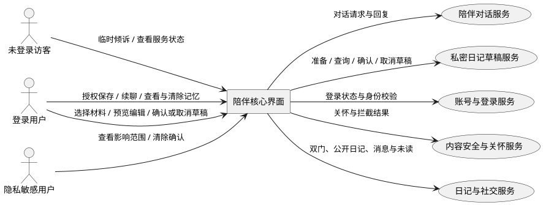
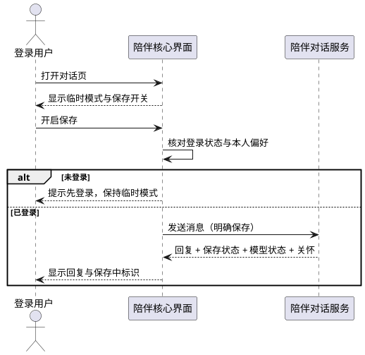
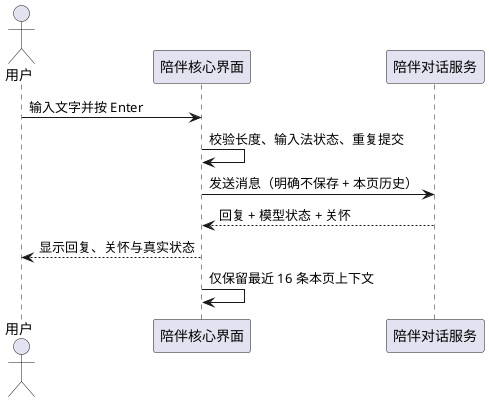
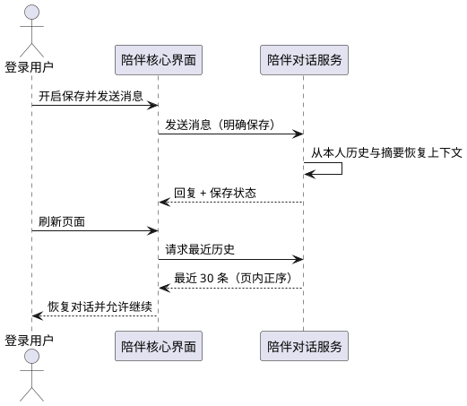
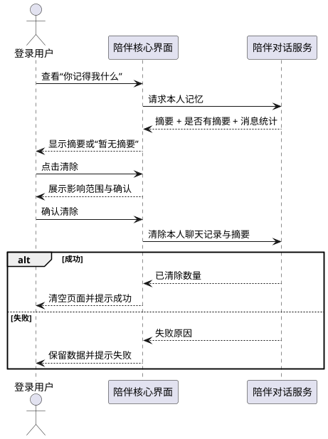
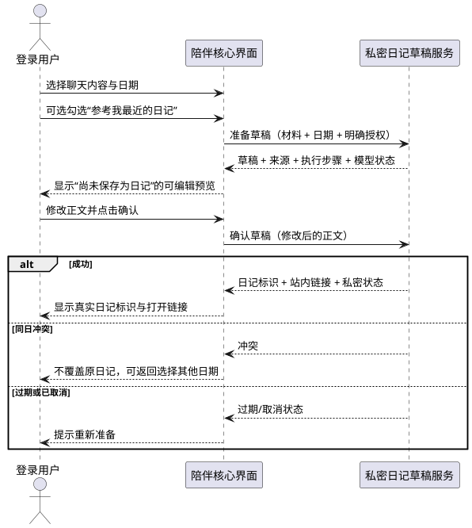
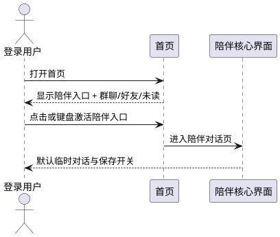
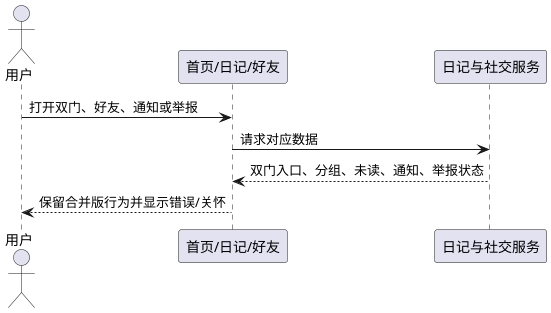

# 1. 组件定位

## 1.1 核心职责

本组件负责可控记忆对话与私密日记草稿确认界面，实现用户掌控的记录闭环。

## 1.2 核心输入

1. 未登录访客或登录用户输入的文字消息：用于发起临时对话或保存式对话。
2. 保存模式开关指令：用户显式选择本次对话是否保存到账号。
3. 历史与记忆操作指令：查看历史对话、查看“你记得我什么”、清除对话和记忆。
4. 日记整理材料：用户选中的聊天内容、目标日历日期、是否参考本人近期日记的授权。
5. 草稿操作指令：编辑草稿正文、确认保存为私密日记、取消草稿。
6. 首页入口点击或键盘激活指令：从首页进入陪伴对话页。
7. 登录状态变化：登录、退出、切换账号、会话失效。

## 1.3 核心输出

1. 对话回复：文字内容、真实模型或本地降级状态、关怀提示。
2. 保存状态与历史：本次是否保存、账号历史列表、是否有更早历史。
3. 记忆摘要：摘要正文、是否有摘要、消息总数、待摘要条数、最近聊天时间。
4. 草稿预览：可编辑正文、日期、私密标识、来源、执行步骤、草稿状态与过期时间。
5. 确认结果：真实日记标识、日期、站内日记链接、当前私密状态。
6. 页面状态与提示：登录要求、进行中状态、错误提示、空态提示、清除确认说明。

## 1.4 职责边界

1. 本组件不定义对话、记忆、草稿的持久化结构，不定义摘要生成算法、审核词库和模型调用协议。
2. 本组件不替代日记编辑页、公开日记页、发现页、好友/粉丝、群聊、未读汇总、举报与审核功能。
3. 本组件不修改数据库结构，不重建数据库，不修改真实用户内容，不在浏览器存放模型密钥。
4. 本组件不把本地规则回复描述为大模型结果，不把页面步骤摘要描述为模型内部推理。
5. 本组件不从旧二十四稿原始包整包覆盖当前合并版文件。
6. 本组件不负责修复与本次接入无关的历史问题，例如公开资料手机号字段、匿名瓶子兼容接口、空库初始化。

# 2. 领域术语

**临时对话**
: 仅在当前页面保留上下文的对话方式，刷新页面后本页历史消失，不读写账号聊天记录与长期摘要。

**保存对话**
: 登录用户显式授权后，由服务端把本轮对话写入本人账号历史的对话方式。

**历史续聊**
: 登录用户重新打开页面后，从本人账号历史中恢复最近对话并继续聊天。

**长期记忆**
: 服务端在本人的聊天历史基础上形成的摘要，用于跨会话恢复上下文。

**记忆摘要**
: 长期记忆的文字表现形式。摘要异步产生，刚开始聊天时可能没有摘要但仍已有聊天记录。

**私密日记草稿**
: 服务端暂存的待确认日记内容，尚未写入日记。草稿有有效期，需用户明确确认后才成为私密日记。

**确认**
: 用户审阅并编辑草稿后，明确提交“保存为私密日记”的动作。

**取消**
: 用户放弃待确认草稿的动作。取消只改变草稿状态，不删除已保存日记。

**关怀提示**
: 当内容触发危机识别或内容被拦截时，系统展示的支持渠道与求助提示。关怀不抵消内容规则。

**真实模型状态**
: 本次回复是否来自真实模型，以及是否处于本地规则或降级模式。本地模式不得标注为大模型结果。

**参考日记授权**
: 用户明确勾选后，允许服务端读取本人目标日期及之前短时间内的少量日记作为整理参考。未勾选时不读取。

**双门入口**
: 日记页保留的左右两扇门入口，左门进入本人日记，右门进入关注对象的公开日记。

# 3. 角色与边界

## 3.1 核心角色

未登录访客：可以临时倾诉和查看服务状态，不能保存对话、查看账号历史、查看记忆或准备私密草稿。

登录用户：可以显式授权保存对话、刷新后续聊、查看和清除本人记忆，并完成私密日记草稿的预览、编辑、确认与取消。

隐私敏感用户：需要清楚区分“关闭保存”“清除记忆”“取消草稿”“删除日记”四种不同动作，并能在执行前看到影响范围。

## 3.2 外部系统

陪伴对话服务：接收对话请求，返回回复、保存状态、真实模型/降级状态与关怀信息。

私密日记草稿服务：接收整理材料与日期，返回待确认草稿；接收确认或取消指令，返回草稿状态与日记结果。

账号与登录服务：提供登录状态、当前用户身份与权限校验。

内容安全与关怀服务：识别危机表达与混合违规内容，返回关怀提示或拦截结果。

日记与社交服务：提供双门日记入口、公开日记、评论、收藏、关注、私信、群聊、未读汇总、举报与审核能力。

## 3.3 交互上下文

# 4. DFX约束

## 4.1 性能

1. 在本地开发环境，页面首屏可交互时间不超过 1 秒；上游模型回复时延不设固定上限，但界面必须持续显示明确的进行中状态。
2. 单次对话请求携带的历史不得超过 16 条；历史列表每页最多 30 条。
3. 请求进行中，重复提交次数必须为 0；按钮必须处于明确的禁用或进行中状态。
4. 历史分页加载时，页内按时间正序展示；更早一页必须向前拼接，不得打乱顺序。

## 4.2 可靠性

1. 清除记忆失败时，页面已有数据必须 100% 保留，并显示失败原因，不得呈现“已清空”的假成功。
2. 清除、切换模式、切换账号或新建会话之后，旧请求的迟到响应重新填充界面的次数必须为 0。
3. 同一草稿重复或并发确认，只允许产生 1 篇日记，并返回相同的日记标识。
4. 同日已有日记时，必须返回冲突，原日记内容不得被覆盖。
5. 草稿预览阶段不得写入日记；确认阶段才允许写入。

## 4.3 安全性

1. 保存对话、查看历史、查看记忆、清除记忆、准备草稿、确认草稿、取消草稿均必须要求登录。
2. 前端不得存放模型密钥；所有请求必须通过统一请求封装，鉴权信息只在统一封装中维护。
3. 模型输出、用户文字、昵称、摘要和草稿正文必须以纯文本方式渲染，不得作为 HTML 执行。
4. 关怀渠道的电话链接只允许电话字符；不得把模型输出或用户文字拼接为可执行链接。
5. 他人草稿必须返回“不存在”，不得泄漏草稿是否存在；跨账号读取次数必须为 0。
6. 不得在前端代码中把日记可见性改为公开；首次确认的日记必须为私密。

## 4.4 可维护性

1. 每次请求结果必须按统一结构处理，并优先处理关怀信息，不得只显示错误文案而丢弃关怀。
2. 页面必须显示真实模型或本地降级状态；不得把本地规则回复标注为大模型结果。
3. 需求验收必须覆盖临时模式旧行为回归、保存模式新行为、草稿确认与取消、错误与关怀分支。
4. 测试必须发现真实断链，不得通过删除断言制造“全部通过”。

## 4.5 兼容性

1. 临时对话的旧行为必须保留：显式不保存、上下文本页保留、长回复完整显示、单条上下文不超过 2000 个 UTF-16 单元且不截断代理对。
2. 必须保留中文输入法 Enter 不误发、请求进行中阻止重复提交、纯文本输出和关怀提示。
3. 不引入前端框架，不改变现有页面配色与原生 HTML/JS 形态。
4. 不改变现有对话、草稿接口协议；如确需调整，必须同步更新接口契约并保留旧客户端兼容。
5. 必须保留双门入口、互关与粉丝、其他私信、未读汇总、群聊、站内链接白名单、举报权限与审核增量。

# 5. 核心能力

## 5.1 对话模式与保存授权

### 5.1.1 业务规则

1. **默认临时模式**：页面首次使用、新账号、未登录、退出登录或切换账号后，必须默认使用临时对话。
   a. 验收条件：When 用户首次打开页面，the system shall 显示“临时对话，刷新后本页清空”，并默认不保存。
2. **显式保存开关**：页面必须提供“保存对话以便下次继续”的显式开关，不得默认开启。
   a. 验收条件：When 页面加载完成，the system shall 显示关闭状态的保存开关和用途说明。
3. **登录要求**：未登录时尝试开启保存，必须提示先登录，不得发起保存请求。
   a. 验收条件：If 未登录用户点击保存开关，then the system shall 显示登录要求并保持临时模式。
4. **每次请求显式表态**：每次对话请求必须明确发送保存或临时意图，不得省略保存字段。
   a. 验收条件：When 用户发送消息，the system shall 对临时模式明确发送不保存，对保存模式明确发送保存。
5. **按用户保存偏好**：保存模式偏好只能按当前用户标识保存；退出、换账号或登录失效后必须重新核对，不得沿用另一人的授权。
   a. 验收条件：When 用户 A 退出后用户 B 登录，the system shall 回到临时模式，不得继承用户 A 的保存选择。
6. **关闭保存不等于清除**：关闭保存开关只影响后续请求，不得删除已存在的账号历史或记忆摘要。
   a. 验收条件：When 用户关闭保存开关，the system shall 保留账号历史，并明确说明“关闭保存不会删除已存记录”。
7. **禁止项**：禁止把临时上下文自动混入已保存历史，禁止在未登录时写入账号历史。
   a. 验收条件：When 临时模式发送消息，the system shall 只使用本页上下文，且账号历史记录数不变。

### 5.1.2 交互流程

### 5.1.3 异常场景

1. **未登录开启保存**
   a. 触发条件：用户未登录时点击保存开关。
   b. 系统行为：保持临时模式，显示登录要求，不发起保存请求。
   c. 用户感知：提示“登录后才能保存对话记忆”。
2. **登录状态失效**
   a. 触发条件：请求返回未登录或会话失效。
   b. 系统行为：停止保存式请求，清理失效状态，保留当前页面可显示的临时内容；不得假装保存成功。
   c. 用户感知：显示重新登录提示。
3. **偏好读取失败**
   a. 触发条件：页面无法确认当前用户的保存偏好。
   b. 系统行为：回退到临时模式，不得默认保存。
   c. 用户感知：显示“本次按临时对话进行”。

## 5.2 临时对话

### 5.2.1 业务规则

1. **仅本页上下文**：临时对话的上下文必须只存在于当前页面，刷新后清空。
   a. 验收条件：When 用户刷新临时对话页，the system shall 不再显示上一轮消息，下一次请求不携带旧上下文。
2. **上下文长度**：临时上下文最多保留最近 16 条消息，每条 1–2000 个 UTF-16 单元；不得发送 system 角色。
   a. 验收条件：When 连续发送多条消息，the system shall 只携带最近 16 条，且每条长度在允许范围内。
3. **长回复完整显示**：模型回复必须完整显示；用于后续请求的上下文可受长度限制，但不得拆分 UTF-16 代理对。
   a. 验收条件：When 模型返回超过 2000 个 UTF-16 单元的内容，the system shall 完整显示原文，并保证下一次请求的历史条目合法。
4. **输入校验**：空消息和超过 2000 个 UTF-16 单元的消息必须被拒绝，不得静默截断。
   a. 验收条件：If 用户提交空内容或超长内容，then the system shall 显示明确提示且不发起请求。
5. **中文输入法**：中文输入法组合输入期间的 Enter 不得触发发送。
   a. 验收条件：When 用户处于输入法组合状态并按 Enter，the system shall 不发送消息。
6. **重复提交防护**：请求进行中必须阻止重复回车和重复点击。
   a. 验收条件：While 正在等待回复，the system shall 禁用发送按钮，且重复提交只产生 1 次请求。
7. **纯文本与关怀**：模型内容必须以纯文本显示；出现关怀信息时必须展示支持渠道。
   a. 验收条件：When 回复包含关怀信息，the system shall 先显示关怀提示，再显示回复内容。
8. **真实状态**：必须显示本次回复是真实模型还是本地支持回复。
   a. 验收条件：When 服务返回本地模式，the system shall 显示“本地支持回复，未使用大模型”，不得显示“已连接大模型”。

### 5.2.2 交互流程

### 5.2.3 异常场景

1. **上游超时或不可用**
   a. 触发条件：陪伴对话服务超时、网络失败或返回降级。
   b. 系统行为：保留用户输入，显示本地支持回复或错误提示，不把失败轮次加入后续上下文。
   c. 用户感知：显示“暂时无法连接大模型”或“本地支持回复”，并提供重试可能。
2. **回复为空**
   a. 触发条件：服务返回成功但回复内容为空。
   b. 系统行为：不把空回复加入上下文，显示可重试提示。
   c. 用户感知：提示“回复暂时为空，请稍后重试”。
3. **关怀与错误同时出现**
   a. 触发条件：错误响应携带关怀信息。
   b. 系统行为：先展示关怀，再展示错误，不丢弃关怀。
   c. 用户感知：看到支持渠道与错误原因。

## 5.3 保存对话与历史续聊

### 5.3.1 业务规则

1. **保存模式由服务端取历史**：保存模式下，客户端不得把临时上下文作为模型历史发送；服务端必须从本人账号历史与摘要恢复上下文。
   a. 验收条件：When 保存模式发送消息，the system shall 不发送客户端历史，或发送空历史。
2. **历史第一页**：历史第一页必须是最近 30 条消息，页内按时间正序展示。
   a. 验收条件：When 用户打开历史对话，the system shall 显示最近 30 条，并按从旧到新排列。
3. **向前分页**：更早历史必须向前拼接，并按消息标识去重。
   a. 验收条件：When 用户加载更早一页，the system shall 把更早消息插到当前列表前面，且不出现重复消息。
4. **摘要与历史区分**：没有摘要不代表没有聊天记录；页面必须区分“暂无摘要”和“历史为空”。
   a. 验收条件：When 消息总数大于 0 但没有摘要，the system shall 显示“暂无摘要”，不得显示“没有聊天记录”。
5. **刷新续聊**：保存模式下刷新页面，必须恢复本人最近历史。
   a. 验收条件：When 登录用户开启保存并发送消息后刷新，the system shall 显示刚才的对话并可继续发送。
6. **关闭保存的记录不增加**：关闭保存后继续聊天，账号历史记录数不得增加。
   a. 验收条件：When 用户关闭保存并发送消息，the system shall 保持账号历史条数不变。

### 5.3.2 交互流程

### 5.3.3 异常场景

1. **历史加载失败**
   a. 触发条件：历史接口失败或超时。
   b. 系统行为：保留当前页面内容，显示可见错误与重试入口。
   c. 用户感知：提示“历史暂时加载失败”，不显示空的假历史。
2. **分页重复**
   a. 触发条件：相邻页出现相同消息。
   b. 系统行为：按消息标识去重，保持时间顺序。
   c. 用户感知：列表无重复项。
3. **保存请求失败**
   a. 触发条件：保存模式请求失败。
   b. 系统行为：不把失败轮次计入已保存历史，保留用户输入供重试。
   c. 用户感知：显示失败原因，不显示“已保存”。

## 5.4 记忆查看与清除

### 5.4.1 业务规则

1. **记忆内容可见**：用户必须能查看本人记忆摘要、是否有摘要、消息总数、待摘要条数和最近聊天时间。
   a. 验收条件：When 用户打开“你记得我什么”，the system shall 显示真实摘要或明确的空态。
2. **清除前确认**：清除前必须展示确认说明，说明将清空本人的聊天记录和摘要，但不删除日记与草稿。
   a. 验收条件：When 用户点击清除，the system shall 先显示影响范围，用户确认后才发起清除。
3. **清除后同步清空**：清除成功后必须同步清空页面历史与本页临时上下文，刷新后为空。
   a. 验收条件：When 清除成功，the system shall 清空页面消息、历史列表和记忆摘要，并显示成功提示。
4. **清除失败保留数据**：清除失败必须保留已有数据并提示失败，不得先清空页面再报错。
   a. 验收条件：If 清除请求失败，then the system shall 保留原消息与摘要，并显示失败原因。
5. **迟到响应不得回填**：清除、切换模式、切换账号或新会话之后，旧异步响应不得重新填充已清空的界面。
   a. 验收条件：When 清除成功时仍有旧请求在途，the system shall 丢弃该旧响应。
6. **禁止项**：禁止把“关闭保存”当成“清除记忆”，禁止在清除时删除日记或草稿。
   a. 验收条件：When 用户清除记忆，the system shall 只清除聊天记录与摘要，日记与草稿数量不变。

### 5.4.2 交互流程

### 5.4.3 异常场景

1. **清除确认被取消**
   a. 触发条件：用户在确认弹窗中选择取消。
   b. 系统行为：不发起清除请求。
   c. 用户感知：页面数据保持不变。
2. **清除时登录失效**
   a. 触发条件：清除请求返回未登录。
   b. 系统行为：保留页面数据，提示重新登录，不显示成功。
   c. 用户感知：显示登录要求。
3. **摘要为空但有历史**
   a. 触发条件：消息总数大于 0，摘要为空。
   b. 系统行为：显示“暂无摘要”，同时提示仍有聊天记录可查看。
   c. 用户感知：不会误以为所有记录已清空。

## 5.5 私密日记整理

### 5.5.1 业务规则

1. **用户选择材料与日期**：用户必须选择要整理的内容和目标日期；日期按用户本地日历日期提交。
   a. 验收条件：When 用户准备草稿，the system shall 使用用户选择的 YYYY-MM-DD 日期，不使用 UTC 日期替代本地今天。
2. **默认不读其他日记**：只有用户主动勾选“参考我最近的日记”且授权严格为真时，才允许读取本人近期日记。
   a. 验收条件：When 用户未勾选参考日记，the system shall 不读取任何历史日记，并在预览中标注“未参考近期日记”。
3. **材料长度**：待整理内容必须为 1–2000 个 UTF-16 单元，不得静默截断。
   a. 验收条件：If 用户提交空材料或超过 2000 个 UTF-16 单元，then the system shall 拒绝并提示调整。
4. **预览不写日记**：草稿预览必须明确“尚未保存为日记，草稿已暂存服务端”，预览时不得调用普通日记保存。
   a. 验收条件：When 草稿预览显示，the system shall 不新增任何日记记录。
5. **预览可编辑**：预览必须展示可编辑正文、日期、私密标识、来源和简洁执行步骤；正文编辑上限为 5000 个 UTF-16 单元。
   a. 验收条件：When 用户修改预览正文，the system shall 只把修改保留在页面，确认时才提交。
6. **确认才保存**：用户点击确认后，才允许保存为私密日记；必须展示真实日记标识和站内日记链接。
   a. 验收条件：When 用户确认草稿，the system shall 保存 1 篇私密日记，并显示真实日记标识与链接。
7. **首次私密**：首次确认的日记必须为私密；前端不得把可见性改为公开。
   a. 验收条件：When 草稿首次确认成功，the system shall 显示“私密”状态，不得显示公开。
8. **取消只改状态**：取消草稿只改变草稿状态，不得删除已保存日记。
   a. 验收条件：When 用户取消待确认草稿，the system shall 返回取消状态，日记数量不变。
9. **同日冲突不覆盖**：目标日期已有日记时，必须提示冲突，不得自动覆盖；用户可返回选择其他日期重新准备。
   a. 验收条件：If 同日已有日记，then the system shall 显示冲突提示，原日记内容保持不变。
10. **过期与状态**：草稿超过有效期后不可确认；已取消、已确认、已过期的草稿必须返回对应状态。
    a. 验收条件：When 用户确认过期草稿，the system shall 提示过期并允许重新准备。
11. **跨账号不可访问**：不存在和属于他人的草稿必须返回相同“不存在”结果。
    a. 验收条件：If 用户访问他人草稿，then the system shall 返回“草稿不存在”，不泄漏内容或存在性。
12. **重复确认幂等**：同一草稿重复或并发确认，只允许产生 1 篇日记，并返回相同日记标识。
    a. 验收条件：When 用户重复点击确认，the system shall 只写入 1 篇日记，按钮在进行中禁用。
13. **超时不明时重试确认**：确认结果不明时，必须用同一草稿标识查询或重试确认，不得自动重新准备新草稿。
    a. 验收条件：If 确认请求超时，then the system shall 用原草稿标识查询状态，不生成新草稿。
14. **危机停止**：检测到明确危机表达且草稿为空时，只展示关怀与支持提示，不继续生成或保存。
    a. 验收条件：When 准备结果返回空草稿并携带关怀，the system shall 只显示支持信息，不显示确认按钮。
15. **禁止项**：禁止在预览阶段写日记，禁止自动覆盖同日日记，禁止把草稿取消说成删除日记，禁止在代码中把日记设为公开。

### 5.5.2 交互流程

### 5.5.3 异常场景

1. **同日已有日记**
   a. 触发条件：用户确认的日期已有本人日记。
   b. 系统行为：停止保存，保留草稿状态，允许返回选择其他日期重新准备。
   c. 用户感知：显示“这一天已有日记，草稿不会覆盖”，原日记不变。
2. **草稿过期**
   a. 触发条件：确认时草稿已超过有效期。
   b. 系统行为：不写入日记，提示重新准备。
   c. 用户感知：显示过期提示与重新准备入口。
3. **草稿已取消或已确认**
   a. 触发条件：用户对已取消草稿确认，或对已确认草稿取消。
   b. 系统行为：返回冲突状态，不重复写入、不删除日记。
   c. 用户感知：显示当前草稿状态。
4. **他人草稿**
   a. 触发条件：用户访问不属于本人的草稿。
   b. 系统行为：返回“不存在”，不读取内容。
   c. 用户感知：显示草稿不存在。
5. **危机表达**
   a. 触发条件：整理材料触发危机识别。
   b. 系统行为：停止读取日记、不调用模型、不创建草稿，只返回关怀。
   c. 用户感知：显示支持渠道，不显示确认保存。
6. **模型降级**
   a. 触发条件：草稿由本地规则生成。
   b. 系统行为：在预览中明确标注本地规则，不冒充大模型。
   c. 用户感知：看到“本地规则保留原话，不是大模型生成”。
7. **确认超时**
   a. 触发条件：确认请求超时，结果不明。
   b. 系统行为：用同一草稿标识查询状态；若已确认则展示原结果，未确认则允许重试。
   c. 用户感知：不产生第二篇日记。

## 5.6 首页陪伴入口

### 5.6.1 业务规则

1. **入口位置**：首页群聊卡片上方必须提供明显的“和小陪聊聊”入口，并配一句用途说明。
   a. 验收条件：When 登录用户进入首页，the system shall 在群聊卡片上方看到陪伴入口与用途说明。
2. **局部接入**：入口只作局部增加，不得替换整页，不得删除群聊、互关分组、粉丝入口、其他私信和未读角标。
   a. 验收条件：When 首页加载完成，the system shall 同时保留原有群聊房间、好友/粉丝、其他私信与未读汇总。
3. **可访问性**：入口必须可键盘聚焦，Enter 可激活，文字对比度清晰。
   a. 验收条件：When 键盘用户聚焦入口并按 Enter，the system shall 进入陪伴对话页。
4. **语义明确**：入口文案必须让用户知道这是 AI 陪伴对话，不是普通好友私信。
   a. 验收条件：When 用户阅读入口，the system shall 看到“和小陪聊聊”及用途说明。

### 5.6.2 交互流程

### 5.6.3 异常场景

1. **入口跳转失败**
   a. 触发条件：页面地址不可用。
   b. 系统行为：保留首页其他功能，显示可见错误。
   c. 用户感知：可返回首页继续使用社交功能。
2. **未读数据加载失败**
   a. 触发条件：未读接口失败。
   b. 系统行为：陪伴入口仍可用，未读区域显示可见错误，不隐藏整个首页。
   c. 用户感知：不会因为 AI 入口导致社交入口消失。

## 5.7 合并版保留能力

### 5.7.1 业务规则

1. **双门入口**：日记页必须保留原双门图片和左右门跳转；左门进入本人日记，右门进入关注对象的公开日记。
   a. 验收条件：When 用户打开日记页，the system shall 显示原图与左右门，点击后进入对应页面。
2. **社交与未读**：互关好友、单向关注、粉丝回关、其他私信、未读汇总必须保持可用。
   a. 验收条件：When 用户查看好友页，the system shall 正确显示互关与粉丝分组、其他私信入口和未读角标。
3. **通知链接白名单**：@ 与祝福通知只能跳转允许的站内目标，外链不得变成可点击按钮。
   a. 验收条件：When 用户点击站内通知，the system shall 跳转到日记详情或收到的祝福；外部链接保持普通文字。
4. **举报权限**：收到的私信可举报；举报详情只能读取本人有权查看的内容，私密内容不得泄漏。
   a. 验收条件：When 用户打开举报详情，the system shall 只显示其有权查看的内容与处理状态。
5. **审核与关怀**：混合违规内容仍被拦截，但错误响应中的关怀必须展示；新的短处罚不得缩短仍在生效的长期禁言。
   a. 验收条件：When 内容被拦截且携带关怀，the system shall 显示拦截结果与关怀；长期禁言时长不被缩短。
6. **禁止项**：禁止从旧二十四稿原始包整包覆盖当前合并版文件，禁止删除既有社交、举报、审核断言来制造通过。

### 5.7.2 交互流程

### 5.7.3 异常场景

1. **双门图片缺失**
   a. 触发条件：原图资源不可用。
   b. 系统行为：保留左右门链接与文字标签，显示可见替代说明。
   c. 用户感知：仍可进入本人日记或关注日记。
2. **未读接口失败**
   a. 触发条件：未读汇总接口失败。
   b. 系统行为：显示错误，不把未读误报为 0。
   c. 用户感知：看到“未读暂时无法加载”。
3. **举报内容已转私密**
   a. 触发条件：原公开日记后来转为私密。
   b. 系统行为：举报详情不再显示正文。
   c. 用户感知：只看到处理状态，不泄漏私密内容。

# 6. 数据约束

## 6.1 对话消息

1. **message**：非空文字，长度 1–2000 个 UTF-16 单元，不得静默截断。
2. **role**：只能是 user 或 assistant；禁止 system。
3. **history**：最多 16 条；每条内容长度 1–2000 个 UTF-16 单元。
4. **remember**：必须是布尔值；临时模式为 false，保存模式为 true；新界面不得省略。
5. **saved**：表示本次是否写入账号历史；临时模式必须为 false。
6. **provider**：对话回复中的模型信息对象，至少包含是否为真实模型和模型名称；本地模式不得标注为真实模型。
7. **degraded**：表示本次是否处于本地或降级模式。
8. **care**：可选的关怀对象，包含提示文字与支持渠道列表；错误响应也可能携带。

## 6.2 记忆摘要

1. **summary**：本人长期记忆摘要文字；可为空。
2. **hasMemory**：表示是否已有摘要；为 false 不代表没有聊天记录。
3. **totalMessages**：本人消息总数，必须为非负整数。
4. **pendingMessages**：尚未进入摘要的消息数，必须为非负整数。
5. **lastChat**：最近聊天时间；可为空。
6. **清除范围**：只清除聊天记录与摘要，不删除日记和草稿。

## 6.3 私密日记草稿

1. **id**：草稿的唯一标识，格式为 UUID；不存在或属于他人时统一按“不存在”处理。
2. **date**：有效的 YYYY-MM-DD 日历日期，按用户本地日期提交。
3. **text**：草稿正文，确认时长度 1–5000 个 UTF-16 单元；不得静默截断。
4. **sources**：来源列表，每项包含日记标识、日期和站内链接；未授权时为空。
5. **provider**：草稿生成方式字符串；本地规则必须明确标注，不与对话模型对象混用。
6. **status**：只能是 pending、confirmed、cancelled、expired 之一。
7. **expiresAt**：草稿过期时间，使用 UTC 时间；超过后不可确认。
8. **isPublic**：确认结果中的可见性；首次确认必须为 false，前端不得改为 true。
9. **diaryId**：确认成功后的真实日记标识；重复确认必须返回同一标识。
10. **url**：确认成功后的站内日记链接；只能展示服务端返回的对应站内页面。

## 6.4 保存模式偏好

1. **用户标识**：偏好只能绑定当前登录用户，不得跨账号复用。
2. **取值**：只能是开启或关闭；默认关闭。
3. **失效条件**：退出登录、切换账号、登录失效后必须重新核对并回到临时模式。
4. **与清除的关系**：关闭偏好不好删除历史；清除记忆不改变偏好本身，但清除后页面为空。

## 6.5 关怀信息

1. **message**：关怀提示文字，必须以纯文本显示。
2. **lines**：支持渠道列表，每项包含名称与电话；电话只保留数字、加号、括号和连字符。
3. **展示顺序**：权限或错误分支必须先处理关怀，再处理错误文案。
4. **禁止项**：禁止把模型输出或用户文字作为 HTML 插入页面。