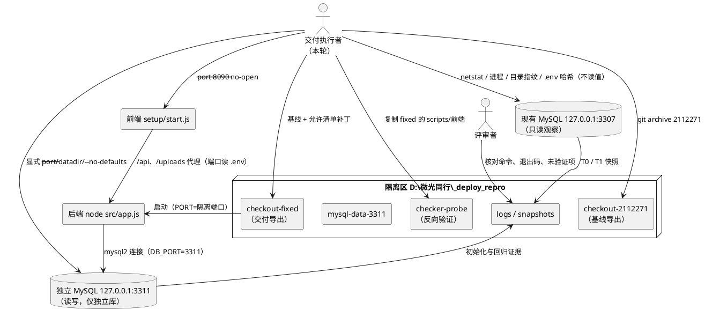
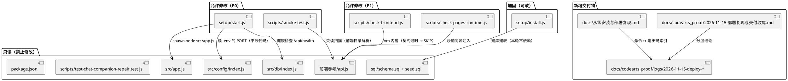
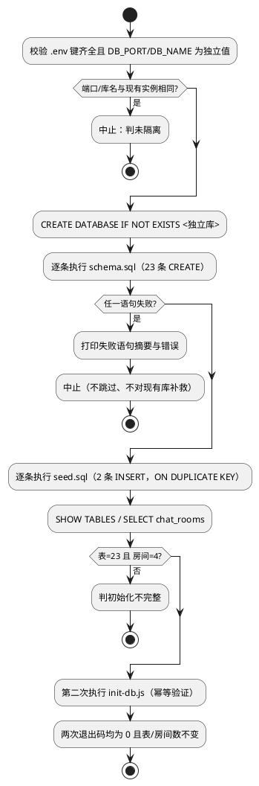
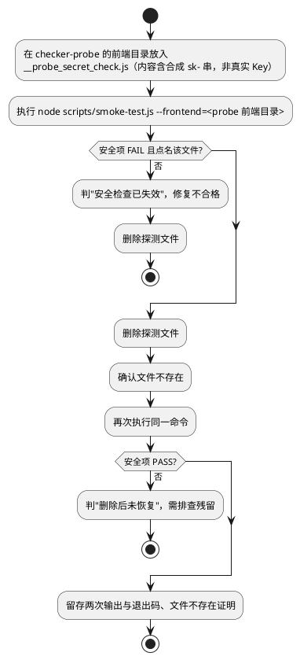
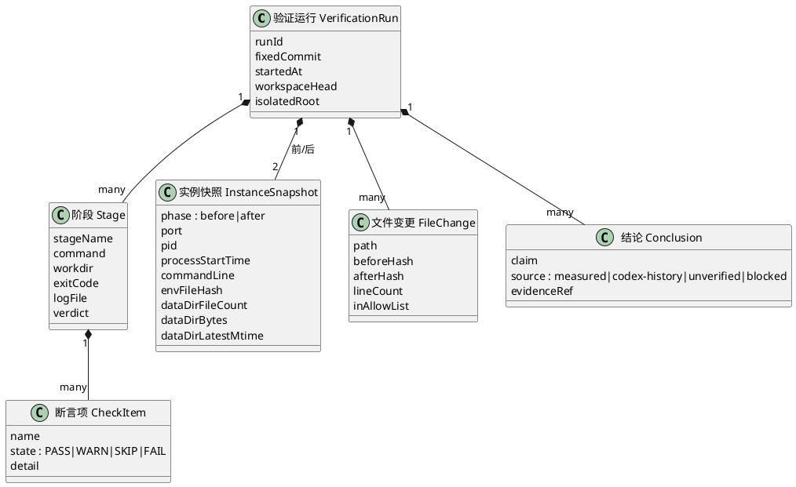

# 部署复现与交付工程收尾 · 实现方案设计（design.md）

> 文档类型：增量技术设计（HOW）
> 工作区：`D:\微光同行\Glimmer`
> 上游规格：`.codeartsdoer/specs/deploy_repro_hardening/spec.md`（1112 行；R10–R13、18 项验证、现状问题清单 A1–A7 / B1–B12 / C1–C5、10 个待确认点）
> 固定提交基线：`2112271db26b34a557719afc60a77b91557ee624`（Codex 独立验收通过，2026-11-15 20:04:29 +0800）
> 继承基线（只读、不得回退）：`.codeartsdoer/specs/guest_context_hardening/{spec,design,tasks}.md`（R9 已验收并固定）
> 本轮依据：`docs/2026-11-15_CodeArts补修验收通过.md`、`docs/codearts_proof/2026-11-15-游客上下文归属修复.md`
> 状态：设计阶段产出，**未执行**任何安装、启动、测试、数据库写入命令；本文不含业务代码、不含测试代码、不含配置改动
> 本文只回答"怎么改、改哪里、如何证明、什么不算完成"，逐条对齐 R10–R13，不缩减任何一条

---

# 一、需求与存量功能关系分析

## 1.0 本轮基线与设计前提

### 1.0.1 Git 与工作区（设计阶段只读核对）

| 核对项 | 实测结果 | 判定 |
|---|---|---|
| `git rev-parse HEAD` | `2112271db26b34a557719afc60a77b91557ee624` | 正是固定提交，起点正确 |
| `git status --short` | 仅 `?? .codeartsdoer/specs/deploy_repro_hardening/` | 工作区干净；本轮新增规格/设计目录属未跟踪，不算代码改动 |
| `git log -1` | `feat: complete companion memory and private diary flows with acceptance evidence` | 与验收报告一致 |
| 分支 / 推送 | `main`；未推送验证不在本轮范围 | 只登记，不提交、不推送 |

**设计前提 1：本轮所有"修复"只作用于部署入口脚本、静态检查器与说明文档；业务功能源码、SQL、前端页面一律只读。**
**设计前提 2：所有验证都在仓库外的隔离目录与独立 MySQL 实例中进行；现有 3307 / 3000 / 8081 进程只做只读观察，不停止、不重启、不改写。**

### 1.0.2 关键文件哈希（沿用 spec 5.2，本轮不重复计算业务文件）

spec 5.2 已给出 9 个关键文件的换行数与 SHA-256。设计阶段不重复计算，避免与实施阶段产生第二套口径；实施阶段 V01/V17 必须以当次计算结果与 spec 5.2 逐字比对。

| 文件 | spec 5.2 值（设计阶段引用） | 本轮关系 |
|---|---|---|
| `前端参考/chat-companion.js` | 1743 行 / `31C567E9…A22270` | 只读；功能已验收 |
| `后端源码/scripts/test-chat-companion-repair.test.js` | 1587 行 / `B08A6CFA…E371B7` | 只读；68 条断言与 harness 不得改 |
| `前端参考/chat-session.js` | 76 行 / `BD5710B4…1AF7C` | 只读契约 |
| `前端参考/api.js` | 123 行 / `956755AB…41A626` | 只读契约；**其 `API_CANDIDATES` 含 3000，是本轮必须绕开的既有假设** |
| `后端源码/package.json` | 29 行 / `7E0E9EB1…2CEA04` | 只读；`test:competition` / `test:merge24` / `npm test` 语义不得改 |
| `后端源码/scripts/smoke-test.js` | 433 行 / `D9E8EE71…CE2BDB` | **必改（P0）** |
| `后端源码/src/db/index.js` | 115 行 / `0F013792…B1DD` | 只读 |
| `后端源码/src/app.js` | 317 行 / `21835DF4…790A` | 只读 |
| `docs/review/2026-11-15-identity-guest/acceptance-boundaries.test.cjs` | 90 行 / `785BFB7A…098A` | 只读；独立验收入口 |

### 1.0.3 现有运行实例（引用 spec 5.3，实施阶段须以当次 `netstat` 再确认）

| 端口 | PID | 进程 | 设计含义 |
|---:|---:|---|---|
| 3000 | 47736 | `node`，`D:\Node.js\node.exe src/app.js` | 现有后端；本轮**不得复用、不得停止**；隔离后端必须换端口 |
| 3307 | 39896 | `mysqld`，`--datadir=./mysql-data`（相对路径） | 现有实例；只读；数据目录指纹必须先解析启动 cwd |
| 8081 | 35644 | `node setup/start.js --no-open --port 8081` | 现有前端；不得停止 |
| 8080 | 40112 | `python`（非本项目） | 证明"8080 可用"不成立；文档必须改为"以实际输出为准" |

### 1.0.4 十个默认决策（用户未逐条回答，按 spec 默认继续）

| 编号 | 决策 | 落地约束 | 主要影响文件 |
|---|---|---|---|
| D1 | 独立库采用"端口 3311 + 独立绝对数据目录 + 新库名"三重隔离 | `@@port=3311`、`@@datadir` 在 `_deploy_repro` 下、库名 `peizhe_deploy_20261115`；任一项与现有实例相同即判未隔离并停止 | 验证脚本/报告 |
| D2 | 临时目录允许在仓库外 `D:\微光同行\_deploy_repro\` | 不写入工作区、不进入 `git status`；数据目录不得嵌套进现有数据目录 | 全部验证步骤 |
| D3 | 允许在隔离目录 `npm ci`（需网络） | 只允许锁文件安装；失败保留原始 stderr 与退出码并标"环境阻塞"；**禁止**复制/软链现有 `node_modules` | 报告、V03 |
| D4 | 允许复用本机 `D:\mysql\bin\mysqld.exe`（8.4.13），不下载 8.0.28 | 只复用程序，不复用数据目录与配置；报告登记版本差异 | `setup/start.js`、`setup/install.js`、报告 |
| D5 | 检查器修复按 P0/P1/P2 分层 | P0：`smoke-test.js` + `setup/start.js`；P1：`check-frontend.js`、`check-pages-runtime.js`；P2：`test-api-*.js` 只标注不篡改 | 修改清单 |
| D6 | 交付说明放 `docs/`，根 README 与 `docs/README.md` 加索引 | 新增 `docs/从零安装与部署复现.md`；README 只加一行索引，不重写历史结论 | `docs/`、`README.md` |
| D7 | 不改 `.gitignore`；登记"`**/*.log` 本地日志默认不入库"，新增日志同时保存 `.txt` 副本 | 每份日志双份：`.log`（可检索、被忽略）+ `.txt`（交付可见）；登记 `git check-ignore -v` 实测输出 | 报告、日志目录 |
| D8 | 允许在隔离副本做合成 `sk-` 串反向验证，验证后删除 | **仅在 probe 副本**；放入→FAIL、删除→PASS；删除后给出文件不存在证明与目录哈希 | V14 |
| D9 | 独立前端使用 8090（冲突则顺延并记录） | 不占用 8080/8081；前端端口由 `--port 8090` 指定；实际端口以日志为准 | V07 |
| D10 | 浏览器验收不纳入本轮，只做自动化与 HTTP 健康检查 | 浏览器类项目一律标"未验证"；不得用历史浏览器结论冒充本轮结果 | 报告"未验证范围" |

---

## 1.1 需求功能与存量功能对比

### 1.1.1 已实现功能

> 匹配度口径：100% = 需求可直接复用存量能力不加改动；75% = 能力存在但取值来源/边界需修正；50% = 只有部分机制；25% = 仅有相关基础设施。

| 需求功能 | 存量功能 | 代码位置 | 匹配度 |
|---|---|---|---|
| R10.5 建库建表 + 种子数据（23 表 / 4 房间） | `init-db.js` 读 `.env` 连库、`CREATE DATABASE IF NOT EXISTS`、逐条执行 `schema.sql`+`seed.sql`、打印表清单与房间清单、失败即退出 1 | `后端源码/scripts/init-db.js:55-59`、`70-92`、`94-104` | 100% |
| R10.5 幂等（重复执行不报错、不重复房间） | `schema.sql` 全部 `CREATE TABLE IF NOT EXISTS`；`seed.sql` 带 `ON DUPLICATE KEY UPDATE` | `后端源码/sql/schema.sql`；`seed.sql` 两段 INSERT | 100% |
| R10.6 健康判据字段 | `/api/health` 返回 `code:0`、`data.db.connected`、`data.db.version`、`data.ai.configured` | `后端源码/src/app.js:167-192` | 100% |
| R10.6 启动前置校验（缺 `DB_PASSWORD` 拒绝启动） | `checkConfig()` 把空 `DB_PASSWORD` 列为 problem 并 `process.exit(1)` | `后端源码/src/config/index.js:96-98`；`src/app.js:255-261` | 100% |
| R10.7 静态托管 + `/api`、`/uploads` 代理 + 端口顺延 | `serveStatic` 托管 `前端参考/`、`proxyToBackend` 转发、`listenWithFallback` 20 次顺延、`Cache-Control: no-store` | `setup/start.js:129-153`、`156-173`、`179-207`、`325-337` | 100% |
| R10.3 锁文件安装能力 | 仓库存在 `package-lock.json`；`npm ci` 可用 | `后端源码/package-lock.json` | 100% |
| R12.6 从 `.env` 读 DB 端口 | `readDbPort()` 已解析 `DB_PORT`，非法时回落 3306 | `setup/start.js:36-44` | 75%（仅 DB 端口读配置，后端端口仍硬编码） |
| R12.8 MySQL 程序可由环境变量定位 | `MYSQL_DIR` 已支持 | `setup/start.js:62`；`setup/install.js:43` | 50%（只到目录级，且拼死版本子目录） |
| R13.2 证据命名与退出码习惯 | 既有日志已用 `*-competition.log`、`EXIT_CODE=<n>`、顶部命令原文 | `docs/codearts_proof/logs/2026-11-15-guest-context-*.log` | 75%（缺 `.txt` 副本与统一前缀） |
| R13.5 既有证据只读 | `docs/review/**`、`docs/codearts_proof/**` 均为独立文件，可按新增命名避开 | 目录清单（review 3 组、proof 5 报告 + logs + backup + screenshots） | 100% |

### 1.1.2 需要扩展的功能

| 需求功能 | 存量功能 | 差异说明 | 扩展方向 |
|---|---|---|---|
| R12.2 前端目录来源单一化 | `smoke-test.js` 在三处硬编码 `D:/Study/Match/2026-2027.up/chat/前端八稿` | 输入差异：无参数可用；位置差异：假设仓库外旧项目；边界差异：旧目录不存在时无回退 | 新增解析顺序"`--frontend`/`FRONTEND_DIR` → `<ROOT>/../前端参考` → 旧默认值（带 WARN）"，并在输出打印实际路径 |
| R12.3 跳过四态化 | `check()` 只有 pass/warn/fail 三计数；跳过用普通字符串返回 | 输出差异：`（跳过）`/`（找不到前端目录，跳过）` 无前缀 → 落入 fail 分支；计数差异：无 skip 计数 | 新增 `skip` 计数与 `SKIP:` 约定；`check()` 四态分支；汇总行增加"跳过 N"；退出码语义显式定义 |
| R12.4 检查项守恒 | 检查项散落在循环列表与 `check()` 调用中 | 无清单导出机制；无 before/after 对照口径 | 以"日志逐行名称集合"为清单来源，要求名称集合 diff 为空、总数相等、判定变化仅限旧路径 3 项 |
| R12.6 后端端口以 `.env` 为准 | `BACKEND_PORT = 3000` 常量贯穿健康检查、代理、日志文案 | 取值差异：不读 `PORT`；文案差异：`后端已启动（3000）` 写死；失败路径：`.env` 缺失时静默回落 3306 | 新增 `readBackendPort()`（读 `.env` 的 `PORT`，非法/缺失即报错退出 1）；健康检查、代理、文案全部改用该值 |
| R12.7 同端口实例归属校验 | 端口占用即打印"后端在运行（3000）" | 缺失差异：无 PID/命令行/仓库根判定；风险差异：把旧目录后端当本次版本 | 新增"端口占用 → 取 PID → 取命令行 → 判定 owned/foreign/unknown"，foreign/unknown 不宣告成功并给建议命令 |
| R12.8 mysqld 路径可配置 | `MYSQL_HOME` + 固定 `mysql-8.0.28-winx64` 子目录 | 差异：本机程序在 `D:\mysql\bin`（无版本子目录）；失败路径：默认不存在时只提示"先跑一键安装" | 新增 `--mysqld` / `MYSQLD`、`--mysql-basedir` / `MYSQL_BASEDIR`、`--mysql-datadir` / `MYSQL_DATA_DIR`；默认不存在时输出"找不到 mysqld，请指定"并退出 1 |
| R12.8 / B10 启动参数确定 | `start.js` 启动 mysqld 只给 basedir/datadir/port/console | 差异：缺 `--no-defaults`（可能读 `D:\mysql\my.ini`）、缺 `--bind-address`、缺 `--mysqlx=OFF` | 启动参数与现有实例对齐；`--no-defaults` 置于首个参数位（MySQL 规则） |
| R11.4 / B9 独立实例不得对既有实例 `ALTER USER` | `usePrivateInstance()` 在 3307 已在监听时仍会 `testCredential('')` 并 `ALTER USER` | 风险差异：只要该端口空密码可登录即改写认证 | 新增前置：目标端口已监听 → **直接拒绝**并提示换端口；只在"本进程刚 `--initialize-insecure` 出的实例"上设密码 |
| R10.3 依赖安装判据 | `installDeps()` 见 `node_modules` 存在即跳过、用 `npm install` | 判据差异：无法证明"从零"；无锁文件约束 | 本轮不改 install.js 的安装行为；由验证流程改为显式 `npm ci`（隔离副本），install.js 仅在文档标注"一键安装不等于从零验证" |
| R13.1 从零安装说明 | `README.md` 方式 B 有片段命令，但端口/判据不全 | 差异：缺成功/失败判据、缺独立库路径、缺实际端口 | 新增 `docs/从零安装与部署复现.md`，与 V01–V18 一一对应 |

### 1.1.3 需要新增的功能或接口

> **本轮不新增任何 HTTP 路由、不改任何既有接口契约、不改数据库结构、不改前端。** "新增"只发生在脚本 CLI、检查器输出语义、交付文档与验证资产上。

| 编号 | 新增能力 | 输入 | 输出 | 依赖关系 |
|---|---|---|---|---|
| N1 | `smoke-test.js` 前端目录解析入口 | `--frontend=<dir>` / `FRONTEND_DIR` / 相对路径 | 实际解析路径打印 + 检查结果 | 只依赖仓库内 `前端参考/` |
| N2 | `smoke-test.js` 四态汇总 | 同上 | `通过 X 警告 Y 跳过 Z 失败 W` + `EXIT_CODE` | 不新增网络、不连库、不启服务 |
| N3 | `start.js` 后端端口解析 | `后端源码/.env` 的 `PORT` | 健康检查/代理/文案统一端口 | 需要 `.env` 存在 |
| N4 | `start.js` 端口归属判定 | 端口号 | `owned` / `foreign` / `unknown` + PID/命令行/建议命令 | Windows CIM 或 `netstat -ano` |
| N5 | `start.js` MySQL 程序定位参数 | `--mysqld`、`--mysql-basedir`、`--mysql-datadir`、对应环境变量 | 解析路径日志 / 明确失败提示 | 不改变默认行为 |
| N6 | `install.js` 独立实例安全前置 | `--force-private` + `--private-port` | 端口已监听即拒绝；`data-<port>` 已存在即拒绝 | 不改变 `PRIVATE_PORT` 默认值 |
| N7 | `check-frontend.js` / `check-pages-runtime.js` 目录与基址参数 | `--frontend` / `FRONTEND_DIR`；`--base` / `API_BASE` / `.env PORT` | 实际路径与实际基址打印 | 契约过时项输出 SKIP 并给替代入口 |
| N8 | 交付文档 | 本轮日志与退出码 | `docs/从零安装与部署复现.md` + 过程报告 | 需先完成 V01–V18 |
| N9 | 本轮证据 | 各阶段命令输出 | `docs/codearts_proof/logs/2026-11-15-deploy-*.log` + `.txt` | 与 `.gitignore` 事实登记配套 |
| N10 | 现有实例零写入快照方法 | 端口/PID/命令行/目录指纹/`.env` 哈希 | 前后对照表 | **不使用现有凭证**（见 2.1.3.2） |

---

## 1.2 存量功能详细分析

### 1.2.1 现状核对总表（R10–R13 逐条，精确到文件:行号）

> 判定口径：**修** = 本轮必改；**加固** = 本轮最小改动（仅增参数/前置校验/提示）；**只标注** = 不改代码只写说明；**不改** = 明确不触碰。

#### A. 文档层（R13.1 / R12.2 的误导来源）

| 编号 | 位置 | 根因（精确） | 影响 | 判定 |
|---|---|---|---|---|
| A1 | `README.md:104` | 方式 A 第 2 步写"浏览器自动打开 `http://localhost:8080`"，未说明 8080 可能被占用、实际端口以窗口输出为准 | 本机 8080 被 python 占用（PID 40112），实际为 8081；新人误判启动失败 | **修**（改为"默认 8080 起，占用则自动顺延，以窗口打印的实际端口为准"，并给出 8081 实例事实） |
| A2 | `docs/前置安装指南.md:200` | 示例输出写 `本机打开：http://localhost:8080`，未标注"示例" | 同上 | **修**（示例标注为示例 + 实际端口说明） |
| A3 | `docs/前置安装指南.md:313-314` | 命令写成 `node scriptsix-duplicate-nick.js`：源文本 `scripts\fix-duplicate-nick.js` 中 `\f` 被当作转义字符吞掉 | 照抄必然"找不到模块"；`fix-duplicate-nick.js` 实际存在 | **修**（改用正斜杠 `node scripts/fix-duplicate-nick.js`，两行同时修） |
| A4 | `后端源码/README.md:12`、`15` | 写"`node src/app.js` 起在 3000"、"健康检查 `127.0.0.1:3000`"，未说明以 `.env` 的 `PORT` 为准 | 与 `start.js` 硬编码 3000 叠加后产生错配；换端口后文档全错 | **修**（改为"端口由 `.env` 的 `PORT` 决定（默认 3000）"） |
| A5 | `README.md:145`；`docs/参赛核心验证报告.md:41` | 已如实披露"`npm test` 旧路径仍需修复"，但无修复后判据与出口 | 披露正确但无法核查是否已修 | **修**（README 增一行指向新文档与本轮判据；验证报告历史段落**不改**，仅在报告中登记其结论已由本轮闭环） |
| A6 | `docs/本地运行说明.md:72-73` | 记录 `npm test` "122 通过 / 5 警告 / 3 失败"、`check-frontend.js` 假设旧全局 `API` | 历史基线，必须原样保留 | **追加**（只在文件末尾追加本轮结论段，不改历史段落） |
| A7 | `后端源码/scripts/test-all.sh:22-26` | 注释仍写"转发到虚拟机"，与 `run_on_vm` 实际本地执行不一致 | 排错误导 | **只标注**（不改脚本；在交付文档"历史脚本过时清单"登记） |
| A8 | `docs/交接说明.md:20`、`46`、`165` | 写"浏览器自动打开 8080"、"后端 3000" | 与 A1/A4 同类 | **不改**（该文件首行已声明"历史归档，不作为当前执行指令"；只在交付文档登记"以 A1/A4 为准"） |

#### B. `后端源码/scripts/smoke-test.js`（P0，`npm test` 入口）

| 编号 | 位置 | 根因（精确） | 影响 | 判定 |
|---|---|---|---|---|
| B1a | `L87` | `const FRONTEND_DIR = 'D:/Study/Match/2026-2027.up/chat/前端八稿'` 模块级常量 | 前端文件循环（5 项）永远 warn，无法指向真实前端 | **修**（统一走解析函数） |
| B1b | `L308` | 安全检查内再写死同一路径；不存在时 `return '（找不到前端目录，跳过）'` | 无 `WARN:` 前缀 → `check()` 落入 else 分支 → **fail** | **修**（改解析函数 + 返回 SKIP） |
| B1c | `L323-324` | 第三方直连检查内写死同一路径；不存在时 `return '（跳过）'` | 同上 → **fail** | **修** |
| B1d | `L346-349` | `[7]` 目录存在性检查写死同一路径，返回模板字符串 | 同上 → **fail** | **修** |
| B2 | `L15`、`L18-37` | 计数器只有 `pass/fail/warn`；`check()` 只有 pass / `WARN:` / else 三分支，无 SKIP | "未执行"与"失败"无法区分，SKIP 被计 FAIL | **修**（新增 `skip` 计数与 `SKIP:` 约定；四态分支） |
| B3 | `L421-432` | 汇总行 `通过 X 警告 Y 失败 W`；`problems.length` 为 0 即退出 0 | 无法看出跳过数量；SKIP 存在时退出码语义未定义 | **修**（汇总加"跳过 Z"；退出码语义显式写入注释与文档：FAIL>0 → 1，否则 0） |
| B4 | `L49-83` | 必需文件清单 68 项（含 `.gitignore`、`scripts/test-api-*.js`、`scripts/deploy.sh` 等） | 清单本身正确、当前文件齐全；**禁止删减** | **不改**（守恒基线，任何删项即判不合格） |
| B5 | `L120-277` | SQL 结构、切分逻辑、seed 检查 | 与前端目录无关，当前应全 PASS | **不改** |
| B6 | `L280-342` | 安全红线 6 项（含 `sk-` 正则 `/sk-[a-zA-Z0-9]{20,}/`） | 是反向验证的对象；正则与扫描范围（`.js`/`.html`）不得放宽 | **不改**（只改路径来源） |
| B7 | `L390-398` | shell 换行符循环（按 `scripts/*.sh` 实际数量展开） | 随文件数变化，不是硬编码项 | **不改** |
| B8 | `L400-418` | 路由挂载检查（`src/routes` 实际 14 个文件 + 1 项汇总） | 当前应全 PASS | **不改** |

> 说明：`smoke-test.js` 的检查项总数以"日志逐行名称集合"为准，不在设计阶段凭静态推算写死数字（静态推算会与 `.sh` 实际数量、路由文件数量耦合，易产生伪差异）。

#### C. `setup/start.js`（P0，启动路径）

| 编号 | 位置 | 根因（精确） | 影响 | 判定 |
|---|---|---|---|---|
| C1 | `L31` | `const BACKEND_PORT = 3000` | 后端端口不读 `.env`，与 R10.4/R12.6 冲突 | **修**（`readBackendPort()` 读 `.env` 的 `PORT`） |
| C2 | `L86` | `checkHealth()` 用 `port: BACKEND_PORT` | 后端换端口后健康检查永远失败 | **修**（改用解析值） |
| C3 | `L160-162` | `proxyToBackend` 用 `port: BACKEND_PORT` 且 `host` 头硬编码 | `/api`、`/uploads` 代理指向错误端口 | **修** |
| C4 | `L302`、`L304` | 文案 `后端已启动（3000）` / `后端在运行（3000）` | 换端口后输出与实际不符 | **修**（输出实际端口） |
| C5 | `L240-305` | 端口已占用时直接 "后端在运行"，无 PID/命令行/仓库归属判定 | 会把旧目录/旧版本后端当成本次源码（R12.7 核心风险） | **修**（新增归属判定三态） |
| C6 | `L62-64` | `MYSQL_HOME` + `MYSQL_NAME='mysql-8.0.28-winx64'` → `MYSQLD` 拼出 `D:\mysql\mysql-8.0.28-winx64\bin\mysqld.exe` | 本机实际 `D:\mysql\bin\mysqld.exe`；端口未开时启动分支必然"找不到 MySQL" | **修**（可配置路径，默认不存在时明确报错） |
| C7 | `L223-227` | spawn 参数只有 `--basedir/--datadir/--port/--console` | 缺 `--no-defaults`（可能读 `D:\mysql\my.ini`）、缺 `--bind-address=127.0.0.1`、缺 `--mysqlx=OFF` | **修**（与现有实例参数对齐，`--no-defaults` 首位） |
| C8 | `L321` | `if (!NO_OPEN === false) { /* 仍然继续起静态服务 */ }` 空块 | 恒不成立，死代码，无行为影响 | **修**（删除该行，不改变控制流） |
| C9 | `L36-44` | `.env` 缺失时 `readDbPort()` 静默回落 3306 | 会导致按 3306 去启动/探测一个不存在的实例 | **修**（`.env` 缺失 → 提示先安装并退出 1，不猜测端口） |
| C10 | `L202` | `server.listen(port, '0.0.0.0')` | 前端监听 `0.0.0.0` 是既有行为（手机局域网访问需要） | **不改**（R4.3.3 的 127.0.0.1 约束只针对 **MySQL 实例**，不针对前端静态服务） |
| C11 | `L117-153` | 静态文件路径拼接 + `startsWith(FRONTEND_DIR)` 防目录穿越 | 大小写/尾斜杠边界在 Windows 下足够用，本轮不涉及 | **不改** |

#### D. `setup/install.js`（加固，不改变既有默认行为）

| 编号 | 位置 | 根因（精确） | 影响 | 判定 |
|---|---|---|---|---|
| D1 | `L61` | `let PRIVATE_PORT = PRIVATE_PORT_ARG \|\| 3307` | 默认端口与现有实例撞车；若 3307 已在跑，`usePrivateInstance` 会把它当"新建实例"处理 | **不改默认值**（按 spec 决策 11），只新增"端口已被监听即拒绝" |
| D2 | `L404`、`L423` | `testCredential('', PRIVATE_PORT)` 成功后无条件 `ALTER USER 'root'@'localhost' … BY <随机密码>` | **高危**：若 3307 是现有实例且空密码可登录，会直接改写现有认证 | **加固**（执行前必须证明该端口由本进程刚初始化的实例监听；否则拒绝并退出非 0） |
| D3 | `L338-341` | `fresh` 分支（本机 mysqld 由脚本首次 `--initialize-insecure`）同样执行 `ALTER USER` | 该分支语义正确（实例确由本进程创建），但无"实例归属"证据输出 | **加固**（补充"数据目录由本进程创建"的日志与校验） |
| D4 | `L237-241` | `initMysqlData` 的 spawn 缺 `--no-defaults` | 可能读 `D:\mysql\my.ini` 覆盖端口/目录 | **修**（`--no-defaults` 置于首位） |
| D5 | `L265-271` | `startMysql` 的 spawn 缺 `--no-defaults`；用 `--mysqlx-port=port+30000` 规避 X plugin 冲突 | 配置来源不确定 | **修**（加 `--no-defaults`；保留既有 mysqlx 偏移策略） |
| D6 | `L129-132`、`L134-138` | `ensureMysql`：端口已开即复用；本机 mysqld 存在即启动 | 复用行为本身合理 | **不改**（复用不等于隔离；隔离由本轮独立实例流程保证） |
| D7 | `L44-49`、`L140-147`、`L392-396` | 默认下载 `mysql-8.0.28-winx64.zip`（222MB），下载前仅 warn | 从零安装会依赖网络大文件 | **加固**（先探测本机 `mysqld`；不存在再提示下载，提示文案给出"可用 `--mysqld`/`MYSQLD` 指定已有程序"） |
| D8 | `L463` | `const dbName = 'peizhe'` 硬编码，忽略 `.env` 的 `DB_NAME` | 走 install.js 无法建出独立库名 | **不改**（本轮建库走 `init-db.js`，它读 `.env` 的 `DB_NAME`）；在文档中标注差异 |
| D9 | `L542-545`、`L547` | 见 `node_modules` 即跳过；用 `npm install` | "从零安装"判据不成立 | **不改**（R10.3 由隔离流程 `npm ci` 承担；文档标注"一键安装 ≠ 从零验证"） |
| D10 | `L582-586` | 顺序：建库 → 写 `.env` → 装依赖 → migrate → seed | 建库发生在 `.env` 之前，因此库名/端口来自 `pickCredentials` 而非模板 | **不改**（本轮不依赖 install.js 建库） |
| D11 | `L341`、`L423` | `IDENTIFIED WITH mysql_native_password` | MySQL 8.4 默认未加载该插件（本机 8.4.13），高概率报错 | **只标注 + 提示**（不改认证目标；在报告中登记"8.4 兼容风险"，本轮独立实例用默认插件设密码） |
| D12 | `L63`、`L144-147`、`L580` | `--check` 只读模式 | 可作为 install.js 改动的安全验证入口 | **不改**（V15 用 `--check` 证明不改环境） |

#### E. `后端源码/scripts/check-frontend.js`（P1）

| 编号 | 位置 | 根因（精确） | 影响 | 判定 |
|---|---|---|---|---|
| E1 | `L23` | `process.argv[2] \|\| 'D:/Study/Match/2026-2027.up/chat/前端八稿'` | 无参数运行必失败；路径来源不单一 | **修**（`--frontend` / `FRONTEND_DIR` → `../前端参考` → 旧默认（WARN）） |
| E2 | `L54-75` | `loadApiObject()` 用 `vm` 跑 `api.js` 后取 `ctx.API` | 当前 `api.js` 是 `api()` 函数 + `apiBase()`，**没有 `window.API`** → `ctx.API === undefined` | **修（只标注不篡改）**（检测到契约缺失时不崩、输出 `SKIP: 旧 window.API 契约不存在`，并给替代入口；**不改任何断言内容**） |
| E3 | `L92-95` | `collectApiPaths(apiObject)` 未判空 | `Reflect.ownKeys(undefined)` 抛 `TypeError` → 未捕获 → 退出 1 | **修**（前置判空；异常归类为契约过时） |
| E4 | `L155-178` | `API.x.y(` / `API.x(` 正则与内省路径比对 | 契约过时的具体断言；**不得放宽** | **不改** |
| E5 | `L264-275` | 汇总与 `fail > 0` 退出 1 | 需增加"跳过 N"显示 | **修（仅输出层）** |

#### F. `后端源码/scripts/check-pages-runtime.js`（P1）

| 编号 | 位置 | 根因（精确） | 影响 | 判定 |
|---|---|---|---|---|
| F1 | `L30` | 默认 `'D:/Study/Match/2026-2027.up/chat/九稿'` | 无参数必失败 | **修**（同 E1 解析顺序） |
| F2 | `L31` | `BASE = process.argv[3] \|\| 'http://127.0.0.1:3000'` | 硬编码 3000，隔离环境会打到现有后端 | **修**（`--base` / `API_BASE` → `.env` 的 `PORT` → 3000（WARN）） |
| F3 | `L179-180` | 用正则 `/var BASE = '[^']*';/` 替换 api.js 基址 | 当前 api.js 无 `var BASE`（用 `API_CANDIDATES`）→ 替换无效，页面脚本仍打 3000 | **修**（sandbox 注入同源 `location`，使 `API_CANDIDATES[0]` = 目标基址；保留原替换以兼容旧契约） |
| F4 | `L182-191` | 登录态种子（`13800138000` / `123456`） | 需要目标库含演示账号（`seed.sql` 不含用户，需 `seed-demo.js`） | **不改**；文档标注依赖 |
| F5 | `L297-338` | 页面判定与退出码 | 不在 `npm test` 门禁内 | **不改** |

#### G. `后端源码/scripts/test-api-*.js`（P2，8 个文件）

| 编号 | 位置 | 根因（精确） | 影响 | 判定 |
|---|---|---|---|---|
| G1 | `test-api-client.js:23`、`test-api-ai.js:14`、`test-api-bless.js:15`、`test-api-bottle.js:20`、`test-api-comment.js`、`test-api-interact.js`、`test-api-message.js`、`test-api-profile.js` | 全部硬编码旧前端目录 | 无参数必失败 | **只标注**（不改） |
| G2 | `test-api-client.js:86-91` | 断言 `window.API` 已导出 | 当前 `api.js` 无 `window.API` → 真实契约变更 | **只标注**（R12.9：禁止改断言使其"通过"） |
| G3 | `test-api-*.js` 全部 | 依赖真实后端与真实库，且会写入测试数据 | 不属于"纯静态检查器" | **只标注**；替代入口 = `test:competition`、`test:merge24`、独立验收脚本 |

#### H. 仓库级与数据层

| 编号 | 位置 | 根因（精确） | 影响 | 判定 |
|---|---|---|---|---|
| H1 | `.gitignore:13-14` | `*.log` 与 `**/*.log` | 新增 `.log` 默认不入库，"本地有日志、交付包没有" | **不改**；登记 + `.txt` 副本（D7） |
| H2 | 现有 3307 进程命令行 `--datadir=./mysql-data` | 相对路径，解析位置取决于启动 cwd；文档记录为 `D:\微光同行\.runtime\mysql-data` | 数据目录指纹必须先确认 cwd，不得直接假设绝对路径 | **不改**；指纹方法见 2.1.3.2 |
| H3 | `后端源码/src/app.js:151` | `executeSqlFile()` 使用 `mysql.createConnection`，但 `app.js` **未 import `mysql`** | 空库首次启动时 `ensureSchema()` 走到该分支 → `ReferenceError` → 被 `catch` 吞成 `⚠️ 自动建表失败`，随后服务照常启动但表不存在 | **不改**（`src/**` 禁止修改）；**规避**：S5 必须先 `init-db.js` 建表，S6 再启动；V05 记录"启动日志无自动建表分支" |
| H4 | `后端源码/src/app.js:93-146` | `ensureSchema()` 含 `ALTER TABLE ... ADD COLUMN` | 在独立库上若触发即为对独立库的 DDL | **不改**；V05 校验 `users.session_version`/`session_device`/`messages.is_sys` 已存在（`schema.sql` 已含），使该分支不触发 |
| H5 | `前端参考/api.js:11-21` | `API_CANDIDATES` 含 `http://localhost:3000/api`、`http://127.0.0.1:3000/api` | 若页面由非代理方式打开（如 file://），会打到现有 3000 | **不改**；本轮前端一律经 `start.js` 代理，`API_CANDIDATES[0] = location.origin + '/api'` 命中 |
| H6 | `后端源码/package.json:13-15` | `npm test` = `smoke-test.js`；两条回归为 `&&` 链（单一退出码） | 符合 R4.2.4 | **不改** |
| H7 | `docs/本地运行说明.md:45`、`38` | 记录仓库 setup 脚本与专用启动器不等价、前端 8080 | 历史事实，保留 | **不改**（仅在末尾追加本轮结论） |

### 1.2.2 存量脚本的接口契约分析（修复前必须遵守的既有契约）

| 契约 | 现状 | 本轮约束 |
|---|---|---|
| `check(name, fn)` 返回语义 | `true`/`undefined` → PASS；`'WARN:…'` → WARN；其他字符串 → FAIL；抛异常 → FAIL | 新增 `'SKIP:…'` → SKIP；**不得**把"目录存在但检查失败"改为 SKIP |
| `npm test` 退出码 | `problems.length > 0` → 1，否则 0 | 保持；新增"仅 SKIP/WARN → 0"，并在输出显式声明 |
| `start.js` CLI | `--port <n>` / `--port=<n>` / `--no-open` | 保持；新增 `--mysqld`、`--mysql-basedir`、`--mysql-datadir`（均为可选，不改变默认） |
| `install.js` CLI | `--check`、`--force-private`、`--private-port=<n>` | 保持；`--private-port` 语义由"建议端口"收紧为"显式目标端口 + 安全前置" |
| `check-frontend.js` CLI | `argv[2]` = 前端目录 | 保持位置参数兼容；新增 `--frontend` 优先 |
| `check-pages-runtime.js` CLI | `argv[2]` = 前端目录、`argv[3]` = 后端基址 | 保持；新增 `--frontend` / `--base` 优先 |
| `/api/health` 响应 | `{code,msg,data:{db:{connected,version,error},ai:{configured,model}}}` | 只读使用；不新增字段、不改语义 |
| `init-db.js` 输出 | 表清单 + 房间清单 + 退出码 | 作为 V05 判据来源；不改脚本 |
| 日志格式 | 既有日志顶部命令、末尾 `EXIT_CODE=<n>` | 本轮沿用并扩展（命令 + 工作目录 + 开始时间 + 完整输出 + 退出码） |

### 1.2.3 存量约束与依赖（设计必须绕开的硬约束）

1. **`src/**` 与 `sql/**` 不得改**：H3 的 `mysql` 未导入缺陷只能靠"先建表再启动"规避，不能在代码层修。
2. **`前端参考/**` 不得改**：H5 的 3000 候选地址只能靠 `start.js` 代理命中同源候选，不能改 `api.js`。
3. **`package.json` 脚本语义不得改**：V08–V11 必须原样使用 `test:competition`、`test:merge24` 与 `--test` 单文件命令。
4. **现有 `.env` 不得读值、不得改**：只能取 SHA-256；因此"现有库库清单/行数"在无凭证条件下**不可读**（见 2.1.3.2 的取舍）。
5. **现有 3307 的 datadir 是相对路径**：指纹必须先解析进程启动 cwd；解析不到则以 `@@datadir` 为权威，否则登记"无法确定绝对路径"。
6. **8080 已被非本项目占用**：任何"8080 通过"都不成立；前端必须用 8090 或顺延端口。
7. **MySQL 8.4.13**：`mysql_native_password` 默认未加载（D11 风险）；独立实例设密码走默认插件。
8. **`--no-defaults` 必须是 mysqld 的第一个参数**：否则可能读 `D:\mysql\my.ini` 覆盖端口/目录，导致"隔离失败"。
9. **`.gitignore` 忽略 `**/*.log`**：日志必须双份交付（`.log` + `.txt`）。
10. **既有 68 条断言与 harness 不得动**：V08 单文件回归必须 68/68。

### 1.2.4 与上一轮（R9）验收成果的关系

| 上一轮成果 | 本轮关系 | 证据 |
|---|---|---|
| `前端参考/chat-companion.js`（1743 行 / `31C567E9…`） | 只读；V08/V09/V11 必须证明未被改动 | V17 修改面 |
| 68 条回归（含 13 条 `EDGE-R9-*`） | 只读；V08 判据 68/68 | V08 |
| `acceptance-boundaries.test.cjs`（4/4） | 只读；V11 复跑 | V11 |
| Codex 浏览器主流程通过 | **本轮不复跑**，标"未验证（历史复验）" | 报告分层 |
| CodeArts 上轮 `ECONNREFUSED 127.0.0.1:3307`（退出 1） | 原样保留；本轮用独立实例复跑，成功与否独立记录 | 报告对比段 |

**结论（第一章）**：R10–R13 的每一条都能映射到具体存量能力与具体缺陷位置；本轮不存在"需要重写业务"的需求，只有"路径来源、端口来源、跳过语义、独立实例安全前置、交付证据"五类工程性缺口。
---

# 二、增量设计方案

## 2.0 总体方案

### 2.0.1 隔离目录布局（D2 决策）

```text
D:\微光同行\_deploy_repro\                 ← 仓库外；不进 git status
├── checkout-2112271\                      ← 基线导出：git archive 2112271 原样
│   ├── 前端参考\ 后端源码\ setup\ docs\ ...
│   └── （无 node_modules、无 后端源码\.env、无 uploads 运行文件）
├── checkout-fixed\                        ← 交付导出：基线 + 本轮允许清单修改
│   ├── 同上结构
│   └── 修改仅限：scripts/{smoke-test,check-frontend,check-pages-runtime}.js、setup/{start,install}.js
├── checker-probe\                         ← 检查器反向验证专用（checkout-fixed 的 scripts+前端副本）
├── mysql-data-3311\                       ← 独立实例数据目录（绝对路径，绝不在现有数据目录内）
├── logs\                                  ← 本轮原始命令输出（与 docs 内的正式日志互为副本）
├── tmp\                                   ← 临时 client 配置、PID 登记（用完即删）
└── snapshots\                              ← T0/T1 现有实例只读快照（txt/json）
```

**为什么分三个副本：**

1. `checkout-2112271` 只用于两件事：证明"固定提交可导出且关键哈希一致"（V01-a），以及取得"修复前 `npm test` = 3 失败"的真实证据（V12）。它必须与 2112271 逐字一致，**不能**携带本轮修复。
2. `checkout-fixed` 用于完整的"从零安装 → 初始化 → 启动 → 两套回归"（V02–V11、V13）。它同样是干净副本（无依赖、无 `.env`、无上传文件），因此"从零"判据成立；其与 2112271 的差异全部落在允许清单内，并由 V17 逐文件哈希登记。
3. `checker-probe` 只承载 R12.5 的合成 `sk-` 反向验证，避免在 `checkout-fixed` 的"可复现交付副本"里留下任何探测文件。

### 2.0.2 从零安装链路（S1–S13 与 V01–V18 的对应）

| 步骤 | 动作 | 判据 | 对应验证 |
|---|---|---|---|
| S1 | 导出两个副本（`git archive` + 允许清单补丁） | 目录存在；无 `node_modules`/`.env`/上传文件；只读文件哈希 = spec 5.2 | V01 |
| S2 | 记录 Node/npm/mysqld 版本 | Node ≥18（实测 24.22.0）、MySQL 8.x（实测 8.4.13） | V02 |
| S3 | `npm ci`（`checkout-fixed/后端源码`） | 退出 0；`node_modules` 存在；`npm ls --depth=0` 无 missing | V03 |
| S4 | 生成 `.env`（模板 + 独立库连接项，Key 留空） | 键名齐全；`DB_PORT=3311`；`DEEPSEEK_API_KEY` configured=false；`.env` 只记录 SHA-256 | V04 |
| S5a | 启动独立实例（显式端口/绝对目录/`--no-defaults`） | 3311 启动前空闲；启动后只由新 PID 监听 `127.0.0.1`；`@@port/@@datadir` 与现有不同 | V05-a、V15 |
| S5b | `node scripts/init-db.js` 两次 | 两次退出 0；23 表；4 房间；无重复 | V05-b |
| S6 | 启动后端（`checkout-fixed/后端源码`，端口来自隔离 `.env`） | `/api/health`：`code:0`、`db.connected:true`、`ai.configured:false`、端口 ≠ 3000 | V06 |
| S7 | 启动前端（`node setup/start.js --port 8090 --no-open`） | `/chat-companion.js` 内容哈希 = 磁盘哈希；`/api/health` 代理可达 | V07 |
| S8 | 单文件回归 | 68/68；退出 0 | V08 |
| S9 | `npm run test:competition` | 退出 0；137 Node + 18/71/66 | V09 |
| S10 | `npm run test:merge24` | 退出 0；23 Node + 13/3 | V10 |
| S11 | 独立验收脚本 | 4/4；退出 0 | V11 |
| S12 | 修改面核对 | 只允许清单变化；禁止清单哈希不变 | V17 |
| S13 | 脱敏检索 + 忽略规则登记 | 真实凭证/手机号命中 0；`git check-ignore -v` 命中 `**/*.log` | V18 |

> **顺序约束（不可打乱）**：S5b 必须先于 S6（原因见 1.2.1 H3：`app.js` 空库自建表分支会因未 import `mysql` 而失败）；S4 必须先于 S5b（`init-db.js` 从 `.env` 取库名/端口/密码）；S3 必须先于 S5b（`init-db.js` 依赖 `mysql2`）；V12 必须先于 P0/P1 修复，V13/V14 必须后于修复。

### 2.0.3 为什么两套回归与 `npm test` 这样排

1. **`npm test`（静态检查器）先跑**：它不连库、不启服务、不依赖 `node_modules`（只 import 仓库内 `src/utils/sql.js`），因此可在任何阶段独立执行，且必须在**修复前**先取一次真实红灯（V12），修复后再取一次（V13），两次日志构成"3 失败 → 0 失败"的完整证据链。
2. **回归后跑**：`test:competition`、`test:merge24`、独立验收脚本都依赖隔离后端与独立库，必须在 S5–S7 全部通过后按 V08 → V09 → V10 → V11 顺序串行执行；任一条非 0 时后续条目不写成"通过"。
3. **不把 `npm test` 混进回归链**：`package.json` 的 `test:competition` / `test:merge24` 均不含 `smoke-test.js`（`package.json:13-15`），本轮**不改**该组成；`npm test` 作为独立静态门禁单独取证。

### 2.0.4 为什么本轮不改业务源码

| 理由 | 说明 |
|---|---|
| 功能已固定 | 2112271 已由 Codex 独立验收；任何 `src/**`/`前端参考/**` 改动都会使"固定提交"失去意义，并让 68 条断言与 4 项独立验收失去可比性 |
| 缺陷可规避 | H3（`mysql` 未导入）可通过"先建表再启动"规避；H5（`api.js` 候选 3000）可通过同源代理规避；二者都不需要改代码 |
| 约束成本 | 改业务源码会把本轮变成"功能返修 + 部署复现"的混合任务，无法再用"业务文件哈希不变"作为修改面证据 |

### 2.0.5 独立实例与现有实例的四维对照（R11.1）

| 维度 | 现有实例 | 独立实例（本轮） | 判定方式 |
|---|---|---|---|
| 进程 | PID 39896（`D:\mysql\bin\mysqld.exe`） | 新 PID（本轮启动） | `netstat -ano` + `Get-CimInstance Win32_Process` |
| 端口 | 3307 | 3311（冲突则顺延并记录） | `netstat -ano` 前后 + `SELECT @@port` |
| 数据目录 | `./mysql-data`（相对，需按 cwd 解析） | `D:\微光同行\_deploy_repro\mysql-data-3311`（绝对） | `SELECT @@datadir` + 目录存在性 |
| 库名 | 既有库（`.env` 的 `DB_NAME`） | `peizhe_deploy_20261115` | `SHOW DATABASES`（独立实例） + `init-db.js` 输出 |

---

## 2.1 实现模型

### 2.1.1 上下文视图



图中只表达"现有实例只读、独立实例读写、证据落盘、评审可核"四条关系；不展示脚本内部函数与 SQL 语句。

### 2.1.2 服务/组件总体架构



依赖方向说明：修复只发生在"入口脚本层"，全部以只读方式使用业务模块；`package.json`、`src/**`、`sql/**`、`前端参考/**` 的哈希在 V17 中必须与 spec 5.2 一致。

### 2.1.3 实现设计文档

#### 2.1.3.1 R10 · 可复现安装与启动

**（1）导出与复制策略（R10.1）**

| 对象 | 策略 | 禁止 |
|---|---|---|
| 源码 | `git archive 2112271 \| tar -x -C checkout-2112271`；`checkout-fixed` = 基线副本 + 用 `git diff` 生成补丁（仅允许清单文件）应用 | 不复制 `node_modules`、不复制 `后端源码/.env`、不复制 `uploads/*`、不复制 `.runtime/`、不复制 `mysql-data*` |
| 依赖 | 仅在 `checkout-fixed/后端源码` 执行 `npm ci` | 不软链、不复制现有 `node_modules`；不使用 `npm install` 顶替 |
| 数据库 | 只在 `mysql-data-3311` 新建 | 不复用 `.runtime/mysql-data`、不复用 `D:\mysql\data*` |
| 配置 | 从 `.env.example` 生成 | 不读取/不复制现有 `.env` 的任何值 |

导出后必须证明的"干净"判据：`node_modules` 不存在、`后端源码/.env` 不存在、`后端源码/uploads` 下除 `.gitkeep` 外无文件、`checkout-2112271` 中 9 个关键文件哈希等于 spec 5.2（含 `smoke-test.js` 的 `D9E8EE71…`）。

**（2）`npm ci` 失败回退（R10.3）**

设计为"两级失败处理"，不允许第三级：

| 级别 | 触发 | 处理 | 报告口径 |
|---|---|---|---|
| L1 | 首次 `npm ci` 非 0，stderr 含网络/镜像/代理/证书关键词 | 记录原始 stderr 与退出码；**允许**用同一锁文件重试一次（不改 registry 配置、不设 `NODE_TLS_REJECT_UNAUTHORIZED=0`） | 两次命令与退出码都入日志；成功则记"重试后成功"，失败则"环境阻塞" |
| L2 | 重试仍非 0 | 停止 S4–S11；不复制现有依赖、不改锁文件、不降级依赖 | 结论区写"未完成从零安装"，S6–S11 一律"未验证" |

**（3）`.env` 模板生成（R10.4）**

- 来源：`后端源码/.env.example`（21 个键 + 2 个注释态键）。
- 必须改写的键：`DB_HOST=127.0.0.1`、`DB_PORT=<独立端口>`、`DB_USER=root`、`DB_PASSWORD=<仅写入隔离 .env 的随机串>`、`DB_NAME=peizhe_deploy_20261115`、`PORT=<隔离后端端口，非 3000>`、`JWT_SECRET=<随机串>`、`DEEPSEEK_API_KEY=`（留空）。
- 必须保持的键：`HOST`、`NODE_ENV`、`JWT_EXPIRES_IN`、`DEEPSEEK_API_URL`、`DEEPSEEK_MODEL`、`DEV_SMS_CODE`、`SMS_ENABLED`。
- 证据口径：只输出"键名 + configured 布尔"对照表与 `.env` 的 SHA-256；**任何日志/报告/截图不得出现值**。
- 失败路径：模板缺键 → 中止并标"待确认"（不猜键、不从现有 `.env` 取值）。

**（4）数据库初始化（R10.5）**



事务边界：`init-db.js` 逐条提交（无显式事务）；因此"幂等"依赖 `IF NOT EXISTS` 与 `ON DUPLICATE KEY UPDATE`，不依赖回滚。设计不改该语义。

**（5）启动命令与判据**

| 步骤 | 命令（工作目录） | 成功判据 | 失败处置 |
|---|---|---|---|
| 独立实例 | `D:\mysql\bin\mysqld.exe --no-defaults --basedir=D:/mysql --datadir=D:\微光同行\_deploy_repro\mysql-data-3311 --port=3311 --bind-address=127.0.0.1 --mysqlx=OFF --console`（后台） | 3311 可连；`@@port=3311`；`@@datadir` 为上述绝对路径 | 端口被占 → 顺延到 3312+ 并记录；目录已存在 → 拒绝复用 |
| 后端 | `node src/app.js`（`checkout-fixed/后端源码`，隔离 `.env` 已就位） | `/api/health` → `code:0`、`db.connected:true`、`ai.configured:false` | 端口冲突 → 改隔离 `.env` 的 `PORT` 并记录；连库失败 → 输出真实错误，标"未通过" |
| 前端 | `node setup/start.js --port 8090 --no-open`（`checkout-fixed`） | 端口 8090（或顺延值）；`/chat-companion.js` 哈希一致；`/api/health` 代理可达 | 哈希不一致 → 判"非本次实例"；端口冲突 → 顺延并在日志记录 |

**（6）退出码与日志（R10 通用）**

- 每个阶段一条命令、一个退出码；`&&` 链只用于"本来就是一条命令"的两套回归。
- 日志顶部：`COMMAND=`、`WORKDIR=`、`START_AT=`；末尾：`EXIT_CODE=<n>`。
- 失败即停：S3/S5 失败时 S6–S11 不执行、不写"通过"。

#### 2.1.3.2 R11 · 独立测试环境与数据隔离

**（1）四维隔离与端口选择（R11.1 / R11.2）**

1. 启动前：`netstat -ano | findstr ":3311"` 必须无输出；同时登记 3306/3307/3000/8080/8081/8090 的占用情况。
2. 启动后：`netstat -ano | findstr ":3311"` 只出现一个 PID，且 `Get-CimInstance Win32_Process` 显示为 `mysqld.exe`、命令行含 `--port=3311` 与绝对 `--datadir`。
3. 实例身份：独立实例上执行 `SELECT @@port, @@version, @@datadir, DATABASE();`（只读）。
4. 判据：`@@port=3311`、`@@datadir` 前缀为 `D:\微光同行\_deploy_repro\`、PID ≠ 39896、库名 ≠ 现有库名。

**（2）"现有库零写入"的前后校验（R11.3）—— 关键取舍**

现有 `.env` 的值**禁止读取**（R4.3.1），因此"用 root 密码连 3307 执行 `SHOW DATABASES` / `COUNT(*)`"在本轮**默认不执行**。设计采用"无凭证五件套 + 可选增强"：

| 证据 | 采集方式 | 前后比较口径 | 能证明什么 |
|---|---|---|---|
| E1 端口/PID | `netstat -ano` + `Get-CimInstance Win32_Process` | PID 相同、进程启动时间相同 | 实例未被重启/替换 |
| E2 进程命令行 | 同上取 CommandLine | 逐字相同（含 `--datadir=./mysql-data`、`--port=3307`） | 启动参数未被改 |
| E3 `.env` 指纹 | 只对 `后端源码/.env` 计算 SHA-256（不输出内容） | SHA-256 相同 | 配置未被改写 |
| E4 数据目录指纹 | 先解析 cwd（CIM/父进程/文档记录 `D:\微光同行\.runtime`），再统计文件数、总字节、最新 mtime | 三项相同 | 磁盘层无新增写入迹象 |
| E5 独立实例对照 | 独立实例库清单、23 表、4 房间、测试数据 | 与现有实例无关 | 写入确实落在独立库 |

**增强项（默认不执行，需用户书面确认后才可执行）**：用临时 client 配置文件（`tmp\` 下、权限最小、用后即删、内容不进日志）连 3307 执行 `SHOW DATABASES` 与 6 张关键表的 `COUNT(*)`。若用户不确认，报告中把"现有库库清单/行数前后一致"标为**未验证（原因：不得读取现有凭证）**，不得写"通过"。

**（3）禁止借道现有实例初始化（R11.4）**

- 独立实例**只**用显式命令启动：`--no-defaults`（首位）、`--basedir`、`--datadir`（绝对）、`--port`、`--bind-address=127.0.0.1`、`--mysqlx=OFF`。
- **不使用** `install.js --force-private` 建立本轮实例（其默认端口 3307 与现有实例冲突，且 `ALTER USER` 风险未消除）。
- 若改用 `install.js`，必须先满足：`--private-port=3311`、3311 空闲、`data-3311` 不存在、3307 只读负向验证（**不**用空密码尝试登录，改为"不做任何认证尝试"）、`MYSQL_DIR` 指向独立目录。任一条不满足即禁止执行。
- 设密码时：只在"本进程刚 `--initialize-insecure` 出来且由本进程监听"的实例上执行 `ALTER USER 'root'@'localhost' IDENTIFIED BY '<随机密码>'`（默认插件，不指定 `mysql_native_password`，规避 D11）。

**（4）破坏性语句与测试数据边界（R11.5 / R11.6）**

- 全部 SQL 日志检索 `DROP`/`TRUNCATE` 命中必须为 0（`schema.sql`/`seed.sql` 已核对无此类语句）。
- 回归产生的测试数据全部落独立库；结束后按精确 ID/uid 清理，记录条件与影响行数。
- 不对任何库执行 `ALTER`/`UPDATE`/`DELETE`/`INSERT`（除独立库初始化与回归自身产生的写入）。

#### 2.1.3.3 R12 · 历史静态检查器与启动路径修复（逐脚本最小方案）

**（1）`smoke-test.js`（P0）**

| 改动点 | 最小方案 | 不改什么 |
|---|---|---|
| 路径解析 | 新增单一解析函数：`--frontend=<dir>` → `FRONTEND_DIR` 环境变量 → `path.resolve(ROOT, '..', '前端参考')` → 旧默认值（同时打印 `WARN: 使用了旧默认路径`）。解析结果在 `[1]` 之后打印一次 `前端目录: <实际路径>` | 不改 68 项必需文件清单、不改 SQL/切分/安全/路由检查逻辑 |
| 四处调用点 | `L87` 的模块常量改为解析结果；`L308`、`L323`、`L346` 统一使用解析结果 | 不改 `sk-` 正则（`/sk-[a-zA-Z0-9]{20,}/`）、不改扫描范围（`.js`/`.html`） |
| 四态 | `check()` 增加 `SKIP:` 前缀分支 → `skip++` 并打印 `⏭`；新增 `skip` 计数；汇总行改为 `通过 X 警告 Y 跳过 Z 失败 W` | 不改 `WARN:` 语义、不把"目录存在但检查失败"改为 SKIP |
| 退出码 | `fail > 0` → 1；`fail == 0` → 0（无论 warn/skip）；在输出中显式声明"跳过不计通过" | 不改既有 `problems` 收集与打印 |
| 失败提示 | 解析失败时打印"尝试过的路径"（参数值、环境变量值、相对路径绝对化结果、旧默认值） | 不新增网络、不连库、不启服务 |

**（2）`setup/start.js`（P0）**

| 改动点 | 最小方案 | 不改什么 |
|---|---|---|
| 后端端口 | 新增 `readBackendPort()`：读 `后端源码/.env` 的 `PORT`；缺失/非法 → 打印"缺 `.env` 或 `PORT` 非法，请先安装"并 `exit 1`。`BACKEND_PORT` 改为其结果 | 不改 `/api`、`/uploads` 判定规则（`u === '/api' \|\| u.startsWith('/api/')`） |
| 健康检查 | `checkHealth()` 使用解析后的端口 | 不新增健康接口字段 |
| 代理 | `proxyToBackend` 使用解析后的端口与 `host` 头 | 不改 502 兜底语义 |
| 文案 | `后端已启动（<实际端口>）` / `后端在运行（<实际端口>）` | 不改其它提示文案语义 |
| 实例归属 | 端口占用时：`netstat -ano` 取 PID → CIM 取 `Name`/`CommandLine`/`ExecutablePath` → 判定 `owned`/`foreign`/`unknown`；`owned` 才打印"后端在运行"并继续；`foreign`/`unknown` 打印"端口被非本次源码实例占用"+PID+命令行+"建议：改隔离 `.env` 的 `PORT`，或关闭该进程"并 `exit 2`（不启动前端） | 不 kill 任何进程；不要求后端新增实例标识接口 |
| MySQL 程序定位 | `--mysqld=<path>` / `MYSQLD` → 默认 `MYSQL_HOME/bin/mysqld.exe` → 旧版本目录；`--mysql-basedir` / `MYSQL_BASEDIR`；`--mysql-datadir` / `MYSQL_DATA_DIR`。找不到时输出"找不到 mysqld：<尝试过的路径>；可用 --mysqld 指定"并 `exit 1` | 不触发 222MB 自动下载（下载只在 install.js） |
| mysqld 参数 | 启动参数改为 `--no-defaults`（首位）、`--basedir`、`--datadir`、`--port`、`--bind-address=127.0.0.1`、`--mysqlx=OFF`、`--console` | 不改"端口已开则不启动 MySQL"的分支 |
| 死代码 | 删除 `L321` 空 if 块 | 不改其它控制流 |

归属判定补充：`start.js` 启动后端成功后，在 `os.tmpdir()` 写一份运行登记（`glimmer-backend-<port>.json`：`pid`、`repoRoot`、`port`、`startedAt`），下次复用前先校验登记与 PID 是否一致；登记文件不进仓库、不进日志内容（只记"登记存在/不存在"）。

**（3）`check-frontend.js`（P1）**

| 改动点 | 最小方案 | 不改什么 |
|---|---|---|
| 目录 | `--frontend` / `FRONTEND_DIR` → `../前端参考` → 旧默认（WARN） | 不改内联脚本语法检查、标签配对、外链存在性、localStorage 残留检查 |
| 契约缺失 | `loadApiObject()` 返回空对象并在调用处判空；契约缺失时 API 方法存在性项输出 `SKIP: 旧 window.API 契约不存在（当前前端使用 api()）`，并打印替代入口（`test:competition` / `test:merge24` / 独立验收脚本） | 不改 `API\.x\.y(` 正则与比对逻辑；不删任何断言 |
| 汇总 | 输出增加"跳过 N" | 不改 `fail > 0 → 1` |

**（4）`check-pages-runtime.js`（P1）**

| 改动点 | 最小方案 | 不改什么 |
|---|---|---|
| 目录 | 同 `check-frontend.js` | 不改假 DOM、脚本抽取、渲染观测逻辑 |
| 基址 | `--base` / `API_BASE` → 隔离 `.env` 的 `PORT` → 3000（WARN） | 不改登录种子与页面判定 |
| 同源注入 | sandbox 的 `location` 补齐 `protocol: 'http:'`、`origin: <base>`、`host`，使 `api.js` 的 `API_CANDIDATES[0]` 命中目标基址；保留原 `var BASE` 替换以兼容旧契约 | 不改 `var BASE` 正则本身、不改超时/定时器处理 |

**（5）`install.js`（加固，可改）**

| 改动点 | 最小方案 |
|---|---|
| `--no-defaults` | `initMysqlData`（`L237-241`）与 `startMysql`（`L265-271`）的 spawn 参数首位加入 `--no-defaults` |
| 目录/程序显式化 | 新增 `--mysqld`、`--mysql-basedir`、`--mysql-datadir`（优先于 `MYSQL_HOME` 拼接） |
| `ALTER USER` 前置保护 | `usePrivateInstance()`：若目标端口当前已被监听 → 立即拒绝（"该端口已有实例，禁止在此设密码；请改用 --private-port 指定空闲端口"）并 `exit 1`；若 `data-<port>/mysql` 已存在 → 拒绝复用；只在"本进程刚初始化并启动成功"的实例上 `ALTER USER` |
| 下载前提示 | 先探测 `--mysqld`/`MYSQL_HOME/bin/mysqld.exe`/旧版本目录；全部不存在时才提示下载，并在提示中给出"用 `--mysqld` 指定已有程序" |
| 8.4 风险提示 | 设置密码失败时，若实例版本 ≥ 8.4，追加提示"`mysql_native_password` 在 8.4 默认未加载"，并给出 `IDENTIFIED BY` 的手工命令 |
| 不改 | `PRIVATE_PORT` 默认 3307、`--check` 语义、建库名 `peizhe`、`npm install` 行为 |

**（6）检查项守恒的做法（R12.4）**

1. 修复前：在工作区执行一次 `npm test`，完整日志入 `2026-11-15-deploy-smoke-before.log`。
2. 从日志按行抽取检查项名称集合（`✅ <名称>` / `⚠️ <名称> —— …` / `❌ <名称> —— …` / `⏭ <名称>`），排序后得到 `before.txt`。
3. 修复后同法得到 `after.txt`。
4. 守恒判据：`diff before.txt after.txt` **为空**（名称集合完全相同）；总数相等；判定变化仅限 3 项（旧前端目录两项 + 目录存在性一项）由 `❌ → ✅`（目录存在时）或 `❌ → ⏭`（目录缺失时）。
5. 若出现删除项或新增"条件更宽松"的项，判修复不合格并回退该改动。

**（7）合成 `sk-` 反向验证的做法（R12.5）**



约束：合成串只放在 `checker-probe`，绝不进入工作区与 `checkout-fixed`；删除后给出文件不存在证明与目录文件数对照；两次运行的完整输出入 `2026-11-15-deploy-smoke-reverse.log`。

#### 2.1.3.4 R13 · 交付说明与真实日志

**（1）从零安装说明章节结构（R13.1）**

`docs/从零安装与部署复现.md` 固定 8 节：

| 节 | 内容 | 判据来源 |
|---|---|---|
| 0 适用范围与不适用范围 | 本机 WSL/Windows 差异、不配置真实模型、不覆盖现有库 | 文档声明 |
| 1 前置条件 | Node ≥18、npm、MySQL 8.x 程序、磁盘/网络 | V02 |
| 2 隔离目录与独立实例 | 目录布局、显式启动命令、四维隔离说明 | V01、V05-a、V15 |
| 3 依赖安装 | `npm ci`、失败回退两级、`npm ls` 判据 | V03 |
| 4 配置生成 | 键名清单、必须改写项、Key 留空、指纹 | V04 |
| 5 初始化数据库 | 两次执行、23 表/4 房间、幂等 | V05-b |
| 6 启动与健康检查 | 后端命令、`/api/health` 判据、前端命令与端口、哈希一致性 | V06、V07 |
| 7 回归与静态检查 | 四条命令 + `npm test` 前后对比 + 退出码 | V08–V14 |

每条命令都必须附"本轮实际退出码"与日志文件名；未实测的步骤标"待验证"。

**（2）日志命名、内容、脱敏（R13.2 / R13.4）**

- 命名：`docs/codearts_proof/logs/2026-11-15-deploy-<stage>.<ext>`，`<stage>` ∈ {export, version, install, env, db-init, backend, frontend, unit, competition, merge24, acceptance, smoke-before, smoke-after, smoke-reverse, ports, db-guard, surface, redaction, cleanup}。
- 扩展名：`.log`（原始，可检索）+ `.txt`（同内容副本，交付可见）。
- 内容：`COMMAND=`、`WORKDIR=`、`START_AT=`、完整 stdout/stderr、`EXIT_CODE=<n>`；不得只留摘要。
- 脱敏：生成后对本轮全部新增证据检索 `password`、`Bearer`、`sk-`（排除合成串说明段）、`JWT_SECRET=`、`DEEPSEEK_API_KEY=`、真实手机号样式；命中真实值即删除该证据并重新生成。
- 汇聚：`docs/codearts_proof/logs/2026-11-15-deploy-index.txt` 给出"验证项 → 日志文件 → 退出码"映射。

**（3）`.gitignore` 事实登记（R13.3）**

- 不改 `.gitignore`；执行 `git check-ignore -v docs/codearts_proof/logs/2026-11-15-deploy-<stage>.log`，把真实输出写入报告，并写明"命中的是 `**/*.log`（第 14 行）；本地 `.log` 默认不入库，交付以 `.txt` 副本为准"。
- 不执行 `git add`、不执行 `git add -f`。

**（4）交付清单五类信息（R13.6）**

| 类别 | 必填字段 |
|---|---|
| 修改 | 文件路径、修复前/后 SHA-256、换行数、改动意图一句话 |
| 命令 | 逐条可复制的原文、工作目录 |
| 退出码 | 每条命令的 `EXIT_CODE`、判定（通过/失败/环境阻塞） |
| 未验证 | 项目、原因、已尝试的命令、阻塞原始错误 |
| Git | HEAD、`git status --short`、未跟踪清单、"未提交未推送"声明 |

**（5）既有证据只读（R13.5）**

新增文件命名唯一（`deploy-*` 前缀，与既有 `guest-context-*`、`ab-edge-*`、`identity-guest-*` 不冲突）；新增前后对 `docs/review/**` 与既有 `docs/codearts_proof/**` 计算哈希并对照，任一项变化即停止并报告事故。

---

## 2.2 接口设计

### 2.2.1 总体设计

| 类别 | 接口/入口 | 稳定性 | 变更策略 |
|---|---|---|---|
| 静态检查 | `npm test`（`smoke-test.js`） | 稳定 | 只增加"路径来源 + SKIP"两类语义；检查项集合不变 |
| 前端检查 | `check-frontend.js` / `check-pages-runtime.js` | 实验（历史脚本） | 增加参数与基址来源；契约过时项显式 SKIP |
| 启动器 | `setup/start.js` CLI | 稳定 | 新增可选参数；默认行为在"`.env` 缺失"时改为显式失败 |
| 安装器 | `setup/install.js` CLI | 稳定 | 新增可选参数与安全前置；默认端口不变 |
| 后端契约 | `/api/health` | 稳定 | **不改**（只读消费） |
| 数据库初始化 | `node scripts/init-db.js` | 稳定 | **不改** |
| 回归 | `package.json` 的 `test:competition` / `test:merge24` | 稳定 | **不改** |

### 2.2.2 接口清单

#### （1）`smoke-test.js`

```text
node scripts/smoke-test.js [--frontend=<dir>]
环境变量：FRONTEND_DIR
入参：无（可选 --frontend）
出参：stdout 逐项 PASS/WARN/SKIP/FAIL + 汇总行 + 解析路径
退出码：0 = 无 FAIL；1 = 存在 FAIL
前置：无（不需要依赖、数据库、网络）
后置：无副作用（只读文件）
异常映射：目录不存在 → 相关项 SKIP（不是 FAIL）；文件读取异常 → FAIL
```

调用示例（本轮）：

```text
# 修复前（工作区）
cd 后端源码 && npm test                     # 期望 EXIT_CODE=1，3 项 FAIL（旧路径）
# 修复后（工作区）
cd 后端源码 && npm test                     # 期望 EXIT_CODE=0，3 项转为 PASS
# 隔离副本显式指定
cd D:\微光同行\_deploy_repro\checkout-fixed\后端源码
node scripts/smoke-test.js --frontend=../前端参考
```

#### （2）`setup/start.js`

```text
node setup/start.js [--port=<前端端口>] [--no-open]
                    [--mysqld=<path>] [--mysql-basedir=<dir>] [--mysql-datadir=<dir>]
环境变量：MYSQLD / MYSQL_BASEDIR / MYSQL_DATA_DIR / MYSQL_DIR
读取：后端源码/.env 的 PORT（后端端口）、DB_PORT（数据库端口）
出参：MySQL / 后端 / 前端三段状态 + 实际端口 + 归属判定
退出码：0 = 全部就绪；1 = 前置资源缺失（`.env`/依赖/mysqld）；2 = 后端端口被非本仓库实例占用
前置：.env 存在且 PORT 合法；后端依赖已安装（或端口已由本仓库实例占用）
后置：后端与前端进程在后台运行；运行登记写入 os.tmpdir()
异常映射：端口占用 → owned 复用 / foreign 冲突(2) / unknown 冲突(2)；连库失败 → 警告并继续（既有行为）
```

调用示例（本轮隔离）：

```text
cd D:\微光同行\_deploy_repro\checkout-fixed
node setup/start.js --port 8090 --no-open
node setup/start.js --port 8090 --no-open --mysqld=D:\mysql\bin\mysqld.exe
```

#### （3）`setup/install.js`

```text
node setup/install.js [--check] [--force-private] [--private-port=<n>]
                      [--mysqld=<path>] [--mysql-basedir=<dir>] [--mysql-datadir=<dir>]
退出码：0 = 完成/检查通过；1 = 失败或安全检查拒绝
新增前置：--force-private 且目标端口已监听 → 拒绝（exit 1）
后置：不改现有实例；新增 --no-defaults 后配置来源确定
```

调用示例（本轮只读验证，不建实例）：

```text
cd D:\微光同行\_deploy_repro\checkout-fixed
node setup/install.js --check            # 期望：不改环境、不改数据库
```

#### （4）`check-frontend.js` / `check-pages-runtime.js`

```text
node scripts/check-frontend.js [--frontend=<dir>] [<dir>]
node scripts/check-pages-runtime.js [--frontend=<dir>] [--base=<url>] [<dir>] [<base>]
环境变量：FRONTEND_DIR / API_BASE
退出码：0 = 无 FAIL；1 = 存在 FAIL（SKIP 不改变退出码）
契约过时：API 方法存在性项输出 SKIP + 替代入口（不崩溃、不篡改断言）
```

调用示例：

```text
cd D:\微光同行\_deploy_repro\checkout-fixed\后端源码
node scripts/check-frontend.js --frontend=../前端参考
node scripts/check-pages-runtime.js --frontend=../前端参考 --base=http://127.0.0.1:<隔离后端端口>
```

#### （5）回归入口（只读使用，不改）

```text
node --test --test-timeout=5000 --test-reporter=spec scripts/test-chat-companion-repair.test.js
npm run test:competition
npm run test:merge24
node --test --test-timeout=5000 --test-reporter=spec docs/review/2026-11-15-identity-guest/acceptance-boundaries.test.cjs
```

---

## 2.3 数据模型

### 2.3.1 设计目标

本轮没有新的业务数据模型；需要建模的是**验证过程的结构化数据**，用于"证据可核查"与"结论可分层"：

1. 一次验证（run）包含按序执行的多个阶段（stage），每个阶段恰好一条命令、一个退出码、一份日志。
2. 每个阶段可产生多个断言项（item），判定为 PASS/WARN/SKIP/FAIL 四态之一。
3. 现有实例快照（snapshot）在验证前后各取一次，用于"零写入"对照。
4. 修改面（change）记录文件级前后哈希，与允许清单比对。
5. 结论（conclusion）必须标注来源：本轮实测 / Codex 历史复验 / 未验证或环境阻塞。

### 2.3.2 模型实现



关系与多重性：一次 Run 组合多个 Stage；Stage 组合多个 Item；Run 组合恰好两个 Snap（前后各一，缺失则"零写入"不可判定）；Run 聚合多个 Change；Run 聚合多个 Conclusion。

生命周期：Run 从"导出完成"开始、到"报告落盘"结束；Stage 一次执行即冻结（不可重跑覆盖同名日志，重跑必须用新的 stage 后缀并保留旧文件）；Snap 在写入前后各采集一次，采集后只读。

不变量（可在报告中逐条核对）：

1. 任一 `Conc.source = measured` 必须指向一个 `Stage.exitCode = 0` 且 `logFile` 存在。
2. 任一 `Stage.verdict = blocked` 必须带原始错误文本，且其后继 Stage 不得为 `pass`。
3. 任一 `Change.inAllowList = false` 即判本轮修改面违规。
4. `Snap(before)` 与 `Snap(after)` 的指纹差异非零时，`Conc` 不得包含"现有库零写入 = 通过"。

---

## 2.4 修改文件清单

### 2.4.1 必改（P0/P1 + 交付文档）

| 文件 | 类别 | 改动意图 | 允许范围 |
|---|---|---|---|
| `后端源码/scripts/smoke-test.js` | P0 | 前端目录解析单一化、SKIP 四态、汇总与退出码语义、解析失败打印尝试路径 | 仅路径来源与跳过归类；68 项必需文件清单与所有断言不变 |
| `setup/start.js` | P0 | 后端端口读 `.env`、健康检查/代理/文案统一、端口归属三态校验、mysqld 可配置、`--no-defaults` 等启动参数、删除死代码 | 不改静态托管与代理判定规则；不改 502 兜底 |
| `后端源码/scripts/check-frontend.js` | P1 | 目录参数化；契约缺失时 SKIP 而非崩溃；汇总加"跳过" | 不改任何断言与正则 |
| `后端源码/scripts/check-pages-runtime.js` | P1 | 目录参数化；基址来自参数/`.env`；sandbox 同源注入使基址生效 | 不改假 DOM 与判定逻辑 |
| `docs/从零安装与部署复现.md` | 新增 | R13.1 从零安装说明（8 节） | 只写实测命令与判据 |
| `docs/codearts_proof/2026-11-15-部署复现与交付收尾.md` | 新增 | 本轮过程报告（分层结论、修改清单、未验证项） | 不覆盖既有报告 |
| `docs/codearts_proof/logs/2026-11-15-deploy-*.log/.txt` | 新增 | 本轮证据 | 命名唯一、含命令/退出码 |

### 2.4.2 可改（视验证结果决定，改动前须在报告中说明理由）

| 文件 | 改动意图 | 触发条件 |
|---|---|---|
| `setup/install.js` | `--no-defaults`、目录/程序显式化、`ALTER USER` 前置保护、下载前探测、8.4 提示 | R11.4/B9/B10/B12 需在报告中形成闭环；若不改则必须写明"本轮不走该路径"并给出替代流程 |
| `README.md` | A1 端口表述、A5 增加"修复后判据"索引一行、文档索引新增一行 | 必做（A1/A5 属文档缺陷） |
| `docs/README.md` | 索引新增 `从零安装与部署复现.md` 与过程报告 | 与上一条配套 |
| `docs/前置安装指南.md` | A3 `\f` 转义修正（两行）、A2 示例端口标注 | 必做 |
| `后端源码/README.md` | A4 端口以 `.env` 为准、测试入口说明 | 必做 |
| `docs/本地运行说明.md` | 末尾**追加**本轮结论段（不改历史段） | 必做 |

> 说明：A2/A3/A4 与 README 索引属"文档缺陷修复"，虽列在"可改"，但本轮必须完成，否则 R13.1 的"命令与实测对应"不成立。

### 2.4.3 只读不改（禁止清单）

| 文件/目录 | 原因 | 校验方式 |
|---|---|---|
| `后端源码/src/**` | 业务路由、中间件、配置读取、`app.js` 自检 | 哈希 = spec 5.2（`app.js`、`db/index.js`） |
| `后端源码/sql/**` | 表结构与种子契约 | 全文件哈希不变 |
| `前端参考/**` | 页面、`api.js`、`chat-session.js`、`chat-companion.js`、CSS | 哈希 = spec 5.2 |
| `后端源码/scripts/test-chat-companion-repair.test.js` | 68 条断言与 harness 切片 | 哈希 = `B08A6CFA…` |
| `后端源码/scripts/test-api-*.js`（8 个） | P2 只标注 | 哈希不变 |
| `后端源码/scripts/test-all.sh` | A7 只标注 | 哈希不变 |
| `后端源码/package.json` / `package-lock.json` | 脚本语义与锁文件 | 哈希 = `7E0E9EB1…`；lock 不变 |
| `后端源码/.env` | 真实配置 | 只算 SHA-256，前后一致 |
| `.gitignore` | 忽略规则 | 哈希不变 |
| `docs/review/**` | 既有验收证据 | 全部哈希不变 |
| 既有 `docs/codearts_proof/**`（报告/日志/截图/backup） | 历史过程证据 | 全部哈希不变 |
| `docs/2026-11-15_CodeArts补修验收通过.md`、`docs/2026-11-15_CodeArts复验与待办.md`、`docs/参赛核心验证报告.md` | 历史结论段 | 哈希不变；本轮只在报告中引用 |
| `docs/交接说明.md` | 历史归档（首行已声明） | 不改；A8 只在报告中登记 |

### 2.4.4 明确禁止的操作

1. 不提交、不推送、不执行 `git reset --hard` / `git checkout .` / `git clean` / `git add -f`。
2. 不修改 `package.json` 的脚本组成（含把 `smoke-test.js` 加入或移出回归链）。
3. 不删除或注释任何检查项、不放宽任何断言、不把 SKIP 计 PASS。
4. 不复制现有 `node_modules`、不复用现有库、不复用现有 `.env`。
5. 不配置真实模型、不打印任何凭证值。
6. 不停止/重启现有 3000 / 8081 / 3307 进程。

---

## 2.5 验证与证据（V01–V18）

### 2.5.1 阶段与执行顺序（严格）

| 阶段 | 内容 | 涉及验证 | 前置 |
|---|---|---|---|
| P0 | 只读登记：`git` 状态、关键哈希、现有实例端口/PID/命令行、`.env` 哈希、数据目录指纹（T0） | V15(前)、V16(前) | 无 |
| P1 | 导出 `checkout-2112271` 与 `checkout-fixed`；记录工具版本 | V01、V02 | P0 |
| P2 | 修复前 `npm test`（工作区或基线副本） | V12 | P1 |
| P3 | 实施 P0/P1 修复（工作区） | — | P2 |
| P4 | 修复后 `npm test`（工作区） | V13 | P3 |
| P5 | probe 副本反向验证 | V14 | P3 |
| P6 | `checkout-fixed` 依赖安装 | V03 | P1 |
| P7 | 独立实例启动 + 隔离 `.env` + 初始化两次 | V04、V05 | P6 |
| P8 | 后端启动 + 健康检查 | V06 | P7 |
| P9 | 前端启动 + 静态一致性 + 端口/归属后段 | V07、V15(后) | P8 |
| P10 | 四条回归 | V08、V09、V10、V11 | P9 |
| P11 | 现有实例后快照（T1） | V16 | P10 |
| P12 | 修改面 + 脱敏 + 忽略规则 | V17、V18 | P11 |
| P13 | 清理（停隔离进程、按 ID 清理测试数据、删除临时 client 配置） | cleanup | P12 |

> 说明：V04（隔离 `.env`）在 P6 与 P7 之间随 S4 执行（先 `npm ci` 不改 `.env`，`.env` 生成后再初始化）；V15 分前后两段（前段在 P0，后段在 P9）；V02 与 V01 同阶段采集，避免安装后才发现版本不满足。

### 2.5.2 V01–V18 明细

| 编号 | 验证项 | 命令（摘要） | 预期结果 | 失败处置 | 证据 |
|---|---|---|---|---|---|
| V01 | 隔离目录导出 | `git archive 2112271 \| tar -x -C <base>`；`git diff` 补丁应用后核对 | 两副本存在；无 `node_modules`/`.env`/上传文件；`checkout-2112271` 9 文件哈希 = spec 5.2；`checkout-fixed` 除 `smoke-test.js` 外其余 8 个只读文件哈希不变（`smoke-test.js` 变化在 V17 登记） | 哈希不一致或混入依赖 → 中止，换新空目录重导 | `deploy-export` |
| V02 | Node/MySQL 版本 | `node -v`、`npm -v`、`mysqld --version` | Node 24.22.0（≥18）；MySQL 8.4.13 | 版本不足 → 环境阻塞并停止 | `deploy-version` |
| V03 | 依赖安装 | `npm ci`（`checkout-fixed/后端源码`）、`npm ls --depth=0` | 退出 0；`node_modules` 存在；无 missing | 非 0 → L1 重试一次；仍失败 → 环境阻塞，S6–S11 不执行 | `deploy-install` |
| V04 | 隔离 `.env` | 模板生成 + 键名/configured 表 + SHA-256 | 键名齐全；`DB_PORT=3311`；`DB_NAME=peizhe_deploy_20261115`；`DEEPSEEK_API_KEY` configured=false；无值输出 | 模板缺键 → 中止并标待确认 | `deploy-env` |
| V05 | 独立库初始化 | 独立实例启动（S5a）；`node scripts/init-db.js` 两次（S5b）；`SHOW TABLES`、`SELECT code,name FROM chat_rooms` | 3311 由新 PID 监听；两次退出 0；23 表；4 房间；无重复 | 实例启动失败 → 顺延端口或登记目录状态；初始化失败 → 打印语句摘要并停 | `deploy-db-init` |
| V06 | 后端健康 | `node src/app.js`（隔离 `.env`）+ `GET /api/health` | `code:0`、`db.connected:true`、`ai.configured:false`、端口 ≠ 3000 | 连库失败 → 输出真实错误并标未通过；端口冲突 → 改隔离 `.env` `PORT` | `deploy-backend` |
| V07 | 前端静态一致性 | `node setup/start.js --port 8090 --no-open`；`GET /chat-companion.js` 与磁盘哈希比对；代理 `/api/health` | 实际端口 8090 或顺延；内容哈希相等；代理返回与后端一致 | 哈希不一致 → 判"非本次实例"并中止前端结论 | `deploy-frontend` |
| V08 | 单文件回归 | `node --test --test-timeout=5000 --test-reporter=spec scripts/test-chat-companion-repair.test.js` | 68/68；退出 0 | 非 0 → 记录失败用例名与断言，归类断言/环境 | `deploy-unit` |
| V09 | 竞赛回归 | `npm run test:competition` | 退出 0；137 Node + 18/71/66 | 非 0 → 归类断言/环境；不得分段拼接 | `deploy-competition` |
| V10 | 合并回归 | `npm run test:merge24` | 退出 0；23 Node + 13/3 | 同上 | `deploy-merge24` |
| V11 | 独立验收脚本 | 仓库根执行 `acceptance-boundaries.test.cjs` | 4/4；退出 0 | 非 0 → 记录失败项；不得改断言 | `deploy-acceptance` |
| V12 | `npm test` 修复前 | `cd 后端源码 && npm test` | 退出 1；3 项 FAIL（`sk-` 检查、第三方直连、目录存在性），定位到 `smoke-test.js:308/323/346` | 若失败项数与预期不同 → 以真实日志为准逐项定位，不得套用预期 | `deploy-smoke-before` |
| V13 | `npm test` 修复后 | 同上 | 退出 0；同一名称集合；3 项由 FAIL→PASS；无 FAIL | 出现删除项/放宽 → 判不合格并回退 | `deploy-smoke-after` |
| V14 | 安全检查反向验证 | probe 副本放入合成 `sk-` 串 → 跑；删除 → 跑 | 放入时 FAIL 且点名探测文件；删除后 PASS；文件已不存在 | 放入仍 PASS → 判检查失效，修复不合格 | `deploy-smoke-reverse` |
| V15 | 端口与归属 | `netstat -ano`（3306/3307/3000/8080/8081/8090/3311）+ CIM 进程信息；`install.js --check` | 3311 独立、`127.0.0.1`；3000/8081/3307 的 PID 与命令行前后一致；`--check` 不改环境 | 任一现有 PID 变化 → 立即停止并报告 | `deploy-ports` |
| V16 | 现有库零写入 | T0/T1 快照（端口/PID/启动时间/命令行/`.env` SHA-256/数据目录文件数/字节/mtime） | 五项全部一致 | 任一项变化 → 停止并如实报告（区分本轮/外部） | `deploy-db-guard` |
| V17 | 修改面 | 逐文件 SHA-256 + 换行数 + `git status --short` + `git diff --stat` | 变化仅落在允许清单；禁止清单哈希等于 spec 5.2 | 出现禁止文件变化 → 回退该文件并报告 | `deploy-surface` |
| V18 | 脱敏与忽略规则 | 关键词检索本轮证据；`git check-ignore -v <新增日志>` | 真实凭证/手机号命中 0；命中 `**/*.log` 并登记 | 命中 → 删除并重新生成；未登记 → 补登记 | `deploy-redaction` |

### 2.5.3 浏览器项（明确未验证）

| 项目 | 状态 | 说明 |
|---|---|---|
| 游客三轮、四入口、刷新、退出换号 | **未验证（本轮不执行）** | 历史浏览器结论来自 Codex（2026-11-15），只作为"历史复验"引用 |
| 393×852 视觉指标 | **未验证** | 本轮不涉及 |
| 真实模型效果 | **未验证** | `ai.configured=false` 必须保持 |

---

## 2.6 风险与回滚

| 风险 | 触发条件 | 预防 | 检测 | 回滚/处置 |
|---|---|---|---|---|
| 误连现有 3307 | 隔离 `.env` 写成 3307，或 `install.js` 默认端口被使用 | `.env` 生成后立即校验 `DB_PORT ≠ 3307` 且 ≠ 3306；不使用 `--force-private` 默认端口 | V04、V05 首条检查 | 立即停止；未写入则改配置重来；已写入则逐条登记并评估 |
| `ALTER USER` 误改认证 | `install.js usePrivateInstance` 对已监听端口设密码 | 前置"端口已监听即拒绝"；本轮不执行该分支 | V15 的 `--check` + 代码走查 | 若发生（不应发生）：不尝试"改回"，立即停止并报告；由用户决定后续 |
| 端口冲突 | 3311/8090 被占用 | 启动前 `netstat` 证明空闲 | 启动日志 | 顺延并记录最终端口；不 kill 占用进程 |
| `npm ci` 网络失败 | 镜像/代理/证书 | 保留原始 stderr；不关闭 TLS 校验；不设 `NODE_TLS_REJECT_UNAUTHORIZED=0` | 退出码与 stderr | L1 重试一次；仍失败 → 环境阻塞，后续标未验证 |
| 路径修复引入回归 | 解析函数改动影响必需文件检查或 SQL 检查 | 只改路径来源与跳过归类；检查项清单不变 | V12/V13 名称集合 diff + V08–V11 | 回退该脚本到修复前版本（用 `docs` 内备份），重新最小化修改 |
| 误判"后端已启动" | 端口被旧目录实例占用 | 归属三态校验；foreign/unknown 退出 2 | V15 进程命令行 | 改隔离 `.env` 端口重来 |
| 误写现有库 | `init-db.js` 指向 3307 | `.env` 双校验（端口+库名） | V05、V16 | 停止；报告差异；不"修复"现有库 |
| 8.4 认证插件不兼容 | `mysql_native_password` 未加载 | 独立实例用默认插件设密码；install.js 只加提示 | 设密码命令输出 | 改用默认插件重设；登记风险 |
| 覆盖既有证据 | 文件名冲突 | 统一 `deploy-*` 前缀；写入前检查同名文件不存在 | V17/V18 哈希对照 | 立即停止；从 git/备份恢复；报告事故 |
| 日志不入库 | `.gitignore` 忽略 `*.log` | 双份 `.log` + `.txt`；报告登记 | `git check-ignore -v` | 交付以 `.txt` 为准；不改 `.gitignore` |

回滚方式（统一）：

1. **文件级**：修改前把被改文件复制到 `docs/codearts_proof/backup/2026-11-15-deploy/`（新增目录，不覆盖既有 backup），哈希登记；回滚即从该目录复制回并核对哈希。
2. **副本级**：`checkout-fixed` 可整体删除重建（从基线重新导出），不依赖回滚补丁。
3. **数据库级**：独立实例可整体停止并保留目录（不删除）；不执行 `DROP`/`TRUNCATE`；测试数据按精确 ID 清理。
4. **Git 级**：不提交、不推送；不使用破坏性命令。

---

## 2.7 什么不算完成（判定红线）

| 编号 | 不算完成的做法 | 为什么 |
|---|---|---|
| N-1 | 删除检查项、注释断言、合并检查项以减少失败 | 违反 R12.4 检查项守恒 |
| N-2 | 放宽断言（如 `sk-` 正则缩短、扫描范围收窄、目录存在性改为恒真） | 会让反向验证失效 |
| N-3 | 把 SKIP 计入 PASS，或把"跳过"写成"全部通过" | 违反四态语义（R12.3） |
| N-4 | 复用现有 `node_modules`、软链依赖、复用现有库冒充"从零安装" | 使 R10.1/R10.3 判据失效 |
| N-5 | 改动业务功能（`src/**`、`sql/**`、`前端参考/**`）来"让回归变绿" | 破坏固定提交与 68 条断言可比性 |
| N-6 | 在日志/报告/截图中出现凭证、token、真实手机号 | 违反 R4.3.2 |
| N-7 | 把环境阻塞（网络/端口/权限）写成"通过"，或用历史结果冒充本轮 | 违反 R13.7 |
| N-8 | 分段运行后拼接成"一次完整回归通过" | 违反 R4.2.4 |
| N-9 | 用静态推断代替真实执行（"应该会通过"） | 违反 R10.9/R13.7 |
| N-10 | 对现有库执行任何写入或用"可能是正常业务写入"解释差异 | 违反 R11.3 |
| N-11 | 修改 `.gitignore`、`package.json` 脚本来"解决"证据/门禁问题 | 超出允许清单 |
| N-12 | 停止/重启现有 3000/8081/3307 进程 | 影响现有使用者 |
| N-13 | 在现有工作区放入合成 `sk-` 串 | 违反 R12.5 隔离要求 |

---

## 2.8 未验证范围与分层结论口径

### 2.8.1 结论分层（R10.9）

| 层 | 含义 | 可写入报告的措辞 |
|---|---|---|
| 本轮实测 | 本轮有命令、有退出码、有完整日志 | "本轮实测通过/失败（证据：日志 X，EXIT_CODE=n）" |
| Codex 历史复验 | 仅引用 2026-11-15 报告 | "历史复验记录为通过，本轮未重跑" |
| 未验证 | 本轮未执行 | "未验证（原因：…；已尝试/未尝试的命令：…）" |
| 环境阻塞 | 本机外部条件导致无法执行 | "环境阻塞（原始错误：…；退出码：…）" |

### 2.8.2 本轮明确未验证的项目

1. 浏览器端到端（游客三轮、四入口、刷新、退出换号、视觉指标）。
2. 真实 `DEEPSEEK_API_KEY` 配置与模型质量/延迟/忠实度。
3. 现有库的库清单与关键表行数（因不得读取现有凭证；见 2.1.3.2 的取舍说明）。
4. 手机硬件、系统键盘、真实移动端浏览器。
5. 多实例部署、共享锁、持久版本控制。
6. 公开上线认证、渗透测试、全站回归。
7. `install.js` 的完整一键安装链路（本轮用显式独立实例流程；`install.js` 只做 `--check` 与代码走查）。
8. MySQL 8.0.28 下载路径（D4：不下载旧版）。

### 2.8.3 本轮完成后对外可声明的最小事实集

1. 固定提交 2112271 的源码可在隔离目录导出，只读文件哈希与 spec 5.2 一致。
2. 在独立端口/目录/库名上与现有实例四维分离的 MySQL 上，`init-db.js` 可两次退出 0 并得到 23 表 + 4 房间。
3. 隔离后端 `/api/health` 返回 `db.connected=true`、`ai.configured=false`，且端口不是 3000。
4. 隔离前端托管的 `chat-companion.js` 与磁盘哈希一致，`/api/health` 代理可达。
5. 单文件 68/68、两套完整回归与独立验收脚本的退出码（通过或环境阻塞，如实记录）。
6. `npm test` 从"3 失败"变为"0 失败"，且检查项名称集合不变、安全检查经合成串反向验证仍有效。
7. 修改面全部落在允许清单；禁止清单哈希不变；现有实例的五项只读指纹前后一致。
8. 本轮日志双份归档、脱敏检索命中 0、`.gitignore` 忽略事实已登记。

**设计结束。**