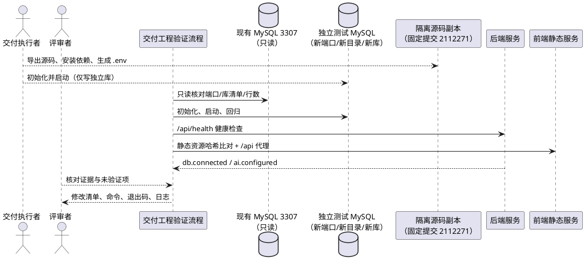
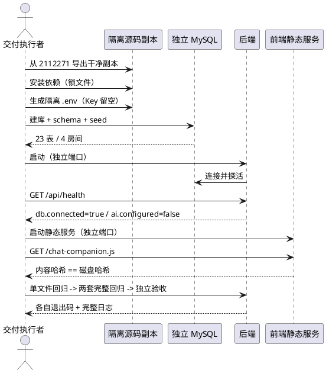
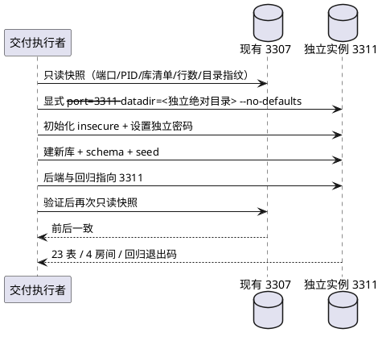
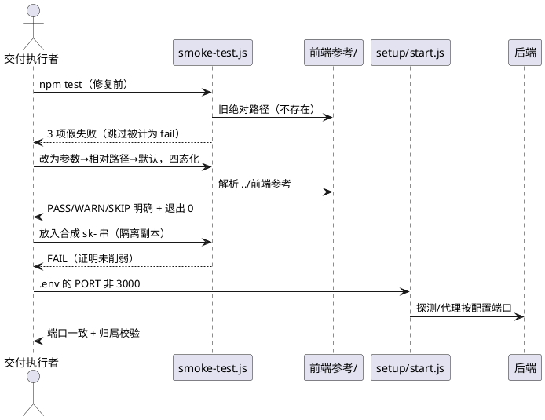
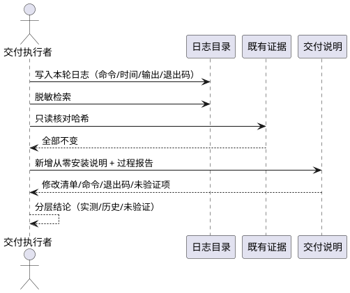

# 部署复现与交付工程收尾增量需求规格（deploy_repro_hardening）

> 文档类型：增量需求规格（EARS）
> 适用范围：从零安装、独立测试数据库、启动路径与历史静态检查器修复、交付说明与真实过程日志
> 关联基线：Git HEAD `2112271db26b34a557719afc60a77b91557ee624`（Codex 独立验收通过并固定的版本），工作区 `git status --short` 为空
> 继承基线（必须只读，不得回退）：
> - `.codeartsdoer/specs/guest_context_hardening/spec.md`（R9 本页匿名上下文归属与隔离边界）、`design.md`、`tasks.md`
> - `.codeartsdoer/specs/identity_guest_hardening/spec.md`（R7 身份核验绑定、R8 游客匿名临时聊天与登录失效隔离）、`design.md`、`tasks.md`
> - `.codeartsdoer/specs/ab_edge_hardening/spec.md`（R1–R6 A/B 边界收尾）、`design.md`、`tasks.md`
> 本轮依据：
> - `docs/2026-11-15_CodeArts补修验收通过.md`（Codex 独立验收通过，固定提交 2112271）
> - `docs/codearts_proof/2026-11-15-游客上下文归属修复.md`（CodeArts 上一轮过程记录）
> - `README.md`、`docs/README.md`、`docs/交接说明.md`、`docs/本地运行说明.md`、`docs/前置安装指南.md`、`docs/参赛核心验证报告.md`
> - `后端源码/package.json`、`后端源码/.env.example`、`后端源码/src/config/index.js`、`后端源码/src/db/index.js`、`后端源码/src/app.js`、`后端源码/scripts/smoke-test.js`、`后端源码/scripts/check-frontend.js`、`后端源码/scripts/check-pages-runtime.js`、`后端源码/scripts/test-all.sh`、`setup/install.js`、`setup/start.js`
> - `前端参考/README.md`、`后端源码/sql/schema.sql`、`后端源码/sql/seed.sql`
> 状态：待用户评审。本文件只定义“做什么、怎样算对、什么算失败”，不含实现补丁，不修改任何代码、测试、配置或文档，不执行安装、启动或测试命令

---

# 1. 组件定位

## 1.1 核心职责

本组件负责把固定提交 2112271 的源码在隔离目录与隔离测试库中从零装起来、跑通两套完整回归，并把启动路径与历史静态检查器的错误配置修到“可复现、可核查”，不改变任何 A/B 陪伴功能行为。

## 1.2 核心输入

1. 固定提交：Git HEAD `2112271` 的源码树、提交时间与父提交关系。
2. 部署入口：`一键安装.bat` / `一键启动.bat`、`setup/install.js`、`setup/start.js`、`后端源码/package.json` 脚本、`后端源码/scripts/init-db.js`。
3. 配置模板：`后端源码/.env.example` 的键名与默认值；现有 `后端源码/.env` 的**键名与是否设置**（不读取值）。
4. 数据库资源：现有 3307 实例（只读核对）、`后端源码/sql/schema.sql`（23 张表）、`sql/seed.sql`（初始房间）。
5. 历史检查器：`npm test` 指向的 `scripts/smoke-test.js`，以及 `check-frontend.js`、`check-pages-runtime.js`、`test-all.sh`、`test-api-*.js` 的路径与契约假设。
6. 既有证据：`docs/review/**`、`docs/codearts_proof/**`、Codex 验收报告与两套完整回归日志。
7. 约束指令：独立目录、独立库、不打印凭证、不配置真实模型、不提交不推送。

## 1.3 核心输出

1. 隔离环境报告：导出目录路径、Node/MySQL 版本、依赖安装结果、`.env` 键名与 `configured` 状态。
2. 独立测试实例：新端口、新数据目录、新库名的实例身份信息与初始化结果（23 表 + 4 房间）。
3. 启动证据：后端健康检查 JSON 摘要（`db.connected`、`ai.configured`）、前端静态资源哈希一致性、端口归属。
4. 回归证据：单文件、`test:competition`、`test:merge24`、独立验收脚本的命令原文、退出码与完整日志。
5. 修复清单：启动路径与静态检查器的文件级差异、修复前后哈希、检查项守恒证明。
6. 交付说明：从零安装文档、真实过程记录、未验证项清单。
7. 非输出（禁止产生）：任何业务行为变更、任何对现有库的写入、任何真实凭证回显、任何“未执行却写通过”的结论。

## 1.4 职责边界

**本组件负责：**

1. 在隔离目录复现“从零安装 → 初始化 → 启动 → 两套回归”的完整链路。
2. 建立与现有 3307 完全分离的测试数据库，并证明现有库未被改动。
3. 定位并修复启动路径配置与历史静态检查器的**错误配置**（路径、工作目录、端口、依赖假设）。
4. 补齐可复现安装说明与真实过程日志，区分本轮实测与历史复验。

**本组件不负责（本轮非目标）：**

1. 不新增、不改变 A/B 陪伴功能行为；不修改 R1–R9 的任何可观察语义。
2. 不重写前端业务逻辑，不改 `chat.html`、`chat-companion.js`、`chat-session.js`、`api.js`、`chat-companion.css`。
3. 不改后端业务路由、HTTP 契约、状态码、鉴权、`remember` 语义、数据库结构。
4. 不配置真实模型：`DEEPSEEK_API_KEY` 保持未设置或占位；不得把本地规则回复描述为真实模型效果。
5. 不提交、不推送、不执行 `git reset --hard`、`git checkout .`、`git clean`、`git add` 之外的破坏性操作。
6. 不覆盖、不改写既有 `docs/review/**`、`docs/codearts_proof/**`、Codex 验收报告与历史失败日志。
7. 不做真实模型质量、真实用户数据、公开上线认证、手机硬件或多实例部署验证。

---

# 2. 领域术语

**固定提交（fixed commit）**
: 指 `2112271db26b34a557719afc60a77b91557ee624`，即 Codex 独立验收通过后固定的本地功能版本。

**隔离目录（isolated checkout）**
: 指与现有工作区 `D:\微光同行\Glimmer` 分离、由固定提交导出的干净源码副本；其中不含 `node_modules`、不含 `.env`、不含运行时上传文件。

**独立测试实例（isolated test instance）**
: 指使用独立端口、独立数据目录、独立库名启动的 MySQL 实例，与现有 3307 实例在进程、端口、数据目录、库名四个维度均不相同。

**现有实例（existing instance）**
: 指当前监听 `127.0.0.1:3307` 的 MySQL 服务（PID 39896，程序 `D:\mysql\bin\mysqld.exe`），及其承载的既有数据库；本轮只允许只读核对。

**启动路径配置（startup path configuration）**
: 指安装与启动脚本中关于源码目录、前端目录、后端端口、MySQL 端口、mysqld 路径、工作目录的假设与取值方式。

**历史静态检查器（legacy static checker）**
: 指仓库内不依赖数据库的旧检查脚本，包括 `scripts/smoke-test.js`（`npm test` 入口）、`check-frontend.js`、`check-pages-runtime.js`，以及 `test-api-*.js` 中对前端全局 `API` 对象的契约断言。

**检查项守恒（check-item conservation）**
: 指修复前后检查器执行的检查条目数量不减少、判定条件不放宽；只允许改变“路径来源”和“不可用时的归类”。

**跳过（SKIP）**
: 指因前置资源缺失而未执行的检查项；它既不是通过（PASS），也不得伪装成失败（FAIL）。

**环境阻塞（environment blocked）**
: 指因本机网络、端口、权限、依赖下载等外部条件导致命令无法执行或无法完成；必须记录原始错误与退出码，不得标记为通过。

**脱敏（redaction）**
: 指日志、截图、报告中不出现 token、`Authorization`、数据库密码、JWT 密钥、模型 Key、真实手机号与真实用户内容；`.env` 只记录键名与 `configured` 布尔值。

---

# 3. 角色与边界

## 3.1 核心角色

交付执行者：在本机执行导出、安装、初始化、启动与回归，并记录真实命令与退出码。

评审者：核对规格、修复边界、证据真实性与未验证项，决定是否接受本轮收尾。

后续接手者：按新增的从零安装说明在新目录/新机器复现，不需要口头补充。

## 3.2 外部系统

Git：提供固定提交 2112271 的源码树与状态，用于导出与哈希核对。

Node.js / npm：提供运行时与依赖安装；本机为 Node 24.22.0、npm 11.19.1，要求 ≥18。

MySQL：现有 3307 实例（只读）与待新建的独立测试实例（读写，仅限独立库）。

前端静态服务：`setup/start.js` 托管 `前端参考/` 并把 `/api`、`/uploads` 代理到后端。

模型服务：本轮不接入；`ai.configured=false` 是必须保留的事实。

## 3.3 交互上下文

图中不展示脚本内部函数、SQL 语句细节或具体凭证；只表达“现有库只读、独立库读写、证据可核查”的边界。

---

# 4. DFX 约束

## 4.1 性能

1. 历史静态检查器必须保持纯本地静态检查：不得新增网络请求、不得连接数据库、不得因检查而启动服务。
2. 单次 `npm test`（`smoke-test.js`）在本机的完成时间应当可测量并记录；若超过 120 秒，必须记录原因，不得静默超时。
3. 从零安装的依赖安装与数据库初始化必须各自有明确的完成判据，不得以“等待一段时间”代替判据。

## 4.2 可靠性

1. 安装与初始化必须幂等：同一独立库重复执行 `init-db.js` 不得报错、不得产生重复房间或重复演示数据。
2. 任何一步失败必须保留原始错误与退出码，不得继续把后续步骤描述为成功。
3. 独立实例启动失败时不得留下“半初始化”目录并宣称为已完成；必须记录目录状态。
4. 一次完整回归必须由单条命令产生单一退出码；禁止把分段运行拼接成“一次完整通过”。

## 4.3 安全性

1. `.env` 只允许读取键名与“是否设置”，不得读取、回显、日志化任何值。
2. 日志、截图、报告中禁止出现数据库密码、JWT 密钥、`DEEPSEEK_API_KEY`、token、`Authorization`、真实手机号。
3. 独立测试实例必须仅监听 `127.0.0.1`，不得监听 `0.0.0.0` 暴露到局域网。
4. 禁止对现有库执行 `DROP`、`TRUNCATE`、`ALTER`、`DELETE`、`UPDATE`、`INSERT`。
5. 禁止关闭 TLS 校验、禁止设置 `NODE_TLS_REJECT_UNAUTHORIZED=0` 来“修复”网络问题。

## 4.4 可维护性

1. 前端目录与后端端口的来源必须单一：优先命令行参数/环境变量，其次仓库内相对路径/`.env`，最后才是默认值。
2. 检查器必须明确区分 PASS / WARN / SKIP / FAIL 四态，不得用“返回字符串”隐式表达跳过。
3. 每条修复必须能对应到一个可复现的失败现象与一个可复现的通过判据。
4. 交付说明必须让“没有上下文的新人”按文档独立完成一次安装与启动。

## 4.5 兼容性

1. HTTP 契约（URL、方法、body 字段、状态码语义）保持不变。
2. `前端参考/` 的页面、脚本、样式与既有测试断言语义保持不变。
3. `sql/schema.sql`、`sql/seed.sql` 的建表与初始数据语义保持不变。
4. 现有 3307 实例的端口、数据目录、库名、认证方式保持不变。

---

# 5. 现状核对（本轮只读实测）

> 本章全部为本轮规格阶段的只读核对结果；未执行安装、启动、测试、数据库写入。凡涉及 `.env` 的，只读取键名与 `configured`。

## 5.1 Git 与固定提交

| 核对项 | 实测结果 | 判定 |
|---|---|---|
| `git rev-parse --show-toplevel` | `D:/微光同行/Glimmer` | 仓库根正确 |
| `git rev-parse HEAD` | `2112271db26b34a557719afc60a77b91557ee624` | **正是 2112271** |
| `git status --short` | 无输出 | 工作区干净，无未提交改动 |
| `git log -1` | `feat: complete companion memory and private diary flows with acceptance evidence`，2026-11-15 20:04:29 +0800 | 固定提交已包含规格、证据与测试 |
| 分支 | `main`（由提交记录与历史文档一致） | 未推送验证不在本轮范围 |

**结论：本轮起点就是验收通过并固定的版本，不存在“功能未固定”的前置风险。**

## 5.2 关键文件哈希与行数（本轮实测）

行数口径：换行符（`\n`）个数，与 Codex 报告与 CodeArts 上一轮报告一致。

| 文件 | 换行数 | SHA-256 | 与验收报告关系 |
|---|---:|---|---|
| `前端参考/chat-companion.js` | 1743 | `31C567E972B963BBCE63877728958DBD755890A1AFBA7456F924E781B3A22270` | **一致**（报告同值） |
| `后端源码/scripts/test-chat-companion-repair.test.js` | 1587 | `B08A6CFA336E021369F28B000A2E5CE288D3A45E2D14FE7F2AB3EDB41EE371B7` | **一致**（报告同值，68 条） |
| `前端参考/chat-session.js` | 76 | `BD5710B43AD63984E16485B813514F2572A40CE90A0803A68DC77B3CF6B1AF7C` | 未变，只读契约 |
| `前端参考/api.js` | 123 | `956755AB29F9CAD4A2A31B059C202CCF2E049B34823902346C57F4E84341A626` | 未变，只读契约 |
| `后端源码/package.json` | 29 | `7E0E9EB1450EE71D00FDDF8C6D3B3DD0A2573E07E66111EEB87F58BCEC2CEA04` | 未变 |
| `后端源码/scripts/smoke-test.js` | 433 | `D9E8EE7109285478F3B08C8D36654C892442B3B96A53101152E9A42B80CE2BDB` | 待修复对象 |
| `后端源码/src/db/index.js` | 115 | `0F01379225B46E4CC3AEF5260A14FE90097D970F660F03EE631AEA1B4081B1DD` | 未变，只读 |
| `后端源码/src/app.js` | 317 | `21835DF425EBB4D1D3C7B8A6CA02F1119C508F99515974A5A81E71263A5B790A` | 未变，只读 |
| `docs/review/2026-11-15-identity-guest/acceptance-boundaries.test.cjs` | 90 | `785BFB7AEEC0893F389652EF1F0BEB991DD570A4B4095A49D3FD3CA876E1098A` | 未变，独立验收入口 |

> 说明：用 `split(/\r?\n/)` 计数会比换行数多 1（末尾换行产生空项）。本规格统一用换行数，避免与报告产生“差 1 行”的伪差异。

## 5.3 现有运行实例（只读核对）

| 端口 | PID | 进程 | 命令行/关键事实 |
|---:|---:|---|---|
| 3000 | 47736 | `node` | `D:\Node.js\node.exe src/app.js`；与 3307 有 4 条 `ESTABLISHED` |
| 3307 | 39896 | `mysqld` | `D:/mysql/bin/mysqld.exe --no-defaults --basedir=D:/mysql --datadir=./mysql-data --port=3307 --bind-address=127.0.0.1 --mysqlx=OFF --console` |
| 3307 | — | — | `mysqld Ver 8.4.13 for Win64` |
| 8081 | 35644 | `node` | `D:\Node.js\node.exe setup/start.js --no-open --port 8081` |
| 8080 | 40112 | `python` | `C:\Users\huang\AppData\Local\Python\pythoncore-3.14-64\python.exe`，**不是本项目服务** |

**由此产生三个必须写入规格的事实：**

1. 现有后端正在使用现有 3307 库运行（有活跃连接），本轮任何“模拟干净环境”的操作都不得中断或改写这两个实例。
2. 8080 被非本项目进程占用，因此 Glimmer 前端实际在 8081；根 README 与安装指南中“默认打开 8080”的说法在本机不成立。
3. 现有 3307 的 `--datadir=./mysql-data` 是**相对路径**，其实际解析位置取决于启动时的工作目录；文档记录为 `D:\微光同行\.runtime\mysql-data`。
   **因此“数据目录指纹”必须先确认该进程的启动工作目录，不得直接假设绝对路径。**

## 5.4 `.env` 键名与配置状态（不读取值）

| 键名 | 是否设置 |
|---|---|
| `HOST` / `PORT` / `NODE_ENV` | configured=true |
| `DB_HOST` / `DB_PORT` / `DB_USER` / `DB_PASSWORD` / `DB_NAME` | configured=true |
| `JWT_SECRET` / `JWT_EXPIRES_IN` | configured=true |
| `DEEPSEEK_API_KEY` | **configured=false**（符合“不配置真实模型”） |
| `DEEPSEEK_API_URL` / `DEEPSEEK_MODEL` | configured=true（仅地址与模型名，非密钥） |
| `DEV_SMS_CODE` / `SMS_ENABLED` | configured=true |

结论：现有 `.env` 已具备启动条件，且真实模型 Key 未配置；本轮不得读取或改写它。

## 5.5 启动路径与历史静态检查器问题清单

### A. 文档错误（不影响运行，但会误导复现）

| 编号 | 位置 | 问题 | 影响 |
|---|---|---|---|
| A1 | `README.md` §六 方式 A 第 2 步 | 写“浏览器自动打开 `http://localhost:8080`” | 本机 8080 被 python 占用，实际为 8081；新人会误判“启动失败” |
| A2 | `docs/前置安装指南.md` §五 | 同上，示例输出写 `本机打开：http://localhost:8080` | 同上 |
| A3 | `docs/前置安装指南.md` §6.10 | 命令因 `\f` 转义渲染成 `node scriptsix-duplicate-nick.js` | 照抄必然报“找不到模块” |
| A4 | `后端源码/README.md` | 写“起在 3000”，未说明以 `.env` 的 `PORT` 为准 | 与 `setup/start.js` 硬编码 3000 叠加后产生错配 |
| A5 | `README.md` §七、`docs/参赛核心验证报告.md` §证据边界 | 已如实声明 `npm test` 旧路径问题“仍需修复”，但未给出修复后判据 | 披露正确，缺少可核查出口 |
| A6 | `docs/本地运行说明.md` §日志与检查 | 记录 `npm test` 曾“122 通过 / 5 警告 / 3 失败”，失败来自旧前端目录 | 这是历史基线，必须原样保留，不得改写成通过 |
| A7 | `后端源码/scripts/test-all.sh` 注释 | 仍写“转发到虚拟机”“Windows 上没有 node_modules”，实际 `run_on_vm` 已本地执行且 `node_modules` 存在 | 注释与实现不一致，易误导排错 |

### B. 脚本缺陷（会导致误判或风险）

| 编号 | 位置 | 问题 | 分类 |
|---|---|---|---|
| B1 | `scripts/smoke-test.js` L87/L308/L323/L346 | 硬编码 `D:/Study/Match/2026-2027.up/chat/前端八稿`；该目录不存在时，L308/L323/L346 返回普通字符串（无 `WARN:` 前缀）→ `check()` 记为 **fail** | 路径假设 + 跳过语义错误 |
| B2 | `scripts/check-frontend.js` L23 | 默认路径同一旧目录；且假设旧全局 `API` 对象（当前前端为 `api()`） | 路径假设 + 契约过时 |
| B3 | `scripts/check-pages-runtime.js` L30 | 默认路径为旧 `.../九稿` | 路径假设 |
| B4 | `scripts/test-api-*.js`（8 个文件） | 硬编码旧目录 + 断言 `window.API.*` | 真实契约变更，**不得靠改断言修复** |
| B5 | `setup/start.js` L31 | `BACKEND_PORT = 3000` 硬编码，不读 `.env` 的 `PORT`；健康检查与代理均固定 3000 | 端口假设 |
| B6 | `setup/start.js` L240-305 | 3000 已被占用时直接打印“后端在运行（3000）”，不校验占用进程的工作目录/仓库归属/版本 | 复用校验缺失（会把旧目录后端当成本次版本） |
| B7 | `setup/start.js` L62-64 | `MYSQL_HOME` + 固定版本目录 `mysql-8.0.28-winx64`；本机实际为 `D:\mysql\bin`（无版本子目录） | 环境假设（端口已开时不触发） |
| B8 | `setup/start.js` L321 | `if (!NO_OPEN === false) { }` 为空块死代码 | 整洁性问题，无行为影响 |
| B9 | `setup/install.js` L383-431 | `usePrivateInstance()` 默认 `PRIVATE_PORT=3307`；若该端口实例可用**空密码**登录，会对该实例执行 `ALTER USER root ... BY <随机密码>` | **高危**：可能改动现有实例认证 |
| B10 | `setup/install.js` L250-271 | `startMysql` 未传 `--no-defaults`，可能读取 `D:\mysql` 下的 `my.ini` 覆盖端口/数据目录；现有实例是显式 `--no-defaults` | 配置来源不确定 |
| B11 | `.gitignore` L13-14 | `**/*.log` 使新增 `.log` 默认不被跟踪（历史 `.log` 是强制加入的） | 交付遗漏风险 |
| B12 | `setup/install.js` L43-49 | 默认下载 `mysql-8.0.28-winx64.zip` 到 `D:\mysql`；本机不存在该版本目录 | 从零安装会依赖网络 222MB 下载 |

### C. 环境差异（不是代码缺陷，但影响判据）

| 编号 | 事实 | 对验证的影响 |
|---|---|---|
| C1 | Node 24.22.0（要求 ≥18） | 满足，但必须在报告中记录实际版本 |
| C2 | MySQL 8.4.13，程序在 `D:\mysql\bin` | 与脚本假设的 `D:\mysql\mysql-8.0.28-winx64` 不同 |
| C3 | 8080 被 python 占用 | 前端必落到 8081 或更高；“8080 通过”不能作为判据 |
| C4 | 现有 3307 的 `--datadir` 为相对路径 `./mysql-data` | 数据目录指纹必须结合启动工作目录解析 |
| C5 | `setup/install.js` 的独立实例默认端口 3307 | 与现有实例撞端口，不能直接用于“独立测试库” |

## 5.6 `npm test` 失败的静态判定

`npm test` = `node scripts/smoke-test.js`（纯静态检查，不连库）。按代码静态核对，在旧前端目录不存在时至少 3 项必然 fail：

1. `★ 前端目录里没有明文 API Key（这条最重要）` → 返回 `（找不到前端目录，跳过）`，无 `WARN:` 前缀 → fail。
2. `前端没有直接请求第三方大模型接口` → 返回 `（跳过）` → fail。
3. `前端目录还在（顺手确认路径没写错）` → 返回模板字符串 → fail。

其余检查项（必需文件、package.json、SQL 结构、切分逻辑、路由挂载、shell 换行符）与前端目录无关，应通过。

**这与 `docs/本地运行说明.md` 记录的“3 失败”完全吻合，互为交叉验证。** 但本轮未执行，实施阶段必须以真实日志确认，不得以静态推断代替实测。

同时需登记：`smoke-test.js` L51 把 `.env.example`、`.gitignore` 列为必需文件，二者当前存在；`.env` 不在必需清单内，因此“从零安装必须生成 `.env`”是启动判据而非静态检查判据。

---

# 6. 核心能力

> 以下四条为 EARS 增量规格。每条规则固定包含：前置条件、可观察行为、失败/阻塞路径、证据输出、非目标、验收条件。
> 编号 R10–R13 与 R1–R9 不重叠：R10–R13 **不改变**任何 A/B 功能行为，只约束部署复现与交付工程。

## 6.1 R10 · 可复现安装与启动

### 6.1.1 业务规则

1. **R10.1 隔离目录导出**
   当开始从零安装验证时，系统应当从固定提交导出一个干净源码副本到与现有工作区隔离的目录，且不得在现有工作区内执行覆盖安装或删除依赖。
   - 前置条件：`git rev-parse HEAD` 为 `2112271`；现有工作区状态已登记。
   - 可观察行为：隔离目录存在；其中无 `node_modules`、无 `后端源码/.env`、无运行时上传文件；关键文件 SHA-256 与 5.2 表一致。
   - 失败/阻塞路径：若导出失败、哈希不一致或目录内混入依赖，应中止并记录原因，不得继续安装。
   - 证据输出：导出命令原文、退出码、目录树摘要、关键文件哈希。
   - 非目标：不在现有工作区执行 `npm install`、不删除现有 `node_modules`、不改现有 `.env`。
   a. 验收条件：[执行导出] → [隔离目录存在；关键文件哈希一致；现有工作区 `git status --short` 仍无输出]。

2. **R10.2 版本前置核对**
   当开始安装时，系统应当记录 Node 与 MySQL 的实际版本，并据“Node ≥18、MySQL 8.x”判定是否可继续。
   - 前置条件：隔离目录已就绪。
   - 可观察行为：报告中出现 `node -v`、`npm -v`、`mysqld --version` 的真实输出与版本判定。
   - 失败/阻塞路径：版本不满足时应标“环境阻塞”并停止，不得用其他机器结果替代。
   - 证据输出：版本命令原文、退出码、版本字符串。
   - 非目标：不升级、不降级、不修改系统环境变量。
   a. 验收条件：[Node 24.22.0 与 MySQL 8.4.13] → [判定“满足”，并在报告登记实际版本]。

3. **R10.3 依赖可复现安装**
   当安装依赖时，系统应当使用锁文件进行可复现安装，并以退出码 0 作为唯一成功判据。
   - 前置条件：隔离目录存在 `package-lock.json`。
   - 可观察行为：安装完成；`node_modules` 存在；依赖树无缺失。
   - 失败/阻塞路径：网络或镜像失败时保留原始 stderr 与退出码，标“环境阻塞”；不得把现有工作区的 `node_modules` 复制或软链进隔离目录冒充从零安装。
   - 证据输出：安装命令、退出码、包数量、耗时。
   - 非目标：不升级依赖大版本；不因 Multer 1.x 弃用告警而改锁文件。
   a. 验收条件：[在隔离目录执行锁文件安装] → [退出 0；`node_modules` 存在；`npm ls --depth=0` 无 missing]。

4. **R10.4 配置生成与凭证零读取**
   当生成配置文件时，系统应当只从模板生成隔离副本的 `.env`，填入指向独立测试库的连接项，并保持 `DEEPSEEK_API_KEY` 未设置或占位。
   - 前置条件：`.env.example` 存在且键名完整。
   - 可观察行为：新 `.env` 键名齐全；`DB_PORT` 指向独立实例；`DEEPSEEK_API_KEY` 为空或占位；报告只出现键名与 `configured` 布尔。
   - 失败/阻塞路径：若模板缺键或需要读取现有 `.env` 的值，应中止并标“待确认”，不得猜测或复制真实值。
   - 证据输出：键名清单、`configured` 表、`.env` 文件的 SHA-256（不输出内容）。
   - 非目标：不读取、不打印、不复制任何现有凭证；不配置真实模型。
   a. 验收条件：[生成隔离 `.env`] → [`DEEPSEEK_API_KEY` configured=false；`DB_PORT` 为独立端口；报告无任何值]。

5. **R10.5 数据库初始化判据**
   当初始化独立数据库时，系统应当执行既有 `schema.sql` 与 `seed.sql`，并以“23 张表 + 4 个房间 + 退出 0”作为成功判据。
   - 前置条件：独立实例可连接；目标库名与现有库不同。
   - 可观察行为：`SHOW TABLES` 返回 23 张表；`chat_rooms` 返回 4 个房间；重复执行仍退出 0。
   - 失败/阻塞路径：任一语句失败应中止并打印失败语句摘要与错误；不得跳过失败语句继续。
   - 证据输出：初始化命令、退出码、表清单、房间清单、重复执行结果。
   - 非目标：不改 `schema.sql`/`seed.sql`；不对现有库执行任何语句。
   a. 验收条件：[在独立库执行初始化两次] → [两次退出 0；表 23 张；房间 4 个；无重复]。

6. **R10.6 后端独立启动与健康判据**
   当启动后端时，系统应当使用隔离目录与独立 `.env` 启动，并以健康接口返回 `db.connected=true`、`ai.configured=false` 作为成功判据。
   - 前置条件：依赖已安装、独立库已初始化、后端端口空闲。
   - 可观察行为：后端监听在配置端口；`/api/health` 返回 `code:0`；数据库连接指向独立实例；模型为未配置。
   - 失败/阻塞路径：端口被占时改用其他端口并记录，不得 kill 现有 3000/8081 进程；数据库连不上时应输出真实错误并标“未通过”。
   - 证据输出：启动命令、端口、健康检查 JSON 摘要（脱敏）、退出/停止方式。
   - 非目标：不占用、不重启、不替换现有 3000 后端。
   a. 验收条件：[启动隔离后端] → [`db.connected=true`、`ai.configured=false`、端口为本次指定值且不是现有 3000]。

7. **R10.7 前端启动与静态一致性**
   当启动前端时，系统应当以静态服务托管 `前端参考/`，并证明提供的 `chat-companion.js` 与磁盘文件哈希一致，且 `/api/health` 代理可达。
   - 前置条件：后端已启动；前端端口空闲。
   - 可观察行为：页面可访问；静态资源哈希一致；代理健康检查返回与后端一致的结果。
   - 失败/阻塞路径：若哈希不一致，应判定“非本工作区实例”并中止浏览器结论；端口冲突时顺延并记录。
   - 证据输出：静态服务命令、实际端口、哈希比对结果、代理健康摘要。
   - 非目标：不改前端页面与业务脚本；不改 `setup/start.js` 的代理路径规则。
   a. 验收条件：[启动隔离前端] → [`/chat-companion.js` 哈希等于隔离目录磁盘哈希；`/api/health` 可达且 `db.connected=true`]。

8. **R10.8 两套完整回归与独立验收**
   当执行回归时，系统应当逐条执行单文件回归、`test:competition`、`test:merge24` 与独立验收脚本，并逐条记录命令、退出码与完整日志。
   - 前置条件：隔离后端与独立库可用；`.env` 指向独立库。
   - 可观察行为：四条命令各自的退出码与测试计数；`acceptance-boundaries.test.cjs` 4/4；两套完整回归退出 0。
   - 失败/阻塞路径：任一条非 0 时保留原文并定位为“断言失败/环境阻塞/配置错误”，不得用分段结果拼接成通过，也不得删除或跳过用例。
   - 证据输出：四条命令原文、退出码、完整 stdout/stderr、日志路径。
   - 非目标：不修改测试断言语义；不新增/删除 `EDGE-*` 用例；不改业务源码。
   a. 验收条件：[逐条执行四条命令] → [各自产生单一退出码并归档；任一非 0 时明确归类且不写“通过”]。

9. **R10.9 结果真实性分层**
   当编写结果报告时，系统应当把结论分为“本轮实测”“Codex 历史复验”“未验证/环境阻塞”三类，并逐条标注来源。
   - 前置条件：所有命令已执行或明确未执行。
   - 可观察行为：报告中的每个通过结论都能对应到本轮的日志与退出码；历史结果单独成段。
   - 失败/阻塞路径：不得把历史退出 0 写成本轮通过；不得把静态推断写成实测。
   - 证据输出：分层表格 + 日志索引。
   - 非目标：不改写 Codex 报告与历史失败日志。
   a. 验收条件：[阅读报告] → [任一“通过”均可追溯到本轮日志；无来源结论为零]。

### 6.1.2 交互流程

### 6.1.3 异常场景

1. **导出目录被污染**
   a. 触发条件：隔离目录中已存在 `node_modules` 或 `.env`。
   b. 系统行为：中止本轮验证，改用新的空目录重新导出；不得删除旧目录中的数据“凑干净”。
   c. 用户感知：报告写明污染项与重新导出的新路径。

2. **依赖安装失败**
   a. 触发条件：网络、镜像、代理或锁文件导致安装非 0。
   b. 系统行为：保留原始错误；不复制现有依赖；标“环境阻塞”。
   c. 用户感知：明确“未完成从零安装”，不宣称可复现。

3. **独立库初始化中断**
   a. 触发条件：SQL 执行中途失败。
   b. 系统行为：停止后续步骤，保留已建表清单与失败语句摘要；不得对现有库执行补救。
   c. 用户感知：明确“初始化未完成”与失败位置。

4. **后端端口冲突**
   a. 触发条件：指定端口已被占用（可能正是现有 3000）。
   b. 系统行为：改用其他端口并记录实际端口；不得停止占用进程。
   c. 用户感知：报告中出现“实际端口与本机现有实例不同”的明确说明。

5. **前端静态资源与磁盘不一致**
   a. 触发条件：静态服务托管的不是隔离目录，或缓存了旧文件。
   b. 系统行为：判定“非本次实例”，中止浏览器结论；核对服务进程工作目录。
   c. 用户感知：明确“页面可用不代表本次源码生效”。

6. **完整回归被数据库阻塞**
   a. 触发条件：数据库不可达或指向错误实例（如误连现有库）。
   b. 系统行为：保留原始 `ECONNREFUSED`/认证错误；标“环境阻塞”；核对 `.env` 指向。
   c. 用户感知：明确未取得退出 0，不写“通过”。

---

## 6.2 R11 · 独立测试环境与数据隔离

### 6.2.1 业务规则

1. **R11.1 四维隔离**
   当建立测试数据库时，系统应当在新端口、新数据目录、新库名、新进程四个维度与现有 3307 实例分离。
   - 前置条件：已只读登记现有实例的端口、PID、数据目录、库名。
   - 可观察行为：独立实例 `SELECT @@port`、`SELECT @@datadir` 与现有实例不同；PID 不同；库名不同。
   - 失败/阻塞路径：任一项与现有实例相同，应判定“未隔离”并停止写入。
   - 证据输出：两侧 `@@port`、`@@datadir`、PID、库清单对照表。
   - 非目标：不改现有实例的端口、数据目录或认证方式。
   a. 验收条件：[启动独立实例并查询] → [`@@port≠3307`、`@@datadir` 不在现有数据目录内、PID 不同、库名不同]。

2. **R11.2 新端口选择**
   当选择独立端口时，系统应当选用现有实例与前端端口之外的空闲端口，并在启动前证明该端口无人监听。
   - 前置条件：已核对 3306/3307/3000/8080/8081 的占用。
   - 可观察行为：端口探测无监听；启动后仅该实例监听该端口；监听地址为 `127.0.0.1`。
   - 失败/阻塞路径：端口被占时顺延并在报告中记录最终端口；不得复用 3307。
   - 证据输出：`netstat -ano` 前后对照、最终端口、监听地址。
   - 非目标：不关闭、不迁移任何现有监听进程。
   a. 验收条件：[选择 3311 并启动] → [启动前 3311 无监听；启动后 3311 由新 PID 监听且 `bind-address=127.0.0.1`]。

3. **R11.3 现有库零写入证明**
   当完成一轮验证时，系统应当以只读快照证明现有库未被写入。
   - 前置条件：验证前已记录快照。
   - 可观察行为：库清单、关键表行数、`.env` 哈希、数据目录文件数与总字节在验证前后一致。
   - 失败/阻塞路径：任一项变化即判定“污染现有库”，立即停止并如实报告；不得用“可能是正常业务写入”解释。
   - 证据输出：前后快照对照表 + 差异为零的结论。
   - 非目标：不对现有库执行 `COUNT` 以外的查询；不读取业务内容。
   a. 验收条件：[验证前后比对] → [`SHOW DATABASES` 一致；`users`/`diaries`/`ai_messages`/`ai_diary_drafts` 等行数一致；现有 `.env` SHA-256 一致；数据目录指纹一致]。

4. **R11.4 禁止借道现有实例初始化**
   当启动独立实例时，系统应当显式指定端口与数据目录，禁止走会探测或修改 3307 的默认路径。
   - 前置条件：已确认 `setup/install.js` 的 `usePrivateInstance()` 默认端口为 3307，且空密码可登录时会 `ALTER USER`。
   - 可观察行为：独立实例的启动命令包含显式 `--port` 与 `--datadir`；不含探测 3307 的分支；不使用默认 `--force-private`。
   - 失败/阻塞路径：若只能通过 `install.js` 建立实例，必须显式传入已确认空闲的 `--private-port`，并先证明该端口空闲、`data-<port>` 不存在；否则中止。
   - 证据输出：逐字命令、端口空闲证明、目录不存在证明。
   - 非目标：不修改 `install.js` 以“绕开”该风险而不留证据；不依赖“现有 3307 应该有空密码”的偶然性。
   a. 验收条件：[查看启动命令] → [显式端口+显式绝对数据目录+`--no-defaults`；3307 未被作为初始化目标]。

5. **R11.5 破坏性语句全局禁止**
   当验证期间执行任何 SQL 时，系统应当只对独立库使用建表与种子语句，禁止对任何库执行 `DROP`/`TRUNCATE`。
   - 前置条件：`schema.sql`、`seed.sql` 已核对为无 `DROP`/`TRUNCATE`（本轮实测：无匹配）。
   - 可观察行为：全部 SQL 日志中无 `DROP`/`TRUNCATE`；测试夹具清理仅限独立库的按 ID 删除。
   - 失败/阻塞路径：如需清理，只允许对独立库执行精确条件删除，并记录条件与影响行数。
   - 证据输出：SQL 日志检索结果、清理语句与影响行数。
   - 非目标：不清理现有库任何数据；不执行 `ALTER` 改现有表。
   a. 验收条件：[检索全部本轮 SQL 日志] → [`DROP`/`TRUNCATE` 命中为 0]。

6. **R11.6 独立库内的测试数据边界**
   当回归产生测试数据时，系统应当保证数据只落在独立库，并在结束后说明清理范围。
   - 前置条件：后端与回归均指向独立库。
   - 可观察行为：测试账号与会话只在独立库可见；现有库中同名账号数量不变。
   - 失败/阻塞路径：若发现写入现有库，立即停止并报告，不得继续后续用例。
   - 证据输出：两侧同名账号/记录计数对照、清理清单。
   - 非目标：不删除现有库中的任何演示账号或真实数据。
   a. 验收条件：[运行两套回归后比对] → [现有库关键表行数不变；独立库产生测试数据并可精确清理]。

### 6.2.2 交互流程

### 6.2.3 异常场景

1. **误用现有 3307 初始化**
   a. 触发条件：未显式指定端口/目录，`install.js` 默认落到 3307。
   b. 系统行为：立即中止；若已执行任何语句，逐条登记并评估影响；不得继续。
   c. 用户感知：明确“隔离失败”，并给出未受影响/受影响的核查结果。

2. **独立实例端口被占**
   a. 触发条件：3311 已被其他进程监听。
   b. 系统行为：顺延到下一空闲端口，记录最终端口；不 kill 占用进程。
   c. 用户感知：报告中出现最终端口与顺延原因。

3. **数据目录已存在**
   a. 触发条件：目标数据目录中已有 `mysql` 子目录。
   b. 系统行为：中止并要求人工确认；不得复用、不得清空。
   c. 用户感知：明确“目录已存在，拒绝复用”。

4. **现有实例在验证期间发生写入**
   a. 触发条件：前后快照出现差异。
   b. 系统行为：停止验证，定位差异表与时间窗口；区分“本轮操作”与“外部正常业务”。
   c. 用户感知：如实报告差异，不宣称“零影响”。

---

## 6.3 R12 · 历史静态检查器与启动路径修复

### 6.3.1 业务规则

1. **R12.1 失败项逐条定位**
   当 `npm test` 非 0 时，系统应当逐条给出“文件:行号 → 原因分类 → 判定”，原因分类限定为：路径假设、工作目录假设、端口假设、依赖假设、真实缺陷。
   - 前置条件：已真实执行 `npm test` 并保存完整日志（本轮规格阶段不执行）。
   - 可观察行为：定位表覆盖全部失败项；每一项可被日志行号复现。
   - 失败/阻塞路径：无法归类时标“待确认”，不得笼统归为“环境问题”。
   - 证据输出：定位表 + 日志摘录（含行号）。
   - 非目标：不以“旧脚本本来就这样”豁免定位。
   a. 验收条件：[执行 `npm test`] → [每条失败都有文件:行号与分类；无“未知原因”]。

2. **R12.2 前端目录来源单一化**
   当检查器需要前端目录时，系统应当按“命令行参数/环境变量 → 仓库内相对路径 `../前端参考` → 默认值”的顺序解析，不再硬编码旧项目绝对路径。
   - 前置条件：`前端参考/` 位于仓库根并与 `后端源码/` 同级。
   - 可观察行为：在仓库内无参数运行可定位到 `前端参考/`；显式传参仍生效；报告中打印实际解析路径。
   - 失败/阻塞路径：解析失败时应打印尝试过的路径，便于复现。
   - 证据输出：实际解析路径、传参与不传参两种运行结果。
   - 非目标：不移除参数覆盖能力；不改变检查内容。
   a. 验收条件：[在 `后端源码` 执行 `npm test`] → [报告显示解析到 `<仓库根>/前端参考`；3 项旧路径失败消失]。

3. **R12.3 跳过语义四态化**
   当检查所依赖的目录不存在时，系统应当输出 SKIP 并计入“跳过”，不得计入 PASS，也不得因返回普通字符串而计为 FAIL；当目录存在时，必须执行原断言。
   - 前置条件：检查器已有 PASS/WARN/FAIL 计数。
   - 可观察行为：目录缺失时汇总出现“跳过 N”；目录存在时安全检查实际执行并可被反向用例触发失败。
   - 失败/阻塞路径：若无法区分“目录不存在”与“检查通过”，判定实现不合格。
   - 证据输出：两种场景下的汇总输出。
   - 非目标：不得把“目录存在但检查失败”改为 SKIP。
   a. 验收条件：[临时把前端目录改名] → [对应项计入 SKIP，汇总退出码语义明确]；[恢复目录] → [安全检查实际执行]。

4. **R12.4 检查项守恒**
   当完成检查器修复时，系统应当证明检查项数量未减少、断言条件未放宽。
   - 前置条件：已保存修复前检查项清单。
   - 可观察行为：修复前后检查项名称清单 diff 仅允许“路径来源”和“跳过归类”两类变化；总数不减少。
   - 失败/阻塞路径：若发现删除检查项或降低断言，判定修复不合格并回退。
   - 证据输出：检查项清单 diff、总数对照、受影响项说明。
   - 非目标：不以“让命令变绿”为目标；不以注释掉检查项换取退出 0。
   a. 验收条件：[对比修复前后清单] → [检查项总数不减少；无断言条件放宽；差异仅限两类]。

5. **R12.5 安全检查反向验证**
   当证明前端明文密钥检查未被削弱时，系统应当在隔离副本中放入一个合成的 `sk-` 测试串，运行检查器并确认其失败，随后删除该测试串并确认恢复通过。
   - 前置条件：操作仅在隔离副本内进行。
   - 可观察行为：放入合成串 → 检查器 FAIL 且指向该文件；删除后 → 恢复 PASS。
   - 失败/阻塞路径：若放入合成串仍 PASS，判定检查已失效，修复不合格。
   - 证据输出：两次运行的输出与退出码、合成串已删除的证明。
   - 非目标：不在现有工作区放入任何测试串；不提交合成串。
   a. 验收条件：[隔离副本放入 `sk-` 合成串] → [检查器 FAIL]；[删除后] → [恢复 PASS]。

6. **R12.6 后端端口以配置为准**
   当启动器启动或探测后端时，系统应当从 `.env` 的 `PORT` 读取后端端口，并用于健康检查与 `/api`、`/uploads` 代理。
   - 前置条件：`.env` 存在且含 `PORT`。
   - 可观察行为：`.env` 改端口后，启动器探测与代理目标同步变化；日志打印实际后端端口。
   - 失败/阻塞路径：`.env` 缺失时应提示先安装，不得回落到硬编码而不告知。
   - 证据输出：不同 `PORT` 下的探测/代理目标日志。
   - 非目标：不改后端业务代码；不改 `.env.example` 语义。
   a. 验收条件：[把隔离 `.env` 的 `PORT` 设为非 3000] → [启动器探测与代理均指向该端口并成功]。

7. **R12.7 同端口实例归属校验**
   当目标后端端口已被占用时，系统应当校验该进程是否属于当前仓库（例如进程命令行/工作目录/健康实例标识），不得直接宣告“后端已启动”。
   - 前置条件：可获取端口占用进程信息。
   - 可观察行为：端口被其他目录实例占用时，输出“端口被非本次源码实例占用”并给出处理建议；属于本仓库时正常复用。
   - 失败/阻塞路径：无法判定归属时，不得宣称成功，应提示人工核对。
   - 证据输出：PID、命令行、判定结果、建议命令。
   - 非目标：不 kill 占用进程；不要求后端新增实例标识接口。
   a. 验收条件：[用其他目录的后端占用目标端口] → [启动器不打印“后端已启动”，而是明确冲突]。

8. **R12.8 MySQL 程序定位可配置**
   当 MySQL 端口未监听时，系统应当支持通过参数/环境变量指定 `mysqld` 路径与 `basedir`；找不到时明确报错，不静默猜测版本目录。
   - 前置条件：本机 `mysqld` 位于 `D:\mysql\bin`，脚本默认假设 `D:\mysql\mysql-8.0.28-winx64\bin`。
   - 可观察行为：显式指定路径后可启动；未指定且默认不存在时给出“找不到 mysqld，请指定”的明确提示。
   - 失败/阻塞路径：不得触发 222MB 下载而不提示。
   - 证据输出：路径解析日志、失败提示、成功启动日志。
   - 非目标：不改变安装器默认下载行为（除提示外）。
   a. 验收条件：[不指定路径且默认目录不存在] → [明确报错并给出指定方式]；[显式指定] → [正常启动]。

9. **R12.9 契约过时脚本只标注不篡改**
   当历史脚本断言的是旧全局 `API` 对象或旧页面路径时，系统应当标记其为“历史脚本已过时”，说明替代入口，禁止通过修改断言使其“通过”。
   - 前置条件：`api.js` 已改为 `api()`，不再导出 `window.API`。
   - 可观察行为：文档/报告中明确列出 `test-api-*.js` 与 `check-frontend.js` 的过时点及替代验证入口（`test:competition`、`test:merge24`、独立验收脚本）。
   - 失败/阻塞路径：若把这些脚本纳入 `npm test` 门禁，必须先恢复契约或明确降级，不得改断言。
   - 证据输出：脚本清单、过时原因、替代入口。
   - 非目标：不改 `api.js` 去恢复旧全局对象。
   a. 验收条件：[查看说明] → [每个过时脚本都有原因与替代入口；无断言被改写]。

10. **R12.10 修复边界清单**
    当实施修复时，系统应当只改动允许清单内的文件，并逐文件给出前后哈希。
    - 前置条件：允许清单已确认（见第 10 章）。
    - 可观察行为：修改清单中不出现业务路由、SQL、前端业务页面、既有测试断言、既有证据。
    - 失败/阻塞路径：若修复必须触碰禁止清单，应停下并提交用户确认。
    - 证据输出：允许/禁止清单、修改清单与哈希、`git status` 变化。
    - 非目标：不顺手重构、不批量格式化、不调整无关注释。
    a. 验收条件：[核对修改清单] → [全部落在允许清单；禁止清单哈希不变]。

### 6.3.2 交互流程

### 6.3.3 异常场景

1. **修复后检查项变少**
   a. 触发条件：清单 diff 出现删除项。
   b. 系统行为：回退该改动，重新按“守恒”要求修复。
   c. 用户感知：明确“检查项被删除，修复不合格”。

2. **跳过被当成通过**
   a. 触发条件：目录不存在但仍计入 pass。
   b. 系统行为：判定四态实现错误，修正计数与输出。
   c. 用户感知：汇总中出现“跳过 N”，不再出现“全部通过”。

3. **`.env` 缺失导致启动器误判**
   a. 触发条件：未生成 `.env` 就启动。
   b. 系统行为：提示先安装并退出 1，不猜测端口。
   c. 用户感知：明确缺失项与下一步。

4. **端口被非本仓库实例占用**
   a. 触发条件：3000 上是其他目录/旧版本后端。
   b. 系统行为：输出冲突与进程信息，不宣告成功。
   c. 用户感知：知道“页面能开”不等于“本次源码生效”。

5. **MySQL 路径不存在**
   a. 触发条件：默认版本目录缺失且端口未开。
   b. 系统行为：明确报错并给出指定方式，不静默下载。
   c. 用户感知：按提示指定 `D:\mysql\bin`。

---

## 6.4 R13 · 交付说明与真实日志

### 6.4.1 业务规则

1. **R13.1 从零安装说明可独立执行**
   当编写交付说明时，系统应当提供一份可让新人独立完成的“从零安装与启动”文档，包含版本前置、命令、成功/失败判据、常见阻塞。
   - 前置条件：本轮实测命令与退出码已归档。
   - 可观察行为：文档中的每条命令都能对应本轮真实执行记录；步骤顺序与依赖关系明确；端口以实际输出为准。
   - 失败/阻塞路径：未实测的步骤必须标“待验证”，不得写成确定结论。
   - 证据输出：文档路径、章节清单、与日志的对应关系。
   - 非目标：不复制旧文档中未验证的结论（如“8080 一定可用”）。
   a. 验收条件：[按文档从零执行] → [每一步都有明确判据；未验证项有标注]。

2. **R13.2 日志命名与内容规范**
   当保存过程日志时，系统应当使用统一命名并包含命令、开始时间、完整 stdout/stderr、退出码。
   - 前置条件：每步执行前确定阶段名。
   - 可观察行为：日志文件名可检索（如 `2026-11-15-deploy-<stage>`）；文件末尾出现 `EXIT_CODE=<n>`；命令原文在文件顶部。
   - 失败/阻塞路径：若输出过大，保留完整文件并在报告中给出关键片段与行号，不得只留摘要。
   - 证据输出：日志清单、每份日志的命令与退出码索引。
   - 非目标：不改写、不覆盖既有日志。
   a. 验收条件：[检查日志] → [每份含命令、时间、完整输出、退出码；命名不与既有文件冲突]。

3. **R13.3 忽略规则事实登记**
   当新增日志时，系统应当检查 `.gitignore` 是否会影响交付，并如实登记；不得擅自修改 `.gitignore` 放宽规则。
   - 前置条件：`.gitignore` 含 `*.log` 与 `**/*.log`。
   - 可观察行为：报告中说明“新增 `.log` 默认不被跟踪”，并给出交付方式（改用 `.txt` 或经用户确认后强制添加）。
   - 失败/阻塞路径：若未登记，可能造成“本地有日志、交付包没有”。
   - 证据输出：`git check-ignore -v` 的实际输出。
   - 非目标：不改 `.gitignore`；不 `git add`。
   a. 验收条件：[执行 `git check-ignore -v <新增日志>`] → [命中 `**/*.log` 并在报告中登记]。

4. **R13.4 脱敏检查**
   当归档日志、截图、报告时，系统应当执行敏感信息检索，确保不含凭证、token、真实手机号。
   - 前置条件：已生成全部证据。
   - 可观察行为：检索 `password`、`Bearer`、`sk-`、`JWT_SECRET=`、真实手机号等关键词，命中为 0 或已脱敏。
   - 失败/阻塞路径：命中真实值时立即删除该证据并重新生成，不得“只打码一部分”。
   - 证据输出：检索命令、命中数、脱敏说明。
   - 非目标：不检索、不读取现有 `.env` 的值。
   a. 验收条件：[检索本轮全部新增证据] → [真实凭证/真实手机号命中为 0]。

5. **R13.5 既有证据只读**
   当新增过程记录时，系统应当写入新文件，不覆盖任何既有报告、日志、截图与失败记录。
   - 前置条件：已列出现有 `docs/review/**`、`docs/codearts_proof/**` 文件清单与哈希。
   - 可观察行为：新增文件命名唯一；既有文件哈希不变；历史 `ENETUNREACH` 与 `EXIT_CODE=1` 原文仍可检索。
   - 失败/阻塞路径：若必须修改既有文件，应停下并提交用户确认。
   - 证据输出：新增文件清单、既有文件哈希前后对照。
   - 非目标：不重命名、不移动既有证据；不“整理”历史日志。
   a. 验收条件：[对比哈希] → [既有证据全部不变；新增文件可识别]。

6. **R13.6 交付清单完整性**
   当结束本轮时，系统应当输出修改清单（文件、前后哈希、行数）、执行命令与退出码、未验证项、Git 状态与 HEAD。
   - 前置条件：全部步骤已执行或明确未执行。
   - 可观察行为：清单可直接复核；每条命令可复制执行；未验证项有阻塞原因。
   - 失败/阻塞路径：缺项时标明“缺失”，不得留空或凭记忆补写。
   - 证据输出：交付清单文档或报告章节。
   - 非目标：不包含真实凭证、不包含未脱敏截图。
   a. 验收条件：[阅读交付清单] → [修改/命令/退出码/未验证/Git 五类信息齐全]。

7. **R13.7 不得以未执行充通过**
   当某项无法执行时，系统应当标注“未验证/环境阻塞”并给出原因与已尝试的命令。
   - 前置条件：命令已尝试或明确因约束未尝试。
   - 可观察行为：结论区不出现该项的“通过”；阻塞项有原始错误。
   - 失败/阻塞路径：若把静态推断、历史结果或“应该可以”写成通过，判定本轮交付不合格。
   - 证据输出：未验证项表格 + 原因 + 原始错误。
   - 非目标：不为了“全绿”而关闭安全校验、改端口或跳过用例。
   a. 验收条件：[检索结论] → [任一未验证项均标注“未验证/环境阻塞”，无“通过”字样]。

### 6.4.2 交互流程

### 6.4.3 异常场景

1. **日志被 `.gitignore` 忽略**
   a. 触发条件：新增 `.log` 未进入版本控制。
   b. 系统行为：登记该事实；按用户确认改用 `.txt` 或强制添加。
   c. 用户感知：明确“日志在本地 vs 在交付包”的差异。

2. **证据含敏感值**
   a. 触发条件：脱敏检索命中。
   b. 系统行为：删除并重新生成；不得保留命中文件。
   c. 用户感知：报告写明“已重新生成，旧文件已删除”。

3. **覆盖了既有证据**
   a. 触发条件：文件名冲突或误写。
   b. 系统行为：立即停止；从备份/版本控制恢复；在报告中登记事故。
   c. 用户感知：明确“既有证据被改动”及恢复结果。

4. **未验证项被写成通过**
   a. 触发条件：结论与证据不一致。
   b. 系统行为：改为“未验证/环境阻塞”。
   c. 用户感知：结论与证据一一对应。

---

# 7. 数据约束

> 本章只描述逻辑约束与可核查字段，不定义数据库物理结构。

## 7.1 独立测试实例

1. **实例端口**：必须与现有 3307 不同，且启动前经 `netstat` 证明空闲；建议 3311（3308/3310 依赖历史脚本默认值，易混淆）。
2. **实例数据目录**：必须为独立绝对路径（如 `D:\微光同行\_deploy_repro\mysql-data-3311`），不得位于现有数据目录内，不得按相对路径解析。
3. **实例库名**：必须与现有库名不同（建议 `peizhe_deploy_20261115`），且初始化前不存在。
4. **监听地址**：必须是 `127.0.0.1`，不得 `0.0.0.0`。
5. **认证方式**：独立实例使用独立随机 root 密码，仅写入隔离副本 `.env`。

## 7.2 隔离配置

1. **键名完整性**：新 `.env` 必须包含 `.env.example` 的全部键；缺失即判初始化不完整。
2. **连接项**：`DB_HOST=127.0.0.1`、`DB_PORT` 为独立端口、`DB_NAME` 为独立库名。
3. **模型项**：`DEEPSEEK_API_KEY` 必须为空或占位；`DEEPSEEK_API_URL`、`DEEPSEEK_MODEL` 可保留模板默认值。
4. **凭证不落日志**：`DB_PASSWORD`、`JWT_SECRET`、`DEEPSEEK_API_KEY` 的值禁止进入任何新增日志、截图、报告。
5. **文件指纹**：现有 `.env` 只允许计算 SHA-256 用于前后比对，不得输出内容。

## 7.3 检查器四态计数

1. **PASS**：检查实际执行且满足条件。
2. **WARN**：检查实际执行，发现非阻断问题。
3. **SKIP**：因前置资源缺失未执行；不得计入 PASS，也不得计入 FAIL。
4. **FAIL**：检查实际执行且不满足条件，或抛出异常。
5. **退出码语义**：存在 FAIL → 非 0；仅 WARN/SKIP → 退出码必须显式定义并在文档说明，不得含糊。

## 7.4 证据文件

1. **命名**：`2026-11-15-deploy-<stage>.<ext>`，`<stage>` ∈ {export, version, install, env, db-init, backend, frontend, unit, competition, merge24, acceptance, surface, cleanup}。
2. **必备字段**：命令原文、工作目录、开始时间、退出码、完整输出。
3. **哈希**：修改文件必须给出前后 SHA-256 与换行数。
4. **脱敏状态**：每份证据标注“已脱敏”与检索命中数。

---

# 8. 从零安装最小步骤与判据

> 以下是实施阶段必须执行的步骤与判据；本轮规格阶段**未执行**任何一条。

| 步骤 | 命令（隔离目录内） | 成功判据 | 失败/阻塞判据 | 建议证据名 |
|---|---|---|---|---|
| S1 导出 | `git archive 2112271 \| tar -x -C <隔离目录>` 或等价导出 | 目录存在；无 `node_modules`/`.env`/上传文件；9 个关键文件哈希一致 | 哈希不一致或混入依赖 → 中止 | `deploy-export` |
| S2 版本 | `node -v` / `npm -v` / `<mysqld> --version` | Node ≥18（实测 24.22.0）；MySQL 8.x（实测 8.4.13） | 版本不足 → 环境阻塞 | `deploy-version` |
| S3 依赖 | `npm ci`（`后端源码` 目录） | 退出 0；`node_modules` 存在；`npm ls --depth=0` 无 missing | 非 0 → 环境阻塞，禁止复制现有依赖 | `deploy-install` |
| S4 配置 | 复制 `.env.example` → `.env`，改 `DB_HOST/DB_PORT/DB_USER/DB_PASSWORD/DB_NAME` | 键名齐全；`DEEPSEEK_API_KEY` 空/占位；`DB_PORT`=独立端口 | 需读取现有值 → 停止并确认 | `deploy-env` |
| S5 初始化 | `node scripts/init-db.js`（`后端源码`） | 退出 0；23 表；4 房间；重复执行仍 0 | 任一语句失败 → 中止并打印语句摘要 | `deploy-db-init` |
| S6 后端 | `node src/app.js`（独立端口） | `/api/health`：`code:0`、`db.connected:true`、`ai.configured:false` | 端口冲突 → 换端口；连库失败 → 未通过 | `deploy-backend` |
| S7 前端 | `node setup/start.js --port <空闲> --no-open` | 页面 200；`/chat-companion.js` 哈希一致；`/api/health` 代理可达 | 哈希不一致 → 非本次实例，中止 | `deploy-frontend` |
| S8 单文件 | `node --test --test-timeout=5000 --test-reporter=spec scripts/test-chat-companion-repair.test.js` | 68/68；退出 0 | 非 0 → 记录失败用例 | `deploy-unit` |
| S9 竞赛回归 | `npm run test:competition` | 退出 0；137 Node + 18/71/66 | 非 0 → 归类断言/环境 | `deploy-competition` |
| S10 合并回归 | `npm run test:merge24` | 退出 0；23 Node + 13/3 | 非 0 → 归类断言/环境 | `deploy-merge24` |
| S11 独立验收 | `node --test --test-timeout=5000 --test-reporter=spec docs/review/2026-11-15-identity-guest/acceptance-boundaries.test.cjs` | 4/4；退出 0 | 非 0 → 记录失败项 | `deploy-acceptance` |
| S12 修改面 | 哈希 + 行数 + `git status` | 只允许清单内文件变化 | 出现禁止文件变化 → 回退 | `deploy-surface` |
| S13 脱敏 | 关键词检索 | 真实凭证/手机号命中 0 | 命中 → 删除重生成 | `deploy-redaction` |

**补充判据：**

1. `npm test`（`smoke-test.js`）必须单独执行一次，修复前后各一次，用于证明“3 失败 → 0 失败”且检查项守恒。
2. `.gitignore` 的影响必须单独登记（建议证据名 `deploy-gitignore`）。
3. 若 S3 或 S5 因网络/权限失败，S6–S11 不得标记为通过；只能标“未验证/环境阻塞”。

---

# 9. 独立测试数据库方案与“不覆盖”验证

## 9.1 推荐方案（方案 S）

| 维度 | 现有实例 | 独立测试实例（建议） |
|---|---|---|
| 端口 | 3307 | **3311**（启动前证明空闲） |
| 程序 | `D:\mysql\bin\mysqld.exe` | 复用同一程序（不下载 8.0.28） |
| 数据目录 | `./mysql-data`（相对，需按启动 cwd 解析） | **`D:\微光同行\_deploy_repro\mysql-data-3311`**（绝对） |
| 库名 | 既有库（`.env` 中 configured） | **`peizhe_deploy_20261115`** |
| 监听 | `127.0.0.1:3307` | `127.0.0.1:3311` |
| 启动参数 | `--no-defaults --basedir=D:/mysql --datadir=./mysql-data --port=3307 --bind-address=127.0.0.1 --mysqlx=OFF` | `--no-defaults --basedir=D:/mysql --datadir=<绝对目录> --port=3311 --bind-address=127.0.0.1 --mysqlx=OFF` |
| 初始化 | 已完成，只读 | `--initialize-insecure` 一次，随后设独立随机密码 |
| 访问方式 | 只读快照 | 读写（仅独立库） |

**选择理由：**

1. 3311 避开 3306/3307（现有）、3308/3310（历史脚本默认值），便于在日志中一眼区分。
2. 绝对数据目录消除“相对路径依赖启动 cwd”的风险（现有实例正暴露该风险）。
3. 复用本机 `D:\mysql\bin\mysqld.exe` 避免 222MB 下载，把“从零安装”的变量收敛到源码与依赖。
4. 显式 `--no-defaults` 避免 `D:\mysql\my.ini` 覆盖端口/目录。

**替代方案（若用户要求用 `setup/install.js`）：**

必须同时满足：
- `--force-private --private-port=3311`；
- 执行前 `netstat` 证明 3311 空闲；
- 执行前证明 `D:\mysql\data-3311` 不存在；
- 执行前对 3307 做**只读**负向验证（空密码不可登录），并在日志中记录“未触碰 3307”；
- `MYSQL_DIR` 指向独立目录（若允许），使数据目录完全脱离 `D:\mysql`。

不满足任一条，禁止执行（因 B9 风险：空密码可登录时会 `ALTER USER`）。

## 9.2 “不覆盖现有数据库”的验证方式

1. **端口与进程归属**
   - 前：`netstat -ano | findstr ":3307"` → PID 39896；`Get-CimInstance Win32_Process` → `D:/mysql/bin/mysqld.exe`。
   - 后：3307 的 PID 不变；3311 为新 PID；两者不重叠。

2. **实例身份**
   - 3307 与 3311 分别执行只读：`SELECT @@port, @@version, @@datadir, DATABASE();`
   - 判据：`@@port` 分别为 3307/3311；`@@datadir` 不同；版本可相同但路径不同。

3. **库清单与行数**
   - 前/后：`SHOW DATABASES;` 一致；对既有库关键表执行 `SELECT COUNT(*)`（`users`、`diaries`、`ai_messages`、`ai_diary_drafts`、`chat_messages`、`messages`）前后一致。
   - 只读原则：仅 `SHOW` 与 `SELECT`。

4. **配置文件指纹**
   - 前/后：现有 `后端源码/.env` 的 SHA-256 一致（不读值）。

5. **数据目录指纹**
   - 前/后：现有数据目录（按进程启动 cwd 解析后的绝对路径）的文件数与总字节一致；不读取文件内容。
   - 若无法解析 cwd，则登记“无法确定绝对路径”，并改用 3307 的 `@@datadir` 输出作为权威来源。

6. **测试数据归属**
   - 回归后：独立库出现测试账号/会话；既有库同名记录计数不变。
   - 清理：仅对独立库按精确 ID 删除，记录条件与影响行数。

## 9.3 明确禁止

1. 不执行 `DROP DATABASE` / `DROP TABLE` / `TRUNCATE`（任何库）。
2. 不对既有库执行 `ALTER`、`UPDATE`、`DELETE`、`INSERT`。
3. 不改现有 `.env` 的 `DB_PORT`/`DB_NAME` 指向。
4. 不复用 `D:\微光同行\.runtime\mysql-data`。
5. 不停止、不重启现有 3000/8081/3307 进程。
6. 不使用默认 `--force-private`（未显式指定端口）。
7. 不把独立实例监听为 `0.0.0.0`。

---

# 10. 修复边界（允许修改 / 禁止修改）

## 10.1 允许修改（仅实施阶段；本规格阶段不执行）

| 文件 | 允许改动范围 | 目的 |
|---|---|---|
| `后端源码/scripts/smoke-test.js` | 前端目录解析（参数/环境变量/相对路径）、跳过四态化、错误提示 | R12.2/R12.3/R12.4 |
| `后端源码/scripts/check-frontend.js` | 默认路径参数化/相对化（不改变检查内容） | R12.2 |
| `后端源码/scripts/check-pages-runtime.js` | 默认路径参数化/相对化 | R12.2 |
| `setup/start.js` | 后端端口读 `.env`；同端口归属校验；mysqld 路径可配置；清理死代码 | R12.6/R12.7/R12.8 |
| `setup/install.js` | 独立实例端口/目录显式化与安全前置校验；`--no-defaults`；下载前提示 | R11.4、B9/B10 |
| `README.md` | 快速开始端口表述、`npm test` 修复后判据、文档索引 | A1/A5/R13.1 |
| `docs/前置安装指南.md` | 修正 `\f` 转义命令；端口说明；从零安装判据 | A2/A3 |
| `后端源码/README.md` | 端口以 `.env` 为准；测试入口说明 | A4 |
| `docs/本地运行说明.md` | 追加本轮结论（不覆盖历史段落） | A6/R13.5 |
| `docs/` 新增文件 | 从零安装文档、过程报告 | R13.1/R13.6 |
| `docs/codearts_proof/` 新增文件 | 本轮日志/截图/报告 | R13.2/R13.5 |

## 10.2 禁止修改

1. `后端源码/src/**` 全部业务代码（路由、中间件、工具、配置读取逻辑）。
2. `后端源码/sql/schema.sql`、`sql/seed.sql`（表结构与初始数据契约）。
3. `前端参考/**` 全部页面、`api.js`、`chat-session.js`、`chat-companion.js`、`chat-companion.css`、`chat.html`。
4. `后端源码/scripts/test-chat-companion-repair.test.js` 的既有 68 条断言与 `class El {` 到 `const chatSuccess =` 的 harness。
5. `docs/review/**` 全部既有文件（含 `acceptance-boundaries.test.cjs`）。
6. 既有 `docs/codearts_proof/**` 报告、日志、截图、备份。
7. `docs/2026-11-15_CodeArts补修验收通过.md`、`docs/2026-11-15_CodeArts复验与待办.md`、`docs/参赛核心验证报告.md` 的历史结论段落。
8. `后端源码/package.json` 的脚本语义（`test:competition`、`test:merge24`、`npm test` 的组成）。
9. `后端源码/.env`（现有）的任何键与值。
10. `.gitignore` 的忽略规则（不得为纳入日志而放宽）。

## 10.3 修复后必须证明“未删除、未弱化”

1. 提供检查项清单（名称 + 判定条件）修复前后对照；总数不得减少。
2. 提供 `npm test` 修复前（3 失败）与修复后（0 失败）的完整日志与退出码。
3. 说明 3 项失败的消失原因是“路径来源修正 + 跳过归类修正”，不是删除检查。
4. 提供 `sk-` 合成串反向验证：放入 → FAIL；删除 → PASS。
5. 提供 `git diff --stat` 与逐文件哈希，证明禁止清单未变。
6. 若某项必须降级（例如旧 `window.API` 契约），必须单列为“历史脚本过时”，不得混入“修复通过”。

---

# 11. 正式验证项目与证据要求

## 11.1 本轮实测项（实施阶段必须真实执行）

| 编号 | 验证项 | 判据 | 证据 |
|---|---|---|---|
| V01 | 隔离目录导出 | 哈希一致、无依赖/配置 | `deploy-export` |
| V02 | Node/MySQL 版本 | Node ≥18、MySQL 8.x | `deploy-version` |
| V03 | 依赖安装 | 退出 0、无 missing | `deploy-install` |
| V04 | 隔离 `.env` | 键齐全、Key 未设置 | `deploy-env` |
| V05 | 独立库初始化 | 23 表 + 4 房间 + 幂等 | `deploy-db-init` |
| V06 | 后端健康 | `db.connected=true`、`ai.configured=false` | `deploy-backend` |
| V07 | 前端静态一致性 | 哈希一致、代理可达 | `deploy-frontend` |
| V08 | 单文件回归 | 68/68、退出 0 | `deploy-unit` |
| V09 | `test:competition` | 退出 0、137+18/71/66 | `deploy-competition` |
| V10 | `test:merge24` | 退出 0、23+13/3 | `deploy-merge24` |
| V11 | 独立验收脚本 | 4/4、退出 0 | `deploy-acceptance` |
| V12 | `npm test` 修复前 | 3 失败，定位表 | `deploy-smoke-before` |
| V13 | `npm test` 修复后 | 0 失败、检查项守恒 | `deploy-smoke-after` |
| V14 | 安全检查反向验证 | 合成串 FAIL / 删除后 PASS | `deploy-smoke-reverse` |
| V15 | 端口与归属 | 3311 独立、3000/8081/3307 未变 | `deploy-ports` |
| V16 | 现有库零写入 | 前后快照一致 | `deploy-db-guard` |
| V17 | 修改面 | 仅允许清单变化 | `deploy-surface` |
| V18 | 脱敏 | 真实凭证命中 0 | `deploy-redaction` |

## 11.2 Codex 历史复验项（只引用，不重跑）

| 项目 | 历史结论 | 本规格要求 |
|---|---|---|
| 两套完整回归 | 2026-11-15 退出 0（137+18/71/66；23+13/3） | 只作为“历史复验”引用，不标本轮通过 |
| 独立验收脚本 | 4/4 | 本轮必须复跑，历史值仅作对照 |
| 浏览器主流程 | 通过（游客三轮、四入口、刷新、退出换号等） | 本轮不重跑浏览器，标“未验证” |
| 真实模型 | `configured=false` | 保持未配置，不宣称模型效果 |

## 11.3 明确不在本轮范围（必须标“未验证”）

1. 真实 `DEEPSEEK_API_KEY` 配置与模型质量、延迟、忠实度。
2. 真实网络超时、跨设备登录、服务端 40100 的真实触发。
3. 手机硬件、系统键盘、真实移动端浏览器。
4. 多实例部署、共享锁与持久版本控制。
5. 公开上线认证、安全渗透测试、全站回归。
6. 393×852 视觉指标（本轮不涉及，不得沿用未复核结论）。

## 11.4 证据规格

1. **命名**：`docs/codearts_proof/logs/2026-11-15-deploy-<stage>.<ext>`；既有文件不覆盖。
2. **内容**：命令原文、工作目录、开始时间、完整输出、`EXIT_CODE=<n>`。
3. **截图**：仅“实例身份/健康检查/端口归属”类，必须脱敏；不伪造。
4. **哈希**：修改文件前后 SHA-256 + 换行数；关键文件与 5.2 表比对。
5. **索引**：报告中给出“验证项 → 日志文件 → 退出码”的映射表。
6. **忽略规则**：新增 `.log` 默认被 `.gitignore` 忽略（已实测命中 `**/*.log`），必须登记并说明交付方式。

---

# 12. 待确认问题

1. **独立库方案**：是否接受“新端口 3311 + 新数据目录 + 新库名 `peizhe_deploy_20261115`”的三重隔离？还是只要求新库名（同实例不同库）？
   *规格默认：三重隔离，因为同实例不同库仍可能与现有库共享实例风险。*
2. **临时目录位置**：是否允许在仓库外创建 `D:\微光同行\_deploy_repro\`（同盘、非仓库）？还是必须在仓库内隔离目录（如 `.deploy-repro/`）？
   *规格默认：仓库外，避免污染工作区与 Git 状态。*
3. **依赖安装**：是否允许在隔离目录执行 `npm ci`（约 143 包，需网络/镜像）？
   *规格默认：允许，因为“从零安装”必须有此步；失败则标环境阻塞。*
4. **MySQL 程序来源**：是否允许复用本机 `D:\mysql\bin\mysqld.exe`（8.4.13），而不下载脚本默认的 8.0.28？
   *规格默认：允许复用，并记录版本差异。*
5. **静态检查器修复范围**：
   - P0 必须修：`smoke-test.js`（`npm test` 入口）、`setup/start.js`（端口/归属）。
   - P1 建议修：`check-frontend.js`、`check-pages-runtime.js` 默认路径。
   - P2 只标注不修：`test-api-*.js` 的 `window.API` 契约。
   *规格默认按 P0/P1/P2 分层；请确认 P2 是否可以只标注。*
6. **交付说明位置**：新增文档放 `docs/从零安装与部署复现.md` 并在根 README 加一行索引，还是直接放根目录？
   *规格默认：`docs/` + 根 README 索引一行。*
7. **新增日志格式**：因 `**/*.log` 被忽略，是改用 `.txt` 交付，还是经确认后强制 `git add -f`（本轮不提交）？
   *规格默认：改用 `.txt` 或登记“本地日志不入库”，不改 `.gitignore`。*
8. **反向验证许可**：是否允许在隔离副本的 `前端参考/` 临时放入合成 `sk-` 串做安全检查反向验证（验证后删除）？
   *规格默认：允许，仅在隔离副本，且必须证明已删除。*
9. **是否允许临时启动独立前端端口（如 8090）**：现有 8080 被 python 占用、8081 被本项目占用。
   *规格默认：允许使用 8090，并记录实际端口。*
10. **浏览器验收是否纳入本轮**：本轮任务只说“部署复现与两套完整回归”，未提浏览器。
    *规格默认：不纳入；若需要，另立任务并明确执行者与时间窗口。*
11. **是否允许修改 `setup/install.js` 的默认端口**：把 `PRIVATE_PORT` 默认从 3307 改为“自动找空端口”会改变既有安装行为。
    *规格默认：不改默认值，只增加“显式端口/目录”与安全前置校验。*
12. **“独立目录”是否允许复用现有 `D:\mysql` 程序目录**：复用程序不等于复用数据。
    *规格默认：允许复用程序，禁止复用数据目录与配置。*

---

# 附录 A · 引用与证据索引

| 类别 | 路径 | 本轮用途 |
|---|---|---|
| Codex 验收报告 | `docs/2026-11-15_CodeArts补修验收通过.md` | 确认固定提交、哈希、下一步任务 |
| CodeArts 过程记录 | `docs/codearts_proof/2026-11-15-游客上下文归属修复.md` | 确认 R9 修改面与历史退出码 |
| 上一轮规格 | `.codeartsdoer/specs/guest_context_hardening/spec.md` | R9 语义与不可回退项 |
| 上一轮设计/任务 | `.codeartsdoer/specs/guest_context_hardening/design.md`、`tasks.md` | 实施边界与证据要求 |
| 更早规格 | `.codeartsdoer/specs/identity_guest_hardening/`、`.codeartsdoer/specs/ab_edge_hardening/` | R1–R8 保留项 |
| 安装入口 | `README.md`、`docs/前置安装指南.md`、`setup/install.js`、`setup/start.js` | 启动路径问题来源 |
| 运行事实 | `docs/本地运行说明.md` | 3307、8080/8081、`npm test` 历史失败 |
| 验证边界 | `docs/参赛核心验证报告.md` | “旧路径仍需修复”的既有披露 |
| 检查器 | `后端源码/scripts/smoke-test.js`、`check-frontend.js`、`check-pages-runtime.js`、`test-all.sh` | 路径/端口/契约假设 |
| 数据库 | `后端源码/sql/schema.sql`（23 表）、`seed.sql`（4 房间） | 初始化判据，无 `DROP`/`TRUNCATE` |
| 独立验收入口 | `docs/review/2026-11-15-identity-guest/acceptance-boundaries.test.cjs` | 4 项正确行为裁决 |
| 既有证据目录 | `docs/review/**`、`docs/codearts_proof/**` | 只读，不得覆盖 |

# 附录 B · 需求追溯表

| 本轮需求 | 来源 | 现状证据 | 成功判据 | 保留的既有能力 |
|---|---|---|---|---|
| R10 可复现安装与启动 | 验收报告“下一步 1”；用户原始请求 | README 方式 B；`setup/*`；`init-db.js` | S1–S13 全链路有退出码与日志 | R1–R9 行为不变 |
| R11 独立环境与数据隔离 | 用户硬约束 3；B9 风险 | 3307 PID 39896；相对 datadir；install.js 默认 3307 | 四维隔离 + 现有库前后快照一致 | 现有库与实例不被触碰 |
| R12 检查器与启动路径修复 | 用户硬约束 6；README §七；本地运行说明 | `smoke-test.js` 4 处旧路径；`start.js` 硬编码 3000 | 3 失败 → 0 失败且检查项守恒 | 不删检查项、不改断言 |
| R13 交付说明与真实日志 | 用户硬约束 9；偏好 4 | `.gitignore` 忽略 `.log`；既有证据目录 | 命令/退出码/日志/脱敏/未验证项齐全 | 既有证据不被覆盖 |

---

**规格结束。**