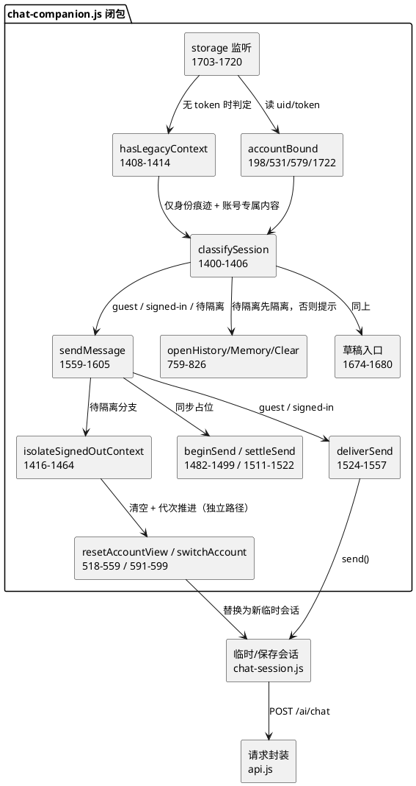
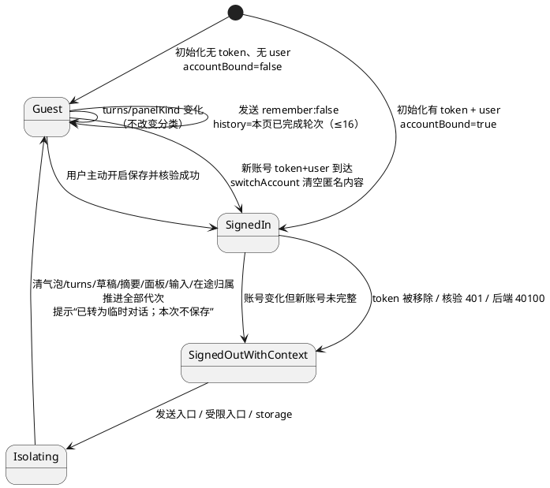
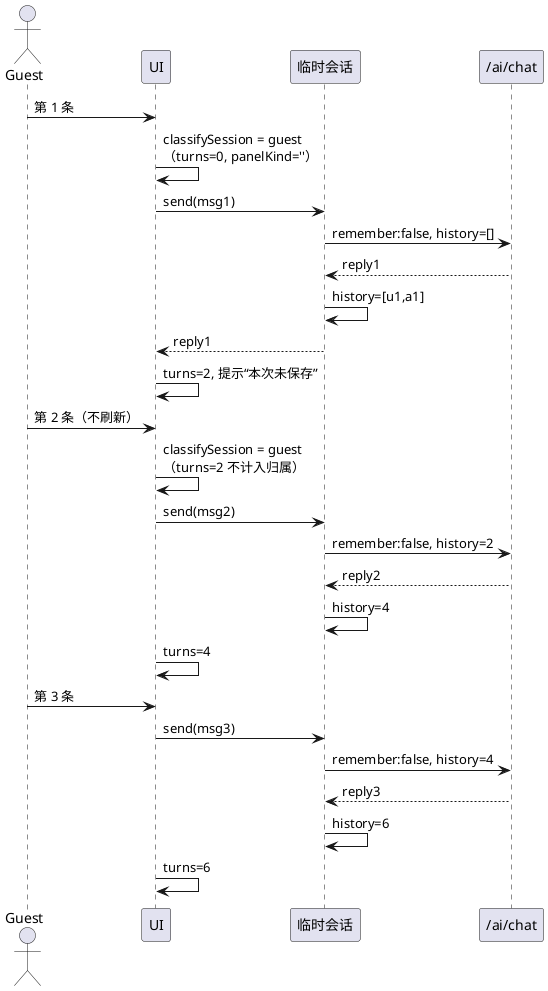
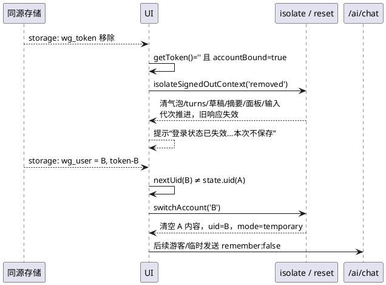
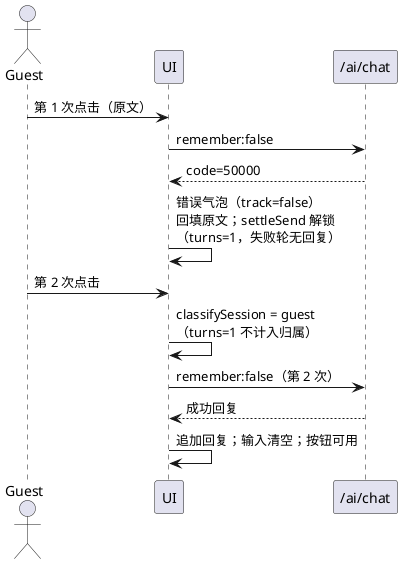
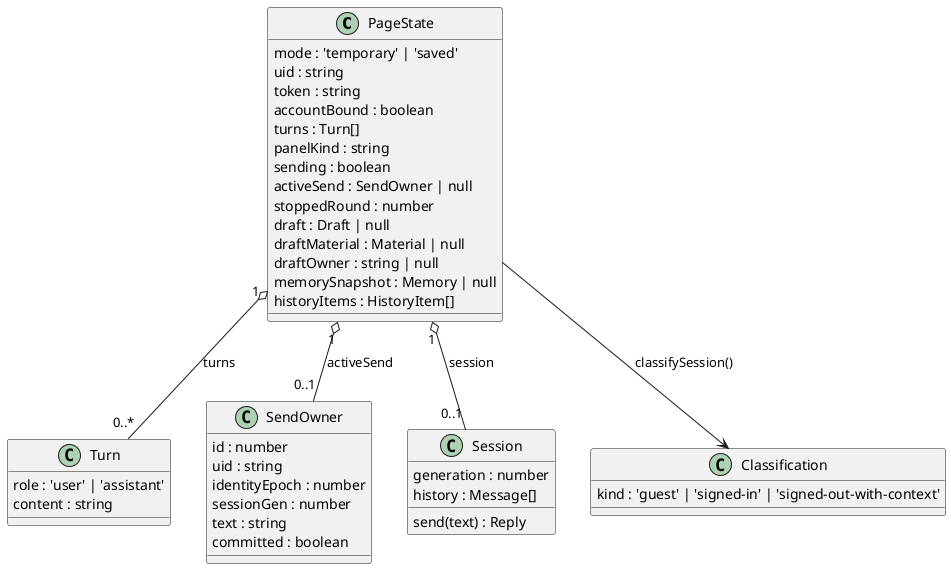

# 一、需求与存量功能关系分析

> 本文档只回答“怎么改、改哪里、如何证明”。不包含业务代码实现，不修改任何源码、测试或配置。
> 上游需求：`.codeartsdoer/specs/guest_context_hardening/spec.md`（R9 共 12 条业务规则 + 13 条 `EDGE-R9-*`）。
> 本轮设计阶段未执行任何测试命令；文中“修复前预期”来自需求规格、复验报告与当前代码的静态核对，实施阶段必须以真实红灯日志再确认。

## 1.0 本轮状态与基线核对

### 1.0.1 Git 实际状态（本轮实测）

| 项 | 实测值 | 说明 |
|---|---|---|
| 仓库根 | `D:\微光同行\Glimmer` | `git rev-parse --show-toplevel` 一致 |
| HEAD | `3086f720feaf03a9e6678ae53821e69bb8075ae7`（短哈希 `3086f72`） | 提交信息：`整理项目结构并上传完整源码与文档`；提交时间 2026-11-13 08:17:12 +0800 |
| 工作区变更 | 37 项：14 项已修改未提交（`M`）+ 23 项未跟踪（`??`） | 不存在“已提交的固定验收版本” |
| 关键未跟踪文件 | `前端参考/chat-companion.js`、`前端参考/chat-companion.css`、`后端源码/scripts/test-chat-companion-repair.test.js`、`后端源码/scripts/test-chat-companion.test.js`、`.codeartsdoer/`、`docs/review/`、`docs/codearts_proof/` | 本轮改动前仍为未跟踪状态 |
| 关键已修改文件 | `前端参考/chat-session.js`、`前端参考/chat.html`、`前端参考/index.html`、`后端源码/package.json` 等 | 属于 R1–R8 阶段遗留改动，本轮不得回退 |

**结论**：本轮不存在可回滚的提交基线。任何回滚必须依赖实施前建立的物理备份，禁止使用 `git reset --hard`、`git checkout .`、`git clean`。

### 1.0.2 关键文件哈希与规模（本轮只读实测）

| 文件 | 行数 | SHA-256（大写规范化） | 与既有记录 |
|---|---|---|---|
| `前端参考/chat-companion.js` | 1744（按换行计）/ 1745（按行切分，末行无换行） | `854EEB95CB6A9A4070F0C39C2F7705E3C01CFA0DF69C582E43C688FD839224B6` | 与复验报告、用户给定值、spec 1.2 一致 |
| `后端源码/scripts/test-chat-companion-repair.test.js` | 1383 / 1384 | `F3574FF05C56B7EE0D0704E3FE2D4B2C189E47AD84E7B6DD1419CCD0D6F02559` | 一致 |
| `前端参考/chat-session.js` | 77 | `BD5710B43AD63984E16485B813514F2572A40CE90A0803A68DC77B3CF6B1AF7C` | 只读契约 |
| `前端参考/api.js` | 123 | `956755AB29F9CAD4A2A31B059C202CCF2E049B34823902346C57F4E84341A626` | 只读契约 |
| `docs/review/2026-11-15-identity-guest/acceptance-boundaries.test.cjs` | 90 | `785BFB7AEEC0893F389652EF1F0BEB991DD570A4B4095A49D3FD3CA876E1098A` | 独立验收入口，只读 |

行号说明：`chat-companion.js` 使用编辑器行号（1–1745）引用；`wc -l` 结果为 1744，因为文件末尾无换行符，两者不矛盾。

### 1.0.3 证据现状与缺口（只读，不覆盖）

| 证据 | 现状 | 本轮用法 |
|---|---|---|
| `docs/review/2026-11-15-identity-guest/acceptance-boundaries.txt` | 4 项：F1 通过；G1/G2/G3 失败；退出 1。G1 实际 1 期望 2；G2 聊天区只剩“登录状态已失效，已转为临时对话；本次不保存”；G3 实际 1 期望 2 | 作为“修复前必须转绿”的独立裁决 |
| `guest-first.png`（34,044 字节）与 `guest-first-ax.txt` | 首轮正常：初始问候 + 用户消息 + “我在听。你愿意的话，可以慢慢说。”；状态区“本次未保存；临时对话刷新后清空” | 首轮行为基线 |
| `guest-second.png`（29,498 字节）与 `guest-second-ax.txt` | 第二轮后：聊天区只剩一条“登录状态已失效，已转为临时对话；本次不保存”，输入框为空，按钮存在但无输入 | 缺陷现象基线 |
| `docs/review/2026-11-15-identity-guest/competition.txt` / `merge24.txt` | 历史记录为 Codex 2026-11-15 独立运行，退出 0（124 项 Node + 18/71/66；23 项 Node + 13/3 组） | 只作为历史记录，不得表述为本轮实测 |
| `docs/codearts_proof/logs/2026-11-13-identity-guest-{competition,merge24}.log` | 原文含 `Sandbox Network Error: hit restricted [127.0.0.1:3307]`、`connect ENETUNREACH 127.0.0.1:3307`、`EXIT_CODE=1` | 必须原样保留，不得改写为通过 |
| `docs/codearts_proof/2026-11-13-身份核验与游客聊天加固.md` | **不存在**；目录中仅有 AB 边界、任务 A/B、首页入口五份报告 | 本轮报告需注明“上一轮指定报告缺失”，不得补写 |

---

## 1.1 需求功能与存量功能对比

### 1.1.1 已实现功能

| 需求功能 | 存量功能 | 代码位置 | 匹配度 |
|---|---|---|---|
| R9 规则 5·用例 R9-01 游客每轮以 `remember:false` 发送 | 临时会话固定 `remember:false`，请求体由会话对象生成 | `chat-session.js:33-35`；`chat-companion.js:1576-1579` | 100% |
| R9 规则 5·用例 R9-01 本页已完成上下文依次 0/2/4 条、最多 16 条 | 成功回复后追加 user/assistant 两条并截断最近 16 条 | `chat-session.js:35,47-53` | 100% |
| R9 规则 9·用例 R9-02 刷新后清空且不恢复 | 匿名上下文仅存在内存；初始化只读 `wg_user`/`wg_token`，不读历史/记忆 | `chat-companion.js:1692-1697` | 100% |
| R9 规则 7/8·用例 R9-04…08 受限入口显示“登录后才能…” | 四个入口均有游客提示分支 | `759-767`、`783-786`、`822-825`、`1678` | 75%（提示正确，前置误隔离） |
| R9 规则 10·用例 R9-10 真实退出登录隔离旧账号 | `storage` 无 token 且曾绑定 → 隔离；清空气泡/草稿/摘要/面板/输入/在途归属 | `1703-1720`、`1416-1464` | 100% |
| R9 规则 10·用例 R9-11 凭证移除（user 仍在）仍隔离 | `accountBound` 与身份痕迹保留在判据内 | `1722`、`1408-1414`、`1708-1710` | 100% |
| R9 规则 11·用例 R9-12 A/B 换号隔离 | 账号变化 → `switchAccount` → `resetAccountView` | `591-599`、`518-559` | 100% |
| R9 规则 10·用例 R9-13 游客双击只发一次 | `beginSend` 同步占位；`sendMessage` 顶部检查 `sending/activeSend` | `1482-1499`、`1560` | 100% |
| R8-07 旧账号迟到响应不落地 | `isSendCurrent` 校验 owner/session/generation/identityEpoch/uid | `1501-1509`、`1434-1435`、`1536` | 100% |
| R1/R2/R3 草稿、清除、读取归属 | 票据 + 代次 + 响应判定 | `483-511`、`893` 起 | 100% |
| R5/R6 关怀可见性与停止终态 | 面板内关怀渲染与 stopped 分支 | `235-250`、`660-674` | 100% |

### 1.1.2 需要扩展的功能

| 需求功能 | 存量功能 | 差异说明 | 扩展方向 |
|---|---|---|---|
| R9 规则 1/4·用例 R9-01/02/09 归属由来源决定 | `classifySession()` 依据 `getToken/currentUid/accountBound/hasLegacyContext` | `hasLegacyContext()` 把页面级通用状态 `turns.length`、`panelKind` 计入，导致游客第二轮被判 `signed-out-with-context` | **仅收窄 `hasLegacyContext()` 的组成**：移除 `turns.length` 与 `panelKind`，保留身份痕迹与账号专属内容 |
| R9 规则 6·用例 R9-03 失败重试必须真正请求 | `sendMessage` 在 `beginSend` 后分类，失败分支已释放锁并回填原文 | 失败尝试留下 1 条 user 轮次，重试时被 `turns.length` 误判为旧账号内容 | 同上；失败分支与锁逻辑不改 |
| R9 规则 7/8·用例 R9-04…08 受限入口不清空匿名对话 | 四个入口先 `classifySession()`，待隔离则 `isolateSignedOutContext` | 游客打开面板设置 `panelKind`，或已有 `turns`，会在“打开面板前”被隔离 | 同上；入口门禁顺序与文案不改 |
| R9 规则 4·用例 R9-09 面板打开状态不构成归属证据 | `openPanel` 设置 `state.panelKind` | `panelKind` 被 `hasLegacyContext` 计入 | 同上；不新增“面板打开时发送”的新逻辑，只靠判据收窄 |
| 可维护性 5.4.1（非 R9 规则编号）归属判据集中 | `requireSignedInFor()` 已定义但**无调用点**；四个入口各自内联判据 | 判据本身仍集中在 `classifySession/hasLegacyContext`，入口只是调用，不构成两套判据 | 本轮**不**把入口重构为 `requireSignedInFor`，避免扩大改动面；不删除该函数 |

### 1.1.3 需要新增的功能或接口

**不新增任何 HTTP 接口、不新增 `state` 字段、不新增持久化键。**

本轮新增的是“可观察契约”，全部由既有函数与既有字段体现：

| 编号 | 新增可观察契约 | 观察方式 |
|---|---|---|
| C1 | 无 token/无 user 时，`turns.length > 0` 不改变分类结果 | `/ai/chat` 请求计数；`state.turns.length` |
| C2 | 无 token/无 user 时，`panelKind` 为非空受限面板不改变分类结果 | 面板文本、请求计数、`state.panelKind` |
| C3 | 首条失败后再次点击发送产生第二次 `/ai/chat` | 请求计数与请求体 `remember` |
| C4 | 受限入口只产生本地提示，不产生受保护请求 | `/ai/messages`、`/ai/memory`、`/companion/*` 计数为 0 |
| C5 | 真实退出/换号/token 移除仍先隔离 | `state.uid/mode/turns/draft/memorySnapshot` 与聊天区文本 |

验证资产为 13 条 `EDGE-R9-*`，追加在正式测试文件末尾，不新增运行脚本。

---

## 1.2 存量功能详细分析

### 1.2.1 R9 缺陷根因与执行时序（本轮核对）

#### 根因链

1. `classifySession()`（`1400-1406`）：当 `getToken()` 为空时，只要 `state.accountBound || hasLegacyContext()` 为真，即返回 `signed-out-with-context`（`1404`）。
2. `hasLegacyContext()`（`1408-1414`）的组成（`1409-1412`）：
   - `state.uid`、`state.token`、`state.mode === 'saved'`；
   - `state.turns.length`；
   - `state.draft`、`state.memorySnapshot`、`state.historyItems.length`；
   - `state.panelKind`。
3. 其中 `state.turns.length` 与 `state.panelKind` 属于**页面级通用状态**：
   - `addBubble()`（`256-266`）在每轮成功回复时向 `state.turns` 追加 2 条；
   - `openPanel()`（`622-632`）把 `state.panelKind` 设为 `history`/`memory`/`clear`/`draft`。
4. 因此无 token 游客在第二轮、失败重试、打开受限入口时，均被判为“待隔离”。
5. `state.accountBound` 在初始化时由 `Boolean(state.uid && state.token)` 赋值（`1722`），并在 `resetAccountView`（`531`）与恢复保存成功（`579`）中维护；它才是“曾/仍绑定账号”的可信痕迹。
6. `switchAccount`（`591-599`）与 `storage` 监听（`1703-1720`）仍以 `accountBound || hasLegacyContext()` 或账号变化触发隔离，是真实退出/换号的既有安全路径。

#### 关键执行时序

**路径 A：游客不刷新发送第二条**

| 步骤 | 位置 | 行为 | 结果 |
|---|---|---|---|
| T0 | `1559-1562` | 点击“说”，读取并校验输入 | 输入非空 |
| T1 | `1567` → `1482-1499` | `beginSend()` 同步占位 | `activeSend=owner`、`sending=true`、按钮禁用 |
| T2 | `1570` → `1400-1406` | `classifySession()` | `token=''`、`uid=''`、`accountBound=false`，但 `turns.length=2` → `signed-out-with-context` |
| T3 | `1571-1572` → `1416-1464` | `isolateSignedOutContext('removed')` | 清 `turns`、`chatEl`、`inputEl`、`session`；`activeSend=null`；按钮恢复；追加失效气泡 |
| T4 | `1573` → `1511-1522` | `settleSend(owner)` | `state.activeSend !== owner`，只清理自身 typing，不解锁他人 |
| T5 | `1574` | 直接返回 | `/ai/chat` 计数保持 1 |

**路径 B：游客首条失败后重试**

| 步骤 | 位置 | 行为 | 结果 |
|---|---|---|---|
| T0 | `1524-1533` | 第一次 `deliverSend` 已追加 user 气泡 | `turns.length=1` |
| T1 | `1545-1556` | 失败：错误气泡 `track=false`、回填原文、`settleSend` | 输入恢复、按钮可用、错误气泡不入 `turns` |
| T2 | `1560` | 第二次点击通过发送锁检查 | 进入 `beginSend` |
| T3 | `1570-1575` | `turns.length=1` → 待隔离 | 隔离清空、**不发送**、总数仍为 1 |

**路径 C：游客聊天后打开历史**

| 步骤 | 位置 | 行为 | 结果 |
|---|---|---|---|
| T0 | `759-761` | `classifySession()` → 待隔离 → `isolateSignedOutContext` | 聊天被清空，追加失效气泡 |
| T1 | `762` | 再次分类（隔离后为 `guest`） | 继续打开面板 |
| T2 | `763-766` | 打开“历史对话”并提示“登录后才能查看历史对话” | 用户看到登录提示，但匿名对话已丢失 |

**路径 D：游客在面板打开状态下发送（`R9-09`）**

`openPanel` 设置 `panelKind='history'` → 下一次发送在 T2 被判待隔离。即使 `turns` 为空，仅 `panelKind` 也会触发。

#### 时序上的硬约束

`beginSend()` 在 `classifySession()` **之前**执行（`1567` 先于 `1570`）。因此：

1. 任何“在途动作”标志（`sending`、`activeSend`）都**不得**进入 `hasLegacyContext()`；否则游客首条发送即被隔离。
2. `identity_guest_hardening/design.md:502` 曾把 `state.activeSend !== null` 列为组成，但当前实现并未纳入（`1408-1414` 无此项）。本轮必须明确保持“不纳入”，防止后续按旧设计误加。
3. `hasLegacyContext()` 只允许由“来源”决定，不得由“正在发送”决定。

### 1.2.2 三层归属模型与 `state` 字段映射

| 层级 | 含义 | 现有字段 | 能否证明旧账号遗留 | 本轮处置 |
|---|---|---|---|---|
| 身份痕迹层 | 页面仍残留账号身份或保存模式 | `state.uid`（`183`）、`state.token`（`184`）、`state.mode`（`181`）、`state.accountBound`（`198`） | **能**。`accountBound` 表示“曾/仍绑定”，即使 token 被移除也保留为 `true` 直到隔离完成 | **保留为隔离依据** |
| 账号专属内容层 | 只能由需登录接口产生的业务结果 | `state.draft`（`190`）、`state.draftMaterial`（`200`）、`state.draftOwner`（`201`）、`state.memorySnapshot`（`196`）、`state.historyItems`（`187`） | **能**。游客受限入口不会产生这些结果 | **保留为隔离依据**（`draftMaterial/draftOwner` 不单独入判据，由 `draft` 覆盖） |
| 页面级通用层 | 游客与登录账号都会产生的界面状态 | `state.turns`（`186`）、`state.panelKind`（`204`）、`state.sending`（`185`）、`state.activeSend`（`206`）、`state.stoppedRound`（`208`）、`inputEl.value`、`session.history`（会话闭包内） | **不能**。游客合法产生 | **禁止单独作为隔离依据**；本轮从 `hasLegacyContext` 移除 `turns` 与 `panelKind`，并明确不纳入其余字段 |

**映射结论**：

- 旧账号遗留 = 身份痕迹层非空 **或** 账号专属内容层非空。
- 本页匿名上下文 = 身份痕迹层为空 **且** 账号专属内容层为空，无论页面级通用层取何值。
- 隔离触发点 = 凭证移除、账号切换、核验 401、后端 40100、受限入口检测到“待隔离”；**不得**由页面级通用层触发。

### 1.2.3 被误用字段与必须保留字段

| 字段 | 现状用途 | 游客是否合法产生 | 本轮处置 | 理由 |
|---|---|---|---|---|
| `state.turns.length` | 被 `hasLegacyContext` 当作旧账号证据（`1411`） | 是（每轮 +2） | **移除** | 页面级通用状态，误伤核心缺陷 |
| `state.panelKind` | 被当作旧账号证据（`1412`） | 是（受限入口打开即设置） | **移除** | 页面级通用状态，导致受限入口清空聊天 |
| `state.sending` / `state.activeSend` | 未在 `hasLegacyContext` 中 | 是 | **明确不纳入** | `beginSend` 先于分类执行；纳入会阻断首条 |
| `state.stoppedRound` | 未在 `hasLegacyContext` 中 | 游客路径不可达 | **明确不纳入** | 草稿停止标记，不属于归属证据 |
| `state.uid` | 身份痕迹 | 否（游客为 `''`） | **保留** | 防止 `accountBound` 维护遗漏时漏隔离 |
| `state.token` | 身份痕迹（页面绑定凭证） | 否 | **保留** | `getToken()` 已空但页面仍绑定旧凭证时，必须隔离 |
| `state.mode === 'saved'` | 保存模式 | 否（游客无法开启） | **保留** | 保存模式残留即账号痕迹 |
| `state.accountBound` | 曾/仍绑定账号 | 否 | **保留（在 `classifySession` 中使用）** | 真实退出/换号的主依据 |
| `state.draft` / `state.memorySnapshot` / `state.historyItems` | 账号专属内容 | 否 | **保留** | 只能由受保护接口产生 |
| `state.draftMaterial` / `state.draftOwner` | 草稿归属材料 | 否 | **不新增** | 与 `draft` 同生命周期，`draft` 已覆盖 |

### 1.2.4 既有 55 条测试与 harness 契约

| 项 | 事实 | 约束 |
|---|---|---|
| 用例构成 | 17 条 `P1/P2/B`/`normal confirm`；19 条 `EDGE-R1-01…R6-03`；19 条 `EDGE-R7-01…09`、`EDGE-R8-01…10` | 不得删除、不得改期望、不得重编号 |
| 文件锚点 | `class El {` 在第 13 行；`const chatSuccess =` 在第 119 行 | 新增用例只能追加在文件末尾（第 1384 行之后） |
| 切片机制 | 独立脚本取 `source.slice(source.indexOf('class El {'), source.indexOf('const chatSuccess ='))`，再用 `new Function('fs','vm','ROOT', fixture + 'return { setup, deferred, flush };')` 加载 | **第 13–118 行之间的任何增删改都会改变独立脚本行为** |
| harness 语义 | `setup(request, {user, token, saved})` 默认 `user={uid:'A'}`、`token='token-A'`；游客必须显式传 `{user:{}, token:''}` | 不得改变默认值与返回结构 |
| 既有断言依赖 | `state.uid/mode/turns/sending/memorySnapshot/draft/draftStatus/panelKind/historyItems`、`calls`、`nodes.chat`、`nodes['cc-panel-body']`、按钮文案 | 字段名、类型、按钮文案保持 |
| 门禁 | `R9` 修改后 55 条必须全部通过；13 条新增应与既有 `R8-04/05/06/08/09/10` 并存 | 重叠是刻意的防回归门禁，不得合并或删除 |

### 1.2.5 受保护的只读契约

| 文件/契约 | 关键事实 | 本轮不得改变 |
|---|---|---|
| `前端参考/api.js` | `57-60`：仅当 `getToken()` 非空时附加 `Authorization`；`107-113`：非 silent 401 会清 token 并跳转 | 游客请求不得附加鉴权、不得触发跳转 |
| `前端参考/chat-session.js` | `14-35`：临时会话 `remember:false` + `history.slice(-16)`；保存会话 `remember:true` + `history:[]`；成功才追加 history | `remember`/`history` 语义与 16 条上限 |
| `前端参考/chat.html` | `107` 状态区、`113-116` 四个受限入口、`119-125` 面板、`129-130` 输入与发送 | 元素 ID、`data-cc-action`、文案 |
| `后端源码/package.json` | `14-15`：`test:competition` 已包含 `test-chat-companion-repair.test.js`；`test:merge24` 不包含它 | 不新增脚本、不改脚本列表 |
| `后端源码/src/**`、`sql/**`、`.env` | 端口、数据库、`remember` 语义、`ai.configured=false` | 一律不改 |
| `docs/review/**`、`docs/codearts_proof/**` | 既有独立脚本、日志、截图、报告 | 只读；只允许在 `docs/codearts_proof/` 下新增本轮文件 |
---

# 二、增量设计方案

## 2.0 设计原则与总体取舍

### 2.0.1 总体方案：只收窄一处判据的“组成”

**核心改动点只有一个**：`hasLegacyContext()`（`1408-1414`）的组成从 8 项收窄为 6 项。

| 组成项 | 归属层级 | 现状 | 本轮 |
|---|---|---|---|
| `state.uid` | 身份痕迹 | 计入 | 保留 |
| `state.token` | 身份痕迹 | 计入 | 保留 |
| `state.mode === 'saved'` | 身份痕迹 | 计入 | 保留 |
| `state.draft` | 账号专属内容 | 计入 | 保留 |
| `state.memorySnapshot` | 账号专属内容 | 计入 | 保留 |
| `state.historyItems.length` | 账号专属内容 | 计入 | 保留 |
| `state.turns.length` | 页面级通用 | 计入 | **移除** |
| `state.panelKind` | 页面级通用 | 计入 | **移除** |

同时**不新增** `state` 字段、不新增函数、不新增请求、不改 HTTP 契约。

### 2.0.2 与既有函数的关系

| 函数/路径 | 位置 | 与本次改动的关系 | 是否修改 |
|---|---|---|---|
| `classifySession()` | `1400-1406` | 调用 `hasLegacyContext()`；判据结构不变，结果随组成收窄而修正 | **不改代码** |
| `hasLegacyContext()` | `1408-1414` | 唯一改动点：删除 `turns.length` 与 `panelKind` 两项 | **改** |
| `isolateSignedOutContext()` | `1416-1464` | 完整保留；真实失效仍清空全部旧账号内容与在途归属 | **不改** |
| `state.accountBound` | `198`、`531`、`579`、`1722` | 真实退出/换号的主依据；不因收窄而失效 | **不改** |
| `sendMessage()` | `1559-1605` | 三分流结构保持；`guest` 分支在收窄后可被正确到达 | **不改** |
| `resetAccountView()` / `switchAccount()` | `518-559` / `591-599` | 换号、退出清空路径保持；不因收窄而放宽 | **不改** |
| 受限入口 | `759-777`、`779-816`、`818-826`、`1674-1680` | 内联“待隔离先隔离、否则登录提示”顺序保持；收窄后游客不再进入隔离分支 | **不改** |
| `storage` 监听 | `1703-1720` | 无 token 时仍用 `accountBound || hasLegacyContext()`；收窄后游客页不再被误清，真实退出仍触发 | **不改** |
| `requireSignedInFor()` | `1466-1480` | 已定义但无调用点；本轮保留原状，不新增调用、不删除 | **不改** |

### 2.0.3 备选方案对比与选择理由

| 方案 | 做法 | 改动面 | 风险 | 结论 |
|---|---|---|---|---|
| **A（采用）** | 仅收窄 `hasLegacyContext()` 组成 | 1 个函数内的 2 个条件 | 极小；需回归真实退出/换号 | **采用** |
| B | 额外引入显式“本页匿名上下文”标志（如 `guestContext`） | 新增字段 + 初始化 + 隔离复位 + 换号复位 + 发送分支读取 | 引入第二个真相来源；需维护“何时置位/清除”；测试若依赖新符号会造成假红 | 不采用 |
| C | 删除或跳过 `isolateSignedOutContext` | 删除安全路径 | 旧账号内容泄漏；违反 R8/R9-10/11/12 | 禁止 |
| D | 在 `sendMessage` 中对游客特判 `turns` | 发送入口增加例外 | 判据分裂为两处；受限入口仍被误隔离；维护性差 | 不采用 |
| E | 把 `turns` 从 `resetAccountView/isolate` 中移除 | 清空逻辑弱化 | 真实退出后旧气泡残留 | 禁止 |

**选择 A 的理由**：

1. **语义回归**：`hasLegacyContext` 的原意就是“旧账号遗留”；页面级状态从来不是“遗留”，收窄即恢复原意。
2. **安全不削弱**：真实退出（`accountBound=true`）、token 移除（`state.token` 残留）、换号（`switchAccount`）、账号专属内容（`draft/memory/history`）全部仍在判据内。
3. **可观察性**：不新增内部符号，13 条测试只依赖既有 `state` 字段、DOM、请求计数，不会因“引用新符号不存在”产生假红（满足 spec 5.4.2）。
4. **最小面**：不触碰 `chat-session.js`、`api.js`、HTML、后端与 `package.json`；55 条既有测试的行为面保持不变。

### 2.0.4 明确不做的事

1. 不把游客历史/记忆做成可用功能；受限入口仍只提示登录。
2. 不新增游客持久化、不新增匿名身份、不改后端 `remember` 语义。
3. 不重构四个入口为 `requireSignedInFor`（避免扩大改动面导致 R2/R3/R8 既有用例波动）。
4. 不删除 `forceTemporary`（虽当前无调用点，但属于既有契约，删除会扩大 diff）。
5. 不调整提示文案标点（见 2.9 第 7 条）。

---

## 2.1 实现模型

### 2.1.1 上下文视图

```plantuml
@startuml
skinparam componentStyle rectangle

actor "匿名游客" as Guest
actor "登录用户 A" as A
actor "换号/退出用户" as B

component "陪伴核心界面\nchat.html + chat-companion.js" as UI
component "临时会话\nchat-session.js (remember:false)" as Temp
component "保存会话\nchat-session.js (remember:true)" as Saved

cloud "陪伴对话服务\n/ai/chat" as Chat
cloud "身份服务\n/auth/me" as Auth
cloud "历史/记忆服务\n/ai/messages /ai/memory" as Read
cloud "草稿服务\n/companion/*" as Draft
database "同源存储\nwg_token / wg_user / 保存偏好" as Store

Guest --> UI : 连续输入并点击“说”
UI --> Temp : 每轮 1 次 send()
Temp --> Chat : POST remember:false\nhistory=本页已完成轮次
Chat --> Temp : 临时回复
Temp --> UI : 回复 + care
UI --> Guest : 保留聊天 + “本次未保存”

Guest --> UI : 历史/记忆/清除/草稿
UI --> Guest : 仅“登录后才能…”
UI -/-> Read : 不发请求
UI -/-> Draft : 不发请求
UI -/-> Auth : 不发 /auth/me

A --> UI : 已登录聊天/草稿
UI --> Saved : remember:true, history=[]
Store --> UI : storage(wg_token/wg_user)
UI --> UI : accountBound 或账号专属内容\n→ 先隔离
UI --> B : “登录状态已失效，已转为临时对话；本次不保存”
@enduml
```

图中只表达外部可观察关系：游客不发 `/auth/me`、不发受保护请求；真实退出/换号仍触发隔离。

### 2.1.2 服务/组件总体架构



**依赖频率**：`classifySession` 在每次发送与每次受限入口点击时各调用 1–2 次（本地同步）；`/ai/chat` 每轮 1 次；`/auth/me` 仅在已登录票据路径或保存开关路径调用，游客路径为 0 次。

### 2.1.3 实现设计文档

#### 会话分类状态机



#### 判据表（收窄后）

| 输入组合（`getToken()` 为空） | `accountBound` | 身份痕迹/账号专属内容 | 分类 | 动作 |
|---|---|---|---|---|
| 游客首条之前 | `false` | 空 | `guest` | 发送 `remember:false`，`history=[]` |
| 游客已完成 1–3 轮（`turns=2/4/6`） | `false` | 空 | `guest` | 发送，`history=2/4/…` |
| 游客打开历史/记忆/清除/草稿（`panelKind` 非空） | `false` | 空 | `guest` | 打开面板并提示登录，不发请求 |
| 游客首条失败（`turns=1`） | `false` | 空 | `guest` | 再次点击发送，产生第 2 次请求 |
| 曾登录 A，token 被移除 | `true` | `uid`/`token` 可能残留 | `signed-out-with-context` | 先隔离，本次不发送 |
| 曾登录 A，`user` 与 `token` 均被清 | `true` | 可能空 | `signed-out-with-context` | 先隔离 |
| 页面残留 A 的草稿/摘要/历史 | `true` 或 `false` | 非空 | `signed-out-with-context` | 先隔离 |
| A 的 token 换成 B | 账号变化 | — | `switchAccount('B')` | 清空 A 内容并绑定 B |

#### 不变量

| 编号 | 不变量 | 保障点 |
|---|---|---|
| I1 | 身份痕迹层为空且账号专属内容层为空时，分类必须为 `guest` | `classifySession` + 收窄后的 `hasLegacyContext` |
| I2 | `accountBound=true` 且 `getToken()` 为空时，必须先隔离，不得直接发送 | `1404`、`1571-1575`、`1708-1710` |
| I3 | 隔离完成后 11 项完成标志全部成立 | `1416-1464`（不改） |
| I4 | 游客发送固定 `remember:false`，`history` 只来自本页临时会话 | `chat-session.js:33-35` |
| I5 | 游客路径不产生 `/auth/me`、`/ai/messages`、`/ai/memory`、`/companion/*` | `1576-1579`、四入口游客分支 |
| I6 | 页面级通用状态（`turns/panelKind/sending/activeSend/stoppedRound/input`）不进入归属判据 | 收窄后的 `hasLegacyContext` |
| I7 | 一次点击最多产生一次 `beginSend` 占位与一条用户气泡 | `1482-1499`、`1560` |
| I8 | 旧账号在途响应不写入新页面、不回填输入、不解锁新发送 | `isSendCurrent`、`settleSend`、`isolate` 代次 |

#### 游客连续三轮时序



#### 真实退出/换号时序（保持不变）



#### 失败重试时序



---

## 2.2 接口设计

### 2.2.1 总体设计

本轮不新增对外 HTTP 接口，只调整闭包内部判定契约。稳定性分级如下：

| 分类 | 接口 | 稳定性 | 本轮变化 |
|---|---|---|---|
| 分类 | `classifySession()` | 内部·稳定 | 契约不变，结果修正 |
| 分类 | `hasLegacyContext()` | 内部·稳定 | **组成收窄** |
| 隔离 | `isolateSignedOutContext(reason)` | 内部·稳定 | 不变 |
| 门禁 | `requireSignedInFor(feature)` | 内部·保留 | 不变、不新增调用点 |
| 发送 | `sendMessage()` / `beginSend()` / `deliverSend()` | 内部·稳定 | 不变 |
| 受限入口 | `openHistoryPanel()` / `openMemoryPanel()` / `openClearPanel()` / 草稿入口 | 内部·稳定 | 不变 |
| 账号 | `resetAccountView(nextUid)` / `switchAccount(nextUid, notice)` | 内部·稳定 | 不变 |
| 会话 | `createTemporaryChat` / `createSavedChat` | 只读依赖 | 不变 |

### 2.2.2 接口清单

#### （1）`classifySession()`

| 项 | 契约 |
|---|---|
| 签名 | `classifySession(): 'guest' | 'signed-in' | 'signed-out-with-context'` |
| 业务说明 | 判定当前页面会话归属，是所有发送与受限入口的分流依据 |
| 前置条件 | 无；纯本地同步判定，不发起网络请求 |
| 判定顺序 | 1）`getToken()` 与 `currentUid()` 均非空 → `signed-in`；2）`getToken()` 为空且（`accountBound` 或 `hasLegacyContext()`）→ `signed-out-with-context`；3）其余 → `guest` |
| 后置条件 | 不修改任何 `state` 字段，不推进代次，不写存储 |
| 异常映射 | 无异常；存储读取失败按“空 token/空 user”处理（由 `getToken/currentUid` 内部兜底） |
| 调用点 | `sendMessage`（`1570`）、`openHistoryPanel`（`760`/`762`）、`openMemoryPanel`（`780`/`782`）、`openClearPanel`（`819`/`821`）、草稿入口（`1675`/`1677`） |
| 典型场景 | 游客已完成 3 轮、面板已打开历史时再次发送：仍返回 `guest`，发送继续 |

#### （2）`hasLegacyContext()`

| 项 | 契约 |
|---|---|
| 签名 | `hasLegacyContext(): boolean` |
| 业务说明 | 判定页面是否存在旧账号遗留上下文（身份痕迹或账号专属内容） |
| 前置条件 | 无；实时计算，不持久化 |
| 判定组成 | `state.uid` 非空 **或** `state.token` 非空 **或** `state.mode==='saved'` **或** `state.draft` 非空 **或** `state.memorySnapshot` 非空 **或** `state.historyItems.length>0` |
| **明确排除** | `state.turns.length`、`state.panelKind`、`state.sending`、`state.activeSend`、`state.stoppedRound`、`inputEl.value` |
| 后置条件 | 纯查询，无副作用 |
| 异常映射 | 无 |
| 调用点 | `classifySession`（`1404`）、`storage` 监听（`1709`） |
| 典型场景 | 游客 `turns=6` 且 `panelKind='history'`：返回 `false`，分类为 `guest`；曾登录 A 且 `draft` 非空：返回 `true`，先隔离 |

#### （3）`isolateSignedOutContext(reason)`

| 项 | 契约 |
|---|---|
| 签名 | `isolateSignedOutContext(reason: 'removed'|'auth401'|'backend40100'|'restore-failed'): void` |
| 业务说明 | 真实失效时先清空旧账号内容与在途归属，再转为匿名临时会话 |
| 前置条件 | 已确认存在身份痕迹或账号专属内容；不得由页面级通用状态触发 |
| 执行顺序 | 推进 `modeEpoch/panelEpoch/draftEpoch/identityEpoch/clearEpoch/readSeq/restoreSeq` → 失效 `session`/`activeSend` → 清 `turns/historyItems/draft 族/memorySnapshot/panel/care/input` → 替换临时会话、复位 `uid/token/accountBound/mode` → 统一提示 |
| 后置条件 | I3 的 11 项完成标志全部成立；`sendEl.disabled=false`；不写 `saveModeKey`、不删服务端数据 |
| 异常映射 | 无网络操作，不产生异常 |
| 调用点 | `sendMessage` 待隔离分支（`1571-1575`）、`40100`（`1548-1551`）、`enableSaved` 核验失败（`1618-1623`）、四入口待隔离分支（`761/781/820/1676`）、`storage`（`1709/1713`） |
| 典型场景 | 登录 A 且有草稿，token 被移除：A 气泡、草稿、摘要、输入全部清空，追加“登录状态已失效…” |

#### （4）`requireSignedInFor(feature)`

| 项 | 契约 |
|---|---|
| 签名 | `requireSignedInFor(feature: 'save'|'history'|'memory'|'clear'|'draft'): boolean` |
| 业务说明 | 受限能力的统一门禁（既有定义，本轮不接入） |
| 前置条件 | 无 |
| 行为 | `signed-out-with-context` → 隔离并返回 `false`；非 `signed-in` → 写登录提示并返回 `false`；`signed-in` → `true` |
| 后置条件 | 不发起受保护请求 |
| 异常映射 | 无 |
| 本轮约束 | **保留现状，不新增调用点、不删除**；四个入口继续使用既有内联判据，避免改动面扩大 |

#### （5）`sendMessage()`

| 项 | 契约 |
|---|---|
| 签名 | `sendMessage(): Promise<void>` |
| 业务说明 | 发送入口；同步占位后按会话分类三分流 |
| 前置条件 | 输入非空且 ≤2000 字；`sending/activeSend` 均为空 |
| 分流 | 1）`signed-out-with-context` → 隔离 + `settleSend`，本次不发送；2）`guest` → 直接 `deliverSend`，不做 `/auth/me`；3）`signed-in` → 票据核验后 `deliverSend` |
| 后置条件 | 一次点击最多 1 次 `beginSend`；失败时释放自身锁；成功后按钮可用 |
| 异常映射 | 业务错误 → 错误气泡 + 原文回填；`40100` → 隔离；网络错误 → 可恢复提示 |
| 典型场景 | 游客第二轮、失败重试、面板打开时发送：均走 `guest` 分支 |

#### （6）受限入口

| 入口 | 签名 | 契约 |
|---|---|---|
| 历史 | `openHistoryPanel(): Promise<void>` | 待隔离先隔离；非登录 → 打开面板并提示“登录后才能查看历史对话”，不发 `/ai/messages` |
| 记忆 | `openMemoryPanel(): Promise<void>` | 同上，提示“登录后才能查看记忆”，不发 `/ai/memory` |
| 清除 | `openClearPanel(): void` | 同上，提示“登录后才能清除记录”，不渲染“确认清除”，不发 DELETE |
| 草稿 | 工具入口（`1674-1680`） | 同上，提示“登录后才能生成草稿”，不渲染材料选择与“生成草稿”，不发 `/companion/prepare` |

共同前置：面板可打开；共同后置：`state.turns` 与聊天区不变（游客分类下），`panelKind` 变为对应类型。共同异常：无网络请求，不产生接口异常。

#### （7）`resetAccountView(nextUid)` / `switchAccount(nextUid, notice)`

| 项 | 契约 |
|---|---|
| 签名 | `resetAccountView(nextUid: string): void`；`switchAccount(nextUid: string, notice?: string): void` |
| 业务说明 | 换号/退出时清空上一段页面内容并重新绑定身份 |
| 前置条件 | 仅当 `nextUid !== state.uid` 时由 `switchAccount` 调用 `resetAccountView` |
| 后置条件 | `state.uid=nextUid`、`mode='temporary'`、`turns=[]`、`draft=null`、`memorySnapshot=null`、`historyItems=[]`、面板关闭；`accountBound=Boolean(nextUid)` |
| 异常映射 | 无；`restoreSavedForAccount` 失败只影响保存恢复，不影响清空 |
| 典型场景 | A→B 换号：页面无 A 内容，`uid='B'`，不发出携带 A 上下文的 `remember:true` 请求 |
| 本轮约束 | 不改动；换号路径**不清输入框**（保持 `P1-07` 语义）；只有隔离函数清输入 |

---

## 2.3 数据模型

### 2.3.1 设计目标

1. 用既有 `state` 字段表达三层归属，不新增字段，保持测试可见性。
2. 让“身份痕迹/账号专属内容”与“页面级通用状态”在判定上彻底分离。
3. 保持隔离完成标志与代次体系不变，确保真实失效不漏触发。
4. 不改变对象生命周期（刷新即重建、匿名内容不持久化）。

### 2.3.2 模型实现



| 对象 | 创建 | 销毁/复位 |
|---|---|---|
| `PageState` | 页面挂载时创建 | 刷新即重建 |
| `Turn` | 每次 `addBubble(track=true)` 追加 | `isolateSignedOutContext` / `resetAccountView` 清空 |
| `SendOwner` | 每次 `beginSend` 创建 | `settleSend` 或隔离置空 |
| `Session` | 初始化、`replaceSession`、隔离 | 隔离/换号时 `invalidate` 并替换 |
| `Classification` | 每次分类即时返回 | 不存储 |

**多重性说明**：`state.turns` 与 `Turn` 为 0..*；`activeSend` 与 `SendOwner` 为 0..1；`session` 恒为 1（隔离时替换而非置空）。图中不展示技术字段（`sendSeq`、`identityEpoch` 等代次计数器只作为 `SendOwner` 属性出现，不单独建类）。

**持久化策略**：`PageState` 全部只存内存。除 `wg_token`/`wg_user`/`wg_ai_save_mode_*` 外，本轮不新增任何本地持久化键。
---

## 2.4 逐项设计 R9-01…R9-13

> 通用前提：所有用例沿用既有 harness；游客场景必须显式传 `{ user: {}, token: '' }`；不使用修复后新增的内部符号；断言优先使用请求计数与请求体，其次使用 `state` 既有字段与 DOM 文本。

### 2.4.1 R9-01 同一游客页连续三轮

| 项 | 设计 |
|---|---|
| 前置 | `setup(handler, { user: {}, token: '' })`；`/ai/chat` 返回成功；`/ai/status` 由 harness 自动返回 |
| 步骤 | 依次输入 3 条合成文本并点击“说”，每轮 `flush()` |
| 代码落点 | `sendMessage` 的 `guest` 分支（`1576-1579`）→ `deliverSend` → `session.send`（`chat-session.js:25-58`） |
| 设计行为 | 收窄后第 2、3 轮分类仍为 `guest`；每轮调用 1 次 `/ai/chat`；`chat-session` 在成功时追加 2 条并截断 16 条，因此 `history` 依次为 0、2、4；不调用 `/auth/me` |
| 关键断言 | `/ai/chat` 恰好 3 次且 `remember===false`；`history.length` 依次 0/2/4；无 `/auth/me`；`state.turns.length===6`；聊天区含 3 条用户文本；`cc-save-state` 不含“登录状态已失效”；`storage` 无新增 `wg_ai_save_mode_*` |
| 修复前预期 | **红**：第 2 次点击被隔离，请求总数 1 |
| 修复后预期 | **绿**：3 次请求，聊天保留 |
| 不改动 | `chat-session.js` 的 16 条上限与 `remember` 语义；发送锁；提示文案 |

**为什么 `turns=6` 而不是 8**：初始问候由 `addBubble(..., 'ai', false)` 追加（`1696`），`track=false` 不入 `turns`；3 轮成功 = 3 条 user + 3 条 assistant = 6。

### 2.4.2 R9-03 游客首条失败后重试

| 项 | 设计 |
|---|---|
| 前置 | 游客会话；`/ai/chat` 第 1 次返回 `{ code: 50000, msg }`，第 2 次返回成功 |
| 步骤 | 输入原文 → 点击 → `flush` → 断言输入恢复、按钮可用 → 再次点击 → `flush` |
| 代码落点 | 失败分支 `1545-1556`（错误气泡 `track=false`、回填、`settleSend`）；重试再次进入 `1560` → `beginSend` → `classifySession` |
| 设计行为 | 失败轮在 `turns` 留下 1 条 user（`1532` 已追加），但收窄后不再构成归属证据；第二次点击产生第 2 次真实请求；`remember:false` |
| 关键断言 | 第 1 次失败后 `input.value===原文`；`send.disabled===false`；`/ai/chat` 总数 2；第 2 次 `remember===false`；聊天区含回复；无 `/ai/messages`/`/ai/memory`/`/companion/*`；无“登录状态已失效” |
| 修复前预期 | **红**：第二次点击被隔离，总数仍 1 |
| 修复后预期 | **绿**：总数 2，回复出现 |
| 重试语义 | 失败尝试的用户气泡保留；重试成功再追加 1 条用户气泡与 1 条回复。二者属于两次不同点击，不是“同一次点击重复追加”；失败轮不进入 `chat-session.history`，因此第 2 次请求的 `history` 仍为 0（既有语义） |
| 错误气泡 | 保留在聊天区，`track=false` 不计入 `turns` 与 `history`（默认决策见 2.9 第 2 条） |

### 2.4.3 R9-04 游客聊天后打开历史

| 项 | 设计 |
|---|---|
| 前置 | 游客已完成 1 轮；`turns=2` |
| 步骤 | `action('history')` → `flush` |
| 代码落点 | `openHistoryPanel`（`759-777`）：`760` 分类 → 收窄后为 `guest`，不进入 `761` 隔离；`762` 仍非 `signed-in` → `763-766` 打开面板并提示 |
| 设计行为 | 面板标题“历史对话”，正文“登录后才能查看历史对话。”；聊天区与 `turns` 不变；不发 `/ai/messages` |
| 关键断言 | 面板含“登录后才能查看历史对话”；聊天区仍含游客文本；`state.turns.length===2`；无 `/ai/messages`；`state.historyItems.length===0` |
| 修复前预期 | **红**：`761` 隔离清空聊天，聊天区只剩失效气泡 |
| 修复后预期 | **绿**：提示出现，聊天保留 |

### 2.4.4 R9-05 游客聊天后打开记忆

| 项 | 设计 |
|---|---|
| 代码落点 | `openMemoryPanel`（`779-816`）：`780-782` 不触发隔离；`783-786` 本地提示 |
| 关键断言 | 面板含“登录后才能查看记忆”；聊天与 `turns` 保留；无 `/ai/memory`；`state.memorySnapshot===null` |
| 修复前预期 | 红（同根因，聊天被清空） |
| 修复后预期 | 绿 |

### 2.4.5 R9-06 游客聊天后打开清除

| 项 | 设计 |
|---|---|
| 代码落点 | `openClearPanel`（`818-826`）：`819-821` 不触发隔离；`822-825` 本地提示后返回 |
| 设计行为 | 不渲染“确认清除/取消”按钮；不发 `DELETE /ai/memory` |
| 关键断言 | 面板含“登录后才能清除记录”；聊天与 `turns` 保留；`calls` 中无 `method==='DELETE'`；无 `/ai/memory` |
| 修复前预期 | 红（同根因） |
| 修复后预期 | 绿 |

### 2.4.6 R9-07 游客聊天后打开草稿

| 项 | 设计 |
|---|---|
| 代码落点 | 工具入口（`1674-1680`）：`1675` 分类为 `guest`，不进入 `1676` 隔离；`1677-1678` 打开面板并提示 |
| 设计行为 | 不渲染材料选择、不渲染“生成草稿”；不发 `/companion/prepare`；`state.draft===null` |
| 关键断言 | 面板含“登录后才能生成草稿”；聊天与 `turns` 保留；无 `/companion/*`；`findButton('生成草稿')===undefined`；`state.draft===null` |
| 修复前预期 | 红（同根因） |
| 修复后预期 | 绿 |

### 2.4.7 R9-08 关闭受限面板后继续聊天

| 项 | 设计 |
|---|---|
| 前置 | 游客已完成 1 轮并打开过历史 |
| 步骤 | `action('history')` → `ui.closePanel()` → 输入第 2 条并发送 → `flush` |
| 代码落点 | `closePanel`（`634-645`）：推进 `panelEpoch/draftEpoch`、`panelKind=''`、隐藏面板、清面板正文；**不触碰** `turns` 与 `session` |
| 设计行为 | 关闭后仍为 `guest`；第 2 次请求正常发出，`remember:false`；两次请求的 `history` 为 0 与 2 |
| 关键断言 | `/ai/chat` 总数 2；两次均 `remember===false`；聊天区含两条游客文本；无 `/auth/me`；无受保护请求 |
| 修复前预期 | 红：第 1 步已清空上下文 |
| 修复后预期 | 绿 |

### 2.4.8 R9-09 面板打开状态下发送（防御性单元断言）

| 项 | 设计 |
|---|---|
| 前置 | 游客已完成 1 轮并打开历史，**不关闭** |
| 步骤 | 直接输入第 2 条并发送 → `flush` |
| 代码落点 | `openPanel` 设置 `panelKind='history'`；`sendMessage` 分类只由收窄后的 `hasLegacyContext` 决定 |
| 设计行为 | `panelKind` 不构成归属证据；发送正常；不关闭面板、不改变面板内容 |
| 关键断言 | `/ai/chat` 总数 2；`remember===false`；`state.panelKind==='history'`；无“登录状态已失效” |
| 边界 | **仅 DOM/单元模拟**，不表述为浏览器实测；浏览器是否允许面板打开时输入由页面结构决定 |
| 修复前预期 | 红：`panelKind` 触发隔离 |
| 修复后预期 | 绿 |

### 2.4.9 R9-10 真实退出登录仍隔离（防回归）

| 项 | 设计 |
|---|---|
| 前置 | 默认登录 A（`user {uid:'A'}`、`token 'token-A'`）；页面手工构造 A 的 `turns`、`draft`、`memorySnapshot` 与聊天文本 |
| 步骤 | `setAccount(null,'')` → `emitStorage('wg_user')` → `flush` → 游客发送 |
| 代码落点 | `storage` 监听（`1703-1720`）：`getToken()===''` 且 `accountBound===true` → `1709` 隔离 |
| 设计行为 | 隔离清空 A 的全部内容；`uid=''`、`mode='temporary'`；随后发送 `remember:false` |
| 关键断言 | A 气泡/草稿/摘要清空；`state.uid===''`；`state.mode==='temporary'`；游客发送 `remember===false`；聊天区无 A 文本 |
| 修复前预期 | **绿**（`accountBound` 已覆盖） |
| 修复后预期 | **绿**（收窄不得削弱） |

### 2.4.10 R9-11 凭证移除但 user 仍在（防回归）

| 项 | 设计 |
|---|---|
| 前置 | 登录 A；页面有 A 的 `turns` |
| 步骤 | `setAccount({ uid:'A' }, '')` → `emitStorage('wg_token')` → `flush` → 游客发送 |
| 代码落点 | 同上；身份痕迹层仍含 `state.uid`/`state.token`，且 `accountBound===true` |
| 关键断言 | A 气泡清空；`state.uid===''`；`state.mode==='temporary'`；发送 `remember===false` |
| 修复前预期 | 绿 |
| 修复后预期 | 绿（收窄后仍保留 `uid/token` 两项） |

### 2.4.11 R9-12 A/B 换号仍隔离（防回归）

| 项 | 设计 |
|---|---|
| 前置 | A 页面有 `turns` 与 `draft`；B 凭证到达 |
| 步骤 | `setAccount({ uid:'B' }, 'token-B')` → `emitStorage('wg_user')` → `flush` |
| 代码落点 | `storage` 监听：`nextUid('B') !== state.uid('A')` → `1716-1717` `switchAccount('B')` → `resetAccountView` |
| 关键断言 | 页面无 A 内容；`state.uid==='B'`；`state.mode==='temporary'`；`calls` 中无 `remember===true` 的 `/ai/chat` |
| 修复前预期 | 绿 |
| 修复后预期 | 绿 |

### 2.4.12 R9-13 游客双击仍只发一次（防回归）

| 项 | 设计 |
|---|---|
| 前置 | 游客会话；`/ai/chat` 返回 `deferred` |
| 步骤 | 输入文本 → 连续 emit 两次 click → `flush` → resolve → `flush` |
| 代码落点 | `sendMessage` 顶部 `1560` 同步检查；`beginSend`（`1482-1499`）唯一占位 |
| 关键断言 | `/ai/chat` 1 次；用户气泡 1 个；响应返回后 `send.disabled===false` |
| 修复前预期 | 绿 |
| 修复后预期 | 绿 |

> 迟到 auth、旧响应落地、草稿幂等由既有 `EDGE-R7-01/07/09`、`EDGE-R8-07`、`B1` 锁定；本轮不重复新增，但必须随单文件全量回归通过。

---

## 2.5 修改文件清单

### 2.5.1 必改（仅实施阶段）

| 文件 | 改动范围 | 允许的最大 diff |
|---|---|---|
| `前端参考/chat-companion.js` | 仅 `hasLegacyContext()`（`1408-1414`）：删除 `state.turns.length` 与 `state.panelKind` 两个条件；可追加一行说明性注释 | 不超过 3 行增删；不改其它函数、不改 `state` 字段、不改导出 |
| `后端源码/scripts/test-chat-companion-repair.test.js` | 仅在第 1384 行之后追加 13 条 `EDGE-R9-*` | 前 1383 行一字不改；不新增 import；复用既有 `setup/action/buttons/findButton/setAccount/emitStorage/chatSuccess` |
| `docs/codearts_proof/` | 新增本轮报告、日志、截图 | 不覆盖任何既有文件 |

### 2.5.2 只读不改（硬约束）

| 文件/区域 | 原因 |
|---|---|
| `前端参考/api.js` | 无 token 不附加 `Authorization`；非 silent 401 跳转语义 |
| `前端参考/chat-session.js` | `remember`/`history` 与 16 条上限是 R9-01 的自然实现基础 |
| `前端参考/chat.html`、`login.html`、`settings.html`、日记页、双门 HTML | 入口 ID、按钮文案、面板结构是测试定位依据 |
| `后端源码/package.json` | 不新增脚本；`test:competition` 已包含 repair 测试 |
| `后端源码/src/**`、`sql/**`、`.env`、端口、数据库 | 非目标；不改 `remember` 语义与 `ai.configured` |
| 后端其它测试脚本 | 不改断言、不跳过 |
| 既有 55 条测试与 `class El {`–`const chatSuccess =`（第 13–118 行） | harness 切片被独立脚本复用，任何改动都会破坏独立验收 |
| `docs/review/2026-11-15-identity-guest/acceptance-boundaries.test.cjs` | 独立验收入口，4 项断言方向与期望不得改 |
| `docs/review/**` 其它文件、`docs/codearts_proof/**` 既有文件 | 证据只读；旧 `ENETUNREACH` 失败日志保持原样 |
| `.codeartsdoer/specs/guest_context_hardening/spec.md` | 上游需求，不得改写 |
| `docs/2026-11-15_CodeArts复验与待办.md` | 复验结论只读 |

### 2.5.3 明确禁止的操作

1. 运行根目录 `tmp-run-red.cjs`/`tmp-run-green.cjs` 等临时脚本覆盖生产文件“凑红/凑绿”。
2. 用 `sed`、PowerShell 批量替换生产源码后再恢复。
3. `git reset --hard`、`git checkout .`、`git clean`、提交或推送（除非用户另行明确要求）。
4. 在测试文件 harness 区间插入用例、注释或常量。
5. 为让游客通过而删除/跳过隔离分支、把 `remember` 改为 `true`、把受限入口改为“发请求后 401 提示”。
6. 在日志、截图、报告、测试输出中写入 token、`Authorization`、密钥、真实手机号或真实用户内容。

---

## 2.6 测试策略

### 2.6.1 落点与运行方式

| 项 | 约定 |
|---|---|
| 追加位置 | `后端源码/scripts/test-chat-companion-repair.test.js` 末尾（第 1384 行之后） |
| 命名 | `EDGE-R9-01` … `EDGE-R9-13`，TAP 输出可直接检索 |
| 复用 harness | `setup`（`54-117`）、`deferred`（`44-48`）、`flush`（`50-52`）、`action`、`buttons`、`findButton`、`setAccount`、`emitStorage`、`chatSuccess`（`119`） |
| 不引用 | 修复后才可能新增的符号、内部临时变量、未导出的判据函数 |
| 运行命令 | 单文件 `node --test scripts/test-chat-companion-repair.test.js`；完整 `npm run test:competition`、`npm run test:merge24`（均在 `后端源码` 目录） |
| 独立裁决 | 仓库根目录执行 `& 'D:\Node.js\node.exe' --test 'docs\review\2026-11-15-identity-guest\acceptance-boundaries.test.cjs'` |

### 2.6.2 13 条用例的红绿预期

| 编号 | 前置 | 步骤 | 关键断言 | 修复前 | 修复后 |
|---|---|---|---|---|---|
| R9-01 | 游客；`/ai/chat` 成功 | 连发 3 条，每轮 `flush` | 3 次请求；`remember:false`；`history` 0/2/4；无 `/auth/me`；`turns=6`；聊天含 3 条；无失效文案；无新偏好键 | 红（总数 1） | 绿 |
| R9-02 | 沿用 R9-01 handler | 完成三轮 → 新建 `setup` 模拟刷新 → 检查 → 再发 1 条 | 新页 `turns=0`；仅初始问候；无 `/ai/messages`/`/ai/memory`；再发 1 次 `remember:false` | 红（第 2 轮即失败，灯点在请求缺失） | 绿 |
| R9-03 | 游客；第 1 次 50000，第 2 次成功 | 发送 → `flush` → 断言 → 再发送 → `flush` | 输入恢复；按钮可用；总数 2；第 2 次 `remember:false`；含回复；无受保护请求；无失效文案 | 红（总数 1） | 绿 |
| R9-04 | 游客完成 1 轮 | `action('history')` → `flush` | 面板含“登录后才能查看历史对话”；聊天保留；`turns=2`；无 `/ai/messages`；`historyItems=0` | 红（聊天被清空） | 绿 |
| R9-05 | 游客完成 1 轮 | `action('memory')` → `flush` | 面板含“登录后才能查看记忆”；聊天与 `turns` 保留；无 `/ai/memory`；`memorySnapshot=null` | 红 | 绿 |
| R9-06 | 游客完成 1 轮 | `action('clear')` → `flush` | 面板含“登录后才能清除记录”；聊天保留；无 DELETE；无 `/ai/memory` | 红 | 绿 |
| R9-07 | 游客完成 1 轮 | `action('draft')` → `flush` | 面板含“登录后才能生成草稿”；聊天保留；无 `/companion/*`；无“生成草稿”按钮；`draft=null` | 红 | 绿 |
| R9-08 | 游客完成 1 轮并打开历史 | `action('history')` → `ui.closePanel()` → 发第 2 条 | 总数 2；均 `remember:false`；两条用户文本；无 `/auth/me`；无受保护请求 | 红 | 绿 |
| R9-09 | 游客完成 1 轮并打开历史（不关） | 直接发第 2 条 → `flush` | 总数 2；`remember:false`；`panelKind==='history'`；无失效文案 | 红 | 绿 |
| R9-10 | 登录 A；A 有 turns/draft/摘要 | `setAccount(null,'')` + `emitStorage('wg_user')` → `flush` → 游客发送 | A 内容清空；`uid=''`；`mode='temporary'`；发送 `remember:false` | **绿** | 绿 |
| R9-11 | 登录 A；A 有 turns | `setAccount({uid:'A'},'')` + `emitStorage('wg_token')` → `flush` → 游客发送 | A 气泡清空；`uid=''`；`mode='temporary'`；`remember:false` | **绿** | 绿 |
| R9-12 | A 有 turns/draft；B 凭证到达 | `setAccount({uid:'B'},'token-B')` + `emitStorage('wg_user')` → `flush` | 无 A 内容；`uid='B'`；`mode='temporary'`；无 `remember:true` | **绿** | 绿 |
| R9-13 | 游客；`/ai/chat` deferred | 连点两次 → `flush` → resolve | 1 次请求；1 个用户气泡；按钮最终可用 | **绿** | 绿 |

### 2.6.3 避免假红/假绿的具体要求

| 风险 | 规避方式 |
|---|---|
| 引用修复后新符号 → `ReferenceError` 假红 | 只用既有 `setup/action/closePanel/state/calls/nodes`；不引用 `hasLegacyContext` 等闭包内部函数 |
| 只断言 DOM 文本，无法区分“未请求”与“请求失败” | **请求计数优先**：`s.calls.filter(c => c.url==='/ai/chat')`；再断言请求体 `remember/history` |
| 竞态导致时序不稳定 | 使用 `deferred()` 控制“在途”，用 `flush()`（10 次微任务）等待落盘；不用 `setTimeout`/真实时钟 |
| 场景未真实构造（`turns` 为空、面板未开） | 游客场景必须真实发送成功 1 轮；手工构造时显式写 `state.turns` 与 `nodes.chat.textContent` |
| 发送锁未释放导致第二条发不出 | 每轮发送后 `flush()`；失败用例先断言 `send.disabled===false` |
| harness 被改动导致独立脚本行为变化 | 新增用例只追加末尾；不修改第 13–118 行；改完核对测试文件前 118 行哈希 |
| 把“应红”用例写成永远失败 | 红灯断言必须指向“请求未发出/聊天被清空/失效文案出现”，不得依赖未定义变量或环境错误 |

### 2.6.4 红绿执行顺序

1. **先红**：只追加 13 条测试，不改业务源码；执行单文件命令，保存完整 stdout/stderr 与退出码。
2. 审计红灯：9 条应红（R9-01…09）失败点必须与 2.6.2 一致；4 条应绿（R9-10…13）与既有 55 条必须通过；无 `TypeError`/`ReferenceError`。
3. **后绿**：仅改 `hasLegacyContext()`；再次执行单文件，13 条新增 + 55 条既有全部通过，退出 0。
4. 独立脚本：确认仍能切片加载并退出 0（4 项全通过）。
5. 两套完整回归：`test:competition`、`test:merge24` 退出 0。

### 2.6.5 独立脚本边界

`acceptance-boundaries.test.cjs` 固定 4 项（F1、G1、G2、G3），**不新增、不删除、不改变断言方向**。本轮只要求其退出 0。若后续需要覆盖历史/记忆/清除/草稿四个入口，应另建独立脚本，不扩充该文件。
### 2.6.6 R9 十二条业务规则与设计/用例映射（不得缩减）

| 规则（spec 6.1.1） | 设计落点 | 覆盖用例 |
|---|---|---|
| 1 归属必须由来源决定，不得由内容存在性决定 | 2.0.1 收窄组成；2.1.3 判据表 | R9-01、R9-02 |
| 2 身份痕迹判定范围（uid/token/saved/accountBound） | 1.2.2 身份痕迹层；2.2.2（2）保留 4 项 | R9-10、R9-11、R9-12 |
| 3 账号专属内容判定范围（draft/memory/history） | 1.2.2 账号专属内容层；2.2.2（2）保留 3 项 | R9-04…07（游客页三类内容均为空，不构成隔离理由）；R9-10、R9-12；既有 R8-05/06 |
| 4 页面级通用状态不构成归属证据 | 1.2.3 表；`hasLegacyContext` 移除 `turns/panelKind` | R9-01、R9-09；R9-04…07 |
| 5 同一页面连续多轮（每轮 1 次、`remember:false`、0/2/4） | 2.4.1；`chat-session.js` 既有语义 | R9-01 |
| 6 失败后重试必须真正再次请求 | 2.4.2；失败分支不变 | R9-03 |
| 7 受限入口只提示登录、不清空匿名对话 | 2.4.3–2.4.6；四入口内联判据不变 | R9-04、R9-05、R9-06、R9-07 |
| 8 关闭受限面板后继续聊天 | 2.4.7；`closePanel` 不触碰聊天 | R9-08 |
| 9 刷新后清空且不恢复 | 2.4.1/2.4.2 的新 `setup` 模拟；无持久化键 | R9-02 |
| 10 真实退出/换号/凭证移除仍先隔离 | 2.4.9、2.4.10；`isolate`/`switchAccount` 不变 | R9-10、R9-11 |
| 11 换号不携带旧账号或匿名内容 | 2.4.11；`resetAccountView` 不变 | R9-12；既有 R8-08 |
| 12 文案与禁止项 | 2.9 第 7 条；2.7.4 文案核对清单 | 全部 13 条 + 既有 55 条 |

**12 条规则与 13 条用例均无遗漏**：规则 1–11 由 13 条用例直接覆盖；规则 12 由全部用例的“不出现失效文案/不出现已保存/不发受保护请求”断言共同覆盖。

---

## 2.7 验收与证据

### 2.7.1 执行顺序（实施阶段真实执行）

| 顺序 | 命令（目录） | 目标 | 日志命名 |
|---|---|---|---|
| 0（先红） | `node --test scripts/test-chat-companion-repair.test.js`（`后端源码`） | 9 条应红、4 条应绿、55 条既有绿；记录失败点 | `2026-11-15-guest-context-red.log` |
| 1 | 同上（改后） | 68 条全绿，退出 0 | `2026-11-15-guest-context-single.log` |
| 2 | `& 'D:\Node.js\node.exe' --test 'docs\review\2026-11-15-identity-guest\acceptance-boundaries.test.cjs'`（仓库根） | 4 项全通过，退出 0 | `2026-11-15-guest-context-acceptance.log` |
| 3 | `npm run test:competition`（`后端源码`） | 完整竞赛回归退出 0 | `2026-11-15-guest-context-competition.log` |
| 4 | `npm run test:merge24`（`后端源码`） | 合并回归退出 0 | `2026-11-15-guest-context-merge24.log` |

每条日志必须包含：完整命令原文、工作目录、开始时间、完整 stdout/stderr、`EXIT_CODE=<n>`。不得只记录“通过”。

**执行边界**：若某条命令因环境（如 MySQL 端口不可达）中断，必须记录原始错误与退出码，标注“环境阻塞”，不得改写为通过；不得用历史 `competition.txt`/`merge24.txt` 冒充本轮执行。

### 2.7.2 浏览器实测项与未验证项

**可以实测（若环境可用）**：

| 编号 | 步骤 | 通过标准 | 证据 |
|---|---|---|---|
| B1 | 无登录打开 `chat.html`，发送第 1 条并等待回复 | 回复出现；“本次未保存；临时对话刷新后清空” | 截图 + 无障碍树 |
| B2 | 不刷新发送第 2、3 条 | 三条聊天均保留；无“登录状态已失效”；输入不被清空 | 截图（对照 `guest-second.png` 的失败形态） |
| B3 | 游客点击历史/记忆/草稿入口 | 只出现“登录后才能…”；关闭后匿名聊天仍在并可继续发送 | 截图 |
| B4 | 刷新页面 | 只剩初始问候；可重新临时聊天 | 截图 |
| B5 | 游客首条失败后重试 | 输入恢复、按钮可用、再次点击真正请求 | 需可控失败手段；否则标注“模拟响应/未验证” |
| B6 | 合成账号退出/换号 | 旧气泡/草稿/摘要消失并转为临时对话 | 仅在准备合成账号后；否则“未验证” |

**必须标注未验证或不可验证**：

1. 真实大模型效果：后端 `ai.configured=false`，只能得到本地规则/降级回复，**不得描述为真实模型效果**。
2. 真实网络超时、跨设备登录、服务端 40100：未实际触发的一律标注“未验证/模拟响应”。
3. `EDGE-R9-09` 的“面板打开状态下发送”：仅 DOM 模拟，不冒充浏览器实测。
4. 真实双账号端到端：未准备合成账号时，只能做可控响应/最小 DOM harness。
5. 393×852 视觉指标：本轮不涉及，不沿用历史未复核结论。

### 2.7.3 三种“退出 0”的语义

| 入口 | 退出 0 含义 | 可否作为验收通过 |
|---|---|---|
| `acceptance-boundaries.test.cjs`（新独立断言） | 4 项正确行为全部通过 | **可以** |
| 旧复现脚本（如 `identity-boundary-repro.cjs`） | 缺陷成功复现 | **不可以**（语义相反） |
| 单文件 68 条 / `test:competition` / `test:merge24` | 代码层回归通过 | 可作代码层证据，不替代浏览器验收 |

报告中必须同时保留旧复现脚本结果，并显式标注“两种退出 0 语义不同”（默认决策见 2.9 第 8 条）。

### 2.7.4 过程报告要求

新增 `docs/codearts_proof/2026-11-15-游客上下文归属与隔离边界.md`，至少包含：

1. 本轮 Git 实际状态（HEAD、14 M + 23 ??、关键文件跟踪状态）。
2. 修改前后 `chat-companion.js` 与测试文件的 SHA-256、行数。
3. 13 条 `EDGE-R9-*` 编号、先红日志路径与失败点、后绿日志路径。
4. 四条命令的真实命令、退出码、日志路径（含先红第 0 步）。
5. 独立脚本退出码与 4 项结果；明确“退出 0 = 正确行为通过”。
6. 浏览器逐项结果与未验证项标注（按 2.7.2）。
7. 未修改文件清单与契约不变说明。
8. **明确区分 CodeArts 本轮实际操作与 Codex 独立复验**；保留 CodeArts 上一轮 `ENETUNREACH 127.0.0.1:3307`、`EXIT_CODE=1` 原文，不改写为通过。
9. 注明 `docs/codearts_proof/2026-11-13-身份核验与游客聊天加固.md` 在本轮开始时不存在（若实施阶段仍不存在）。
10. 文案核对清单：临时模式、游客成功、失效隔离、四个受限入口、换号提示，逐条记录实际文本。

### 2.7.5 `configured=false` 的表述边界

正确表述：“后端 `/api/status` 返回 `ai.configured=false`，浏览器显示本地支持回复，未使用大模型；本轮只验证临时会话的请求/上下文/隔离行为，不证明真实模型效果。”

禁止表述：“已完成大模型效果验收”“AI 回复已达标”。

---

## 2.8 风险与回滚

### 2.8.1 双向风险清单

| 风险 | 方向 | 触发条件 | 缓解/验证 |
|---|---|---|---|
| 收窄过度导致旧账号内容泄漏 | 安全（漏隔离） | `accountBound` 维护遗漏，且页面只剩旧气泡 | 保留 `uid/token/mode/draft/memory/history`；R9-10/11/12 防回归；人工核对 `accountBound` 所有赋值点 |
| 收窄不足导致游客仍被误隔离 | 功能（误隔离） | 仍有页面级字段被计入 | R9-01…09 先红后绿；Codex G1/G2/G3 独立裁决 |
| 失败轮 `turns=1` 被重试逻辑误判 | 功能 | 收窄遗漏 `turns` | R9-03 直接断言第 2 次请求 |
| `panelKind` 从判据移除后，真实“待隔离 + 面板打开”被放过 | 安全 | 旧账号内容只剩面板打开状态 | 账号专属内容仍由 `draft/memory/history` 覆盖；面板状态本身不承载账号数据 |
| 换号路径输入被清空，`P1-07` 抖动 | 回归 | 误改 `resetAccountView` | 本轮不改 `resetAccountView`；只有隔离清输入 |
| 独立脚本切片被破坏 | 验收 | 在 harness 区间插入内容 | 只追加末尾；改后核对第 13–118 行哈希 |
| 测试断言引用新符号 | 假红 | 用例引用内部函数 | 只用既有 harness 与 `state/calls/nodes` |
| 日志/截图泄漏真实数据 | 安全 | 使用真实账号或粘贴 token | 只用合成账号/合成文本；落盘前脱敏检索 |

### 2.8.2 实施前备份与哈希

1. 备份目录：`docs/codearts_proof/backup/2026-11-15-guest-context/`。
2. 备份对象：
   - `前端参考/chat-companion.js`；
   - `后端源码/scripts/test-chat-companion-repair.test.js`。
3. 备份文件命名：`chat-companion.before.js`、`test-chat-companion-repair.before.test.js`。
4. 备份后立即计算并记录 SHA-256，必须与 1.0.2 一致：
   - `854EEB95…`
   - `F3574FF0…`
5. 同时记录行数（1744/1745；1383/1384）与 `git status` 快照。

### 2.8.3 失败回滚

| 场景 | 回滚动作 |
|---|---|
| 改后单文件出现非预期红灯 | 从备份恢复 `chat-companion.js`，重新执行单文件，确认回到“9 红 4 绿 + 55 绿”的已知基线 |
| 测试用例本身写错 | 只修改新增的 `EDGE-R9-*` 段（文件末尾），不得触碰前 1383 行 |
| 独立脚本无法加载 | 检查测试文件前 118 行是否被改动；用备份比对 |
| 环境阻塞（数据库不可达） | 保留原始日志，标注“环境阻塞”，不回滚代码、不改配置、不关闭 TLS |
| 需要彻底放弃本轮 | 恢复两个备份文件；删除本轮新增日志/报告（或保留并标注“未采用”）；**不执行** `git reset --hard`/`git clean` |

### 2.8.4 提交与推送

本轮**不创建提交、不推送**。用户明确要求前，`git status` 中的 37 项变更保持原样。

### 2.8.5 未验证范围（设计阶段即声明）

1. 本轮设计阶段未运行任何测试，所有“修复后绿”均为设计预期。
2. 浏览器端到端未在設計阶段执行；B1–B6 是否可测取决于实施阶段环境。
3. 真实模型、真实 40100、跨设备登录、真实网络超时均未验证。
4. `R9-09` 仅为防御性单元断言，不代表浏览器可交互路径。
5. 双账号真实切换未验证（需合成账号）。

---

## 2.9 八个待确认点的默认决策

| # | 待确认点 | 默认决策 | 理由 |
|---|---|---|---|
| 1 | 仅收窄 `hasLegacyContext`，还是引入显式“本页匿名上下文”标志 | **仅收窄组成**（移除 `turns.length`、`panelKind`），不新增标志 | 改动面最小；避免第二个真相来源；不新增内部符号，测试不会假红；`accountBound` 已表达“曾绑定”事实 |
| 2 | 失败错误气泡是否保留、是否计入 history | **保留在聊天区；`track=false`，不计入 `turns` 与 `history`** | 与既有 `EDGE-R8-10`、`G3` 行为一致；错误气泡不是完成轮次；清除它会引入额外的 DOM 归属逻辑，扩大改动面 |
| 3 | 受限入口是否坚持本地提示、不发请求 | **坚持本地提示、不发请求** | R8 既有设计决策 2；避免无凭证请求；符合 DFX 5.1.3；`R9-04…07` 直接断言请求数为 0 |
| 4 | 游客 history 是否沿用最近 16 条 | **沿用**（不改 `chat-session.js`） | 只存在本页内存，不持久化；改上限需改只读文件；连续三轮只用到 4 条，远低于上限 |
| 5 | R9-09“面板打开时发送”是否保留为防御性 DOM 断言 | **保留**，但明确标注“DOM 模拟，非浏览器实测” | 锁定 `panelKind` 不构成归属证据；浏览器是否允许该交互由页面结构决定，不作为验收前提 |
| 6 | 独立脚本是否保持 4 项不动 | **保持不动**（F1/G1/G2/G3，断言方向不改） | 它是外部裁决入口；扩充会改变裁决口径；四个入口的细分覆盖由正式 `EDGE-R9-*` 承担 |
| 7 | 提示文案标点是否保持现状 | **保持现状**（不统一全角/半角，不改分号） | 文案是测试定位与用户语义的一部分；规格只要求语义不变；改标点无收益且有回归风险 |
| 8 | 报告是否同时保留旧复现脚本结果并标注两种“退出 0” | **同时保留并显式标注** | 防止“退出 0 = 通过”的语义混淆；旧脚本退出 0 = 缺陷存在，不能作为验收入口 |

---

## 2.10 设计结论

1. **根因定位**：`hasLegacyContext()` 把页面级通用状态 `state.turns.length` 与 `state.panelKind` 当作旧账号证据，经 `classifySession()`（`1404`）放大为 `signed-out-with-context`，在发送入口（`1570-1575`）与四个受限入口触发隔离，造成游客第二轮被吞、失败重试被吞、打开历史清空聊天。截图与独立脚本 G1/G2/G3 三处现象同源。
2. **修复策略**：只收窄 `hasLegacyContext()` 的组成，保留身份痕迹层与账号专属内容层；`isolateSignedOutContext`、`accountBound`、`switchAccount`、`resetAccountView`、发送锁、旧响应判定全部不动。真实退出、token 移除、A/B 换号仍先隔离。
3. **不引入框架、不改后端、不改 `api.js`/`chat-session.js`/HTML/`package.json`**；不新增 `state` 字段与持久化键。
4. **验证路径**：追加 13 条 `EDGE-R9-*`（9 红 4 绿）→ 单文件 68 条 → 独立脚本 4 项退出 0 → `test:competition` → `test:merge24`；证据落 `docs/codearts_proof/`，区分 CodeArts 与 Codex，保留旧失败记录。
5. **未验证边界**：浏览器端到端、真实模型、真实 40100、双账号切换均需实施阶段实测或标注未验证。

---

## 附录 A · 需求追溯与证据缺口

| 本轮需求 | 来源 | 设计落点 | 用例 | 保留能力 |
|---|---|---|---|---|
| R9-01/02/09 归属与面板状态 | spec 6.1.1.1/4；`guest-second.png`；G1 | 2.0.1、2.1.3 | R9-01/02/09 | R8 游客 `remember:false`、R4 发送锁 |
| R9-03 失败重试 | spec 6.1.1.6；G3 | 2.4.2 | R9-03 | R4 单飞、R8-10 失败不写历史 |
| R9-04 受限入口 | spec 6.1.1.7/8；G2 | 2.4.3–2.4.7 | R9-04…08 | R8-03/04、R2 读取失效 |
| R9-10 退出/换号/凭证移除 | spec 6.1.1.10/11 | 2.4.9–2.4.11 | R9-10/11/12 | R7 核验绑定、R8-05/06/07/08 |
| R9-12 文案与禁止项 | spec 6.1.1.12 | 2.7.4 第 10 项 | 全部用例 | 既有文案与按钮定位 |

**证据缺口（如实记录）**：

1. `docs/codearts_proof/2026-11-13-身份核验与游客聊天加固.md` 不存在；本轮报告只能注明缺失，不得补写。
2. 上一轮 CodeArts 的 `ENETUNREACH 127.0.0.1:3307`、`EXIT_CODE=1` 日志必须保持原样。
3. 本轮设计阶段未执行测试；实施阶段必须以真实命令输出替代所有预期性表述。
4. 未找到证书错误记录；不得据此关闭 TLS 或 `strict-ssl`。

**设计结束。**