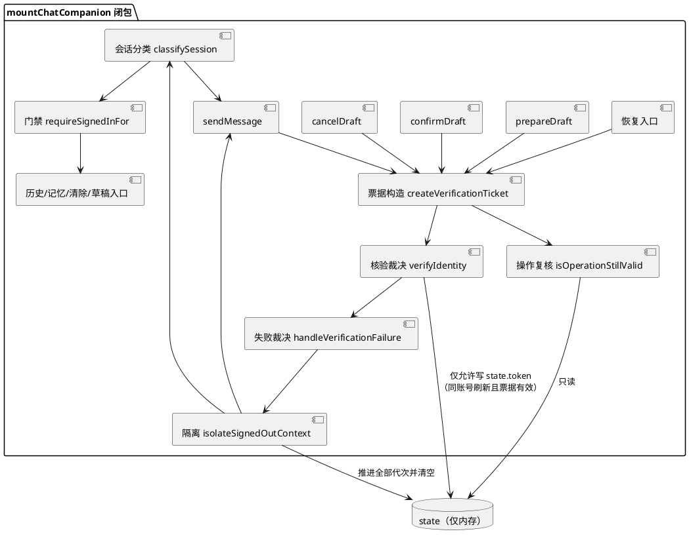
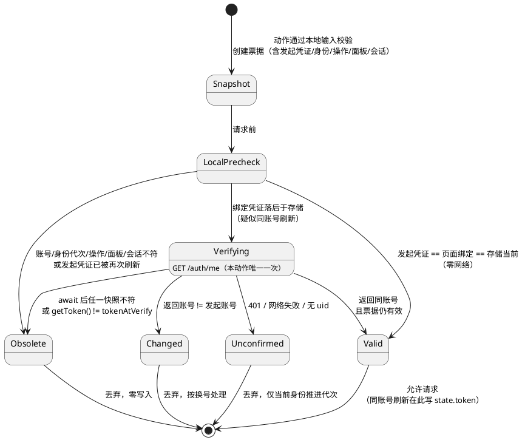
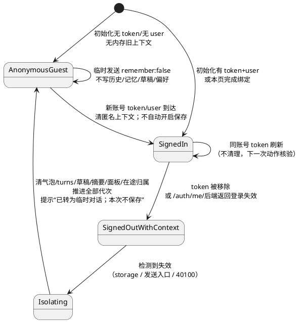
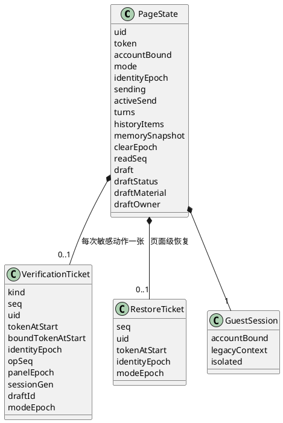

# 一、需求与存量功能关系分析

> 文档类型：增量技术设计（HOW），本轮只回答“怎么改”，不产出业务代码、测试代码或配置改动。
> 工作区：`D:\微光同行\Glimmer`
> 需求来源：`.codeartsdoer/specs/identity_guest_hardening/spec.md`（779 行，R7/R8、DFX、19 条 EDGE 回归、8 个待确认点）
> 继承基线（只读）：`.codeartsdoer/specs/ab_edge_hardening/{spec,design,tasks}.md`（R1–R6 已实现）
> 独立复验依据：`docs/CodeArts六项收尾复验结果.md`（F1/F2）
> 上游指令：`docs/给CodeArts的身份核验与游客聊天补修指令.md`
> 状态：待用户评审。本文档中的行号均以本轮实际核对为准，哈希以本轮实测为准。

## 1.0 本轮状态与基线核对

### 1.0.1 Git 实际可见范围（本轮重新核对）

本轮在 `D:\微光同行\Glimmer` 实际执行 Git 命令，结果如下：

| 核对项 | 本轮实测 | 结论 |
|---|---|---|
| `git rev-parse --show-toplevel` | `D:/微光同行/Glimmer` | 仓库根即当前工作区，**不是**旧记录所称的“非 Git 仓库” |
| `git branch --show-current` | `main` | 当前分支 `main` |
| `git rev-parse HEAD` | `3086f720feaf03a9e6678ae53821e69bb8075ae7` | HEAD 为提交“整理项目结构并上传完整源码与文档” |
| `前端参考/chat-companion.js` | `??` 未跟踪 | 本轮唯一必改业务文件不在 HEAD 中，不能用 `git diff` 证明改动范围 |
| `前端参考/chat-companion.css` | `??` 未跟踪 | 默认不改 |
| `后端源码/scripts/test-chat-companion-repair.test.js` | `??` 未跟踪 | 36 条基线测试不在 HEAD 中 |
| `后端源码/package.json` | ` M` 已跟踪未提交 | 相对 HEAD 仅 1 行，内容是把 `test-chat-companion.test.js`、`test-chat-companion-repair.test.js` 加入 `test:competition`；本轮**不再修改** |
| `.codeartsdoer/`（含本轮 spec/design） | `??` 未跟踪 | 规格与设计目录未纳入版本控制 |
| `docs/review/`、`docs/codearts_proof/` | `??` 未跟踪 | 历史验收证据与复现脚本未跟踪 |
| 已跟踪且未提交修改 | 14 个文件（`README.md`、`docs/*`、`前端参考/chat-session.js`、`聊天页 HTML`、`index.html`、`package.json`） | 工作区不是 HEAD 的干净副本；不得用 HEAD 代表当前实现 |
| 历史证据的“非 Git 仓库”结论 | 仅代表当时工具环境不可见 | 本轮已实际可见，按本节记录；不修改历史文档原文 |

**边界声明**：本轮不创建提交、不推送、不执行 `git reset --hard`、`git checkout .`、`git clean`，不覆盖任何未提交文档与历史证据。由于核心文件未跟踪，“改动前后对比”以文件 SHA-256、行数、只追加行区间和测试日志为证据，不以 `git diff` 为唯一证据。

### 1.0.2 文件哈希与规模（本轮实测）

| 文件 | SHA-256（本轮实测） | 行数 | 与 spec/复验记录的比对 |
|---|---|---|---|
| `前端参考/chat-companion.js` | `796EF67C8CADD90FE1ED489E406B584BB25C0E29C1F7DF8130EB0DBCD7406DD0` | 1455（末行无换行，`wc -l` 为 1454） | 与 `docs/CodeArts六项收尾复验结果.md`、`source-hashes.json` 一致，说明本轮开始时前端未被额外修改 |
| `前端参考/chat-companion.css` | `BFF4294096E6DF0B3527F566C7C64B298D4541C0C24EB6A6AC81329884CB2E58` | 259 | 本轮默认不改 |
| `前端参考/chat-session.js` | `BD5710B43AD63984E16485B813514F2572A40CE90A0803A68DC77B3CF6B1AF7C` | 77 | 只读，与 `source-hashes.json` 一致 |
| `后端源码/scripts/test-chat-companion-repair.test.js` | `AC27B43AAAFC29E256C6B97E9075D796ED1A2645D90DDC747E4438ED6F02233F` | 970 | 36 条 `test(...)`，其中 19 条 `EDGE-*`；与 `source-hashes.json` 一致 |
| `后端源码/package.json` | 本轮未单独记录哈希 | 29 | `test:competition` 第 14 行、`test:merge24` 第 15 行 |
| 复现脚本 | `docs/review/2026-11-13-final-acceptance/identity-boundary-repro.cjs`，45 行 | — | 输出两行 `REPRO:`，退出 0 = 缺陷存在 |
| 模型状态 | `ai.configured=false` | — | 不得把本地规则回复描述为真实大模型效果 |

**测试文件的公开契约**（不得改变）：36 条用例直接读写 `state.uid`、`state.mode`、`state.turns`、`state.sending`、`state.memorySnapshot`、`state.draft`、`state.draftStatus`；按钮文案 `生成草稿`、`确认保存为私密日记`、`取消草稿`、`返回修改选择`、`确认清除`、`取消`、`关闭`、`再整理一段`、`返回聊天` 是定位依据。

### 1.0.3 与既有 R1–R6 的继承关系

本轮是**增量收尾**，不是重写：

1. 保留 R1 的材料归属、同步换号中止、响应落地校验与同账号刷新允许。
2. 保留 R2 的 `clearEpoch`、读取票据、历史/记忆读取失效、面板影响域。
3. 保留 R3 的清除发起账号与操作归属、跨账号丢弃、同账号关闭面板清理。
4. 保留 R4 的同步占位、`activeSend` 归属、拥有者收尾、旧失败不回填。
5. 保留 R5 的确认成功（含幂等恢复成功）弹层内完整关怀与 `tel:` 安全渲染。
6. 保留 R6 的停止生成终态、生成入口收敛、关怀只追加一次、关闭/返回入口。
7. 只对“身份核验 await 窗口”（R7）与“无登录凭证发送”（R8）做增量加固；**不删除、不弱化、不改写** R2–R6 的任何既有断言与可观察顺序。

## 1.1 需求功能与存量功能对比

### 1.1.1 已实现功能（本轮必须保留）

| 需求功能 | 存量功能 | 代码位置 | 匹配度 |
|---|---|---|---|
| 核验三态与网络复核 | `resolveIdentity` 本地比对 uid/token，凭证变化时调用 1 次 `/auth/me` | `前端参考/chat-companion.js:311-335` | 75%（缺 await 后复核） |
| 账号绑定缺失阻断 | 无 token → `unconfirmed` | `前端参考/chat-companion.js:318-321` | 100%（对登录动作） |
| 身份代次 | 换号/退出/核验失败推进 `state.identityEpoch` | `前端参考/chat-companion.js:197`、`:263`、`:338`、`:395` | 100%（但过期核验也会推进新状态） |
| 草稿响应归属 | `isDraftResponseCurrent` 四维校验 | `前端参考/chat-companion.js:346-354`、`:864`、`:1089`、`:1193` | 100% |
| 材料归属 | `draftMaterial` 绑定 uid/identityEpoch/panelEpoch/draftEpoch | `前端参考/chat-companion.js:745-751` | 100% |
| 草稿归属 | `draftOwner` 绑定草稿 id 与发起代次 | `前端参考/chat-companion.js:886-892`、`:1054-1060`、`:1160-1166` | 100% |
| 面板关闭即失效 | `closePanel` 推进 `panelEpoch`/`draftEpoch` | `前端参考/chat-companion.js:493-504` | 100% |
| 换号清空视图 | `resetAccountView` 清气泡、turns、历史、草稿、摘要、面板、关怀 | `前端参考/chat-companion.js:391-428` | 90%（未清输入、未推进 clearEpoch/readSeq） |
| 换号触发 | `storage` 监听 `wg_token`/`wg_user`，uid 变化时 `switchAccount` | `前端参考/chat-companion.js:1406-1414` | 75%（token 移除但 user 未清时不触发） |
| 同账号刷新允许 | 本地 token 变化时核验同账号后继续 | `前端参考/chat-companion.js:322-334`、`EDGE-R1-02` | 75%（会改写 owner 代次） |
| 发送同步占位 | `beginSend` 在 await 前占 `activeSend` | `前端参考/chat-companion.js:1211-1228`、`:1261-1262` | 100% |
| 发送拥有者收尾 | `settleSend` 只释放自己的锁 | `前端参考/chat-companion.js:1240-1251` | 100% |
| 发送响应归属 | `isSendCurrent` 校验 activeSend/session/generation/identityEpoch/uid | `前端参考/chat-companion.js:1230-1238`、`:1291`、`:1299` | 100% |
| 临时会话请求体 | `remember:false` + 本页最近 16 条 history | `前端参考/chat-session.js:20-53` | 100% |
| 无 token 不附加 Authorization | `rawFetch` 仅在有 token 时加头 | `前端参考/api.js:57-60` | 100% |
| 后端匿名临时聊天 | `authOptional`；`remember:true` 且无 uid 才 401；`saved=Boolean(uid)&&remember!==false` | `后端源码/src/routes/ai.js:239-258` | 100%（本轮不改后端） |
| 游客禁止保存 | `enableSaved` 无 token 直接提示 | `前端参考/chat-companion.js:1318-1324` | 100% |
| 历史/记忆读取登录要求 | 后端 40100 映射为“登录后才能查看…” | `前端参考/chat-companion.js:582-590`、`:638-645` | 75%（无本地门禁） |
| 自动恢复身份复核 | 初始化恢复检查 `modeEpoch`、token、`me.uid` | `前端参考/chat-companion.js:1416-1435`、`:430-448` | 90%（未绑定身份代次与恢复序号） |
| R2–R6 全部可观察行为 | 见 `ab_edge_hardening/design.md` 2.4 与 19 条 `EDGE-*` | `后端源码/scripts/test-chat-companion-repair.test.js:484-970` | 100% |

### 1.1.2 需要扩展的功能

| 需求功能 | 存量功能 | 差异说明 | 扩展方向 |
|---|---|---|---|
| R7 核验绑定发起上下文 | `resolveIdentity` 只比较“预期 uid”与“当前存储 uid” | 输入差异：未记录发起 token 快照、发起身份代次、操作类型/代次、面板代次、会话代次；输出差异：只有三态，无法区分“账号不一致/操作已失效/凭证生命周期变化” | 新增核验票据与四态结果；`resolveIdentity` 内部补 await 后复核 |
| R7 请求前操作有效性 | prepare/confirm/cancel/send 在 `await` 后只改写 owner 代次，直接发请求 | 业务差异：`owner.identityEpoch = state.identityEpoch`（`:849`、`:1077`、`:1183`、`:1273`）把旧操作“续命”；边界差异：关闭面板/换号/新操作后仍可发请求 | 新增 `isOperationStillValid`；删除四处代次改写；五条路径统一“核验 → 请求前复核 → 请求 → 落地复核” |
| R7 过期核验不写新状态 | `resolveIdentity` await 后写 `state.token`/`state.uid`；`stopForIdentity` 无条件推进代次 | 差异：过期结果会覆盖当前凭证绑定、误伤新账号在途响应 | await 后先比对票据；过期结果零写入；`stopForIdentity` 仅在票据仍属当前身份时推进代次 |
| R7 自动恢复票据 | 初始化/`restoreSavedForAccount` 只有 epoch/token/uid 检查 | 差异：无恢复序号、无身份代次、401 未走隔离 | 新增恢复票据与统一裁决；401 转 R8 隔离 |
| R8 游客发送入口 | 所有发送先 `resolveIdentity`，无 token 必 `unconfirmed` | 差异：把“匿名临时会话”误判为“登录失效”；后端契约本允许匿名 `remember:false` | 入口分流：游客跳过核验直接临时发送；曾登录失效才隔离 |
| R8 曾登录/游客区分 | 无“曾绑定账号”标志；`resetAccountView` 不记录来源 | 差异：无法区分“从未登录”和“退出/失效”；`forceTemporary` 只换会话不清旧内容 | 新增 `accountBound` 与内存上下文判定；新增 `isolateSignedOutContext` |
| R8 登录失效隔离 | `forceTemporary` 保留 turns/草稿/摘要；`storage` 仅按 uid 判断 | 差异：401 后旧账号气泡、草稿、摘要仍可见；token 移除但 user 未清时不隔离 | 隔离函数统一清空并推进全部代次；storage 同时比较 uid 与 token |
| R8 游客受限能力门禁 | 历史/记忆/清除/草稿入口直接发请求，依赖 40100 提示 | 差异：无 token 请求无意义；草稿入口无登录提示 | 入口本地门禁：直接提示登录、不发请求 |

### 1.1.3 需要新增的内部能力（不新增 HTTP 接口）

| 能力 | 输入 | 输出 | 核心逻辑 | 依赖 |
|---|---|---|---|---|
| 核验票据 `VerificationTicket` | 动作类型、发起账号、发起凭证、身份代次、操作代次、面板代次、会话代次/会话归属 | 只读快照对象 | 发起时创建；同一动作内唯一；不导出、不落盘、不进日志 | `state`、`getToken()`、`currentUid()` |
| 核验裁决 `verifyIdentity` | 票据 | `valid-same-account` / `identity-changed` / `op-obsolete` / `unconfirmed` | 本地快照先行；仅凭证变化时 1 次 `/auth/me`；await 后重比全部维度；过期零写入 | `fetchMe()` |
| 请求前复核 `isOperationStillValid` | 票据 + 动作类型 | 布尔 | 校验账号、身份代次、面板/操作代次、草稿身份、发送归属、恢复序号 | 票据、`state`、`panelEpoch`、`draftEpoch` |
| 会话分类 `classifySession` | 内存上下文 | `guest` / `signed-in` / `signed-out-with-context` | 用 `accountBound` + token + uid + 内容存在性判定 | `state.accountBound` |
| 登录失效隔离 `isolateSignedOutContext` | 失效原因 | 隔离完成后的匿名临时会话 | 推进全部代次 → 清内容 → 换临时会话 → 明确提示 | `resetAccountView` 增强、`replaceSession` |
| 游客能力门禁 `requireSignedInFor` | 能力类型 | 允许/拒绝 | 游客或待隔离状态直接提示，不发登录请求 | 会话分类、`openPanel`、`showNotice` |
| 恢复票据 `RestoreTicket` | 初始化恢复/换号恢复 | 恢复裁决 | 绑定 uid/token/身份代次/`modeEpoch`/恢复序号 | `fetchMe()`、`loadHistory` 读取票据 |

## 1.2 存量功能详细分析

### 1.2.1 身份与凭证契约

- `getToken()` 优先调用全局 `getToken`，否则读 `localStorage.wg_token`（`chat-companion.js:214-217`）；`getStoredUser()` 同理读 `wg_user`（`:219-222`）。
- 请求层 `rawFetch()` 在**每次请求发出时**重新读取当前 token 写入 `Authorization`（`api.js:57-60`）；`api()` 不接受“按请求指定凭证”（`api.js:82-83`）。因此“请求一定使用发起时的凭证”无法在 `api.js` 不改的前提下绝对保证，只能做到“核验时确认凭证生命周期 + 请求前复核 + 响应归属复核”，并如实记录复核到请求之间的极短残余窗口（见 2.10）。
- `replaceSession()` 会把 `state.token = getToken()`（`chat-companion.js:285`）；`resetAccountView()` 会写 `state.uid = nextUid`、`state.token = getToken()`（`:402-403`）。这两处是**合法的状态重建点**，但不得被“过期核验结果”调用。
- `state.token` 的语义是“页面已确认绑定的凭证”，不等同于“storage 当前凭证”；两者不同即“凭证疑似更新”，需要 1 次核验。这是保留正常同账号 token 刷新的基础。

### 1.2.2 现有代次体系与 R7/R8 缺口

| 代次/字段 | 现有职责 | 推进时机（行号） | R7/R8 缺口 |
|---|---|---|---|
| `modeEpoch`（`:199`、`:209`） | 保存开关用户意图 | 开关变更 `:1369`、`resetAccountView:392`、`forceTemporary:293` | 不能代表身份；恢复票据需要“恢复序号”区分同类恢复 |
| `panelEpoch`（`:210`） | 当前弹层有效期 | `openPanel:483`、`closePanel:495`、`resetAccountView:393` | 只覆盖面板；不能代表账号/凭证 |
| `draftEpoch`（`:211`） | 草稿操作有效期 | `renderDraftSelection:739`、`prepareDraft:830`、`confirmDraft:1052`、`cancelDraft:1159`、`closePanel:496` | 只覆盖草稿操作；无法阻止核验窗口内换号 |
| `state.identityEpoch`（`:197`） | 身份连续有效期 | `resetAccountView:395`、`stopForIdentity:338` | 过期核验会推进**新身份**的代次，误伤当前账号在途响应 |
| `state.clearEpoch`（`:200`） | 清除影响代次 | `openClearPanel` 成功 `:699` | 换号/隔离时未推进；R8 隔离需要使读取票据全部失效 |
| `state.readSeq`（`:201`） | 读取代次 | `createReadTicket:364`、清除成功 `:700` | 隔离时未推进 |
| `state.session.generation`（`chat-session.js:16-24`） | 会话上下文有效期 | `invalidate`/`reset`（`replaceSession:281-282`、`resetAccountView:397-400`、清除成功 `:701`） | 草稿动作不应因“同账号清除”被动失效（见 2.4.1 粒度取舍） |
| `state.activeSend` / `sending`（`:204-205`、`:185`） | 发送归属与锁 | `beginSend:1224-1226`、`settleSend:1246-1249` | 隔离时必须置空并使旧 owner 的响应失效 |
| `state.uid` / `state.token`（`:183-184`） | 页面绑定账号/凭证 | 启动 `:1396-1397`、`replaceSession:285`、`resetAccountView:402-403`、`resolveIdentity:332-333` | 过期核验直接改写；无“曾登录”标志 |

### 1.2.3 R7 缺陷根因与执行时序（F1）

**根因（代码位置）**

1. `resolveIdentity()` 在 `await fetchMe()`（`:325`）之后没有比对发起时的 token、发起身份代次与当前账号，直接写 `state.token = getToken()`、必要时写 `state.uid = me.uid`，并返回 `consistent`（`:332-334`）。
2. `prepareDraft()` 在核验返回后把 `owner.uid = identity.uid`、`owner.identityEpoch = state.identityEpoch`（`:848-849`），然后**直接**发 `/companion/prepare`（`:852-860`）；响应落地前的 `isDraftResponseCurrent`（`:864`）只能阻止显示，不能撤回已发出的材料。
3. `confirmDraft()`（`:1076-1080`）、`cancelDraft()`（`:1182-1186`）、`sendMessage()`（`:1272-1290`）是同一模式：await 后改写 owner 代次，再直接请求。
4. `stopForIdentity()` 在 `unconfirmed` 时无条件 `state.identityEpoch += 1`（`:338`），即使核验结果已属于旧身份，也会推进**当前新身份**的代次。

**复现时序（与 `identity-boundary-repro.cjs` 一致）**

| 步骤 | 页面状态 | 代码路径 | 观察 |
|---|---|---|---|
| 1 | A 已聊天，打开草稿面板并勾选 A 材料 | `renderDraftSelection`（`:738-814`）写入 `draftMaterial.uid='A'` | 材料快照属于 A |
| 2 | A 的 token 由 A1 更新为 A2，点击“生成草稿” | `prepareDraft:841` → `resolveIdentity:325` 发出 `/auth/me` | 核验在途，`state.token` 仍为 A1 |
| 3 | 切换到 B 并触发 `storage('wg_user')` | `storage` 监听 `:1406-1414` → `switchAccount('B')` → `resetAccountView('B')` | `state.uid='B'`、`state.token='token-B'`、`identityEpoch+1`，A 的材料/面板被清空 |
| 4 | `/auth/me` 迟到返回 A | `resolveIdentity:329-334`：`me.uid==='A'` 与 `expectedUid==='A'` 相等 → 返回 `consistent`，写 `state.token='token-B'` | 核验结果被错误地判定为有效 |
| 5 | 旧 prepare 继续执行 | `owner.uid='A'`（`:848`）、`owner.identityEpoch=B 的代次`（`:849`）→ `/companion/prepare`（`:852`） | `api.js:59-60` 取当前 `token-B`，正文是 `await` 前捕获的 A 材料 → **跨账号提交** |

**结论**：这不是“响应落地太晚”，而是“请求前判定缺失 + 过期结果改写当前状态 + 调用方把旧操作续命”三者叠加。只加响应落地检查无法修复，必须在 `await` 之后、请求之前完成判定。

### 1.2.4 R8 缺陷根因与执行时序（F2）

**根因（代码位置）**

1. `sendMessage()` 对**所有**消息先调用 `resolveIdentity({uid, identityEpoch})`（`:1264`）；无 token 时 `resolveIdentity:318-321` 返回 `unconfirmed`；调用方 `:1265-1271` 直接 `settleSend` + 提示“登录状态暂时无法确认，请重新登录后再试”。游客因此被阻断，`/ai/chat` 请求数为 0。
2. 后端契约本身允许匿名临时聊天：`authOptional`（`ai.js:239`）、只有 `remember===true && !uid` 才 401（`:246`）、`saved = Boolean(req.uid) && remember !== false`（`:258`）；`chat-session.js` 的临时会话固定 `remember:false`（`:33-35`）。
3. “原登录会话失效”与“从一开始匿名”没有区分：
   - `forceTemporary()`（`:292-296`）只执行 `replaceSession('temporary')` 与提示，**不清空** `turns`、气泡、草稿、摘要、面板；
   - 发送 40100 分支（`:1301-1303`）调用 `forceTemporary` 后保留旧账号内容，并追加“请重新登录后再保存”气泡；
   - `storage` 监听只在 `nextUid !== state.uid` 时 `switchAccount`（`:1409-1412`）：token 被移除但 `wg_user` 未清时 `nextUid` 不变，**不触发隔离**；反向 `wg_user` 被清而 token 仍在时，`resetAccountView('')` 会把 `state.token` 设为仍存在的 token，形成“无 uid 有 token”的错配。
4. `resetAccountView()` 不清 `inputEl.value`，不推进 `clearEpoch`/`readSeq`，导致“旧账号输入文本可能成为游客消息”与“隔离后旧读取票据仍可能通过”的残余风险。

**复现时序（与真实页面截图 `guest-chat-blocked.png` 一致）**

| 步骤 | 页面状态 | 代码路径 | 观察 |
|---|---|---|---|
| 1 | 未登录打开 `chat.html`，无 token、无 user | 初始化 `:1396-1397` 得 `uid=''`、`token=''`；问候 `:1399` | 页面可输入 |
| 2 | 输入合成句子，点击“说” | `sendMessage:1253` → `beginSend:1261` → `resolveIdentity:1264` | 占位建立后进入核验 |
| 3 | `resolveIdentity` 因无 token 返回 `unconfirmed`（`:318-321`） | `:1265-1271` → `settleSend` → `stopForIdentity:342` | 提示“登录状态暂时无法确认，请重新登录后再试”，输入保留，无气泡、无回复 |
| 4 | 后端 `/ai/chat` 的匿名 `remember:false` 契约 | `ai.js:239-258` | 接口本可正常返回 `code=0, saved=false`，前端未发出请求 |

### 1.2.5 既有 36 条测试保护的契约（本轮不得改变）

1. 换号后首次发送被拒、第二次成功的可观察顺序（`P1-07`，测试 `:255-276`）。**换号路径不得清空输入框**，否则第二次点击无文本，既有测试失败。
2. 清除成功后立即发送不被旧请求阻塞（`P1-06`，`:230-253`）；清除成功时草稿编辑面板不被重绘（`EDGE-R2-03`）。
3. 清除失败保留 turns 与摘要（`P1-05`、`P2-03`）。
4. 旧清除响应不得跨账号清理（`EDGE-R3-01/03`）。
5. 旧发送只收尾自己、旧失败不回填（`EDGE-R4-01/03`）；核验窗口双击只发 1 次（`EDGE-R4-02`）。
6. 确认成功与幂等恢复成功均在弹层内展示完整关怀（`EDGE-R5-01/02`）；care 为空不伪造（`EDGE-R5-03`）。
7. 停止生成终态（`EDGE-R6-01`）、失败可重试（`EDGE-R6-02`）、停止态不跨账号泄漏（`EDGE-R6-03`）。
8. 既有测试不直接调用闭包内部函数，只通过 UI 事件与 `state` 字段断言；新增设计不得要求测试引用“修复后才存在的函数名”。

### 1.2.6 本轮“保留 / 需改”清单

| 项目 | 本轮判定 | 说明 |
|---|---|---|
| `isDraftResponseCurrent` 四维校验 | **保留** | 响应落地已覆盖；只在 confirm/cancel 追加草稿 id 校验（可选、向后兼容） |
| `createReadTicket` / `isReadValid` | **保留** | 隔离时额外推进 `clearEpoch`/`readSeq`，不改函数语义 |
| `judgeClearResponse` | **保留** | 不改清除归属；隔离只影响“新身份”的代次 |
| `beginSend` / `settleSend` / `isSendCurrent` | **保留** | 游客发送复用；隔离时置空 `activeSend` |
| `renderConfirmSuccess` / `renderStopped` | **保留** | 不改 care 渲染与终态视图 |
| `resolveIdentity` | **需改（内部）** | 补发起上下文捕获与 await 后复核；返回四态；过期零写入 |
| `prepareDraft` / `confirmDraft` / `cancelDraft` / `sendMessage` | **需改** | 删除 owner 代次改写；接入票据与请求前复核 |
| `stopForIdentity` | **需改** | 仅在票据仍属当前身份时推进代次；区分四类提示 |
| 初始化恢复 / `restoreSavedForAccount` | **需改（加固）** | 接入恢复票据；401 走隔离 |
| `forceTemporary` | **需改（或替换调用点）** | 发送 401 与“曾登录无 token”改用隔离函数；保留兼容入口 |
| `resetAccountView` | **需改（增量）** | 补 `clearEpoch`/`readSeq`、`accountBound`、可选输入清理（仅退出/失效） |
| `storage` 监听 | **需改** | 同时比较 uid 与 token，区分换号/退出/同账号刷新 |
| 历史/记忆/清除/草稿入口 | **需改** | 增加游客本地门禁；登录用户路径不变 |
| `enableSaved` | **保留为主，微调** | 无 token 提示保留；`me` 失败分支改走隔离 |
| `state` 既有字段名/类型 | **保留** | 只增字段，不改既有字段语义 |
| 后端 `src/**`、`sql/**`、`api.js`、`chat-session.js`、HTML | **不动** | 契约与结构已满足 |

---# 二、增量设计方案

## 2.0 设计原则与总体取舍

1. **在现有闭包与 `state` 上做增量，不重写。** prepare/confirm/cancel/send/restore 的请求顺序、请求体、按钮文案、错误码映射保持不变；新增能力全部落在“核验发起 → 请求前复核 → 响应落地复核”三个切面。
2. **四层归属继续复用，只补“凭证生命周期”维度。** 既有 `identityEpoch` / `panelEpoch` / `draftEpoch` / `clearEpoch` / `activeSend` / `session.generation` 不替换、不重命名；新增票据只引用它们，不另建一套状态机。
3. **请求前判定优先于响应落地判定。** 响应落地检查只能阻止显示，不能撤回已发出的材料；R7 的修复必须发生在“请求发出前”。禁止以“响应落地已校验”解释缺陷已修复。
4. **过期核验零写入。** 任何“发起上下文已失效”的核验结果，不得写 `state.uid`、`state.token`、`state.identityEpoch`、`panelEpoch`、`draftEpoch`、`session`；不得调用 `replaceSession`/`switchAccount`/`forceTemporary`。
5. **不把旧操作“续命”。** 禁止把 `owner.identityEpoch` 赋值为当前代次后继续；旧操作只能被丢弃，用户重试会产生新操作代次与新票据。
6. **游客与登录失效分离。** “从未登录”直接可临时聊天；“曾登录但凭证失效”必须先隔离旧上下文，再转游客。两者共用同一个临时会话实现（`chat-session.js` 既有的 `remember:false`），不新增持久化。
7. **零新增依赖。** 不引入框架、状态库、构建工具；不新增 HTTP 接口、不改后端、不改 `api.js` 与 `chat-session.js`。
8. **可观察契约优先。** 既有 36 条测试读写的字段、按钮文案、请求体、错误语义、Enter 输入法保护不变；新增字段只增不改。
9. **证据如实。** 单测、复现脚本、`configured=false` 的本地规则结果均不得表述为“真实大模型效果”或“浏览器端到端验收通过”。

## 2.1 实现模型

### 2.1.1 上下文视图

```plantuml
@startuml
left to right direction
actor "登录用户 A / 匿名游客" as U
participant "陪伴核心界面\nchat-companion.js" as UI
participant "账号与登录服务\nGET /auth/me" as Auth
participant "陪伴对话服务\nPOST /ai/chat" as Chat
participant "草稿服务\n/companion/*" as Draft
participant "历史与记忆\n/ai/messages, /ai/memory" as Mem
participant "同源存储\nwg_token / wg_user" as Store

U --> UI : 发送 / 草稿 / 历史 / 记忆 / 清除
Store --> UI : storage 变更（仅触发信号）
UI --> Auth : 至多 1 次/动作\n凭证疑似变化时
UI --> Chat : 临时 remember:false\n或保存 remember:true
UI --> Draft : 登录后 prepare/confirm/cancel
UI --> Mem : 登录后读取/清除
@enduml
```

**约束**：`storage` 只作触发信号，身份以“存储当前值 + 页面绑定值 + 票据快照”三者比对为准；`/auth/me` 不是轮询，同一动作最多 1 次。

### 2.1.2 组件总体架构



**职责边界**：

| 组件 | 输入 | 输出 | 禁止 |
|---|---|---|---|
| `classifySession` | 内存中的 uid/token/`accountBound`/内容存在性 | `guest` / `signed-in` / `signed-out-with-context` | 不读服务端、不发请求 |
| `createVerificationTicket` | 动作类型 + 发起快照 | 只读票据 | 不含明文凭证输出、不落盘 |
| `verifyIdentity` | 票据 | 四态结果 + 可选新 token | 过期时零写入；不做第二次核验 |
| `isOperationStillValid` | 票据 | 布尔 | 不推进任何代次 |
| `handleVerificationFailure` | 票据、结果、UI 锚点 | 提示与必要清理 | 不写旧面板、不伪造成功 |
| `isolateSignedOutContext` | 失效原因 | 匿名临时会话 | 不清服务端数据、不写保存偏好 |
| `requireSignedInFor` | 能力类型 | 允许/拒绝 | 游客不发登录请求 |

### 2.1.3 核验票据与四态判定状态机



四态语义（对应 spec 7.1.8）：

| 状态 | 判定依据 | 调用方行为 | 允许的 state 写入 |
|---|---|---|---|
| `valid-same-account` | 票据全部维度一致；或 `/auth/me` 返回同 uid 且 await 后票据仍一致 | 发请求；必要时由 `isOperationStillValid` 再复核 | 仅 `state.token = getToken()`（同账号刷新且票据有效） |
| `identity-changed` | 当前 uid 与发起 uid 不同；或 `/auth/me` 返回不同 uid | 不请求；提示身份变化；由 `switchAccount` 统一清视图 | 无（清理由 `switchAccount` 单独完成） |
| `op-obsolete` | 身份代次/面板代次/操作代次/会话代次不符；或核验期间凭证再次变化；或面板已关闭 | 不请求；提示操作失效/已关闭 | 无 |
| `unconfirmed` | 401、网络失败、无 uid | 不请求；保留面板与输入；仅当票据仍属当前身份时推进 `identityEpoch` | 仅 `state.identityEpoch += 1`（票据仍属当前身份时） |

### 2.1.4 与既有代次的关系（只增不改）

| 既有字段 | 本轮角色 | 与票据的关系 |
|---|---|---|
| `state.uid` / `state.token` | 页面“已确认绑定”的账号与凭证 | 票据记录 `uid`、`tokenAtStart`（发起时存储凭证）、`boundTokenAtStart`（发起时绑定凭证）；核验只允许更新 `state.token` |
| `state.identityEpoch` | 身份连续有效期 | 票据记录发起值；不符即 `op-obsolete`；仅 `unconfirmed` 且票据仍属当前身份时推进 |
| `panelEpoch` | 面板有效期 | 草稿类票据记录；关闭/切换/重开即失效 |
| `draftEpoch` | 草稿操作有效期 | 票据 `opSeq`；同类新操作使旧票据失效 |
| `state.clearEpoch` / `state.readSeq` | 清除影响域 | 隔离时推进，使旧读取票据与清除上下文失效；票据本身不直接比较（既有 `isReadValid` 覆盖） |
| `state.activeSend` / `sendSeq` | 发送归属 | 发送票据 `opSeq = owner.id`；`isSendCurrent` 继续作为落地判定 |
| `session.generation` | 会话上下文有效期 | 发送/恢复票据记录；**草稿类票据不以此硬判定**（见 2.4.1 的粒度取舍） |

### 2.1.5 会话类型与隔离状态机



**隔离完成标志**（缺一不可）：`state.accountBound === false`；`state.uid === ''`；`state.token === ''`；`state.mode === 'temporary'`；`state.turns.length === 0`；`state.draft === null`；`state.memorySnapshot === null`；`state.historyItems.length === 0`；`panelEl.hidden === true`；`state.activeSend === null`；`inputEl.value === ''`（旧账号文本不得成为游客首条消息）。

## 2.2 接口设计

### 2.2.1 总体设计与稳定性

本轮不新增对外 HTTP 接口，只新增/调整 `mountChatCompanion` 闭包内部契约；不导出到全局，避免扩大公开面。既有导出（`mountChatCompanion`、`readUserId`、`saveModeKey` 等，`chat-companion.js:1440-1454`）不变。

| 分类 | 接口 | 稳定性 | 说明 |
|---|---|---|---|
| 票据 | `createVerificationTicket` | 新增·内部 | 发起时快照 |
| 核验 | `verifyIdentity` | 新增·内部 | 四态裁决，替代旧 `resolveIdentity` 的调用语义 |
| 操作 | `isOperationStillValid` | 新增·内部 | 请求前与落地前复核 |
| 失败 | `handleVerificationFailure` | 新增·内部 | 四态提示与最小清理 |
| 会话 | `classifySession`、`isGuestSession`、`hasLegacyContext` | 新增·内部 | 游客/登录/待隔离判定 |
| 隔离 | `isolateSignedOutContext` | 新增·内部 | 登录失效先隔离 |
| 门禁 | `requireSignedInFor` | 新增·内部 | 游客受限能力 |
| 恢复 | `createRestoreTicket`（可复用票据 + 恢复序号） | 新增·内部 | 页面级恢复 |
| 兼容 | `resolveIdentity`、`forceTemporary` | 保留·内部 | 保留为兼容入口；`forceTemporary` 的发送/401 调用点改走隔离 |

### 2.2.2 createVerificationTicket

```javascript
/**
 * @typedef {'prepare'|'confirm'|'cancel'|'send'|'restore'} VerificationKind
 * @typedef {'valid-same-account'|'identity-changed'|'op-obsolete'|'unconfirmed'} VerificationStatus
 *
 * @typedef {Object} VerificationTicket
 * @property {VerificationKind} kind
 * @property {number} seq            // 本次核验唯一序号（模块内单调递增）
 * @property {string} uid            // 发起账号；游客发送允许为空
 * @property {string} tokenAtStart   // 发起时 getToken()；仅内存比较，禁止输出
 * @property {string} boundTokenAtStart // 发起时 state.token
 * @property {number} identityEpoch
 * @property {number} opSeq          // 草稿类=draftEpoch；发送=activeSend.id；恢复=restoreSeq
 * @property {number} panelEpoch     // 仅 prepare/confirm/cancel
 * @property {number} sessionGen     // 仅 send/restore
 * @property {string} draftId        // 仅 confirm/cancel
 * @property {number} modeEpoch      // 仅 restore
 */
function createVerificationTicket(kind, extra)
```

- **前置条件**：动作已通过本地输入校验（非空、≤2000 字、日期合法、草稿终态检查），且已在同步阶段完成发送占位或面板操作代次推进。
- **后置条件**：票据是只读快照；同一动作只创建一次；核验结果不得被其他动作复用（`seq` 与 `opSeq` 双唯一）。
- **禁止**：票据不得包含明文 `Authorization`、不得写日志、不得写 localStorage、不得作为 URL 参数。

### 2.2.3 verifyIdentity

```javascript
/**
 * @param {VerificationTicket} ticket
 * @returns {Promise<{status: VerificationStatus, confirmedUid?: string, nextUid?: string, viaNetwork: boolean}>}
 */
async function verifyIdentity(ticket)
```

**判定顺序（必须按此顺序，先快照后网络）**：

1. **发起上下文复核**（不发网络、不写状态）：
   - `ticket.uid` 非空时：`currentUid() !== ticket.uid` 或 `state.uid !== ticket.uid` → `identity-changed`；
   - `ticket.identityEpoch !== state.identityEpoch` → `op-obsolete`；
   - 草稿类：`ticket.panelEpoch !== panelEpoch` 或 `ticket.opSeq !== draftEpoch` → `op-obsolete`；
   - 发送类：`!state.activeSend || state.activeSend.id !== ticket.opSeq` 或 `ticket.sessionGen !== state.session.generation` → `op-obsolete`；
   - 恢复类：`ticket.modeEpoch !== modeEpoch` 或 `ticket.opSeq !== restoreSeq` → `op-obsolete`；
   - `ticket.tokenAtStart !== getToken()`（核验尚未开始，凭证已被并发刷新）→ `op-obsolete`（不再二次核验）。
2. **本地零网络通过**：`ticket.tokenAtStart === state.token` 且 `ticket.tokenAtStart === getToken()` → `valid-same-account`。
3. **网络复核**（仅当 `ticket.tokenAtStart !== state.token`，即“页面绑定凭证落后于存储”）：
   - 捕获 `tokenAtVerify = getToken()`；`me = await fetchMe()`；
   - **await 之后重新执行第 1 步全部复核**，并追加 `getToken() === tokenAtVerify`；
   - 任一不符：返回对应状态，**不写任何 state**；
   - `!me.ok` → `unconfirmed`；`me.uid !== ticket.uid` → `identity-changed`。
4. **有效落地**：仅当上述全部通过，且 `ticket.tokenAtStart !== getToken()` 时执行 `state.token = getToken()`；不得写 `state.uid`、`state.identityEpoch`、`panelEpoch`、`draftEpoch`、`state.session`。
5. **返回值**：`confirmedUid` 为票据账号（不是响应账号覆盖后的值）；`nextUid` 仅在 `identity-changed` 时给出当前存储 uid，供调用方提示。

**与旧 `resolveIdentity` 的差异**：

- 旧函数只比较“预期 uid / 存储 uid / token 是否等于 state.token”，await 后直接写状态并返回 `consistent`（`:311-335`）；新函数在 await 后重比**五个维度**（账号、身份代次、操作代次、面板/会话代次、发起凭证），且过期零写入。
- 旧 `stopForIdentity` 在 `unconfirmed` 时无条件推进 `identityEpoch`（`:338`）；新失败裁决只在“票据仍属当前身份”时推进（见 2.2.5）。
- `resolveIdentity` 保留为兼容外壳，内部复用同一套快照比较，避免其他未迁移路径继续产生跨账号提交；其所有调用点在本次一并迁移到票据。

### 2.2.4 isOperationStillValid

```javascript
/**
 * @param {VerificationTicket} ticket
 * @returns {boolean}
 */
function isOperationStillValid(ticket)
```

| 动作 | 复核项 |
|---|---|
| `prepare` | 票据 uid 与 `state.uid \|\| currentUid()` 一致；`identityEpoch` 一致；`panelEpoch` 一致；`opSeq === draftEpoch`；`state.draftMaterial` 存在且其 `draftEpoch` 与票据 `opSeq` 一致；`state.draftStatus !== 'stopped'` |
| `confirm` | 同上的账号/身份/面板/操作；追加 `state.draft && state.draft.id === ticket.draftId`；`state.draftStatus === 'pending'` |
| `cancel` | 同 `confirm` |
| `send` | `state.activeSend && state.activeSend.id === ticket.opSeq`；`state.session` 与 owner 相同；`session.generation === ticket.sessionGen`；`inputEl.value.trim()` 仍等于 owner.text（已提交后由 `owner.committed` 覆盖） |
| `restore` | 票据 uid 与 `currentUid()`/`state.uid` 一致；`identityEpoch` 一致；`modeEpoch` 一致；`restoreSeq` 一致；`readSaveMode(ticket.uid) === 'on'` |

- **调用时机**：核验通过后、请求发出前（第一次）；响应落地前（第二次，防止请求在途期间关闭面板/换号/新操作）。
- **后置条件**：只读，不推进任何代次；返回 `false` 时调用方不得写面板、不得写气泡、不得写状态提示以外的 UI。

### 2.2.5 handleVerificationFailure

```javascript
/**
 * @param {VerificationTicket} ticket
 * @param {VerificationStatus} status
 * @param {{statusNode?: Object, buttonEl?: Object, actionLabel: string}} ui
 */
function handleVerificationFailure(ticket, status, ui)
```

| 结果 | State 写入 | 提示（写入位置） | 清理 |
|---|---|---|---|
| `identity-changed` | 无（由 `switchAccount` 统一清视图并推进代次） | `账号或登录状态已变化，请重新…`（`#cc-save-state`；必要时既有 `switchAccount` 气泡） | 清材料/草稿由 `resetAccountView` 完成，本函数不重复清理 |
| `op-obsolete` | 无 | `操作已失效或面板已关闭，本次未提交`（仅 `#cc-save-state`） | 不写面板、不写气泡；释放按钮与草稿忙碌态由调用方完成 |
| `unconfirmed` | **仅当** `ticket.identityEpoch === state.identityEpoch && (ticket.uid === state.uid \|\| ticket.uid === currentUid())` 时 `identityEpoch += 1` | `登录状态暂时无法确认，…未提交，请稍后重试`（`#cc-save-state` + 原面板 status） | 保留面板与输入；按钮恢复可用 |
| `valid-same-account` | 不调用本函数 | — | — |

- **禁止**：`identity-changed`/`op-obsolete` 分支不得调用 `forceTemporary`、`replaceSession`、`state.token = getToken()`、`switchAccount`（除 `identity-changed` 需要切到真实新账号外）。
- 既有 `stopForIdentity` 保留为 `handleVerificationFailure` 的薄封装，确保 `EDGE-R1-01/03` 断言的“账号或登录状态已变化”提示仍写入 `#cc-save-state`。

### 2.2.6 游客与会话分类接口

```javascript
/**
 * @typedef {'guest'|'signed-in'|'signed-out-with-context'} SessionClass
 */
function classifySession()
function isGuestSession()       // classifySession() === 'guest'
function hasLegacyContext()     // 是否存在旧账号内容或在途动作
```

判定规则（顺序执行）：

| 判定 | 条件 | 结果 |
|---|---|---|
| 1 | `getToken()` 非空且 `currentUid()` 非空 | `signed-in`（含游客转登录后的首次动作；`state.token` 可能仍为空，由核验补齐） |
| 2 | `getToken()` 为空且（`state.accountBound` 或 `hasLegacyContext()`） | `signed-out-with-context` |
| 3 | 其他 | `guest` |

`hasLegacyContext()` 的组成（任一为真）：`state.uid` 非空、`state.token` 非空、`state.mode === 'saved'`、`state.turns.length > 0`、`state.draft !== null`、`state.memorySnapshot !== null`、`state.historyItems.length > 0`、`state.panelKind` 非空、`state.activeSend !== null`。

`state.accountBound` 的维护（新增字段，默认 `false`）：

| 时机 | 值 |
|---|---|
| 初始化时 `state.uid && state.token` | `true` |
| `switchAccount(nextUid)` 且 `nextUid` 非空 | `true` |
| `verifyIdentity` 返回 `valid-same-account` 且 `confirmedUid` 非空 | `true` |
| `enableSaved` / 恢复成功绑定账号 | `true` |
| `isolateSignedOutContext` 完成 | `false` |
| `resetAccountView('')`（退出） | `false` |

### 2.2.7 isolateSignedOutContext

```javascript
/**
 * @param {'removed'|'auth401'|'backend40100'|'restore-failed'} reason
 * @returns {void}
 */
function isolateSignedOutContext(reason)
```

执行顺序（不可交换）：

1. 推进代次：`modeEpoch += 1`、`panelEpoch += 1`、`draftEpoch += 1`、`state.identityEpoch += 1`、`state.clearEpoch += 1`、`state.readSeq += 1`；`let restoreSeq += 1`（使全部在途核验、读取、清除、发送、恢复票据失效）。
2. 失效在途归属：`state.session.invalidate()`（只递增 generation，不保留 history）；`state.activeSend = null`；`state.sending = false`；`sendEl.disabled = false`。
3. 清空 UI 内容：`chatEl.replaceChildren()`（含 typing 与旧气泡）；`turns = []`；`historyItems = []`；`historyPage = 1`；`historyHasMore = false`；`draft`/`draftTrace`/`draftProvider`/`draftInclude`/`draftStatus`/`draftMaterial`/`draftOwner` 复位；`memorySnapshot = null`；`stoppedRound = 0`；`panelKind = ''`；`panelEl.hidden = true`；`panelBodyEl.replaceChildren()`；`activeDraftControls = null`；`careEl.hidden = true`；`careEl.replaceChildren()`；`inputEl.value = ''`。
4. 切换会话：`state.session.reset()` 后 `state.session = createTemporary(request)`；`state.mode = 'temporary'`；`state.uid = ''`；`state.token = ''`；`state.accountBound = false`；`saveToggleEl.checked = false`；`updateModeUi()`。
5. 提示：按 `reason` 选择文案（`auth401`/`backend40100`/`removed` 统一使用“登录状态已失效，已转为临时对话；本次不保存”；`restore-failed` 使用“登录状态暂时无法确认，已回到临时对话”）；写入 `#cc-save-state`，并追加一条 `ai` 气泡，`track=false`，不写入 `turns`。
6. 不修改服务端数据、不删除账号历史/记忆、不写 `saveModeKey`（不把 A 的保存偏好改成 off）。

**调用点**：storage 失效检测、发送入口 “signed-out-with-context”、发送 catch 的 `40100`、`enableSaved` 的核验失败、初始化恢复的 401/失败。**不调用**：核验 `unconfirmed`（保留可恢复内容）。

### 2.2.8 requireSignedInFor

```javascript
/**
 * @param {'save'|'history'|'memory'|'clear'|'draft'} feature
 * @returns {boolean} 是否允许继续登录后路径
 */
function requireSignedInFor(feature)
```

- **游客或待隔离状态**：先执行必要的隔离（`signed-out-with-context` → `isolateSignedOutContext('removed')`），再打开对应面板并显示“登录后才能查看历史对话/查看记忆/清除记录/生成草稿”，**不发出任何需要登录的请求**；返回 `false`。
- **登录用户**：返回 `true`，走既有路径（请求、错误映射、读取票据全部不变）。
- 保存开关不在此函数内处理：`enableSaved` 既有无 token 分支保留（`chat-companion.js:1318-1324`），仅把 `me` 失败分支改为隔离。

## 2.3 数据模型

### 2.3.1 设计目标

1. 覆盖 R7 的“账号 + 凭证生命周期 + 身份 + 面板 + 操作 + 会话”六维归属，且不改变既有字段语义。
2. 覆盖 R8 的“会话类型 + 隔离完成标志 + 受限能力门禁”，不新增持久化键、不写服务端。
3. 既有 36 条测试继续直接读写 `state.uid/mode/turns/sending/memorySnapshot/draft/draftStatus`；新增字段只增不改。

### 2.3.2 模型实现



> 类图只表达领域对象与关系；`tokenAtStart` 等凭证字段仅存在于内存，禁止落盘、打印或写入证据文档。

### 2.3.3 生命周期与不变量

| 对象 | 创建 | 失效 | 不变量 |
|---|---|---|---|
| `VerificationTicket` | 动作通过本地校验、进入核验前 | 请求完成或落地丢弃；任一代次变化；新票据创建 | 一张票据只服务一次动作；过期票据零写入 |
| `RestoreTicket` | 初始化/换号恢复开始时 | 换号、退出、新恢复、`modeEpoch` 变化 | 不受关闭草稿/记忆面板影响（决策 5） |
| `GuestSession.accountBound` | 初始化/绑定成功 | 隔离完成 | `true` 时不得直接把游客发送当匿名；必须先判定凭证 |
| `GuestSession.legacyContext` | 由 `hasLegacyContext()` 实时计算 | 隔离清空后 | 不得作为持久化字段写入 storage |

## 2.4 逐项设计 R7

### 2.4.1 票据维度矩阵与粒度取舍

| 动作 | 账号 | 发起凭证 | 绑定凭证 | 身份代次 | 操作代次 | 面板代次 | 会话代次 | 草稿 id | 恢复序号 |
|---|---|---|---|---|---|---|---|---|---|
| `prepare` | 必填 | 必填 | 必填 | 必填 | `draftEpoch` | 必填 | **不比较**（见下） | — | — |
| `confirm` | 必填 | 必填 | 必填 | 必填 | `draftEpoch` | 必填 | **不比较** | 必填 | — |
| `cancel` | 必填 | 必填 | 必填 | 必填 | `draftEpoch` | 必填 | **不比较** | 必填 | — |
| `send` | 可有可无（游客为空） | 必填（游客为空字符串也参与比较） | 必填 | 必填 | `activeSend.id` | 不比较 | 必填 | — | — |
| `restore` | 必填 | 必填 | 必填 | 必填 | — | **不比较**（决策 5） | 不比较 | — | 必填 |

**粒度取舍（必须记录理由）**：

- 草稿类票据**不把 `session.generation` 作为硬性失效条件**。原因：清除成功会执行 `replaceSession(state.mode)`（`chat-companion.js:701`），递增 generation；而 R2 的既有可观察行为要求“清除成功时已打开的草稿编辑面板不被重绘、仍可继续编辑”（`EDGE-R2-03`）。若把 generation 纳入硬判定，`清除成功 → 草稿确认/取消` 会被判失效，改变既有 R2 行为。跨账号与过期风险已由账号、身份代次、面板代次、操作代次、草稿 id 五维覆盖；清除成功的同账号上下文变化不改变这五维。
- 发送/恢复票据**必须**比较 generation：发送依赖会话上下文，恢复依赖页面级会话替换。这样既不缩减 R7 的跨账号保护，也不破坏 R2–R6 的既有行为。
- 恢复票据不比较面板代次/草稿代次：自动恢复是页面级动作，关闭草稿/记忆面板不应使恢复失效（决策 5）。

### 2.4.2 prepare

**请求前复核点**

1. `prepareDraft` 不再把 `owner` 当作可改写对象：`owner` 的 `uid`/`identityEpoch` 来自 `state.draftMaterial`（`:832-837`），全程只读。
2. 在 `await` 前创建票据：`kind='prepare'`、`opSeq=op`（`++draftEpoch`，`:830`）、`panelEpoch=panel`（`:829`）、`uid`/`identityEpoch` 来自材料快照、`tokenAtStart=getToken()`、`boundTokenAtStart=state.token`。
3. `await verifyIdentity(ticket)`：
   - 非 `valid-same-account` → `handleVerificationFailure` → 释放 `buttonEl`、恢复 `status` 文案（仍写原面板，面板未关闭时可见）→ return。
4. `isOperationStillValid(ticket)`：面板未关闭、材料代次一致、身份一致、材料仍是发起时的文本（用 `material.text` 与票据绑定；材料被替换则失效）→ 不成立则提示“操作已失效或面板已关闭，本次未提交”（仅 `#cc-save-state`）→ return。
5. 发请求，请求体保持 `{message, date, includeRecentDiaries}` 不变（`:852-860`）。

**响应落地复核点**

1. 既有 `isDraftResponseCurrent(owner)`（`:864`）继续保留。
2. 追加 `isOperationStillValid(ticket)`：覆盖“请求在途期间关闭面板/换号/新操作”。
3. 失败分支（`:865-872`）在落地前同样复核；不成立时不写 `status`、不追加关怀。

**删除项**：`:848-849` 的 `owner.uid = identity.uid`、`owner.identityEpoch = state.identityEpoch`。

**有效同账号刷新**：`verifyIdentity` 在票据仍有效时写 `state.token=getToken()`；`api.js` 发出请求时自然使用新凭证；prepare 恰好 1 次。

### 2.4.3 confirm

1. 票据：`kind='confirm'`、`opSeq=++draftEpoch`（`:1052`）、`panelEpoch=panelEpoch`（`:1051`）、`draftId=state.draft.id`（`:1050`）、`uid`/`identityEpoch` 来自 `state.draftOwner`（`:1054-1060`）。
2. `await verifyIdentity` → 失败走 `handleVerificationFailure`，并 `setDraftBusy(false)`；面板仍打开时写原 `status` 文案，面板已关闭时只写 `#cc-save-state`。
3. `isOperationStillValid`：`state.draft.id === draftId`、`draftStatus === 'pending'`、面板/操作/身份一致。
4. 发 `/confirm`（`:1080-1084`）；响应落地前 `isDraftResponseCurrent` + `isOperationStillValid`。
5. **幂等恢复路径同样受约束**：`resolveUnknownDraft`（`:1117-1145`）在每次重试/查询前调用 `isOperationStillValid(ticket)`，返回 `false` 时立即返回 `{code:-2}`；不得在操作失效后继续重试同 ID。
6. 删除 `:1076-1077` 的 owner 改写。

### 2.4.4 cancel

1. 票据：`kind='cancel'`、`opSeq=++draftEpoch`（`:1159`）、`panelEpoch=panelEpoch`（`:1158`）、`draftId`。
2. `await verifyIdentity` → 失败走统一失败裁决；`setDraftBusy(false)`。
3. `isOperationStillValid`（草稿 id/pending/面板/操作/身份）→ 发 DELETE。
4. 响应落地前 `isDraftResponseCurrent` + `isOperationStillValid`；取消终态 `cancelled` 与“取消不删除日记”语义不变。
5. 删除 `:1182-1183` 的 owner 改写。

### 2.4.5 send

**入口顺序（在 `beginSend` 之后、任何 await 之前完成分类）**

1. `beginSend()` 保持同步占位（`:1211-1228`、`:1261-1262`），不改变“第一次拒绝、第二次成功”的既有可观察顺序。
2. `classifySession()`：
   - `guest` → 游客路径：
     - 不调用 `verifyIdentity`、不发 `/auth/me`；
     - `isOperationStillValid`（`activeSend`、session、generation、输入一致）；
     - `session.send(owner.text)`（`chat-session.js` 生成 `remember:false` + 最近 16 条）；
     - 成功：`isSendCurrent(owner)` → 追加回复、`showCare`、`showProvider`；`state.mode === 'temporary'` 时 `showNotice('本次未保存；临时对话刷新后清空')`（不写“已保存”）；
     - 失败：`isSendCurrent` → 追加错误气泡、必要时回填输入（仅 owner 当前），不写历史/记忆。
   - `signed-out-with-context` → `isolateSignedOutContext('removed')` → `settleSend(owner)` → 提示“登录状态已失效，已转为临时对话；本次不保存” → **本次不发送**（用户重新输入后即为游客发送）。
   - `signed-in` → 票据路径（下）。
3. 票据路径：
   - 票据 `kind='send'`、`opSeq=owner.id`、`sessionGen=owner.sessionGen`、`uid=owner.uid`、`identityEpoch=owner.identityEpoch`；
   - `await verifyIdentity` → 非 valid：`settleSend(owner)` + `handleVerificationFailure`（`mismatch` 走既有 `switchAccount`，`EDGE-R1-01/03` 文案保留）→ return；
   - `isOperationStillValid`：`state.activeSend===owner`、`session` 未替换、`generation` 未变、输入仍等于 `owner.text`（`:1274-1277` 的既有检查保留并纳入）；
   - 发请求（`:1290`）。

**响应落地**：既有 `isSendCurrent(owner)`（`:1291`、`:1299`）继续作为唯一落地判定；不再追加 owner 代次改写（删除 `:1272-1273`）。

**401/登录失效**：catch 中 `error.code === 40100` 改为 `isolateSignedOutContext('backend40100')`，**不**追加“请重新登录后再保存”气泡、**不**回填输入（旧账号文本不得进入游客输入框）。`mode==='saved' && !getToken()` 的既有分支（`:1278-1282`）改为隔离并 `settleSend`，本次不发送。

**游客与 R4 协作**：游客路径无 `await` 身份核验，`beginSend` 同步占位仍是唯一锁；连续点击第二次在入口 `state.sending || state.activeSend` 处返回；旧游客响应只经 `isSendCurrent` 落地；失败只释放自己的锁。

### 2.4.6 自动恢复

**统一入口**：初始化恢复（`chat-companion.js:1416-1435`）与 `restoreSavedForAccount`（`:430-448`）都改为“创建恢复票据 → `verifyIdentity` → `isOperationStillValid` → 绑定 → 加载历史”。

| 环节 | 设计 |
|---|---|
| 票据 | `kind='restore'`、`uid=expectedUid`、`tokenAtStart=getToken()`、`boundTokenAtStart=state.token`、`identityEpoch=state.identityEpoch`、`modeEpoch=modeEpoch`、`opSeq=++restoreSeq`；不含 `panelEpoch`/`draftEpoch` |
| await 后 | `verifyIdentity` 已重比 uid/身份代次/`modeEpoch`/`restoreSeq`/凭证；不再单靠 `epoch !== modeEpoch`（`:1420`、`:434`） |
| 成功 | `valid-same-account` 且 `isOperationStillValid` → 写 `state.uid`/`state.token`（唯一允许的绑定点）→ `replaceSession('saved')` → `loadHistory(true, true)`（既有 `ReadTicket` 二次校验 `:543-558`） |
| 401 | `isolateSignedOutContext('auth401')`，提示“登录状态已失效，已转为临时对话；本次不保存” |
| 网络失败 | `unconfirmed` → 保持临时会话，提示“登录状态暂时无法确认”，不清空（初始化时通常无内容） |
| 换号 | `identity-changed` → 既有 `switchAccount(nextUid)`；恢复结果不写入新账号 |
| 关闭草稿/记忆面板 | 不使恢复票据失效（票据不含面板/草稿代次） |
| 新恢复操作 | `restoreSeq` 递增使旧恢复失效 |

### 2.4.7 三类时序的预期行为

| 时序 | 触发 | 系统行为 | 用户感知 | 请求数 |
|---|---|---|---|---|
| storage 已处理换号（A→B） | `storage('wg_user'/'wg_token')`，`currentUid() !== state.uid` | `switchAccount(B)` → `resetAccountView` 推进身份/面板/草稿代次并清 A 视图；所有旧票据 `op-obsolete`；迟到核验零写入、不请求 | B 页面干净；无 A 材料/草稿/正文/成功提示 | 旧 prepare/confirm/cancel/send = 0 |
| 核验期间关闭面板 | 用户点关闭/遮罩/Escape | `closePanel` 推进 `panelEpoch`+`draftEpoch`；票据 `op-obsolete`；不请求；不写面板 | 面板保持关闭；仅背景提示“操作已失效或面板已关闭” | 0 |
| 同账号 token 刷新（A1→A2） | `storage('wg_token')`，uid 不变 | 不清理、不推进代次；下一次动作票据 `tokenAtStart !== state.token` → 1 次 `/auth/me`；返回 A → 写 `state.token` → 请求 1 次 | 无身份变化提示 | 1 次核验 + 1 次业务请求 |
| 同账号期间再次刷新（A2→A3） | 核验 await 中 token 再变 | await 后 `getToken() !== tokenAtVerify` → `op-obsolete`；不请求、不写状态；提示重新操作 | 需重新点击（新票据） | 0 次业务请求 |

### 2.4.8 R7 明确禁止项与代码级落点

| 禁止项 | 代码级落点 |
|---|---|
| 仅做响应落地检查 | 不得只保留 `isDraftResponseCurrent`（`:864`、`:1089`、`:1193`）与 `isSendCurrent`（`:1291`）；必须新增请求前 `verifyIdentity` + `isOperationStillValid` |
| 把旧 owner 代次更新为当前代次 | 删除 `:849`、`:1077`、`:1183`、`:1273` 四处赋值 |
| 过期核验改写新状态 | 删除 `resolveIdentity:332-333` 的无条件写入；`verifyIdentity` 过期分支零写入；`stopForIdentity:338` 收窄 |
| 用当前凭证为旧材料背书 | 票据 `tokenAtStart` 必须等于 `getToken()` 且票据全部维度有效；否则不发请求 |
| 把 `storage` 已处理当作唯一身份依据 | 票据同时比较 uid、身份代次、操作/面板/会话代次与凭证快照 |
| 迟到核验重试旧操作 | 不自动重试；用户重试产生新的 `draftEpoch`/`sendSeq`/`restoreSeq` 与新票据 |

---

## 2.5 逐项设计 R8

### 2.5.1 游客判定与会话分类

- **从一开始匿名游客**：初始化时 `state.uid === ''`、`state.token === ''`、`state.accountBound === false`、`hasLegacyContext() === false`。页面不请求 `/auth/me`、不读取历史/记忆、不加载保存偏好。
- **原登录会话失效**：`state.accountBound === true` 或 `hasLegacyContext() === true`，且 `getToken() === ''`（或与页面绑定不一致）。必须先隔离，不得直接当游客发送。
- **已登录**：`getToken()` 与 `currentUid()` 均非空；走既有身份核验与保存/历史/记忆/草稿能力。
- **刷新后的语义**：刷新会丢失 `accountBound` 与匿名消息，页面重新判定；因游客消息不持久化，刷新后就是“从一开始的匿名游客”，不存在待隔离内容。

`storage` 监听改造（替换 `chat-companion.js:1406-1414` 的判断逻辑，事件注册位置不变）：

| 事件状态 | 判定 | 动作 |
|---|---|---|
| `event.key` 非 `wg_token`/`wg_user`/`null` | 非身份键 | 忽略 |
| `getToken() === ''` | 凭证被移除/退出 | `state.accountBound || hasLegacyContext()` → `isolateSignedOutContext('removed')`；否则忽略 |
| `getToken() !== ''` 且 `currentUid() === ''` | 账号标识缺失但凭证存在 | 视为不完整身份，`isolateSignedOutContext('removed')`（保守，不把消息归到无 uid 的账号） |
| `currentUid() !== state.uid` | 换号/游客转登录 | 既有 `switchAccount(nextUid, '检测到账号变化，已回到临时对话')` |
| `currentUid() === state.uid` 且 `getToken() !== state.token` | 同账号凭证刷新 | 不清理、不推进代次、不写 `state.token`；下一次敏感动作由票据触发 1 次核验 |
| 其他 | 无变化 | 忽略 |

`event.key === null`（`localStorage.clear()`）按“凭证被移除”处理。`storage` 仍只作触发信号，不作为唯一身份依据。

### 2.5.2 游客允许临时发送

- `sendMessage` 在 `beginSend()` 之后立即分流；`guest` 分支不调用 `verifyIdentity`，因此**不会**产生 `/auth/me`（满足 DFX 5.1.3：游客只发 1 次 `/ai/chat`）。
- 请求由既有的 `state.session`（`createTemporaryChat`）发出：`remember:false`、`history` 为本页最近 16 条（`chat-session.js:33-35`）；不修改 `chat-session.js`。
- 回复落地：`isSendCurrent(owner)` → `addBubble(reply)`、`showCare`、`showProvider`；`state.mode === 'temporary'` 时 `showNotice('本次未保存；临时对话刷新后清空')`，绝不显示“已保存到本人账号”。
- 提示不再出现“请重新登录后再试”。保存状态区与 `#cc-mode-note`（`updateModeUi:265-278`）持续显示临时会话语义。
- 游客发送失败：追加可恢复错误、输入可再次编辑；不写历史/记忆/草稿/偏好。

### 2.5.3 游客发送不持久化

| 维度 | 保证方式 |
|---|---|
| 服务端历史 | `chat-session.js` 的临时会话固定 `remember:false`；后端 `saved = Boolean(req.uid) && remember !== false`（`ai.js:258`），无 uid 即 `saved:false` |
| 长期记忆 | 游客路径不调用 `/ai/memory`；后端在 `saved=false` 时不读记忆（`ai.js:262-268`） |
| 草稿 | 游客被 `requireSignedInFor('draft')` 拦截 |
| 保存偏好 | 游客路径不调用 `writeSaveMode`；`enableSaved` 无 token 直接返回 |
| 刷新恢复 | 匿名消息只在 `state.turns` 与临时 session 的 `history` 内存中；刷新后 `accountBound=false`、无历史请求 |
| 异常响应 | 即使后端返回 `saved:true`（异常契约），前端在 `mode==='temporary'` 时不显示“已保存”；以 `remember:false` 的语义为准 |

### 2.5.4 游客受限能力门禁

| 入口 | 当前位置 | 改造 |
|---|---|---|
| 保存开关 | `enableSaved:1316-1350` | 保留无 token 分支（`:1318-1324`）；`me` 失败分支（`:1327-1333`）改走 `isolateSignedOutContext('auth401')` |
| 历史 | `openHistoryPanel:618-628` | 入口 `requireSignedInFor('history')`；游客返回 `false` 时显示“登录后才能查看历史对话”，不发 `/ai/messages` |
| 记忆 | `openMemoryPanel:630-659` | 入口 `requireSignedInFor('memory')`；不发 `/ai/memory` |
| 清除 | `openClearPanel:661-726` | 入口 `requireSignedInFor('clear')`；游客不渲染“确认清除”按钮，不发 DELETE |
| 草稿 | 工具入口 `:1383` | 入口 `requireSignedInFor('draft')`；游客不渲染材料选择与“生成草稿” |
| 返回修改/确认/取消 | 面板内按钮 | 游客无法到达（门禁阻止进入草稿面板） |

- 登录用户路径不变：请求、40100 映射、`ReadTicket`、`clearEpoch` 全部保持。
- 待隔离状态（`signed-out-with-context`）访问任一入口：先 `isolateSignedOutContext('removed')`，再提示登录；不展示旧账号任何内容。

### 2.5.5 原登录会话失效必须先隔离

`isolateSignedOutContext(reason)` 的执行顺序与清空清单见 2.2.7。补充约束：

1. **先隔离、后允许发送**：`sendMessage` 的 `signed-out-with-context` 分支先执行隔离并 `settleSend`，本次点击不发送；用户重新输入后为游客发送（满足“隔离未完成前不得允许发送”）。
2. **不得保留旧输入**：隔离清空 `inputEl.value`；不对旧文本做回填。
3. **不得保留保存模式界面**：`mode='temporary'`、`saveToggleEl.checked=false`、`updateModeUi()`；不修改 `saveModeKey(A)`（不把 A 的偏好改成 off）。
4. **在途请求失效**：`identityEpoch`/`panelEpoch`/`draftEpoch`/`clearEpoch`/`readSeq`/`session.generation` 全部推进，`activeSend=null`；旧响应落地判定全部为假。
5. **提示**：统一使用“登录状态已失效，已转为临时对话；本次不保存”（决策 1）。
6. **不删除服务端数据**：隔离只影响本页内存；不得调用 `/ai/memory` DELETE 或草稿 DELETE。

### 2.5.6 登录失效后允许临时发送

- 隔离完成后 `classifySession()` 为 `guest` → 下一次发送走游客路径：`/ai/chat` 1 次、`remember:false`、回复可见。
- 不自动切回保存模式；`mode` 保持 `temporary` 直到用户主动开启并成功核验。
- 网络失败保留输入并显示可恢复错误。
- 旧账号历史/记忆不会被读取或写回。

### 2.5.7 旧账号在途响应不得泄漏

| 在途响应 | 失效依据 | 结果 |
|---|---|---|
| prepare/confirm/cancel | `isDraftResponseCurrent`（identityEpoch/panelEpoch/draftEpoch/uid）+ `isOperationStillValid` | 丢弃；不写面板、不写关怀 |
| 发送 | `isSendCurrent`（`activeSend===owner`、session、generation、identityEpoch、uid） | 丢弃；`settleSend` 只移除自己的 typing；不解锁游客新发送 |
| 清除 | `judgeClearResponse`（`clearSeq`、uid、identityEpoch、面板） | 丢弃；不写成功/失败文案 |
| 历史/记忆读取 | `isReadValid`（uid/identityEpoch/clearEpoch/panelEpoch） | 丢弃；不写 `historyItems`/`memorySnapshot` |
| 幂等恢复 confirm | `resolveUnknownDraft` 的 `isDraftResponseCurrent` + `isOperationStillValid` | 返回 `-2`，不继续重试 |
| 自动恢复 | `RestoreTicket` + `ReadTicket` | 不写入游客页面 |

**关键补充**：隔离时 `activeSend=null`，旧发送的 `finally` 因 `state.activeSend !== owner` 不会解锁；游客新发送建立新 owner，互不影响。旧 `typingEl` 已随 `chatEl.replaceChildren()` 移除，`settleSend` 再次 `remove()` 是幂等的。

### 2.5.8 退出登录

- `storage` 检测到 token/user 被移除 → `isolateSignedOutContext('removed')`。
- 清空气泡、草稿、摘要、面板、关怀、输入；发送按钮恢复可用。
- 之后发送为 `remember:false`。
- 不改变 `settings.html` 的退出实现，不删除服务端历史。
- 若退出时仍有 A 的在途请求，按 2.5.7 丢弃结果。

### 2.5.9 游客转登录不得携带匿名上下文

- `storage` 检测到新账号 → `switchAccount(nextUid)` → `resetAccountView(nextUid)`：`chatEl.replaceChildren()`、`turns=[]`、`session` 替换、草稿/摘要/面板清空；`accountBound=true`。
- 保存模式：`resetAccountView` 固定 `mode='temporary'`、开关关闭；仅当该账号**自己**的 `saveModeKey(uid)` 为 `on` 时调用 `restoreSavedForAccount`（恢复的是账号历史，不是匿名消息），因此不存在“自动开启保存”或“把匿名消息当账号历史”。
- 下一次发送：会话为临时或已保存；临时会话的 `history` 为空（新 session），不会携带匿名消息；保存会话发送 `remember:true` 且 `history:[]`（`chat-session.js:33-35`）。
- 若新账号的偏好恢复失败（401/网络），走恢复票据裁决，不得回退到“携带匿名上下文发送”。

### 2.5.10 游客发送仍遵守发送归属

- `beginSend()` 的同步占位是唯一入口锁：游客连续点击第二次在 `state.sending || state.activeSend` 处返回（`:1254`）。
- 游客分支不引入第二个锁变量；`settleSend` 归属规则不变。
- 游客失败后只释放自己的锁，按钮恢复；不留下永久禁用。
- 游客回复落地仍经 `isSendCurrent`；旧游客请求与新的游客请求互不覆盖。

### 2.5.11 R8 明确禁止项与代码级落点

| 禁止项 | 代码级落点 |
|---|---|
| 游客消息以 `remember:true` 发送 | 游客分支固定使用 `state.session`（temporary）；不调用 `enableSaved`/`replaceSession('saved')`；请求体由 `chat-session.js` 生成 |
| 为恢复游客入口跳过旧账号隔离 | `signed-out-with-context` 必须先 `isolateSignedOutContext`；`forceTemporary` 不再用于发送 401 与“曾登录无 token” |
| 登录失效后保留旧 turns/草稿/摘要继续发送 | 隔离清空 `turns/draft/memorySnapshot/historyItems/panel/care/input`；`resetAccountView` 已覆盖大部分，隔离补齐输入与 `clearEpoch/readSeq` |
| 游客消息写入历史/记忆/草稿 | 游客路径不调用 `/ai/messages`、`/ai/memory`、`/companion/*`；门禁拦截 |
| 把游客状态显示为“已保存到本人账号” | 仅在 `mode==='saved'` 且 `data.saved` 时显示；游客显示“本次未保存；临时对话刷新后清空” |
| 以“游客”名义保留 A 的输入 | 隔离清空 `inputEl.value`；旧失败分支不再把 A 文本回填到游客输入框 |

---
## 2.6 五条路径复核矩阵（总表）

| 路径 | 发起票据（快照） | 请求前复核 1（身份） | 请求前复核 2（操作） | 请求 | 响应落地复核 | 失败时零写入 |
|---|---|---|---|---|---|---|
| prepare | uid/身份/面板/`draftEpoch`/凭证/材料代次 | `verifyIdentity` 四态 | `isOperationStillValid`（面板/材料/身份/操作） | `/companion/prepare` | `isDraftResponseCurrent` + `isOperationStillValid` | 不写 `state.token/uid/identityEpoch`、不写预览 |
| confirm | uid/身份/面板/`draftEpoch`/凭证/`draftId` | `verifyIdentity` | 草稿 id + `pending` + 面板/操作/身份 | `/companion/drafts/:id/confirm` | 同上 + 幂等重试前再复核 | 不写成功文案/日记数据 |
| cancel | uid/身份/面板/`draftEpoch`/凭证/`draftId` | `verifyIdentity` | 草稿 id + `pending` + 面板/操作/身份 | `DELETE /companion/drafts/:id` | 同上 | 不写“草稿已取消” |
| send（登录） | uid/身份/`activeSend.id`/`sessionGen`/凭证 | `verifyIdentity` | `activeSend`/session/generation/输入 | `/ai/chat` | `isSendCurrent` | 不写气泡/提示/输入回填 |
| send（游客） | 无票据（不核验） | — | `activeSend`/session/generation/输入 | `/ai/chat`（`remember:false`） | `isSendCurrent` | 不写历史/记忆/偏好 |
| restore | uid/身份/`modeEpoch`/`restoreSeq`/凭证 | `verifyIdentity` | `isOperationStillValid`（偏好/身份/恢复序号） | `/auth/me` + `/ai/messages` | `RestoreTicket` + `ReadTicket` | 不写旧账号历史/摘要 |

**共同不变量**：任何一步返回 false，调用方都不得继续后续步骤；丢弃时不得写面板 DOM、不得写成功提示、不得推进任何代次（`unconfirmed` 的当前身份推进除外）。

---
## 2.7 修改文件清单

### 2.7.1 必改

| 文件 | 改动意图 | 约束 |
|---|---|---|
| `前端参考/chat-companion.js` | 新增票据/四态核验/请求前复核/失败裁决；删除四处 owner 代次改写；改造 `storage` 监听；新增会话分类、隔离、游客门禁；恢复入口接入票据 | 只增字段与闭包内函数；不改既有导出、按钮文案、请求体、错误码语义、R2–R6 行为；不整段重写 |
| `后端源码/scripts/test-chat-companion-repair.test.js` | 在文件末尾追加 `EDGE-R7-01…09`、`EDGE-R8-01…10` 共 19 条正确行为回归 | 只 append；不修改既有 36 条任何一行；不删除断言、不改期望、不跳过 |
| `docs/codearts_proof/2026-11-13-身份核验与游客聊天加固.md`（新增） | 本轮过程记录：Git、哈希、命令、退出码、日志、浏览器可验证/不可验证 | 只新增；不覆盖 `2026-11-13-AB边界收尾.md` |
| `docs/codearts_proof/logs/2026-11-13-identity-guest-*.log`（新增） | 修复前红色、修复后单文件绿色、两套完整回归日志 | 不含 token/Authorization/密钥/真实个人信息 |

### 2.7.2 可能改（需先证明现有元素不足）

| 文件 | 触发条件 | 改动意图 |
|---|---|---|
| `前端参考/chat-companion.css` | 新增的游客/隔离提示若在现有 `#cc-save-state` 或 `cc-note` 内出现裁切/不可读 | 仅追加最小样式；不得改动既有视觉结构 |
| `docs/README.md` | 需要登记本轮证据文档 | 追加一行索引；不改既有条目 |

### 2.7.3 只读不改（硬约束）

| 文件/目录 | 原因 |
|---|---|
| `后端源码/src/**`、`后端源码/sql/**`、`.env`、数据库、端口 | 非目标；接口契约、鉴权、匿名语义、数据库结构全部不变；不执行 `initdb`/`DROP`/`TRUNCATE`/`ALTER` |
| `后端源码/package.json` | 既有测试文件已在 `test:competition` 列表；本轮不新增独立测试文件，**不改脚本** |
| `前端参考/api.js` | 无 token 不附加 `Authorization` 的既有行为必须保留；不改凭证注入方式 |
| `前端参考/chat-session.js` | `remember:false/true` 与 `history` 语义不变；游客复用临时会话 |
| `前端参考/chat.html`、`login.html`、`settings.html`、日记页、双门页 | 无新增视觉结构；不改变页面入口 |
| 既有 36 条测试 | 不修改、不格式化整文件、不改变用例顺序 |
| `docs/codearts_proof/2026-11-13-AB边界收尾.md`、`docs/review/**`、`docs/交接说明.md`、既有 `ab_edge_hardening` 三份文档 | 历史证据与交接文档，只读 |
| `docs/给CodeArts的身份核验与游客聊天补修指令.md`、`docs/CodeArts六项收尾复验结果.md`、`identity-boundary-repro.cjs/.txt` | 本轮输入与缺陷证据，只读引用 |
| 双门、互关/粉丝、其他私信、未读、群聊、举报、审核 | 保护既有增量 |

---

## 2.8 测试策略

### 2.8.1 落点与运行方式

- **落点**：`后端源码/scripts/test-chat-companion-repair.test.js` 文件末尾（当前 970 行、36 条 `test(...)`、19 条 `EDGE-*` 之后）。只追加，不修改既有任何一行。
- **复用 harness**：`El`、`deferred`、`flush`、`setup`、`setAccount`、`emitStorage`、`findButton`、`action`、`buttons`、`calls`、`storage`；不复制第二套 DOM harness。
- **命名**：`EDGE-R7-01`…`EDGE-R7-09`、`EDGE-R8-01`…`EDGE-R8-10`，共 19 条，便于 TAP 输出与证据检索。
- **运行命令（实施/验收阶段执行；本设计阶段不执行）**：
  1. 单文件：`node --test scripts/test-chat-companion-repair.test.js`（workdir=`后端源码`）
  2. 完整竞赛：`npm run test:competition`
  3. 合并：`npm run test:merge24`
  4. 复现脚本：`node docs/review/2026-11-13-final-acceptance/identity-boundary-repro.cjs`（workdir=仓库根）
- **不改 `package.json`**：该文件已在 `test:competition` 的 `node --test` 列表中。

### 2.8.2 R7 用例设计（9 条）

| 编号 | 名称（建议） | 前置 | 步骤（harness 级） | 关键断言 | 修复前预期 |
|---|---|---|---|---|---|
| `EDGE-R7-01` | 迟到核验且 storage 已处理换号时不得提交 A 材料 | A 已选材料；`/auth/me` 用 `deferred` | `action('draft')`；`state.turns=[{role:'user',content:'A synthetic material'}]`；`renderDraftSelection()`；`panel-body.querySelectorAll=()=>[{value:'0'}]`；`setAccount({uid:'A'},'token-A2')`；点击“生成草稿”并 `flush`；`setAccount({uid:'B'},'token-B')`+`emitStorage('wg_user')`；`verification.resolve({code:0,data:{user:{uid:'A'}}})`；`await pending`+`flush` | `/companion/prepare` 计数 0；`state.uid==='B'`；`state.token==='token-B'`；面板/聊天无 A 材料；`#cc-save-state` 含“账号或登录状态已变化”或“操作已失效” | **红**（当前发出 1 次 prepare，正文含 A 材料） |
| `EDGE-R7-02` | 核验期间关闭面板后不得再发 prepare | 同上，核验在途 | 点击“生成草稿”；`flush`；`s.ui.closePanel()`；核验返回 A；`await pending`+`flush` | prepare 计数 0；`cc-panel.hidden===true`；`cc-panel-body` 无草稿预览/进行中文案 | **红**（当前发出请求） |
| `EDGE-R7-03` | 有效同账号 token 刷新仍只 prepare 一次 | uid=A；token A1→A2；`/auth/me` 返回 A | 打开草稿选材料；`setAccount({uid:'A'},'token-A2')`；点击生成；`flush` | prepare 1 次；`body.message` 含 A 材料；无“身份已变化”提示；`state.token==='token-A2'`；`state.uid==='A'`；turns 未清 | **绿**（防回归，`EDGE-R1-02` 已覆盖） |
| `EDGE-R7-04` | 迟到核验且 storage 已处理换号时不得确认 A 草稿 | A 草稿预览已就绪；confirm 核验 `deferred` | 生成 A 草稿（prepare 立即成功）；`setAccount({uid:'A'},'token-A2')`；点击“确认保存为私密日记”；`flush`；`setAccount({uid:'B'},'token-B')`+`emitStorage('wg_user')`；核验返回 A；`await` | `/confirm` 计数 0；无“已保存为私密日记”；面板无 A 正文；`#cc-save-state` 含变化/失效提示 | **红**（当前用 B 凭证确认 A 草稿） |
| `EDGE-R7-05` | 迟到核验且 storage 已处理换号时不得取消 A 草稿 | A 草稿 `status=pending`；取消核验 `deferred` | 生成 A 草稿；`setAccount({uid:'A'},'token-A2')`；点击“取消草稿”；`flush`；切 B + `emitStorage`；核验返回 A；`await` | DELETE 计数 0；无“草稿已取消”；面板无 A 草稿正文 | **红**（当前发出 DELETE） |
| `EDGE-R7-06` | 迟到核验且 storage 已处理换号时不得发送 A 文本 | A 输入文本；`/auth/me` `deferred` | `input.value='A synthetic private text'`；`setAccount({uid:'A'},'token-A2')`；点击“说”；`flush`；切 B + `emitStorage`；核验返回 A；`await`+`flush` | `/ai/chat` 计数 0；聊天区无 A 文本气泡；`send.disabled===false`；`state.sending===false` | **红**（当前用 B 凭证发送 A 文本） |
| `EDGE-R7-07` | 自动恢复核验期间换号不得写入旧账号历史 | `setup(...,{saved:true})`；初始化 `/auth/me` `deferred`；`/ai/messages` 返回 A 合成历史 | 初始化 `flush`（恢复在途）；`setAccount({uid:'B'},'token-B')`+`emitStorage('wg_user')`；核验返回 A；`flush` | `state.uid==='B'`；聊天区/面板无 A 历史/摘要；旧 `/ai/messages` 结果不写入 | **绿**（防回归：既有 `modeEpoch`/token 检查） |
| `EDGE-R7-08` | 过期核验不得把操作代次更新为当前代次后继续 | A 的 prepare 已发起；核验 `deferred`；换号已处理 | 触发 prepare；切 B + storage；核验返回 A；`flush`；`action('draft')` 重新打开（turns 为空） | 第一次 prepare 计数 0；`state.draft===null`；`state.draftMaterial===null` 或 `uid!=='A'`；无 A 材料在面板/聊天出现 | **红**（当前第一次即越过请求前判定） |
| `EDGE-R7-09` | 迟到的 prepare 响应不得改写已关闭面板 | prepare 已发出且响应 `deferred` | 发起 prepare；`s.ui.closePanel()`；prepare 迟到成功返回；`flush` | `state.draft===null`；面板无预览；无 care/成功文案 | **绿**（防回归：`isDraftResponseCurrent` 已覆盖响应落地） |

### 2.8.3 R8 用例设计（10 条）

| 编号 | 名称（建议） | 前置 | 步骤（harness 级） | 关键断言 | 修复前预期 |
|---|---|---|---|---|---|
| `EDGE-R8-01` | 匿名游客可以发送临时消息且不要求登录 | `setup(handler,{user:{},token:''})`；`setAccount(null,'')` | 输入合成句；`send.emit('click')`；`flush` | `/ai/chat` 1 次；`body.remember===false`；出现回复；无 `/auth/me`；`#cc-mode-note` 或 `#cc-save-state` 含“临时/未保存” | **红**（当前被 `resolveIdentity` 阻断，请求 0） |
| `EDGE-R8-02` | 游客刷新后不持久化、不读取历史/记忆 | 游客已成功发送一次 | 发送成功；用新的 `setup(...,{user:{},token:''})` 模拟刷新；再次发送 | 新页面 `state.turns` 为空（仅初始问候）；无 `/ai/messages`、`/ai/memory`；再次发送 `remember:false`；新页面 `storage` 无新增键 | **红**（首次发送已失败，无法证明“发送后刷新清空”） |
| `EDGE-R8-03` | 游客开启保存模式仍要求登录 | 游客；`saveToggle.checked=false` | `saveToggle.checked=true`；`emit('change')`；`flush` | `state.mode==='temporary'`；`storage` 无 `wg_ai_save_mode_` 写入；`#cc-save-state` 含“登录后才能保存对话记忆” | **绿**（防回归：`enableSaved` 无 token 分支） |
| `EDGE-R8-04` | 游客历史/记忆/草稿仍要求登录 | 游客；`/ai/messages`、`/ai/memory` 返回 `40100` | 依次 `action('history')`、`action('memory')`、`action('draft')`；`flush` | `historyItems` 为空；`memorySnapshot===null`；`draft===null`；面板无合成账号内容；提示含“登录”；无草稿预览 | **红（草稿子断言）**：历史/记忆当前绿，草稿入口当前只显示“还没有可以整理的内容”，不含登录提示 |
| `EDGE-R8-05` | 原登录会话失效先隔离旧账号再允许临时发送 | A 已聊天且有 turns；`/auth/me` 不返回（或返回 401） | A 页面有合成气泡；`setAccount({uid:'A'},'')`+`emitStorage('wg_token')`；`flush`；输入新句子；`send.emit('click')`；`flush` | A 气泡/turns/草稿/摘要清空；`state.uid===''`；`state.mode==='temporary'`；`/ai/chat` 1 次且 `remember===false`；聊天区无 A 旧文本 | **红**（当前 token 移除但 user 未清时不隔离，且发送被阻断） |
| `EDGE-R8-06` | 退出登录后不沿用旧账号内容 | A 已聊天；有草稿/摘要 | `setAccount(null,'')`+`emitStorage('wg_user')`；`flush`；检查；游客发送 | A 气泡、草稿、摘要、面板清空；无 A 内容；游客发送 `remember:false` | **红（游客发送子断言）**：当前隔离清空绿，游客发送 0 次 |
| `EDGE-R8-07` | 旧账号在途回复不得写入游客页面 | A 的 `/ai/chat` `deferred` | A 发送；`setAccount(null,'')`+`emitStorage('wg_user')`；旧响应返回；`flush` | 游客页面无 A 回复/错误/关怀；`input.value` 不被 A 文本回填；`send.disabled===false` | **绿**（防回归：隔离 + `isSendCurrent`） |
| `EDGE-R8-08` | 游客转登录不得携带匿名上下文 | 用测试内构造游客已发送状态（`state.turns=[...]`、`chat.textContent='匿名内容'`） | `setAccount({uid:'A'},'token-A')`+`emitStorage('wg_user')`；`flush`；检查；发送一次 | 匿名内容不再作为 A 的历史展示；`state.mode==='temporary'`；未写 `wg_ai_save_mode_A`；不存在 `remember:true` 且携带匿名 `history` 的请求 | **绿**（防回归：`switchAccount` 清空；前提用测试内构造规避 P2） |
| `EDGE-R8-09` | 游客快速重复发送只产生一次请求 | 游客；`/ai/chat` `deferred` | 输入文本；连续两次 `send.emit('click')`；`flush`；响应返回 | `/ai/chat` 1 次；用户气泡 1 个；最终 `send.disabled===false` | **红**（修复前游客发送 0 次） |
| `EDGE-R8-10` | 游客发送失败不写入历史/记忆 | 游客；`/ai/chat` 返回 `{code:50000}` | 发送；`flush` | `/ai/chat` 1 次；无 `/ai/messages`、`/ai/memory`、`/companion/*`；无保存偏好写入；`input.value` 回到原文 | **红**（修复前 0 次请求；断言含 `/ai/chat===1`） |

### 2.8.4 修复前红/绿判定与与 spec 9.4 的差异

spec 9.4 给出的“应失败”最小集合是：`R7-01/02/04/05/06/08`、`R8-01/02/05`。本轮设计按实际代码路径复核后，需要补充说明（**不修改期望、不缩小断言**）：

1. `R7-03/07/09` 在当前版本预期通过，作为防回归。
2. `R8-03/07/08` 在当前版本预期通过，作为防回归；其中 `R8-08` 用测试内构造匿名状态，避免依赖尚未修复的游客发送能力。
3. `R8-04` 整条在当前版本**红**，原因是草稿入口没有登录提示；历史/记忆子断言当前绿。该条仍按 spec 的完整语义断言，不拆分期望。
4. `R8-06` 整条在当前版本**红**，原因是游客发送子断言；隔离清空子断言当前绿。
5. `R8-09/10` 在当前版本**红**，根因与 `R8-01/02` 同为 P2（游客发送被阻断），不是断言错误。
6. **判定原则**：红必须落在“旧材料被发出 / 游客被阻断 / 隔离未发生 / 提示缺失”等业务断言上；若某条“应失败”用例实际通过，先复核时序构造（storage 是否触发、token 是否变化、面板是否关闭），不得把期望改成缺陷行为。

### 2.8.5 避免“假红/假绿”的具体要求

1. **不引用修复后才存在的符号**：测试只用 `setup` 返回值、`ui.state` 既有字段、DOM 节点与 `calls`；不调用 `verifyIdentity`、`isolateSignedOutContext`、`accountBound` 等新内部符号。
2. **请求计数优先**：用 `calls.filter(c => c.url === ...)` 断言“是否发出”，避免只断言文案。
3. **时序可控**：用 `deferred` + `flush`（10 次微任务），不用 `setTimeout`/轮询；核验、prepare、confirm、chat 响应均由测试显式 resolve。
4. **文案断言用关键词**：`/账号或登录状态已变化|操作已失效/`、`/登录后才能/`、`/临时|未保存/`，不要求全文相等，避免措辞微调造成假红。
5. **前提自检**：涉及游客的用例先断言 `state.mode==='temporary'` 与 `getToken` 等价条件（通过 `setAccount` 构造），再断言目标行为；涉及草稿的用例先断言草稿预览已渲染、`draftStatus==='pending'`，避免前置不成立导致“假通过”。
6. **失败原因审计**：修复前逐条阅读失败输出，确认不是 `TypeError`、`undefined`、环境/端口错误；若是，修正测试构造后重跑。
7. **不改既有断言**：不删除、不修改 36 条既有用例的任何一行；不通过格式化整文件掩盖追加范围。
8. **不把脚本退出 0 当通过**：见 2.8.6。

### 2.8.6 红绿执行顺序、日志与复现脚本语义

| 步骤 | 命令（workdir） | 预期 | 保存物 |
|---|---|---|---|
| 1. 基线冻结 | 记录 `chat-companion.js`、测试文件 SHA-256 与行数；备份 | — | 证据文档 |
| 2. 只追加 19 条 | `node --test scripts/test-chat-companion-repair.test.js`（`后端源码`） | **非 0**（按 2.8.2/2.8.3 的红集合） | `logs/2026-11-13-identity-guest-red.log` + 退出码 |
| 3. 最小修复 | 只改 `前端参考/chat-companion.js` | — | 修改前后哈希 |
| 4. 单文件绿 | 同步骤 2 | **0** | `logs/2026-11-13-identity-guest-green.log` + 退出码 |
| 5. 完整竞赛回归 | `npm run test:competition` | **0**；既有 36 条与全部 Node/脚本检查不回退 | `logs/2026-11-13-identity-guest-competition.log` + 退出码 |
| 6. 合并回归 | `npm run test:merge24` | **0** | `logs/2026-11-13-identity-guest-merge24.log` + 退出码 |
| 7. 复现脚本 | `node docs/review/.../identity-boundary-repro.cjs`（仓库根） | **非 0**（脚本断言“缺陷存在”失败，说明缺陷不再复现） | `logs/2026-11-13-identity-guest-repro.log` |

**复现脚本退出码语义（必须写进证据文档）**：

- 退出 **0** = 脚本内 `assert` 全部成立 = **缺陷仍然存在**；不是验收通过。
- 退出 **非 0** = 至少一个“缺陷存在”断言失败 = 缺陷不再按原路径复现；仍不等于浏览器端到端验收通过，只能作为“缺陷消失”的辅助证据。
- 不得修改该脚本的断言方向来制造 0 或非 0。

### 2.8.7 日志落盘与脱敏

- 日志目录：`docs/codearts_proof/logs/`，文件名前缀 `2026-11-13-identity-guest-`；不覆盖既有 `logs/` 文件。
- 每条日志保存：命令原文、工作目录、开始/结束时间、退出码、完整 stdout/stderr（TAP 输出）。
- 日志与测试输出不得出现 token、`Authorization`、密钥、真实手机号/账号/聊天正文；测试统一使用“synthetic”合成文本与 `token-A/token-B` 占位符（harness 既有做法）。

---
## 2.9 验收与证据

### 2.9.1 自动化验收（必须真实执行）

| 检查 | 命令 | 通过标准 | 记录 |
|---|---|---|---|
| 单文件回归 | `node --test scripts/test-chat-companion-repair.test.js` | 退出 0；55 条（36+19）全部通过 | 日志 + 退出码 + 用例计数 |
| 竞赛完整回归 | `npm run test:competition` | 退出 0；既有 Node/脚本检查不回退 | 日志 + 退出码 + 计数 |
| 合并回归 | `npm run test:merge24` | 退出 0 | 日志 + 退出码 + 计数 |
| 复现脚本 | `node docs/review/.../identity-boundary-repro.cjs` | 非 0（缺陷不再复现）；不得当验收通过 | 日志 + 退出码 |

> 用例计数以实际 TAP 输出为准，不把“预计 55 条”写成实测值。

### 2.9.2 浏览器可验证与不可验证范围

**可以验证（必须如实标注响应来源）：**

| 检查项 | 操作 | 响应来源标注 | 观察点 |
|---|---|---|---|
| 游客临时聊天（P2/F2） | 未登录 `chat.html` 输入合成句，点击“说” | **真实服务**（若 8081/3000 可用）或**控制响应** | `/ai/chat` 1 次、`remember:false`、出现回复、无 `/auth/me`、提示“本次未保存” |
| 游客刷新 | 刷新页面后再发一次 | **真实服务/控制响应** | 匿名消息消失、仍可临时发送 |
| 退出后转游客 | 登录 A 聊天后退出 | **真实服务** | A 气泡/草稿消失、页面为临时对话 |
| 迟到核验换号（P1/F1） | 双标签页或可控响应：A 核验在途 → 切 B 并触发 storage → 核验迟到返回 A | **控制响应**（DevTools 限速/本机代理） | 不出现 A 材料提交；B 页面无 A 内容 |
| 游客受限能力 | 游客点击保存/历史/记忆/草稿 | **真实服务** | 提示登录、无账号数据 |

**不可验证或本轮未验证（必须明确标记）：**

1. 真实大模型效果：`ai.configured=false`，只能验证本地规则/降级回复；不得表述为真实模型效果。
2. 真实双账号端到端：若未创建并登录两个合成账号，只能标注“控制响应/最小 DOM harness”，不得写成完整账号验收。
3. 真实网络超时、跨设备登录、服务端 `40100`：若未实际触发，标注“模拟响应/未验证”。
4. 393×852 关怀弹层：若本轮未在真实浏览器测量，标注“未验证”，不沿用历史结论。
5. 跨浏览器兼容：未在 Chrome 之外验证。

### 2.9.3 Git 状态与 `configured=false` 的表述边界

- **Git 状态结论**：仓库根 `D:/微光同行/Glimmer`，分支 `main`，HEAD `3086f72`；`chat-companion.js`、`chat-companion.css`、repair 测试文件、`.codeartsdoer/`、`docs/review/`、`docs/codearts_proof/` 均未跟踪；`package.json` 等 14 个已跟踪文件有未提交修改。**本轮修复无法用“Git 提交”证明**，只能以文件哈希、只追加行区间、测试日志与证据文档证明。本轮不提交、不推送。
- **`configured=false` 表述边界**：所有回复均来自本地规则/降级路径；证据文档必须写“当前为本地支持回复，未使用大模型”，不得写“AI 回复正常”“模型效果已验证”。模型凭证与端口不做任何改动。

### 2.9.4 新增 CodeArts 过程记录结构

新增 `docs/codearts_proof/2026-11-13-身份核验与游客聊天加固.md`，固定包含：

1. **基本信息**：日期、时区、工作区、HEAD、分支、输入文档与基线哈希。
2. **修改文件清单**：必改/可能改/只读，逐文件一句意图 + 修改前后 SHA-256 + 行数。
3. **Git 实际可见范围**：本设计 1.0.1 的事实与“未提交/未跟踪”说明。
4. **修复前红色证据**：命令、退出码、失败用例名、关键失败断言；逐条说明红的原因属于 R7/R8 业务缺陷。
5. **逐项 R7**：根因行号、改动点、对应用例、修复后结果；明确“已删除四处 owner 代次改写”。
6. **逐项 R8**：会话分类、隔离清单、游客门禁、对应用例。
7. **完整回归结果表**：四条命令、退出码、用例计数、日志路径。
8. **浏览器验收表**：检查项、合成账号、响应来源（真实/控制/设备模拟）、结果、截图路径；不可验证项单列。
9. **状态清单**：`已修复-待人工复核` / `未修复` / `未验收`；不写“验收通过”除非真实页面验收完成。
10. **安全与约束**：未改后端/数据库/端口/模型凭证；日志无 token/Authorization/真实个人信息；未覆盖历史证据。
11. **遗留与复验指引**：未验证范围、复跑命令、残余窗口。

---
## 2.10 风险与回滚

### 2.10.1 实施前备份与哈希

1. 备份到 `docs/codearts_proof/backup/2026-11-13-identity-guest/`：
   - `前端参考/chat-companion.js`
   - `后端源码/scripts/test-chat-companion-repair.test.js`
   - 如改动：`前端参考/chat-companion.css`
2. 记录备份文件与本轮修改前的 SHA-256：
   - `chat-companion.js` = `796EF67C8CADD90FE1ED489E406B584BB25C0E29C1F7DF8130EB0DBCD7406DD0`
   - repair 测试 = `AC27B43AAAFC29E256C6B97E9075D796ED1A2645D90DDC747E4438ED6F02233F`
3. 备份目录只新增，不覆盖既有 `backup/` 内容。

### 2.10.2 失败回滚

1. 若某项修改导致既有 36 条回归失败且无法在最小范围内修复：按备份还原 `chat-companion.js`（测试文件保留追加内容，便于复现红），并在证据文档记录还原原因、时间、哈希。
2. 若新增用例本身构造错误：只修正新增用例，不改业务行为期望；记录修正原因。
3. 回滚后重跑：单文件 → `npm run test:competition` → `npm run test:merge24`，确认回到修复前基线（预期单文件仍有新增红用例，两套完整回归回到 0）。
4. 不执行 `git reset --hard`、`git checkout .`、`git clean`，避免破坏未提交交接文档与历史证据。

### 2.10.3 风险清单

| 风险/未验证项 | 说明 | 处置 |
|---|---|---|
| 复核到请求的残余窗口 | `api.js` 在请求发出时重新读取 token；复核后、请求前 token 仍可能变化 | 票据快照 + 请求前复核 + 响应归属三重防护；如实记录“非零窗口”，不宣称绝对安全 |
| `storage` 作为可信信号 | `resetAccountView` 直接用 storage 的 token 重建绑定；换号后的首次动作可能走零网络路径 | 保留既有契约（P1-07 依赖）；跨账号风险由清空视图与票据身份维度兜底；记录为残余风险 |
| 同账号核验期间再次刷新 | A1→A2→A3 判 `op-obsolete`，用户需重试 | 决策 4；避免无限核验；提示“操作已失效” |
| 草稿动作不比较会话代次 | 清除成功后草稿仍可确认/取消 | 为保留 `EDGE-R2-03` 的既有行为；账号/身份/面板/操作四维仍校验；记录取舍 |
| 隔离清空输入 | 用户可能丢失刚输入的内容 | 规格要求旧账号文本不得成为游客消息；仅在“曾登录失效”时清空，正常游客输入不受影响 |
| 游客上下文丢失 | `isolate` 会清空本页匿名上下文（如有） | 仅在存在旧账号上下文时触发；游客发送路径不触发隔离 |
| 游客转登录依赖账号偏好 | 若该账号偏好为 on，会恢复账号历史 | 恢复的是账号自己的历史，不拼接匿名消息；保存模式不算“自动开启” |
| 手写 DOM harness 局限 | 不验证真实 CSS、滚动、焦点、软键盘、真实网络 | 393×852 与真实网络列为未验证/需人工复核 |
| `configured=false` | 本地规则不是大模型效果 | 文案与证据保持“本地支持回复，未使用大模型” |
| MySQL/服务可用性 | 本轮设计阶段未探测 8081/3000/3307 | 验收前核对 `/api/health`；被环境阻塞时记录“环境阻塞”，不写成断言失败 |
| 跨浏览器 | 未验证 | 列为未验证，不宣称兼容 |
| 后端事务与跨端一致性 | 本轮不改后端、不做数据库验证 | 明确列为未验证 |

---
## 2.11 八个待确认点的默认决策

| # | 待确认点 | 默认决策 | 理由 |
|---|---|---|---|
| 1 | 登录失效转临时会话的提示文案 | **采用“登录状态已失效，已转为临时对话；本次不保存”**；`removed`/`auth401`/`backend40100` 共用该主文案；恢复失败用“登录状态暂时无法确认，已回到临时对话” | 与 spec 6.2.1.5/6.2.3 的验收用词一致；同时覆盖“已失效 + 已转临时 + 未保存”三要素；既有测试未断言该文案，统一不会破坏 36 条 |
| 2 | 游客点击历史/记忆/草稿：直接提示还是走 401 | **直接提示、不发请求**（历史/记忆/清除/草稿四个入口本地门禁）；保存开关保留既有无 token 提示 | 符合 DFX 5.1.3“游客不为身份核验发请求”与 5.3.4“游客不得读取/写入”；避免无凭证请求；`EDGE-R8-04` 明确不依赖请求次数，不会因此假红 |
| 3 | 游客临时会话是否沿用本页最近 16 条 | **沿用**（`chat-session.js:33-35` 的既有语义），不改为“无上下文” | 临时会话的上下文只存在本页内存，不读取服务端历史；改为无上下文需修改 `chat-session.js`（禁止）且损失连续对话体验；不违反“非持久化” |
| 4 | 同账号核验期间再次刷新（A1→A2→A3） | **直接判 `op-obsolete`，不做第二次核验**；提示重新操作，下次点击产生新票据 | DFX 5.1.2 规定同一动作最多 1 次核验；A2→A3 说明凭证生命周期在核验期间再次变化，无法证明“仍属发起上下文”；再核验会引入无限重试与竞态 |
| 5 | 自动恢复是否受关闭草稿/记忆面板影响 | **不受影响**：只受换号、退出、新恢复操作影响；恢复票据不含 `panelEpoch`/`draftEpoch` | 恢复是页面级动作；面板关闭会推进 `panelEpoch`/`draftEpoch`，若纳入硬判定会误伤恢复；spec 6.1.1.9 只要求换号/退出/新恢复使其失效 |
| 6 | 正式回归落点 | **只追加到 `后端源码/scripts/test-chat-companion-repair.test.js`，不改 `package.json`** | 该文件已在 `test:competition` 列表；减少脚本改动面；便于 TAP 计数与“只追加”审计；沿用既有 harness |
| 7 | 浏览器复现的合成账号与清理 | **新建 `identity_guest_a_*` / `identity_guest_b_*` 两个合成账号**，只用于本轮；记录创建 ID；验收后按导出 ID 逐条清理 `users`/`ai_messages`/`ai_diary_drafts`/`diaries`；清理责任写入证据文档与交接说明 | 避免触碰真实用户数据；逐条删除可精确控制，不执行 `DROP`/`TRUNCATE`/`ALTER`；若环境或权限不允许创建，则明确标注“未验证”，不得用模拟数据冒充真实双账号验收 |
| 8 | 游客转登录后的匿名上下文 | **清空**（`resetAccountView` 已清 `turns`/气泡/草稿/摘要）；不保留只读历史；不自动开启保存 | 满足“不得把匿名消息当作账号历史/不得泄漏”；保留只读历史需要新的展示层与持久化例外，超出本轮范围且与“非持久化”冲突 |

---

**设计结论**：本轮不新增 HTTP 接口、不改后端与数据库、不引入框架，只在 `前端参考/chat-companion.js` 的既有闭包与 `state` 上补齐“凭证生命周期 + 操作有效性”核验票据，并把发送入口分为“游客临时 / 登录核验 / 曾登录失效隔离”三条路径。R7 的修复发生在请求发出之前（而非响应落地之后），R8 的修复发生在“区分匿名与失效”并“先隔离后转游客”的入口处；既有 R2–R6 的归属、锁、关怀与终态行为保持不变。所有新增行为都可在现有 Node harness 中先红后绿验证，真实浏览器与 `configured=false` 的边界按 2.9 如实标注。