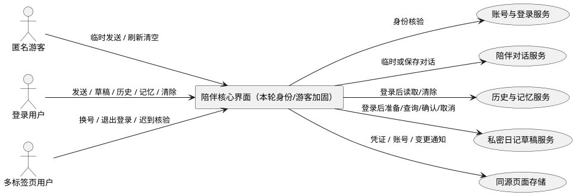
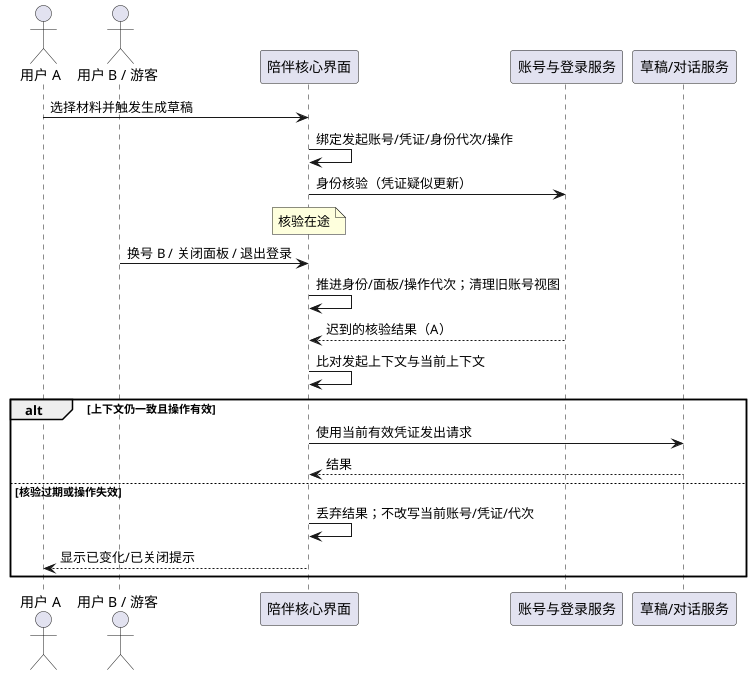
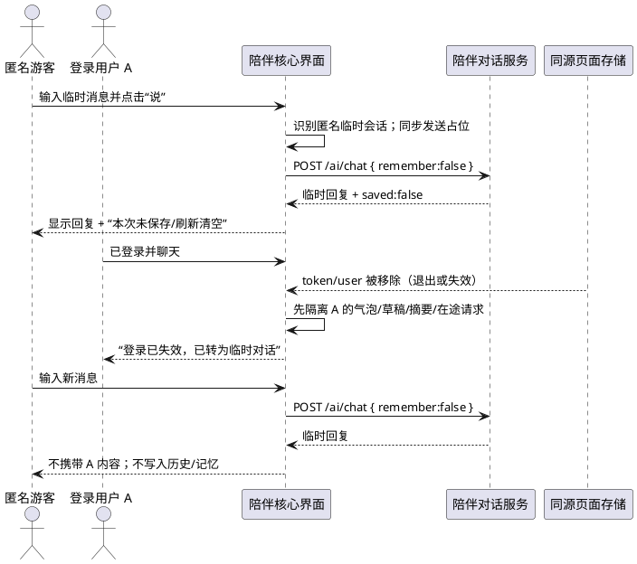

# 身份核验凭证绑定与游客临时聊天增量需求规格（identity_guest_hardening）

> 文档类型：增量需求规格（EARS）
> 工作区：`D:\微光同行\Glimmer`
> 适用范围：在 `ab_edge_hardening` 已实现的 R1–R6 基础上，只收尾两项独立复验问题
> 上游需求来源：`docs/给CodeArts的身份核验与游客聊天补修指令.md`
> 独立复验依据：`docs/CodeArts六项收尾复验结果.md`
> 既有规格（只读、不覆盖）：`.codeartsdoer/specs/ab_edge_hardening/spec.md`（R1–R6、DFX、术语、追溯表）
> 既有设计（只读、不覆盖）：`.codeartsdoer/specs/ab_edge_hardening/design.md`（四层归属、三态身份复核）
> 既有任务规划（只读、不覆盖）：`.codeartsdoer/specs/ab_edge_hardening/tasks.md`（T01–T35）
> 既有证据（只读、不覆盖）：`docs/codearts_proof/2026-11-13-AB边界收尾.md`
> 状态：待用户评审。本文件只定义“做什么”与“如何验收”，不定义实现补丁，不含业务代码、测试代码或配置改动。

---

# 1. 基线事实与继承关系

## 1.1 Git 实际可见状态（本轮重新核对，不沿用旧结论）

本轮在 `D:\微光同行\Glimmer` 实际执行并记录：

| 核对项 | 实际结果 |
|---|---|
| `git rev-parse --show-toplevel` | `D:/微光同行/Glimmer` |
| 当前分支 | `main` |
| `git log -1` | `3086f720feaf03a9e6678ae53821e69bb8075ae7`，提交时间 `Fri Nov 13 08:17:12 2026 +0800`，作者 `Silas-creat`，提交信息“整理项目结构并上传完整源码与文档” |
| `前端参考/chat-companion.js` | `??`，未跟踪（HEAD 中不存在该文件） |
| `前端参考/chat-companion.css` | `??`，未跟踪 |
| `后端源码/scripts/test-chat-companion-repair.test.js` | `??`，未跟踪 |
| `后端源码/package.json` | ` M`，已跟踪且有未提交修改 |
| `前端参考/chat.html` | ` M`，已跟踪且有未提交修改 |
| `.codeartsdoer/`、`docs/review/`、`docs/codearts_proof/` | `??`，未跟踪的规格与证据目录 |
| 工作区整体 | 存在未提交修改与未跟踪文件，不能把 HEAD 当作本轮修复后版本 |

**事实纠正：**

1. 既有 `ab_edge_hardening` 证据文档记录的“非 Git 仓库”，只代表当时工具环境不可见 Git，**不适用于本轮实际工作区**。本轮 Git 仓库可见，根目录为 `D:\微光同行\Glimmer`，HEAD 为 `3086f72`。
2. 当前 `前端参考/chat-companion.js`、`chat-companion.css` 与 36 条测试文件均**未纳入 HEAD**；因此“Git 提交”不能作为 R1–R6 已实现的证明，必须以本轮文件哈希、测试运行与本文件记录为准。
3. 本规格不创建提交、不推送、不执行 `git reset`、`git checkout .`、`git clean`，不覆盖任何未提交文档与历史证据。

## 1.2 当前文件哈希与规模基线

| 文件 | 本轮实测 | 说明 |
|---|---|---|
| `前端参考/chat-companion.js` | SHA-256 `796EF67C8CADD90FE1ED489E406B584BB25C0E29C1F7DF8130EB0DBCD7406DD0`；`wc -l` = 1454，编辑器总行 1455（末行无换行） | 与 `docs/CodeArts六项收尾复验结果.md` 记录一致，说明本轮开始时前端未被额外修改 |
| `前端参考/chat-companion.css` | 259 行（`wc -l`） | 只读；本轮无视觉结构变更时不得改动 |
| `后端源码/scripts/test-chat-companion-repair.test.js` | 969 行（`wc -l`），36 条 `test(...)`，其中 19 条 `EDGE-*` | R1–R6 的正式回归基线 |
| `后端源码/package.json` | 29 行；`test:competition` 在第 14 行，`test:merge24` 在第 15 行 | 仅新增到既有测试文件时不得修改 |
| 复现脚本 | `docs/review/2026-11-13-final-acceptance/identity-boundary-repro.cjs` | 退出 0 = 缺陷存在，不是通过 |
| 复现输出 | `docs/review/2026-11-13-final-acceptance/identity-boundary-repro.txt` | 两个 `REPRO:` 行分别对应 F1、F2 |
| 模型状态 | `ai.configured=false` | 不得称本地规则结果为真实大模型效果 |

## 1.3 与既有 R1–R6 的继承关系

本轮是**增量收尾**，不是重做：

1. 保留 R1 的草稿材料归属、同步身份复核、响应落地校验。
2. 保留 R2 的清除影响代次、读取票据、历史/记忆读取失效、面板影响域。
3. 保留 R3 的清除发起账号与操作归属、跨账号丢弃、同账号关闭面板清理。
4. 保留 R4 的发送同步占位、发送锁归属、拥有者收尾、旧失败不回填。
5. 保留 R5 的确认成功（含幂等恢复成功）弹层内完整关怀与 `tel:` 安全渲染。
6. 保留 R6 的停止生成终态、生成入口收敛、关怀只追加一次、关闭/返回入口。
7. 只对 R1 与 R4 在“身份复核 await 窗口”和“无登录凭证发送”两处做增量加固；不得缩减或改写 R2–R6 的任何有效行为。

---

# 2. 组件定位（增量）

## 2.1 核心职责

本组件负责在身份核验存在异步延迟时，仍把草稿、发送、恢复动作严格绑定到发起账号、发起凭证、身份代次与操作代次；并在匿名游客与已失效登录会话之间建立清晰边界。

## 2.2 核心输入

1. 当前凭证与账号：同源存储中的 `wg_token`、`wg_user`，以及同源其他页面产生的 `storage` 变更通知。
2. 身份核验响应：`GET /auth/me` 的成功、401、网络失败、超时与迟到响应。
3. 草稿动作：选择材料、生成草稿、确认保存、取消草稿、返回修改选择、关闭面板。
4. 发送动作：点击“说”、按 Enter、游客发送、登录失效后的再次发送。
5. 会话恢复：页面初始化时按保存偏好恢复已保存会话、同账号凭证刷新后的恢复、换号后的恢复判定。
6. 会话语义：临时会话（`remember:false`，刷新清空）与保存会话（`remember:true`，仅登录后允许）。
7. 退出登录/登录失效信号：token 被移除、`/auth/me` 返回 401、后端业务码 `40100`、同源存储通知。

## 2.3 核心输出

1. 被正确放行或被明确中止的 prepare / confirm / cancel / send / 自动恢复动作。
2. 账号切换、身份核验过期、操作过期、登录失效、游客临时会话的可理解提示。
3. 游客匿名临时对话气泡与回复；明确“本次未保存/刷新后清空”的状态提示。
4. 登录失效隔离后的空会话页面：无旧账号气泡、草稿、历史、摘要、面板内容与在途请求结果。
5. 不产生跨账号输出：旧账号材料、正文、草稿标识、摘要、清除结果不得出现在新账号或游客页面。

## 2.4 职责边界与非目标

**本组件负责：**

1. 身份核验的“发起上下文”与“返回时上下文”一致性判定。
2. 核验期间的换号、关闭面板、退出登录、操作失效处理。
3. prepare / confirm / cancel / send / 自动恢复五类路径的请求前有效性复核。
4. 匿名游客临时发送，以及“游客”与“原登录会话失效”的区分与隔离。
5. 对应的正式正确行为回归、真实页面验收记录与证据边界说明。

**本组件不负责（本轮非目标）：**

1. 不重写 R1–R6，不缩减既有清除读取失效、清除响应隔离、发送锁归属、确认后关怀、停止生成终态。
2. 不修改后端接口契约、状态码、确认语义、匿名聊天语义与模型配置。
3. 不重建数据库、不切换端口、不执行 `initdb`、`DROP`、`TRUNCATE`、`ALTER`。
4. 不引入前端框架、构建工具、状态管理库；保持原生 HTML/JS/CSS。
5. 不新增对话、记忆、日记、社交、审核功能；不扩展游客可用的保存/历史/记忆/草稿能力。
6. 不修改 `前端参考/api.js`、`前端参考/chat-session.js` 的既有职责与请求结构。
7. 不覆盖历史验收报告、既有 `docs/review/**`、`docs/codearts_proof/` 记录。
8. 不把单元测试、模拟响应、复现脚本退出 0 写成浏览器端到端验收通过。
9. 不把 `configured=false` 的本地规则回复描述为真实大模型效果。
10. 不在日志、提示、截图、测试输出中打印 token、`Authorization`、密钥或真实个人信息。

---

# 3. 领域术语（本轮新增/澄清）

**核验发起上下文**
: 一次身份核验开始时绑定的账号标识、凭证标识、身份代次、操作类型、操作代次、面板代次与会话代次。核验返回时必须与该上下文仍属于同一连续身份和同一有效操作。

**核验过期**
: 身份核验返回时，发起账号、当前账号、身份代次或发起操作已经变化，导致该核验结果不再能证明“当前动作仍属于发起账号”的状态。过期核验不得更新当前状态，不得放行请求。

**核验凭证**
: 身份核验发起时页面持有的凭证标识。仅用于判断发起与返回是否处于同一凭证生命周期，不得在提示、日志或证据中明文展示。

**有效同账号刷新**
: 账号标识不变、凭证字符串发生变化，且核验确认仍为同一账号的状态。该状态允许继续当前动作，不视为换号，但必须使用刷新后的有效凭证。

**匿名临时会话**
: 页面从一开始就没有有效登录凭证、没有绑定账号、没有待隔离的旧登录上下文时建立的会话。消息只存在本页内存，发送时明确 `remember:false`，刷新即清空。

**原登录会话失效**
: 页面曾经绑定账号或处于保存会话，但当前凭证被移除、核验返回 401、或后端返回登录失效。该状态必须先隔离旧账号内容与在途请求，之后才可转为匿名临时会话；不得直接沿用旧上下文发送。

**登录失效隔离**
: 清空旧账号的气泡、临时上下文、草稿、草稿材料、历史、摘要、面板内容与关怀，并使旧账号在途请求失效的过程。隔离完成后页面才可表现为匿名游客。

**操作有效性**
: 一次 prepare / confirm / cancel / send / 恢复动作在请求发出时仍属于原来的账号、身份代次、面板代次、会话代次和操作代次。关闭面板、换号、退出登录、清除成功或更新操作发生后，旧操作失效。

**游客受限能力**
: 保存模式、历史对话、记忆摘要、清除、草稿生成与确认等需要登录的能力。游客只能临时聊天，不能使用这些能力，也不能通过它们读取任何账号数据。

**非持久化**
: 游客消息不写入服务端历史、不写入长期记忆、不写入草稿、不写入保存偏好；页面刷新后不恢复，其他标签页也不能据此恢复。

---

# 4. 角色与边界

## 4.1 核心角色

**匿名游客**：未登录、没有绑定账号的用户；可以发送临时消息，刷新后清空；不能保存、查看历史/记忆或生成草稿。

**登录用户**：已绑定账号的用户；可以使用保存会话、历史、记忆、清除与草稿；身份核验延迟期间不得把旧账号材料提交给新账号。

**多标签页用户**：同一浏览器多个标签页使用不同账号，或在其中一个标签页退出登录/切换账号；其他标签页必须及时隔离旧账号内容。

**隐私敏感用户**：需要明确知道当前消息是否会被保存、是否已切换为游客、旧账号内容是否已被清空。

## 4.2 外部系统

**账号与登录服务**：`GET /auth/me`，返回当前凭证对应账号，或在失效时返回 401。

**陪伴对话服务**：`POST /ai/chat`，匿名且 `remember:false` 时返回临时回复并明确 `saved:false`；登录且保存时返回保存结果。

**历史与记忆服务**：`GET /ai/messages`、`GET /ai/memory`、`DELETE /ai/memory`；均要求登录。

**私密日记草稿服务**：`POST /companion/prepare`、`GET/DELETE /companion/drafts/:id`、`POST /companion/drafts/:id/confirm`；均要求登录。

**同源页面存储**：`wg_token`、`wg_user` 与保存偏好键；提供 `storage` 变更通知，但通知只作为触发信号，不作为唯一身份依据。

## 4.3 交互上下文

---

# 5. DFX 约束（本轮增量）

## 5.1 性能

1. 身份未变化且本地上下文一致时，发送、草稿准备、确认、取消、恢复不得新增固定轮询或额外网络请求。
2. 同一敏感动作在一次执行中最多发起 1 次身份核验；核验过期后不得为同一旧操作自动重试并继续提交。
3. 游客发送不得为了满足身份核验而发起 `/auth/me`；游客只发 1 次 `/ai/chat`。
4. 身份核验期间关闭面板、换号或退出登录后，旧动作的请求数必须为 0。

## 5.2 可靠性

1. 过期核验继续提交旧材料的次数必须为 0。
2. 核验返回后把旧操作代次改写为当前代次并继续执行的次数必须为 0。
3. 游客发送被登录校验阻断的次数必须为 0；游客消息写入服务端历史/记忆的次数必须为 0。
4. 登录失效隔离前，旧账号内容出现在游客页面的次数必须为 0。
5. 旧账号在途响应写回游客页面的次数必须为 0。
6. 既有 R2–R6 的可靠性红线不得回退。

## 5.3 安全性

1. 身份核验必须绑定发起账号、凭证、身份代次和操作归属；不得只用响应落地检查代替请求前判定。
2. 不得以当前身份代次覆盖旧操作的发起代次，使过期操作重新有效。
3. 游客只能使用 `remember:false`；不得把游客消息转为保存消息。
4. 登录失效后必须先隔离旧账号上下文；不得为恢复游客入口而保留旧账号气泡、草稿、摘要或输入内容。
5. 不得在日志、提示、测试输出、截图中打印凭证、`Authorization`、密钥或真实个人信息。
6. 历史、记忆、草稿、保存偏好仍要求登录；游客不得读取或写入。

## 5.4 可维护性

1. 每类敏感动作都必须同时具备“请求前有效性判定”和“响应落地前归属判定”，缺一不可。
2. 错误提示必须可区分：身份变化、核验过期、操作已关闭/失效、登录失效已转临时、游客功能需登录、网络失败。
3. 新增正式回归必须先断言正确行为，并能稳定证明修复前失败；不得把复现脚本退出 0 当作通过。
4. 新增测试优先追加到既有 `后端源码/scripts/test-chat-companion-repair.test.js`，纳入既有 `npm run test:competition`；不得引入新测试框架。
5. 优先只修改 `前端参考/chat-companion.js`；如无新增视觉结构，不得修改 CSS 与 HTML。

## 5.5 兼容性

1. 不改变 `/ai/chat`、`/auth/me`、`/ai/messages`、`/ai/memory`、`/companion/*` 的 URL、方法、请求字段与状态码语义。
2. 保留 `remember` 与 `history` 的既有语义：临时会话 `remember:false`，保存会话 `remember:true`。
3. 保留既有按钮文案与可观察顺序，新增提示文案不得与既有按钮定位冲突。
4. `npm run test:competition` 与 `npm run test:merge24` 在本轮完成后必须退出 0；既有 36 条测试与后续集成检查不得回退。
5. `configured=false` 时继续显示本地规则/未使用大模型状态，不得改写为真实模型效果。

---

# 6. 核心能力

## 6.1 R7 · 身份核验凭证、身份与操作绑定

### 6.1.1 业务规则

1. **核验发起即绑定完整上下文**：当 prepare、confirm、cancel、send 或自动恢复需要发起身份核验时，系统应当在该核验开始时绑定发起账号、发起凭证标识、身份代次、操作类型、操作代次、面板代次和会话代次。
   - 状态前置：动作已经通过本地输入校验，但凭证疑似更新、绑定缺失或身份需要确认。
   - 可观察行为：核验请求携带可追溯到本次动作的发起上下文；核验结果不得被其他动作复用。
   - 失败/过期路径：无法建立绑定时不得发起业务请求，按“身份无法确认”中止。
   - UI 提示：显示与动作对应的“正在确认登录状态…”或既有进行中文案，不显示旧账号内容。
   - 非目标：不要求新增后端字段，不要求改变 `/auth/me` 请求结构。
   a. 验收条件：[A 已选材料后凭证疑似更新，点击生成草稿] → [只发起 1 次身份核验，核验上下文包含 A 的账号、身份代次与本次准备操作]。

2. **核验返回必须证明仍是发起身份**：当身份核验返回时，系统应当确认当前账号仍等于发起账号、当前身份代次仍等于发起代次、当前凭证生命周期仍属于发起上下文，且发起操作仍有效；全部成立才可放行。
   - 状态前置：核验响应已返回，但页面可能已经换号、退出、关闭面板或推进操作代次。
   - 可观察行为：只有“账号 + 身份代次 + 操作有效性”同时成立时，业务请求才会发出；任一不成立即视为核验过期。
   - 失败/过期路径：核验过期时直接丢弃结果，不更新当前账号、凭证或代次。
   - UI 提示：按过期原因显示“账号或登录状态已变化”“操作已关闭/失效”或“登录已失效”；不得显示成功。
   - 非目标：不通过把旧操作代次改成当前代次来“修复”过期；不允许旧核验结果被下一次操作复用。
   a. 验收条件：[A 的核验在途，页面已切 B 并处理 storage，核验迟到返回 A] → [不发出旧 A 材料的请求；B 页面状态不被 A 覆盖]。

3. **过期核验不得改写新状态**：如果身份核验返回时账号、身份代次或操作归属已变化，则系统应当丢弃该核验结果，不得把当前账号改回核验返回账号，不得用当前凭证为旧材料背书，不得更新当前身份代次或操作代次。
   - 状态前置：核验发起后发生换号、退出登录、面板关闭、清除成功或新的同类操作。
   - 可观察行为：当前 `uid`、凭证绑定、身份代次与操作代次保持新状态；旧材料、旧草稿标识、旧发送文本不被提交。
   - 失败/过期路径：若代码路径绕过判定继续执行，则属于缺陷，不得以“响应后被丢弃”解释已发出的旧材料。
   - UI 提示：仅提示过期/已变化，不提示“已保存”“已发送”“已取消”。
   - 非目标：不要求回滚用户在核验期间已经完成的新操作。
   a. 验收条件：[核验迟到返回 A，当前已是 B] → [当前账号仍为 B，当前凭证仍为 B，旧 prepare/confirm/cancel/send 请求数为 0]。

4. **请求前必须复核操作有效性**：当任何敏感请求即将发出时，系统应当在发出前核对发起操作仍属于当前账号、当前面板、当前草稿/材料、当前会话和当前操作代次；不成立时不得发出请求。
   - 状态前置：核验已返回，但面板可能在核验期间关闭、切换或重开；草稿可能已取消、确认或替换；会话可能已清除或换号。
   - 可观察行为：请求发出前完成有效性判定；关闭面板后不产生请求，不把结果写入新面板。
   - 失败/过期路径：操作失效时释放本动作的按钮/锁，保留或按规则清理内容，不进入请求阶段。
   - UI 提示：操作已关闭时保持面板关闭或显示“面板已关闭，未提交”；不得把提示写入新面板。
   - 非目标：不以“响应落地检查”替代请求前判定；不把已关闭面板的动作排队等待。
   a. 验收条件：[点击生成草稿后立即关闭面板，身份核验随后返回] → [`/companion/prepare` 请求数为 0；面板保持关闭；无草稿预览]。

5. **prepare 的增量规则**：当生成草稿时，系统应当只提交发起材料所属账号的已选内容，并在核验返回后、请求发出前再次确认材料、账号、身份代次、面板和操作仍有效。
   - 状态前置：材料已在选择面板绑定到 A；核验期间可能发生同账号凭证刷新、换号或关闭面板。
   - 可观察行为：有效同账号刷新时恰好发出 1 次 prepare，正文只含 A 的材料；换号或关闭面板时不发出 prepare。
   - 失败/过期路径：核验过期不得把 A 的材料配 B 的凭证提交；不得把旧 owner 的身份代次更新为当前代次后继续。
   - UI 提示：身份变化提示“账号或登录状态已变化，请重新选择”；核验无法确认提示“登录状态暂时无法确认，材料未提交”。
   - 非目标：不改变材料 1–2000 字校验、日期校验、`includeRecentDiaries` 语义。
   a. 验收条件：[A 材料 + 核验在途 + 切 B 且 storage 已处理 + 核验迟到返回 A] → [prepare 请求数 0；B 页面无 A 材料与草稿]。

6. **confirm 的增量规则**：当确认草稿时，系统应当确认草稿标识、正文与发起账号仍属于当前有效身份和当前面板，再发出确认请求。
   - 状态前置：A 的草稿预览已渲染；核验期间可能同账号刷新、换号、关闭面板或草稿被取消。
   - 可观察行为：有效同账号刷新时确认 1 次并使用刷新后的凭证；换号/关闭面板时确认 0 次。
   - 失败/过期路径：不得用 B 的凭证提交 A 的草稿正文；不得把旧草稿 owner 的代次更新为当前代次后继续。
   - UI 提示：身份变化提示重新选择并重新生成；已关闭面板时不显示“已保存为私密日记”。
   - 非目标：不改变确认成功后的日记编号、日期、可见性、链接与关怀展示。
   a. 验收条件：[A 的草稿预览 + 核验在途 + 切 B 且 storage 已处理 + 核验迟到返回 A] → [`/confirm` 请求数 0；无保存成功文案；B 页面无 A 正文]。

7. **cancel 的增量规则**：当取消草稿时，系统应当确认草稿仍属于当前有效身份与当前面板，再发出取消请求。
   - 状态前置：A 的草稿预览已渲染；核验期间可能换号、关闭面板或草稿已被确认。
   - 可观察行为：有效同账号刷新时取消 1 次；换号/关闭面板时 DELETE 0 次。
   - 失败/过期路径：不得取消 B 的草稿或取消已失效的 A 草稿后显示“已取消”；不得把过期操作继续执行。
   - UI 提示：身份变化提示“账号或登录状态已变化，请重新选择”；面板关闭时不写入取消成功文案。
   - 非目标：不改变取消终态“取消后不能确认、取消不删除日记”的语义。
   a. 验收条件：[A 的草稿预览 + 核验在途 + 切 B 且 storage 已处理] → [DELETE 请求数 0；无“草稿已取消”提示]。

8. **send 的增量规则**：当发送消息时，系统应当在同步占位后、请求发出前确认发送归属仍有效；身份核验过期不得用新账号凭证发送旧账号文本。
   - 状态前置：发送占位已建立；核验期间可能换号、退出登录、关闭页面、清除或开始新发送。
   - 可观察行为：有效同账号刷新时发送 1 次并收到回复；换号时 `/ai/chat` 请求数 0，B 页面不出现 A 的文本气泡。
   - 失败/过期路径：旧发送的收尾不得解锁新发送；旧文本不得在新账号输入框回填。
   - UI 提示：身份变化提示“账号或登录状态已变化，请确认后重新发送”；发送按钮恢复可用，不留下永久锁。
   - 非目标：不改变发送锁归属、重复提交防护与 Enter 输入法保护。
   a. 验收条件：[A 点击发送且核验在途 + 切 B 且 storage 已处理 + 核验迟到返回 A] → [`/ai/chat` 调用数 0；B 页面无 A 文本；发送按钮可用]。

9. **自动恢复的增量规则**：当页面初始化或按保存偏好恢复对话时，系统应当在恢复结果写入页面前确认恢复目标仍是发起账号，且身份核验未被换号、退出或新的恢复操作作废。
   - 状态前置：页面有保存偏好或已保存会话；核验期间可能切 B、退出或重新加载。
   - 可观察行为：换号/退出后，旧账号历史、摘要、草稿与关怀不写入新账号或游客页面；有效同账号刷新时正常恢复。
   - 失败/过期路径：恢复过期时保持当前新账号的空临时会话，不把旧历史拼接到新账号。
   - UI 提示：身份变化提示已切换/回到临时对话；登录失效提示已转为临时，不显示旧历史。
   - 非目标：不改变保存偏好的读取键、历史分页结构或恢复成功后的正常展示。
   a. 验收条件：[初始化保存恢复的核验在途 + storage 换 B 已处理 + 旧核验迟到返回 A] → [B 页面无 A 的历史/摘要；A 的历史请求不写入 B]。

10. **有效同账号刷新必须保留**：在账号标识不变、仅凭证字符串更新，且核验确认仍为同一账号的条件下，系统应当允许当前动作继续，并使用刷新后的有效凭证完成请求。
    - 状态前置：`uid` 仍为 A；凭证从旧值更新为新值；核验返回 A。
    - 可观察行为：prepare/confirm/cancel/send/恢复的正常路径各只执行 1 次，且请求使用新凭证；不发生换号清理。
    - 失败/过期路径：若凭证更新后账号无法确认，则按“核验无法确认”中止，不发送旧材料。
    - UI 提示：正常路径不额外提示身份变化；只有无法确认时才提示重新登录。
    - 非目标：不要求每次请求都调用 `/auth/me`；本地上下文一致时仍允许零网络复核。
    a. 验收条件：[uid=A，token 由 A1 刷新为 A2，`/auth/me` 返回 A] → [prepare 恰好 1 次；正文含 A 材料；不出现身份变化提示]。

11. **禁止项**：禁止仅做响应落地检查而不检查请求前有效性；禁止把旧 owner 的身份代次赋值为当前代次使其继续；禁止在核验等待期间保留旧材料并允许新账号一键提交；禁止把“storage 已处理”当作唯一身份依据。
    - 状态前置：任意核验在途场景。
    - 可观察行为：请求计数与页面内容证明旧动作未越过请求前判定。
    - 失败/过期路径：出现旧材料被发出、旧正文被确认、旧文本被发送，均判定不满足本条。
    - UI 提示：不得以成功提示掩盖已发生的跨账号提交。
    - 非目标：不新增全局身份轮询或后端接口。
    a. 验收条件：[构造核验在途换号/关闭面板] → [旧动作请求数为 0；页面无旧账号内容]。

### 6.1.2 交互流程

### 6.1.3 异常场景

1. **迟到核验 + storage 已处理换号**
   a. 触发条件：A 的 token 更新触发 `/auth/me`；响应未返回时切 B 并正常处理 storage；随后核验返回 A。
   b. 系统行为：发现发起身份与当前身份不一致，丢弃核验，不更新 B 的账号/凭证，不发出旧 A 材料的请求。
   c. 用户感知：B 页面保持干净，无 A 的材料、草稿、正文或成功提示。
2. **核验期间关闭面板**
   a. 触发条件：点击生成草稿/确认/取消后，在核验返回前关闭或切换面板。
   b. 系统行为：面板/操作代次失效，请求前判定失败，不发出请求。
   c. 用户感知：面板保持关闭或新面板不被旧结果覆盖；无“已保存/已取消”提示。
3. **核验期间退出登录**
   a. 触发条件：核验在途时 token/user 被移除。
   b. 系统行为：旧动作失效；按 R8 先隔离旧账号内容，再允许游客临时会话。
   c. 用户感知：页面清空旧账号内容，显示已转为临时对话。
4. **核验返回时操作已被新操作替换**
   a. 触发条件：同一账号连续两次准备/确认/取消/发送，旧核验后返回。
   b. 系统行为：旧操作代次不等于最新代次，丢弃旧结果，不回滚新操作。
   c. 用户感知：只看到最新操作的结果，不出现旧草稿或旧提示。
5. **核验无法确认（401/网络失败）**
   a. 触发条件：`/auth/me` 返回 401、超时或网络失败。
   b. 系统行为：不发送旧材料；登录用户保留可恢复内容，游客按 R8 处理。
   c. 用户感知：登录用户看到“登录状态暂时无法确认”；游客不被阻断临时发送。
6. **有效同账号刷新**
   a. 触发条件：uid 不变，token 更新，核验返回同账号。
   b. 系统行为：刷新凭证绑定，继续当前动作。
   c. 用户感知：正常完成，不出现换号提示。

---

## 6.2 R8 · 游客匿名临时聊天与登录失效隔离

### 6.2.1 业务规则

1. **游客判定规则**：在页面初始化时没有有效登录凭证、没有绑定账号，并且没有待隔离的旧登录上下文的条件下，系统应当把当前会话识别为匿名临时会话。
   - 状态前置：`wg_token` 为空、`wg_user` 为空或无法解析；页面未处于保存模式。
   - 可观察行为：页面直接进入临时对话；不请求 `/auth/me`、不请求历史/记忆、不加载保存偏好。
   - 失败/过期路径：若存在旧账号内容或保存模式残留，则先按“原登录会话失效”隔离，不得直接当游客。
   - UI 提示：显示临时对话说明“本页保留上下文，刷新后清空”。
   - 非目标：不要求登录后才能进入页面；不新增游客账号或后端匿名身份。
   a. 验收条件：[无 token、无 user 打开页面] → [会话为 temporary；`/auth/me` 请求数 0；无历史/记忆请求]。

2. **游客允许临时发送**：当匿名游客发送非空且不超过 2000 字的消息时，系统应当直接以 `remember:false` 发送，不得因缺少登录凭证而拒绝。
   - 状态前置：会话为匿名临时会话；发送锁空闲。
   - 可观察行为：`/ai/chat` 恰好 1 次，请求体 `remember:false`，`history` 为本页最近上下文；收到回复并显示“本次未保存/临时对话”状态。
   - 失败/过期路径：网络失败或后端错误时显示可恢复错误，不把消息写入历史/记忆。
   - UI 提示：不显示“请重新登录后再试”；保存状态提示明确“本次未保存”。
   - 非目标：不改变 2000 字上限、发送锁归属、Enter 输入法保护与关怀渲染。
   a. 验收条件：[游客输入合成句子并点击“说”] → [`/ai/chat` 调用 1 次；body.remember === false；页面出现回复；无 `/auth/me`]。

3. **游客发送不持久化**：在匿名临时会话期间，系统应当只把消息保留在本页内存，不写入服务端历史、不写入长期记忆、不写入草稿、不写入保存偏好。
   - 状态前置：游客已发送至少一条消息。
   - 可观察行为：无 `/ai/messages`、`/ai/memory`、`/companion/*` 请求；无新增本地持久化键；刷新后页面不恢复匿名消息。
   - 失败/过期路径：即使后端返回 `saved:true`（异常响应），前端也不得把游客消息展示为“已保存到本人账号”。
   - UI 提示：持续显示“临时对话/本次未保存/刷新后清空”。
   - 非目标：不改变后端 `remember:false` 语义；不要求后端新增游客存储。
   a. 验收条件：[游客发送成功后刷新页面] → [匿名消息不恢复；不发出历史/记忆请求；仍可再次临时发送且 `remember:false`]。

4. **游客受限能力必须要求登录**：当游客尝试开启保存模式、查看历史、查看记忆、清除记录或生成/确认草稿时，系统应当提示需要登录，并且不得执行需要登录的读取或写入。
   - 状态前置：会话为匿名临时会话。
   - 可观察行为：不切换为保存模式；不展示任何账号的历史、摘要或草稿；不写入保存偏好。
   - 失败/过期路径：若接口返回 401，仅显示登录提示，不渲染空数据为“已清除/无记录”以外的账号内容。
   - UI 提示：“登录后才能保存对话记忆”“登录后才能查看历史/记忆”“登录后才能生成草稿”等。
   - 非目标：不新增游客可用的历史/记忆/草稿；不改变后端鉴权。
   a. 验收条件：[游客点击保存/历史/记忆/草稿] → [不出现保存成功、历史内容、摘要或草稿预览；提示需要登录]。

5. **原登录会话失效必须先隔离**：如果页面曾绑定账号或处于保存模式，但当前凭证被移除、核验返回 401、或后端返回登录失效，则系统应当先清空旧账号的气泡、临时上下文、草稿、材料、历史、摘要、面板内容与关怀，并使旧账号在途请求失效，然后才转为匿名临时会话。
   - 状态前置：state 曾绑定 A，或保存模式为 on；当前 token 为空/失效。
   - 可观察行为：A 的气泡、turns、草稿、摘要、面板内容被清空；旧请求响应不写回；页面随后处于匿名临时会话。
   - 失败/过期路径：隔离未完成前不得允许发送；不得保留 A 的输入文本作为游客消息。
   - UI 提示：“登录状态已失效，已转为临时对话；本次不保存”。
   - 非目标：不删除服务端 A 的历史/记忆；不把隔离描述为“已清除账号数据”。
   a. 验收条件：[A 已聊天并有草稿 → token 被移除/核验 401] → [A 的气泡与草稿消失；页面为游客临时会话；无 A 内容可见]。

6. **登录失效后允许临时发送**：在旧账号隔离完成后，当用户再次点击发送时，系统应当允许以匿名临时会话发送 `remember:false` 消息，而不是继续提示“请重新登录后再试”。
   - 状态前置：隔离完成；会话为匿名临时会话；输入非空。
   - 可观察行为：`/ai/chat` 1 次，`remember:false`，回复可见；保存状态为未保存。
   - 失败/过期路径：网络失败显示错误并保留输入；不得自动切换回保存模式。
   - UI 提示：保留“已转为临时对话；本次不保存”的明确提示。
   - 非目标：不恢复 A 的保存权限；不把临时消息写入 A 的历史。
   a. 验收条件：[A 的登录失效并完成隔离后输入新句子发送] → [`/ai/chat` 1 次；body.remember === false；A 的旧内容不在页面]。

7. **旧账号在途响应不得泄漏**：如果旧账号的发送、清除、草稿、历史或记忆响应在隔离后返回，则系统应当丢弃该响应，不得写入游客页面、不得回填输入、不得展示旧草稿/历史/摘要。
   - 状态前置：A 有在途请求；页面已转为游客。
   - 可观察行为：游客页面的气泡、输入框、状态提示不被 A 的响应改写；旧请求的收尾只作用于自身。
   - 失败/过期路径：旧请求的 finally 不得解锁游客的新发送，不得移除游客的新进行中提示。
   - UI 提示：不显示 A 的成功/失败提示、关怀或旧文本。
   - 非目标：不要求取消已发出的 HTTP 请求；只要求结果不落地。
   a. 验收条件：[A 的发送/清除/confirm 在途 → 退出登录转游客 → 旧响应返回] → [游客页面无 A 文本与提示；输入框不被回填]。

8. **退出登录后不得沿用旧账号内容**：当用户执行退出登录时，系统应当清除当前账号的页面上下文并转为匿名临时会话，不得保留旧账号气泡、草稿、历史、摘要、保存偏好展示或旧发送锁。
   - 状态前置：登录用户 A 在陪伴页；另一页面或本页执行退出。
   - 可观察行为：`storage` 移除 token/user 后，页面清空 A 内容；发送按钮可用；之后发送为 `remember:false`。
   - 失败/过期路径：若退出时仍有 A 的在途请求，按上一条丢弃结果。
   - UI 提示：显示“已退出登录，已转为临时对话”或等价提示。
   - 非目标：不删除 A 在服务端的历史；不改变 `settings.html` 的退出实现。
   a. 验收条件：[A 页面有气泡 → 退出登录触发 storage] → [气泡、草稿、摘要清空；页面为游客；无 A 内容]。

9. **游客转登录不得携带匿名上下文**：当游客在同一页面登录或被 `storage` 通知切换为新账号时，系统应当清空匿名上下文、重新绑定新账号，并要求保存模式重新显式开启；不得把匿名消息当作新账号历史。
   - 状态前置：游客已有匿名消息；新账号 token/user 到达。
   - 可观察行为：匿名气泡清空或明确不与账号历史合并；保存开关保持关闭直至用户主动开启；不发出携带匿名 `history` 的 `remember:true` 请求。
   - 失败/过期路径：若新账号处于保存偏好，恢复的必须是账号历史，不得拼接匿名消息。
   - UI 提示：显示已切换账号/已回到临时对话；保存需重新选择。
   - 非目标：不改变登录页与保存偏好键；不把匿名消息写入账号。
   a. 验收条件：[游客有匿名消息 → 同页切到 A] → [匿名消息不再展示为 A 的内容；保存模式未自动开启；无 `remember:true` 的匿名历史请求]。

10. **游客发送仍遵守发送归属**：在匿名临时会话期间，系统应当沿用 R4 的同步占位、单一发送锁和拥有者收尾规则；游客连续点击不得产生第二次请求或第二个用户气泡。
    - 状态前置：游客发送进行中或身份/网络等待中。
    - 可观察行为：重复点击被同步拦截；旧响应不影响新发送；按钮状态与提示归属正确。
    - 失败/过期路径：游客发送失败后释放自己的锁，输入可恢复；不得永久禁用按钮。
    - UI 提示：进行中显示“正在回应…”，失败显示可恢复错误。
    - 非目标：不改变 R4 的既有实现与测试。
    a. 验收条件：[游客快速点击两次“说”] → [`/ai/chat` 调用 1 次；用户气泡 1 个；按钮最终恢复可用]。

11. **禁止项**：禁止把游客消息以 `remember:true` 发送；禁止在登录失效后保留旧账号 turns/草稿/摘要继续发送；禁止把匿名消息写入历史/记忆/草稿；禁止为恢复游客入口而跳过旧账号隔离；禁止把游客状态显示为“已保存到本人账号”。
    - 状态前置：任意游客或登录失效场景。
    - 可观察行为：请求体、请求计数、页面内容与本地存储均证明未持久化、未跨账号。
    - 失败/过期路径：出现任一禁止行为即判定不满足。
    - UI 提示：不得用“已保存”掩盖游客未保存事实。
    - 非目标：不新增游客持久化能力。
    a. 验收条件：[游客发送并刷新、退出登录后发送、游客转登录] → [均无匿名持久化；无旧账号内容泄漏]。

### 6.2.2 交互流程

### 6.2.3 异常场景

1. **游客点击发送被登录校验阻断**
   a. 触发条件：无 token、无绑定账号，输入非空后点击“说”。
   b. 系统行为：识别为匿名临时会话，允许 `remember:false` 发送。
   c. 用户感知：收到临时回复，看到“本次未保存/刷新后清空”；不再提示“请重新登录”。
2. **游客刷新后试图恢复**
   a. 触发条件：游客发送后刷新页面。
   b. 系统行为：不读取历史/记忆，不恢复匿名消息；保持临时会话。
   c. 用户感知：页面只显示初始问候；可再次临时聊天。
3. **登录失效时仍保留旧内容**
   a. 触发条件：A 的 token 被移除或核验 401，页面尚未清理。
   b. 系统行为：先隔离 A 的气泡、草稿、摘要、面板与在途请求，再转游客。
   c. 用户感知：旧账号内容消失；明确提示已转临时对话。
4. **旧账号在途回复迟到**
   a. 触发条件：A 的发送/清除/草稿请求在退出后才返回。
   b. 系统行为：丢弃响应，不写入游客页面，不回填输入。
   c. 用户感知：游客页面只显示自己的临时消息与回复。
5. **游客尝试保存/历史/记忆/草稿**
   a. 触发条件：游客打开保存开关或工具入口。
   b. 系统行为：提示登录，不执行需要登录的读取/写入。
   c. 用户感知：看到“登录后才能…”提示，不出现账号数据。
6. **游客快速重复发送**
   a. 触发条件：游客在身份/网络等待期间连续点击。
   b. 系统行为：同步占位拦截第二次进入，只发 1 次。
   c. 用户感知：只出现一条消息与一个回复。
7. **游客转登录**
   a. 触发条件：游客页面检测到新账号 token/user。
   b. 系统行为：清空匿名上下文，重新绑定新账号；保存模式不自动开启。
   c. 用户感知：匿名消息不再作为账号内容；需重新选择是否保存。

---

# 7. 数据约束

> 本章只描述业务逻辑对象约束，不限定实现变量名、存储结构或数据库字段。

## 7.1 身份核验上下文

1. **发起账号**：必填；为发起动作时页面绑定的账号标识；不得在核验返回后被替换为返回账号。
2. **发起凭证标识**：必填；用于判断核验是否仍处于同一凭证生命周期；不得在提示、日志或证据中明文输出。
3. **发起身份代次**：必填；核验返回时必须与当前身份代次一致才可放行。
4. **操作类型**：必填；取值属于 prepare、confirm、cancel、send、restore 之一。
5. **操作代次**：必填；请求发出前必须仍为当前同类操作的最新有效代次。
6. **面板代次**：必填；面板关闭、切换或重开后旧核验不得放行。
7. **会话代次**：必填；会话替换、清除成功、换号或退出后旧核验不得放行。
8. **核验结果**：取值必须明确为“有效同账号”“账号不一致”“无法确认”“已过期”之一；不得用布尔值模糊表达。
9. **过期标志**：核验返回时若发起上下文已失效，必须标记为过期；过期结果不得更新任何当前状态。

## 7.2 游客临时会话

1. **会话类型**：必须为匿名临时会话；不得与保存会话共用同一持久化上下文。
2. **账号绑定**：必须为空；不得把游客消息归到任何账号。
3. **发送标志**：每次游客发送必须为 `remember:false`；不得被保存偏好覆盖。
4. **上下文范围**：只允许本页内存中的最近消息；不得读取服务端历史或长期记忆。
5. **持久化键**：不得新增游客专用持久化键；不得写入历史、记忆、草稿或保存偏好。
6. **刷新行为**：刷新后匿名消息必须消失；页面不得自动恢复匿名上下文。
7. **受限能力**：保存、历史、记忆、清除、草稿必须要求登录；游客不得绕过。

## 7.3 登录失效隔离

1. **旧账号标识**：必须记录隔离前的账号标识，用于判断旧在途响应归属。
2. **失效原因**：必须可区分“凭证被移除/退出”“核验 401”“后端 40100”“网络无法确认”。
3. **隔离完成标志**：只有气泡、turns、草稿、材料、历史、摘要、面板、关怀与在途归属全部清理后，才可标记隔离完成。
4. **在途请求**：隔离后旧请求可继续网络传输，但其结果不得写入页面、不得回填输入、不得解锁新发送。
5. **切换结果**：隔离完成后会话类型必须为匿名临时会话；不得残留保存模式界面状态。

---

# 8. 保留项、不得触碰文件与契约

## 8.1 必须保留的 R1–R6 行为

| 需求 | 必须保留的行为 | 既有证据/测试 |
|---|---|---|
| R1 草稿身份绑定 | 材料归属、同步换号中止、prepare/confirm/cancel 的响应归属、同账号刷新允许 | `EDGE-R1-01…04` |
| R2 清除读取失效 | 清除成功推进影响代次；历史/记忆读取四维校验；草稿面板不被重绘 | `EDGE-R2-01…03`、`P2-01`、`P2-02`、`P2-03` |
| R3 清除响应隔离 | 跨账号丢弃；同账号关闭面板仍清上下文；旧失败不写新页面 | `EDGE-R3-01…03`、`P1-05` |
| R4 发送锁归属 | 同步占位；旧请求只收尾自己；第三次点击不进入；旧失败不回填 | `EDGE-R4-01…03`、`P1-06`、`P1-07`、`P1-08` |
| R5 确认后关怀 | 成功与幂等恢复成功均在当前弹层展示正文、渠道、`tel:`；care 为空不伪造 | `EDGE-R5-01…03`、`B1`、`B4` |
| R6 停止生成终态 | `draft:null + care` 进入 stopped；生成入口收敛；关怀一次；关闭/返回可用 | `EDGE-R6-01…03`、`B4` |

**R7/R8 的修改不得使上述任一用例失败。** 若必须调整既有测试，只能新增用例，不得删除断言、修改期望或跳过用例。

## 8.2 既有测试保护清单

1. 当前 `后端源码/scripts/test-chat-companion-repair.test.js` 共 36 条 `test(...)`，其中 19 条 `EDGE-*`。
2. 既有 17 条（`P1-*`、`P2-*`、`B1`、`B2`、`B3`×2、`B4`、`normal confirm`）的断言语义不得改变。
3. 既有 19 条 `EDGE-*` 的断言语义不得改变；本轮新增用例只能追加在文件末尾。
4. 既有测试直接读写 `state.uid`、`state.mode`、`state.turns`、`state.sending`、`state.memorySnapshot`、`state.draft`、`state.draftStatus`；这些字段名与类型必须保持。
5. 既有按钮文案是测试定位依据：`生成草稿`、`确认保存为私密日记`、`取消草稿`、`返回修改选择`、`确认清除`、`取消`、`关闭`、`再整理一段`、`返回聊天`；本轮不得改名。

## 8.3 允许修改 / 不得修改

**允许修改（实施阶段，本规格阶段不执行）：**

1. `前端参考/chat-companion.js`：仅追加必要的身份核验上下文、请求前有效性判定、游客/登录失效分支；不得整段重写。
2. `后端源码/scripts/test-chat-companion-repair.test.js`：只在文件末尾追加本轮正式回归。
3. `docs/codearts_proof/` 下新增本轮过程记录、日志、截图目录；不得覆盖既有文件。
4. 如确实需要新增视觉提示且无法复用现有 `showNotice`/状态区，才评估 `前端参考/chat-companion.css`；必须先证明现有元素不足。

**不得修改：**

1. `后端源码/src/**`、`后端源码/sql/**`、`.env`、数据库结构/数据；不改端口，不 `initdb`，不 `DROP`/`TRUNCATE`/`ALTER`。
2. `前端参考/api.js`：无 token 时不附加 `Authorization` 的既有行为必须保留。
3. `前端参考/chat-session.js`：`remember:false` / `remember:true` 与 `history` 语义不得改变。
4. `前端参考/chat.html`、`前端参考/login.html`、`前端参考/settings.html`、日记页与双门 HTML。
5. `后端源码/package.json`：新增用例追加到既有测试文件时不得修改；只有新增独立测试文件时才允许评估并记录。
6. HTTP 契约：`/ai/chat`、`/auth/me`、`/ai/messages`、`/ai/memory`、`/companion/prepare`、`/companion/drafts/:id`（GET/DELETE）、`/companion/drafts/:id/confirm` 的 URL/方法/body 字段/状态码语义。
7. 双门入口、互关/粉丝、其他私信、未读汇总、群聊、举报、审核页面与脚本。
8. `docs/codearts_proof/2026-11-13-AB边界收尾.md`、`docs/review/**`、`docs/交接说明.md` 等既有证据与交接文档；只读，不改写、不覆盖。
9. 既有 36 条测试任一行；不得通过格式化整文件掩盖改动范围。
10. 不得执行 `git reset --hard`、`git checkout .`、`git clean`；不得提交或推送，除非用户另行明确要求。

---

# 9. 正式回归用例设计

## 9.1 追加位置与运行方式

**追加位置**：`后端源码/scripts/test-chat-companion-repair.test.js` 文件末尾（当前 969 行、36 条用例之后）。沿用文件内既有 `El`、`deferred`、`flush`、`setup`、`setAccount`、`emitStorage`、`findButton`、`action` 等 harness；不复制第二套 DOM harness，不读取修复后才存在的内部函数。

**命名**：延续 `EDGE-` 前缀，使用 `EDGE-R7-*`、`EDGE-R8-*`，便于 TAP 输出与证据检索。

**运行方式（实施/验收阶段执行，本规格阶段不执行）：**

1. 单文件：在后端目录执行 `node --test scripts/test-chat-companion-repair.test.js`。
2. 完整竞赛回归：在后端目录执行 `npm run test:competition`。
3. 合并回归：在后端目录执行 `npm run test:merge24`。
4. 修复前红色基线：先只追加测试、不改业务源码，执行单文件命令，保存完整 stdout/stderr 与退出码；确认应失败用例的失败点与需求一致。
5. 修复后：同一命令必须退出 0，再执行两套完整命令并保存日志与退出码。

## 9.2 R7 用例清单

| 编号 | 用例名称（建议） | 前置 | 步骤 | 关键断言 | 修复前预期 |
|---|---|---|---|---|---|
| `EDGE-R7-01` | 迟到核验且 storage 已处理换号时不得提交 A 材料 | A 已选材料；A 的 token 更新触发 `/auth/me`；核验响应由 `deferred` 控制 | 1. 打开草稿并选 A 材料；2. 触发 prepare，等待核验请求；3. `setAccount(B)` + `emitStorage('wg_user')`；4. 核验迟到返回 A；5. `flush` | `/companion/prepare` 调用数 = 0；B 页面无 A 材料/草稿；`state.uid === 'B'`；`state.token` 未被 A 覆盖；提示含“账号或登录状态已变化”或“操作已失效” | **应失败**（当前会发出 prepare 并含 A 材料） |
| `EDGE-R7-02` | 核验期间关闭面板后不得再发 prepare | A 已选材料；核验 `deferred` 在途 | 1. 打开草稿选材料并点“生成草稿”；2. 核验未返回时 `closePanel()`；3. 核验返回 A；4. `flush` | `/companion/prepare` 调用数 = 0；`cc-panel` 保持隐藏；面板无草稿预览；无成功/进行中提示残留 | **应失败**（当前会发出请求） |
| `EDGE-R7-03` | 有效同账号 token 刷新仍只 prepare 一次 | uid=A；token A1→A2；`/auth/me` 返回 A | 1. 打开草稿选 A 材料；2. 更新 token 为 A2；3. 点击生成；4. 核验返回 A；5. `flush` | prepare 恰好 1 次；`body.message` 含 A 材料；无“身份已变化”提示；不触发换号清理 | **防回归**（当前应通过，`EDGE-R1-02` 已覆盖同类） |
| `EDGE-R7-04` | 迟到核验且 storage 已处理换号时不得确认 A 草稿 | A 的草稿预览已就绪；核验 `deferred` 在途 | 1. 生成 A 草稿；2. 点确认触发核验；3. 切 B 并 `emitStorage('wg_user')`；4. 核验迟到返回 A；5. `flush` | `/confirm` 调用数 = 0；无“已保存为私密日记”；B 页面无 A 正文；提示身份已变化 | **应失败**（当前会用 B 凭证确认 A 草稿） |
| `EDGE-R7-05` | 迟到核验且 storage 已处理换号时不得取消 A 草稿 | A 的草稿预览已就绪；核验 `deferred` 在途 | 1. 生成 A 草稿；2. 点取消触发核验；3. 切 B 并 `emitStorage('wg_user')`；4. 核验迟到返回 A；5. `flush` | `DELETE /companion/drafts/:id` 调用数 = 0；无“草稿已取消”；B 页面无 A 草稿内容 | **应失败**（当前会发出 DELETE） |
| `EDGE-R7-06` | 迟到核验且 storage 已处理换号时不得发送 A 文本 | A 输入文本并触发发送；核验 `deferred` 在途 | 1. A 输入合成文本；2. 点击“说”触发核验；3. 切 B 并 `emitStorage('wg_user')`；4. 核验迟到返回 A；5. `flush` | `/ai/chat` 调用数 = 0；B 页面无 A 文本气泡；发送按钮可用；无永久发送锁 | **应失败**（当前会用 B 凭证发送 A 文本） |
| `EDGE-R7-07` | 自动恢复核验期间换号不得写入旧账号历史 | 页面带保存偏好；初始化恢复触发 `/auth/me`（`deferred`） | 1. 以 A 的保存偏好初始化；2. 恢复核验未返回时 `setAccount(B)` + `emitStorage('wg_user')`；3. 核验迟到返回 A；4. `flush` | B 页面无 A 的历史/摘要；旧 `/ai/messages` 结果不写入；`state.uid === 'B'` | **防回归**（现有恢复路径已有 epoch/token 检查） |
| `EDGE-R7-08` | 过期核验不得把操作代次更新为当前代次后继续 | A 的 prepare 动作已发起；核验 `deferred`；换号 B 已处理 | 1. 触发 prepare；2. 切 B 并处理 storage；3. 核验返回 A；4. `flush`；5. 再点一次“生成草稿” | 第一次核验期间未发出 A 材料请求；第二次操作使用 B 的当前材料/空材料，不得提交 A 材料；`draftOwner`/`draftMaterial` 不指向 A | **应失败**（当前第一次即越过请求前判定） |
| `EDGE-R7-09` | 迟到的 prepare 响应不得改写已关闭面板 | prepare 已发出且响应 `deferred` | 1. 发起 prepare；2. 关闭面板；3. prepare 迟到成功返回 | 面板无草稿预览；`state.draft === null`；无关怀/成功文案 | **防回归**（`isDraftResponseCurrent` 已覆盖响应落地） |

> 说明：R7-05 的“取消”在既有实现中设有 `state.draftStatus !== 'pending'` 等前置；用例必须先构造 `pending` 草稿，再在核验窗口内换号，避免用例因前置不成立而“假通过”。

## 9.3 R8 用例清单

| 编号 | 用例名称（建议） | 前置 | 步骤 | 关键断言 | 修复前预期 |
|---|---|---|---|---|---|
| `EDGE-R8-01` | 匿名游客可以发送临时消息且不要求登录 | `setup` 时 `user:{}`、`token:''`；`setAccount(null,'')` | 1. 输入合成句子；2. 点击“说”；3. `flush` | `/ai/chat` 调用 1 次；`body.remember === false`；出现回复；无 `/auth/me`；保存状态提示含“未保存/临时” | **应失败**（当前被 `resolveIdentity` 阻断，请求数 0） |
| `EDGE-R8-02` | 游客刷新后不持久化、不读取历史/记忆 | 游客已完成一次临时发送 | 1. 发送成功；2. 用新的无 token `setup` 模拟刷新；3. 再次发送 | 新页面 `state.turns` 不含匿名历史（仅初始问候）；无 `/ai/messages`、`/ai/memory`；再次发送仍 `remember:false`；本地存储无新增持久化键 | **应失败**（当前首次发送即被阻断，无法证明“发送成功后刷新清空”） |
| `EDGE-R8-03` | 游客开启保存模式仍要求登录 | 游客会话；保存开关未开 | 1. 勾选保存开关；2. `flush` | `state.mode` 仍为 `temporary`；未写保存偏好；提示“登录后才能保存对话记忆”；无 `/auth/me` 必要调用 | **防回归**（现有 `enableSaved` 已检查无 token） |
| `EDGE-R8-04` | 游客历史/记忆/草稿仍要求登录 | 游客会话；无 token | 1. 依次点击历史、记忆、草稿入口；2. `flush` | 不展示任何账号历史/摘要/草稿预览；不写入 `state.historyItems`/`memorySnapshot`/`draft`；提示需要登录 | **防回归**（现有 401/身份复核提示已要求登录；断言不得依赖具体请求次数，以免扩大范围） |
| `EDGE-R8-05` | 原登录会话失效先隔离旧账号再允许临时发送 | A 已聊天且有 turns；`token` 被移除或核验返回 401 | 1. 触发失效（移除 token + storage 或 `/auth/me` 401）；2. 输入新句子发送；3. `flush` | A 的气泡/turns/草稿被清空；页面为 `temporary`；`/ai/chat` 1 次且 `remember:false`；A 文本不出现在游客消息或输入回填 | **应失败**（当前会提示重新登录，不发送） |
| `EDGE-R8-06` | 退出登录后不沿用旧账号内容 | A 已聊天；`storage` 移除 `wg_token`/`wg_user` | 1. `setAccount(null,'')` + `emitStorage('wg_user')`；2. 检查页面；3. 游客发送 | A 气泡、草稿、摘要、面板清空；无 A 内容；游客发送 `remember:false` | **防回归**（现有 `switchAccount('')` 会清空；需锁定该行为） |
| `EDGE-R8-07` | 旧账号在途回复不得写入游客页面 | A 的发送响应 `deferred` 在途 | 1. A 发送；2. 退出登录触发隔离；3. 旧响应返回；4. `flush` | 游客页面无 A 回复/错误/关怀；输入框不被 A 文本回填；旧 finally 不解锁游客新发送 | **防回归**（R4 发送归属已覆盖大部分，需补游客隔离场景） |
| `EDGE-R8-08` | 游客转登录不得携带匿名上下文 | 游客已有匿名消息；新账号 A 到达 | 1. 游客发送一条；2. `setAccount(A,'token-A')` + `emitStorage('wg_user')`；3. 检查；4. 尝试发送 | 匿名消息不作为 A 的历史展示；保存模式未自动开启；不发出携带匿名 `history` 的 `remember:true` 请求 | **防回归**（现有 `switchAccount` 清空 turns；需锁定“不自动开启保存”） |
| `EDGE-R8-09` | 游客快速重复发送只产生一次请求 | 游客会话；`/ai/chat` 响应 `deferred` | 1. 输入文本；2. 连续点击“说”两次；3. `flush`；4. 响应返回 | `/ai/chat` 调用 1 次；用户气泡 1 个；按钮最终恢复可用 | **防回归**（R4 同步占位已覆盖，需确认游客分支未绕过） |
| `EDGE-R8-10` | 游客发送失败不写入历史/记忆 | 游客会话；`/ai/chat` 返回错误或网络失败 | 1. 发送；2. 等待失败；3. 检查请求与存储 | 无 `/ai/messages`、`/ai/memory`、`/companion/*`；无保存偏好写入；输入可恢复 | **防回归**（现有临时会话本就不持久化） |

## 9.4 “修复前应失败”的判定与记录

1. 修复前只追加测试，不改业务源码；执行单文件命令，保存完整日志与退出码。
2. 预期至少以下用例失败，且失败断言指向“旧材料被发出/游客被阻断/登录失效未隔离”，而不是环境错误或未定义符号：`EDGE-R7-01`、`EDGE-R7-02`、`EDGE-R7-04`、`EDGE-R7-05`、`EDGE-R7-06`、`EDGE-R7-08`、`EDGE-R8-01`、`EDGE-R8-02`、`EDGE-R8-05`。
3. 若某条“应失败”用例修复前通过，不得把期望改成缺陷行为；先复核场景构造（时序、storage 触发、面板状态、token 更新）是否真实复现，再重跑。
4. 修复后同一套用例必须全部通过；同时既有 36 条不得失败。
5. 不得把 `identity-boundary-repro.cjs` 退出 0 当作本轮验收通过；该脚本只证明缺陷存在。

---

# 10. 验证与证据边界

## 10.1 必须真实执行的命令

实施/验收阶段必须在本仓库后端目录 `D:\微光同行\Glimmer\后端源码` 实际执行，并保存命令原文、退出码与完整日志：

1. `npm run test:competition`
2. `npm run test:merge24`
3. 单文件回归：`node --test scripts/test-chat-companion-repair.test.js`
4. 复现脚本（仅作缺陷存在证据）：`node ../docs/review/2026-11-13-final-acceptance/identity-boundary-repro.cjs`，或在仓库根目录执行对应路径。

日志建议保存到 `docs/codearts_proof/logs/2026-11-13-identity-guest-*.log`；不得覆盖既有 `docs/codearts_proof/logs/` 与 `docs/review/**` 文件。

## 10.2 证据语义

1. 复现脚本退出 0 = “缺陷存在”，**不是**验收通过。
2. 单元测试通过只证明 Node 环境下的可观察行为；不替代浏览器端到端验收。
3. `test:competition`、`test:merge24` 的退出码与完整日志必须保留；不得只写“通过”。
4. 不得引用历史通过记录充当本轮结果；必须区分“基线已有代码”“本轮改动”“人工复核”。
5. 日志、截图、测试输出不得包含 token、`Authorization`、密钥、真实手机号/账号；使用合成账号与合成文本。

## 10.3 浏览器可验证与不可验证范围

**可以（在真实页面/浏览器）验证：**

1. 未登录 `chat.html` 输入合成句子点击“说”，出现临时回复且提示未保存（对应 P2/F2）。
2. 刷新后匿名消息消失，再次发送仍为临时会话。
3. 登录用户退出登录后，陪伴页旧气泡/草稿消失，页面转为临时对话。
4. 用可控响应或双标签页复现“核验在途换号且 storage 已处理”，确认不出现跨账号材料提交。
5. 游客点击保存/历史/记忆/草稿，出现登录提示且无账号数据。

**不可验证或本轮未验证（必须明确标注）：**

1. 真实大模型效果：当前 `configured=false`，只能验证本地规则/降级回复，不得描述为真实模型效果。
2. 真实双账号端到端（若未准备合成账号）：只能做可控响应/最小 DOM harness，不能写成完整真实账号验收。
3. 393×852 关怀弹层若未在本轮实际打开浏览器测量，必须标为“未验证”，不得沿用历史结论。
4. 真实网络超时、跨设备登录、服务端 40100 若未实际触发，必须标为“未验证/模拟响应”。

## 10.4 证据文档要求

1. 新增 `docs/codearts_proof/2026-11-13-身份核验与游客聊天加固.md`（建议文件名，最终以实施阶段为准），记录：
   - 本轮 Git 实际状态（HEAD、分支、关键文件跟踪状态）；
   - 修改前后文件哈希与行数；
   - 新增测试编号与修复前失败日志、修复后通过日志；
   - `test:competition`、`test:merge24` 的命令、退出码、完整日志路径；
   - 浏览器可验证项与不可验证项的逐项标注；
   - 未修改文件清单与契约不变说明。
2. 不得覆盖 `docs/codearts_proof/2026-11-13-AB边界收尾.md`；只新增本轮文件。
3. 若 Git 工具环境再次不可见，应记录“本轮工具环境不可见”，而不是沿用“非 Git 仓库”的旧结论；本轮已实际可见，记录见第 1.1 节。

---

# 11. 待确认问题

1. **游客提示文案**：登录失效转临时会话时，是否使用“登录状态已失效，已转为临时对话；本次不保存”这一固定文案？还是需要与产品现有文案统一？本规格默认使用该文案，但允许在不改变语义的前提下调整措辞。
2. **游客历史/记忆入口的请求策略**：本轮只要求“仍要求登录、不得展示账号数据”。是允许继续发出请求并由 401 提示，还是要求在无 token 时直接提示、不发出请求？本规格建议优先“直接提示、不发请求”，但若为缩小改动面，可接受现有 401 提示路径；需确认取舍。
3. **游客发送的 `history` 内容**：游客临时会话沿用本页最近上下文（最多 16 条）是否符合预期？本规格按现有 `chat-session.js` 语义保留；若要求游客每次完全无上下文，需要明确。
4. **核验凭证变化的边界**：同账号 token 在核验期间再次刷新（A1→A2→A3）时，是允许多一次核验后继续，还是直接判定过期并中止？本规格默认“账号不变且当前凭证仍有效时可继续”，但需要确认是否接受一次额外核验。
5. **自动恢复与关闭面板的关系**：自动恢复是页面级动作，关闭草稿/记忆面板不应使其失效；本规格只要求换号/退出使其失效。是否同意该边界？
6. **正式回归落点**：本轮默认追加到 `test-chat-companion-repair.test.js`，不新增独立文件、不改 `package.json`。是否确认？
7. **真实页面验收账号**：P1 的浏览器复现需要两个合成账号；是否沿用既有合成账号，或新建 `identity_guest_*` 账号并在验收后按导出 ID 清理？本规格建议新建并记录清理责任，避免触碰真实用户数据。
8. **游客转登录后的匿名上下文**：当前默认清空匿名消息；是否允许把匿名消息保留为只读历史但不持久化？本规格默认清空，以满足“不能泄漏/不能当作账号历史”。

---

# 附录 A · 当前实现现状核对（只读事实，供设计与任务阶段参考）

> 以下行号以本轮 `前端参考/chat-companion.js`（1454 行、哈希 `796EF67C...`）为准；只用于说明现状与缺陷位置，不构成本规格的实现方案。

| 路径 | 当前行为 | 与本轮规格的差距 |
|---|---|---|
| `resolveIdentity()`（约 311–335 行） | 本地比对账号/凭证；无 token 直接返回 `unconfirmed`；凭证变化时 `await fetchMe()`；返回后直接把当前 token 写入绑定，返回 `consistent` | await 后未核对发起 token、发起身份代次、当前账号；过期核验可返回 `consistent` |
| `prepareDraft()`（约 816–894 行） | await 核验后把 `owner.uid`/`owner.identityEpoch` 更新为当前值；随后直接发 `/companion/prepare`；响应落地才做 `isDraftResponseCurrent` | 请求前未复核操作/面板/身份是否仍有效；过期核验用新凭证提交旧材料 |
| `confirmDraft()`（约 1034–1115 行） | await 后更新 owner 为当前代次，直接发 `/confirm`；响应落地才检查 | 同上；核验期间换号/关闭面板仍可能发出 A 草稿 |
| `cancelDraft()`（约 1147–1209 行） | await 后更新 owner 为当前代次，直接发 DELETE；响应落地才检查 | 同上 |
| `sendMessage()`（约 1253–1314 行） | 同步占位后 `await resolveIdentity`；更新 owner 为当前代次；直接 `session.send()`；响应落地才 `isSendCurrent` | 同上；且无 token 时在发送前被 `unconfirmed` 拦截，游客无法临时聊天 |
| `restoreSavedForAccount()`（约 430–448 行）与初始化恢复（约 1416–1435 行） | 已保存 `epoch`/`tokenAtStart`，await 后复核 | 相对安全；本轮要求锁定“换号/退出后不写旧历史”并补正式回归 |
| `sendMessage()` 游客分支 | 无 token → `resolveIdentity` 返回 `unconfirmed` → 提示“登录状态暂时无法确认，请重新登录后再试” | 与后端 `/ai/chat` 的 `authOptional` + `remember:false` 匿名语义冲突 |
| 后端 `/ai/chat`（`后端源码/src/routes/ai.js` 约 239–258 行） | `authOptional`；`remember:true` 且无 uid 返回 401；`saved = Boolean(req.uid) && remember !== false` | 契约已允许匿名临时聊天，前端不应阻断；本轮不改后端 |
| `chat-session.js`（77 行） | 临时会话发送 `remember:false` + 本页 `history`；保存会话发送 `remember:true` + 空 history | 契约正确，本轮不改；游客使用临时会话即可 |
| `api.js`（123 行） | 无 token 时不附加 `Authorization` | 已支持匿名请求，本轮不改 |
| 既有测试（36 条） | 19 条 `EDGE-*` 保护 R1–R6；直接读写 `state` 字段 | 本轮只追加，不改既有断言 |

# 附录 B · 需求追溯表

| 本轮需求 | 来源 | 正式回归 | 修复前预期 | 保留的既有能力 |
|---|---|---|---|---|
| R7 身份核验凭证/身份/操作绑定 | `docs/给CodeArts的身份核验与游客聊天补修指令.md` P1；`docs/CodeArts六项收尾复验结果.md` F1 | `EDGE-R7-01…09` | R7-01/02/04/05/06/08 应失败；R7-03/07/09 防回归 | R1 草稿归属、R4 发送锁、R2/R3 清除归属、R5/R6 展示终态 |
| R8 游客匿名临时聊天与登录失效隔离 | 同上 P2；复验结果 F2 | `EDGE-R8-01…10` | R8-01/02/05 应失败；其余防回归 | R4 发送锁、R2 清除读取失效、R5/R6 展示终态、保存/历史/记忆/草稿登录要求 |

---

**规格结束。**