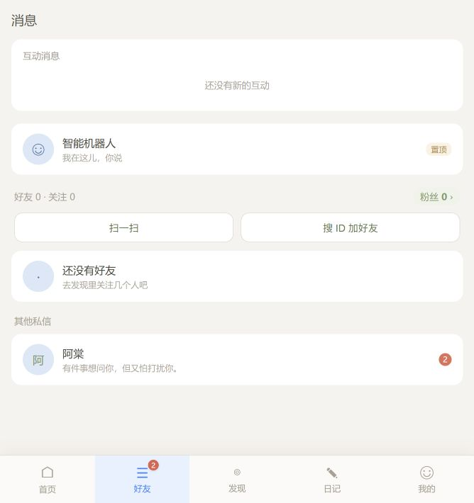

# 微光同行 · Glimmer

<div align="center">

**面向处于 EMO 情绪阶段年轻人的情绪陪伴与生活记录平台**

*An emotional-companion and life-journal platform for young people going through an EMO phase.*


</div>

## 一、这个项目是什么

「微光同行」是一个面向有日常压力、希望倾诉并回顾生活记录的年轻人的 Web 平台。
它提供**生活记录**和**情绪支持**，不做心理诊断，也不替代专业治疗。

核心闭环是一套**由用户掌控的陪伴流程**：

```
表达心情 → 用户授权参考本人日记 → 生成私密日记草稿 → 预览并修改 → 本人确认 → 私密保存 → 下次续聊
```

与"能聊天的陪伴"相比，这个项目把重点放在**记忆的控制权**上：聊什么、记不记、记成什么、什么时候存进日记，每一步都由用户显式选择，并且可以随时查看和清除。

## 二、核心功能

| 模块 | 内容 |
|---|---|
| 日记 | 双门入口（留给自己 / 看看 ta 的）、一天一篇、公开与私密、图片封面、日历视图、浏览记录 |
| 情绪陪伴 | 游客临时聊天、显式保存与刷新续聊、记忆查看/清除、私密草稿预览/确认/取消已接通并完成本机主流程验收；真实模型效果另行验证 |
| 发现 | 公开日记信息流、点赞、收藏、评论与回复、转发 |
| 好友与私信 | 双向关注（好友）+ 单向关注（粉丝）、回关、扫码/搜 ID 加好友、私信 3 秒轮询、问候系统消息 |
| 群聊 | 同龄 / 同省 / 星座 / 兴趣四类房间，未读角标、禁言与机器人管理 |
| 互动消息 | 别人赞 / 收藏 / 评论你的日记时在「好友」页汇总提醒 |
| 漂流瓶与祝福 | 扔瓶子、捞瓶子、给陌生人送祝福、祝福收发记录 |
| 安全与关怀 | 举报（日记 / 评论 / 用户 / 私信）、内容审核与分级处理、危机识别与心理援助热线提示 |
| 账号与资料 | 手机号 + 验证码登录、单点登录（换设备顶号）、头像与资料、二维码名片 |

## 三、界面预览

| 日记双门入口 | 发现页 | 消息 / 好友 |
|---|---|---|
|  |  |  |

> 所有截图使用演示数据，账号与内容均为虚构。

## 四、技术架构

```
浏览器（17 个原生 HTML 页面 + ui.css）
        │
        │  api.js 统一请求、鉴权与错误处理
        ▼
Express 4  /api  （含 compat.js，兼容旧页面路径与返回字段）
        │                       ↘  DeepSeek API（可选；未配置 DEEPSEEK_API_KEY 时使用明确标注的本地兜底回复）
        ▼
MySQL 8（23 张表：用户、日记、评论、关注、私信、群聊、瓶子、祝福、举报、AI 会话与草稿…）
```

| 层 | 选型 |
|---|---|
| 后端 | Node.js 18+、Express 4、mysql2、JWT、multer、cors、dotenv、qrcode |
| 数据库 | MySQL 8.x，`sql/schema.sql` 可重复执行，启动时自动迁移补字段/补表 |
| 前端 | 原生 HTML / CSS / JavaScript，无构建步骤；`api.js` 统一请求，后端 `compat.js` 兼容旧页面接口 |
| AI | DeepSeek Chat API（可选），无 Key 时降级为本地支持回复，不会伪装成大模型输出 |
| 部署 | Windows 双击脚本一键安装/启动；也可手动 `npm install` + `node src/app.js` |

统一响应约定：`{ code, msg, data }`，成功恒为 `code: 0`，错误码为 HTTP 状态码 × 100。

## 五、目录结构

```
.
├── README.md               ← 你正在看的
├── 一键安装.bat            ← 第一次用：装依赖、建库、灌演示数据（约 5 分钟）
├── 一键启动.bat            ← 以后每次：起 MySQL / 后端 / 静态服务并打开浏览器
├── setup/                  ← install.js / start.js（上面两个 bat 的实际逻辑）
├── 后端源码/               ← Express + MySQL 后端
│   ├── src/                ← routes / middleware / utils / db / config
│   ├── sql/                ← schema.sql（23 张表）+ seed.sql（群聊房间）
│   ├── scripts/            ← 初始化、演示数据、冒烟与回归测试
│   ├── uploads/            ← 运行时上传目录（内容不入库）
│   └── .env.example        ← 配置模板（复制为 .env 后按需修改）
├── 前端参考/               ← 17 个页面 + api.js / ui.css / assets
└── docs/                   ← 接口文档、安装指南、更新说明、设计文档、验证报告
```

## 六、快速开始

> 2026-11-15 A/B 页面补修验收结果见 [补修验收报告](docs/2026-11-15_CodeArts补修验收通过.md)。本机规则模式通过，真实模型与干净环境部署仍待补齐。

> 从原机器继续用码道开发，请先读 [docs/码道开始前必读.md](docs/码道开始前必读.md)。上一级 `启动项目.bat` 仍运行 `二十三稿`；Glimmer 的启动器会复用占用 3000 的后端，须核对实际运行目录，不能把旧页面当成本次验收结果。


### 方式 A：Windows 一键（推荐）

1. 双击 **`一键安装.bat`** —— 检查 Node、准备 MySQL（没有会自动下载安装独立实例）、建库建表、灌演示数据、生成 `.env`、`npm install`。
2. 双击 **`一键启动.bat`** —— 启动 MySQL、后端（3000）与静态服务，浏览器自动打开 `http://localhost:8080`。
3. 用演示账号登录：手机号 `13800138000`，验证码框填 `123456`。

> 密码框实际填写的是开发期验证码 `123456`（`DEV_SMS_CODE`），不是真实密码。
> 只想体检不修改：`node setup/install.js --check`。

### 方式 B：手动（macOS / Linux / 已有 MySQL）

```bash
cd 后端源码
npm install
cp .env.example .env          # 修改 DB_HOST / DB_PORT / DB_USER / DB_PASSWORD
node scripts/init-db.js       # 建库建表（可重复执行）
node scripts/seed-demo.js     # 灌演示数据（可选）
node src/app.js               # 后端起在 3000，健康检查 /api/health
```

前端是纯静态页面，需要把 `/api` 与 `/uploads` 代理到后端；Windows 脚本 `setup/start.js` 已内置该代理（含端口冲突自动顺延）。其他平台可用任意静态服务器 + 反向代理达成同样效果。

首次安装遇到 Node / MySQL / 连不上数据库等问题，见 [docs/前置安装指南.md](docs/前置安装指南.md)。

### 演示账号

| 手机号 | 验证码 | 昵称 |
|---|---|---|
| 13800138000 | 123456 | 林小满（演示数据主账号） |
| 19900000001 | 123456 | 阿棠 |
| 19900000002 | 123456 | 老周 |
| 13900000001 | 123456 | 小海 |
| 13900000002 | 123456 | 小光 |

## 七、测试

```bash
cd 后端源码
npm run test:competition   # 参赛核心：AI 会话、私密草稿、危机策略、内容审核、群机器人
npm run test:merge24       # 24 稿增量：社交、消息、审核、禁言回归（需真实 MySQL）
```

`test:competition` 使用 Node 24 内置测试能力，覆盖临时/持久会话隔离、草稿确认事务与幂等、跨账号 404、同日冲突不覆盖、危机提示在模型故障时仍可达等行为；需要已安装依赖、正确 `.env` 与已迁移的数据库。

> 仓库内保留的历史 `npm test`（smoke 脚本）部分断言仍假设旧的前端绝对路径，当前结果不代表全项目通过；以上面两条命令的结果为准。详见 [docs/参赛核心验证报告.md](docs/参赛核心验证报告.md)。

## 八、文档索引

| 文档 | 说明 |
|---|---|
| [docs/接口文档.md](docs/接口文档.md) | 后端全部接口契约（基础模块 + 24 稿增量） |
| [docs/陪伴核心接口契约.md](docs/陪伴核心接口契约.md) | 可控记忆、私密草稿、危机关怀接口的详细约定 |
| [docs/前置安装指南.md](docs/前置安装指南.md) | Node / MySQL 安装、忘记 root 密码、常见报错 |
| [docs/更新说明-二十三稿.md](docs/更新说明-二十三稿.md) | 二十三稿修了哪些问题 |
| [docs/更新说明-二十四稿增量.md](docs/更新说明-二十四稿增量.md) | 二十四稿新增的计数、好友/粉丝、私信与举报能力 |
| [docs/24稿合并说明.md](docs/24稿合并说明.md) | 24 稿增量合并进主干的记录、修正与验证结果 |
| [docs/本地运行说明.md](docs/本地运行说明.md) | 原开发机的环境、数据与启动细节 |
| [docs/参赛评分对齐与交付计划.md](docs/参赛评分对齐与交付计划.md) | 按评分项收敛版本的计划与证据边界 |
| [docs/参赛核心验证报告.md](docs/参赛核心验证报告.md) | 参赛核心能力的验证范围、问题复现与修复 |
| [docs/码道开始前必读.md](docs/码道开始前必读.md) | 合并基线、运行目录、首条码道 Prompt 与保护范围 |
| [docs/码道核心功能接入任务.md](docs/码道核心功能接入任务.md) | 交给华为云码道实现的前端核心任务与验收条件 |
| [docs/陪伴核心接口契约.md](docs/陪伴核心接口契约.md) | 接口契约与验收命令 |
| [docs/superpowers/specs](docs/superpowers/specs) / [plans](docs/superpowers/plans) | 参赛核心能力的设计规格与实施计划 |
| [docs/design-qa.md](docs/design-qa.md) | 日记双门入口的视觉与交互验收记录 |
| [docs/交接说明.md](docs/交接说明.md) | 交付时的前端交接说明（原始版本） |

## 九、安全与已知边界

- **仓库不含任何密钥**：`.env` 被忽略，只提供 `.env.example` 模板；数据库密码与 JWT 密钥由安装脚本随机生成。
- **AI 能力是可选降级设计**：未配置 `DEEPSEEK_API_KEY` 时使用明确标注的本地支持回复，不把规则输出当作大模型结果；真实模型效果仍需单独验证。
- **危机识别基于词库**，存在误报与漏报，关怀提示不构成诊断、治疗或自动救援能力。
- **记忆串行化目前针对单 Node 进程**，多实例部署需要共享锁与持久版本控制。
- **草稿 30 分钟过期指不可再确认**，不等于内容已从数据库删除，清理策略需另行落实。
- 前端静态页与后端不在同源时，图片字段返回相对路径会解析到前端自身目录，需按 `.env` 中的 `PUBLIC_BASE_URL` 配置对外地址。
- 演示数据中的用户、日记、群聊内容均为虚构，仅用于本地演示。

## 十、参赛背景

本项目作为 **2026 华为开发者大赛 · 智能体创新赛 · 西安邮电大学站** 的参赛作品开发，初赛截止 2026-11-18。
仓库中的设计规格、验证报告、码道接入任务与过程记录如实标注了贡献来源：后端能力、测试与审查由 Codex 辅助完成，页面核心接入留待华为云码道实现，不将工具产出描述为对方产出。

## 十一、许可

本仓库用于参赛与作品展示，未附带开源许可证，版权归作者所有；如需引用代码请先联系仓库所有者。
