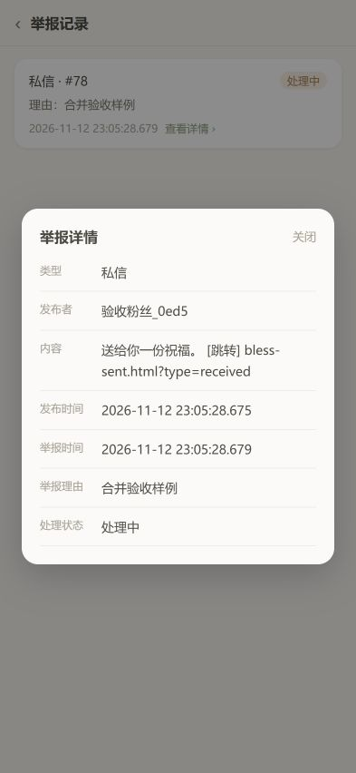

# 24 稿 Debug 版本合并说明

> 说明：本文件保留合并过程记录；`.runtime/` 下的本机快照、差异与测试日志不随仓库提供。
> 合并后的源码即仓库当前内容，二十四稿原包未上传。

已将队友 `24稿` 的功能增量合入实际运行目录 `二十三稿`。队友原包保持原样。下次可用根目录 `一键启动.bat` 启动。

## 队友修改了哪些内容，现已合入哪些

| 范围 | 已合入的行为 |
|---|---|
| 日记与发现页 | 评论、收藏计数，评论/回复后同步数量；评论头像可进入主页；窄屏发现卡片给计数留出位置 |
| 好友与粉丝 | 互关好友和单向关注分组，好友/关注/粉丝统计；粉丝列表、回关按钮、我的页面粉丝入口 |
| 私信与互动 | @ 提及和祝福以私信提醒并提供站内跳转；好友行与底部未读角标；普通私信取消重复互动通知 |
| 举报 | 收到的私信可长按举报；举报记录可打开内容、作者、时间与处理状态详情 |
| 内容处理 | 更明确的违规词、空格/零宽变体检测；私信机器人提示；危机求助仍能在禁言/频控下取得支持 |

原包更新说明不只对应“计数修复”，实际代码含上述多项社交和消息增量，本次按实际差异合并。

## 合并中补上的修正

- 举报创建和详情读取共用权限判断；猜测 ID 不能读取他人私密日记、评论或私信。原公开日记转私密后，历史举报也不再显示正文。
- 自动私信在一个事务内写消息与未读，尊重拉黑，保留发送方原有未读；评论/祝福已保存后，提示投递失败不会诱发重复提交。
- @ 私信不复制日记和评论正文；投递时重查源日记权限。消息跳转仅允许日记详情和收到的祝福两种站内目标。
- 新增“其他私信”入口，未关注的人发来的消息也能找到。昵称、签名与摘要按普通文字渲染；接口失败有可见错误提示。
- 危机识别独立进行。混合广告/攻击/刷屏仍被拦截，同时展示关怀。避免把“拍片、麻醉、验证码、转账、网贷”等正常语境直接判违规。
- 私信拦截日志不记录原文；敏感内容全量打码；重复 emoji 不再因 UTF-16 计数被过早拦截。
- 独立复核发现的禁言覆盖问题已修复：服务重启后，新的 30 秒处罚不能缩短数据库中仍有效的 5 分钟禁言。

## 当前版本已有成果

双门日记入口与原图、左右门对应的功能、AI 服务端接入、临时会话、可控记忆、私密日记草稿预览与确认、日记公开前审核均保留。12 个关键文件与合并前快照哈希一致。

本次无新依赖、无数据库表结构变更；`.env`、已安装依赖、上传文件和用户数据沿用当前环境。没有导入队友旧版本的前端模型密钥或旧 AI 逻辑。

## 验证结果

| 验证 | 结果 |
|---|---|
| `npm run test:merge24` | 23 项 Node 回归 + 13 组真实 MySQL 社交集成 + 3 组真实 MySQL 禁言集成通过 |
| `npm run test:competition` | 57 项会话/危机回归、18 组草稿集成、71 项审核、66 项机器人检查通过 |
| 静态与保留检查 | 51 段 HTML 脚本语法通过；本地脚本无缺失；后端语法通过；12 个保护文件不变 |
| 浏览器 | 互关/粉丝回关、其他私信、@ 和祝福链接、收藏和评论 2→3、评论头像、长按举报、举报详情、拦截仍显示关怀均验证 |
| 手机布局 | 393×852 发现页无横向溢出；举报详情弹窗内容可显示并滚动 |
| 最终运行检查 | 后端已加载最后修复；健康接口与数据库正常；3 个登录接口返回成功；5 个托管页面/脚本与当前源码一致 |

真实数据库测试使用临时随机账号、临时房间，结束后按 ID 和随机标识精确清理。浏览器验收使用 127.0.0.1 的独立站点登录状态，原 localhost 登录保持不变。未调用付费模型或向真实用户发送测试内容。

验收截图：

## 文件与回溯

- 合并前源码快照：`.runtime/merge24/before/`，不含 `.env`、依赖、上传和数据库，不是数据库备份。
- 原始差异清单：`.runtime/merge24/inventory.json`；详细差异在 `diffs/`，含密钥的原始行已在文本差异中遮蔽。
- 最终改动清单：`.runtime/merge24/merged-files.json`。
- 当前项目内共修改 19 个文件，新增 7 个文件（含 5 个回归测试）；外部合并说明和验收工具另存于根目录及 `.runtime/merge24/`。
- 测试日志：`.runtime/merge24/test-merge24.log`、`test-competition.log`。
- 复核和修复记录：`.runtime/merge24/final-review.md`；接口增量已补入 `docs/接口文档.md`。

## 仍需区分的范围

粉丝列表和会话列表目前沿用最多 50 条的加载方式；大规模使用时还需要继续分页。内容审核仍以规则为主，不代表能覆盖所有语义。

旧 `npm test` 的 smoke 脚本仍含过时的前端绝对路径，先前结果为 122 通过、5 警告、3 个路径相关失败；这不应写成“全项目所有历史测试通过”。本次新增验证请使用上面的两个明确命令。

只读审查还记录了与本次增量无关的旧问题：公开资料手机号字段、匿名漂流瓶兼容接口、空库自动初始化。此次未扩展修改这些模块，应在正式公开部署前另做专项处理。
