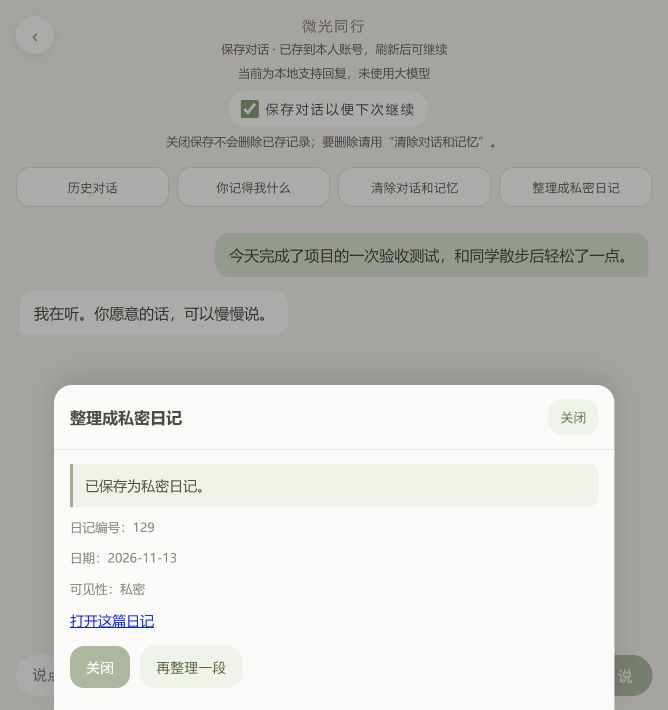
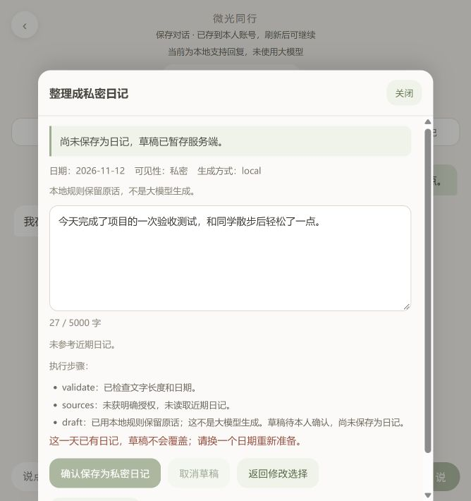
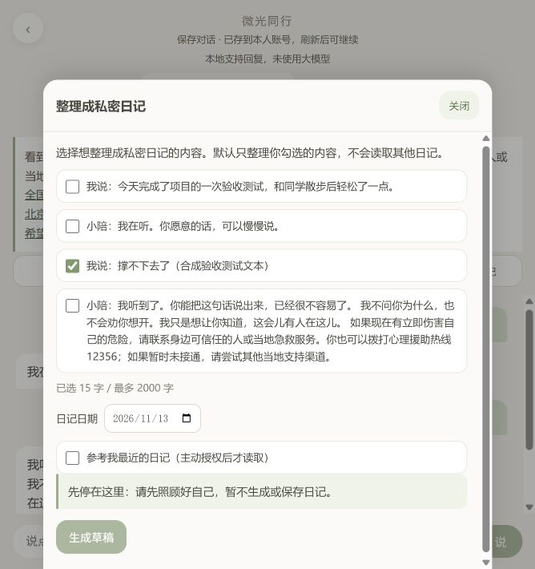

# CodeArts 任务 A/B 验收与返修

检查日期：2026-11-13。检查目录：`D:/微光同行/Glimmer`；基线提交 `3086f72` 加当前未提交修改。本文是 Codex 独立检查结果，不是 CodeArts 自行完成验收的证明。

## 结论

**任务 A/B 的主要界面和正常流程已经实现，应保留；目前还不能标记为完整验收通过。下一轮优先返修保存授权、清除和草稿异步状态，不继续扩展功能。**

CodeArts 实际接上了保存开关、历史/记忆/清除面板、草稿选择/编辑/确认/取消界面，另加首页 AI 入口。主要新增文件为 `前端参考/chat-companion.js`、`chat-companion.css`、`后端源码/scripts/test-chat-companion.test.js`；修改 chat-session.js、chat.html、index.html 及测试命令。后端 src 和 sql 相对基线没有变化。此前由 Codex 修改的交接文档不计入本轮 CodeArts 业务贡献。

CodeArts 留下的原始过程材料在 `docs/codearts_proof/`，明确记录当时数据库连接失败，未完成真实页面端到端验证。应保留这些真实记录，再追加后续修复与复测，不将下面的独立验收冒充 CodeArts 当时的结果。

## 本次环境与验证

- CodeArts 将 Glimmer 的本地 `DB_PORT` 改成了 3306。核对原项目 MySQL 的实例身份后，本次只把该项恢复为 **3307**，没有改其他密钥配置，没有重新建库。
- 前端和后端均从 **Glimmer** 启动，检查页为 `http://localhost:8081/chat.html`，后端 3000；已比对实际服务的 chat-companion.js 与磁盘文件一致。原根目录“启动项目.bat”仍指向二十三稿，不可用它判断新版是否生效。
- 独立验收启动器与服务记录在本机 `.runtime/codearts-review-20261113/`；它们不是跨电脑部署方案。
- 当前模型密钥未配置，页面明确显示“本地支持回复，未使用大模型”。本次不代表真实大模型质量、真实摘要生成或外部模型故障情况下的体验已经验收。
- 本次没有修改 CodeArts 的业务 JS/CSS，也没有替其修复以下问题。只修改本地端口、启动验证、增加独立检查文档和证据。

从 `Glimmer/后端源码` 实际运行：

| 命令 | 本次结果 |
|---|---|
| `npm run test:competition` | 退出码 0；69 项 Node 测试、18 组草稿集成检查、71 项审核和 66 项聊天机器人检查通过 |
| `npm run test:merge24` | 退出码 0；23 项 Node 测试、13 组社交和 3 组禁言集成检查通过 |

测试使用临时合成账号和本机模拟模型。**回归通过不等于前端所有交互通过**：新增测试主要检查辅助函数，没有覆盖下文的操作顺序和请求乱序。

原始日志见 [competition.txt](review/2026-11-13-codearts-ab/competition.txt)、[merge24.txt](review/2026-11-13-codearts-ab/merge24.txt) 和 [test-results.json](review/2026-11-13-codearts-ab/test-results.json)。

## 真实浏览器已验证的流程

用专门创建的本地合成账号操作，未操作真实用户数据：

1. 默认临时聊天：发送成功后数据库消息数为 0，刷新后气泡消失。
2. 开启保存：一轮问答写入 2 条记录，刷新后恢复。
3. 查看记忆：正确提示“暂无摘要，但已有 2 条聊天记录”。
4. 整理草稿：只勾选一条用户消息，默认不参考近期日记；预览已有 pending 草稿，但日记数仍为 0。
5. 编辑并确认：成功返回真实日记编号与站内链接；打开后显示编辑后的正文和私密标识。数据库只有 1 篇，`is_public=0`。
6. 在另一个无日记日期生成并取消草稿：数据库状态为 cancelled；继续点击仍启用的确认按钮后，实际出现错误的“这一天已有日记”提示。日记数没有增加。
7. 合成危机文本：草稿生成停止，没有新增草稿；但支持渠道被弹层遮挡，见 B4。
8. 清除入口确认说明与取消分支可用；**未在浏览器点击不可恢复的确认清除**。清除的请求乱序问题通过隔离脚本复现，服务端清除由回归测试覆盖。不能把它写成完整浏览器清除验收通过。

浏览器检查期间未捕获控制台 warning/error。测试账号及其数据已在检查后精确清理。数据库检查证据只包含合成内容，见 [browser-db-evidence.json](review/2026-11-13-codearts-ab/browser-db-evidence.json)。

正常确认截图：



## 必须返修的问题

P1 表示优先处理的用户保存意愿/清除问题；P2 表示本轮也需收尾的交互正确性问题。下列位置针对本次提交，修复后行号可能变化。

### A1 · P1 · 用户关闭保存后，旧请求可能重新开启保存

位置：`前端参考/chat-companion.js:834`，关联 840、849 和 901。

复现：打开保存，趁 `/auth/me` 未返回立即关闭；此前的认证成功返回后，页面又进入保存模式，并把偏好写为 on。后续聊天会保存，违背用户最后一次选择。

修复方向：模式操作要有独立代次并绑定账号；认证完成时核对最新意图和身份。首次恢复模式走同样规则。仅把复选框暂时置灰不能替代账号与旧请求隔离。

### A2 · P1 · 清除后的内容重新进入下一次请求

位置：`前端参考/chat-session.js:46`，关联 50、reset/invalidate 和 chat-companion.js 的清除回调。

复现：临时模式发送后等待回复，期间清除成功；旧回复到达时，页面虽不显示，helper 仍写回 history。下一次请求再次携带已清除的两条问答。

修复方向：在 helper 内部写 history 前检查会话代次；reset 要令旧请求失效，或清除时替换整个会话实例。覆盖清除失败保留原内容及清除时继续发送的边界。

### A3 · P1 · 换账号后继承另一账号的保存授权

位置：`前端参考/chat-companion.js:790`，关联 verifyMe、页面初始化和模式恢复。

复现：A 账号页面已开启保存，另一个同源标签页登录 B；旧页使用新的 B token 发消息，却仍发送 `remember:true`，尽管 B 从未同意保存。

修复方向：发请求前核对当前身份，监听账号变化；切换时清空前账号气泡、历史、摘要、草稿与临时上下文，令旧响应失效，再按 B 的真实偏好恢复，默认临时。不能只判断 token 是否存在。

### A4 · P2 · 旧记忆响应覆盖清除成功结果

位置：`前端参考/chat-companion.js:397`。

复现：打开记忆后立即打开清除并成功清除；先前记忆 GET 最后返回，重新显示已清除的摘要，并覆盖清除成功的面板正文。

修复方向：历史、记忆、清除请求绑定账号/会话/面板代次。关闭或切换面板、清除成功后，旧响应不得再修改当前面板。

### B1 · P2 · 网络结果不明时缺少真实保存结果

位置：`前端参考/chat-companion.js:748`。

复现：确认已在服务端成功但响应丢失；GET 同一个草稿返回 confirmed，前端自行构造 `diaryId:null,url:null` 的成功结果，显示“日记编号：未返回”，缺少打开链接。

修复方向：通过同一 draftId 幂等 confirm 获取真实 diaryId/url/isPublic/care；不要再次 prepare，也不要假造成功数据。pending/cancelled/expired 与已确认日记被删除要有准确状态和明确的重试入口。

### B2 · P2 · 较早的草稿请求覆盖较新的操作

位置：`前端参考/chat-companion.js:580`，关联 closePanel 和 confirm 回调。

复现：生成 A，关闭后再生成 B，B 先返回，A 后返回；最终预览被替换为 A。切到记忆/历史面板时，也会被晚来的草稿正文覆盖。

修复方向：草稿流程绑定身份和操作代次，关闭/重新进入/账号变化使旧响应失效。确认、取消、返回修改等互斥动作统一管理，不只禁用被点击的按钮。

### B3 · P2 · 取消后还能确认，且错误被误报为日期冲突

位置：`前端参考/chat-companion.js:778` 和错误映射 `:100`。

已在真实浏览器复现：空闲日期 2026-11-12 的草稿取消后，“确认保存为私密日记”仍可点击。服务端返回“草稿已取消”，页面却显示“这一天已有日记”。后端阻止了误保存，前端状态和文案不正确。

修复方向：取消成功进入终态并禁止确认；确认/取消互斥。区分已取消与真实同日冲突，不把所有 40900/41000 一律解释为同日冲突/过期。



### B4 · P2 · 草稿危机关怀渠道显示在弹层后面

位置：`前端参考/chat-companion.js:574`。

真实页面截图显示，`care + draft:null` 把完整关怀和可点击热线放到背景页面，当前弹层只提示“先停在这里”。在窗口较小、历史内容较多时，不能依赖背景或曾经的回复来提供当前支持渠道。

修复方向：直接在当前弹层中渲染后端 care 正文及安全可用的支持链接，停止生成和确认。不要诱导继续尝试生成。这里只检查界面可见性，没有拨打电话或核验热线服务状态。



## 隔离复现与验收方法

从仓库根目录执行：

```powershell
node docs/review/2026-11-13-codearts-ab/A-repro.cjs
node docs/review/2026-11-13-codearts-ab/B-repro.cjs
```

A 脚本加载真实提交的 helper 和 mount 代码，使用最小 DOM 及可控制的异步响应复现 4 项；B 脚本提取真实函数，隔离复现 3 项。两者不访问数据库或外网，记录见 [repro-results.txt](review/2026-11-13-codearts-ab/repro-results.txt)。

**这些脚本断言的是缺陷存在，当前退出码 0 代表复现成功，不代表功能通过。** 修复时把场景转换成“正确行为”的正式回归测试，不能删除断言或把这些脚本直接当成功测试。它们不替代浏览器操作、两个账号和真实服务验证。

## 接下来的顺序

1. **现在发给 CodeArts**：[发给码道的下一条消息.md](发给码道的下一条消息.md)。先处理 A1–A3，再收尾 A4/B1–B4，补实际事件与异步交互测试及真实记录。
2. **返修后复验**：两套回归、双账号隔离、清除/刷新、取消/过期/冲突、乱序请求、网络恢复和关怀可见性。保留双门、社交、未读、举报增量。
3. **验证真实模型**：当前只跑本地支持模式。配置服务端模型后，用合成材料检查真实续聊、摘要、日记质量、拒绝/降级和响应时间，标清真实模型与规则输出。
4. **补可复现启动与必要说明**：核对 setup/start、数据库实例/端口和源码目录；修复现有自检脚本旧路径；补功能与隐私说明。首页入口已由本次 CodeArts 加入，无需重复派发。
5. **完成小规模试用和材料**：用 3–5 位自愿试用者收集真实反馈（先解决公开资料等历史隐私问题，再扩大试用）；整理 3 分钟视频、PPT、源码、README 和真实码道开发证据。
6. **11 月 17 日前形成可提交包**，为用户所述 18 日前的期限留出上传/回退时间；具体提交要求以已保存的分站规则和当时官网为准。

今天优先完成返修、复验和一次真实模型演示。完成这些之前不建议引入新框架、复杂推荐或大规模页面重做。
