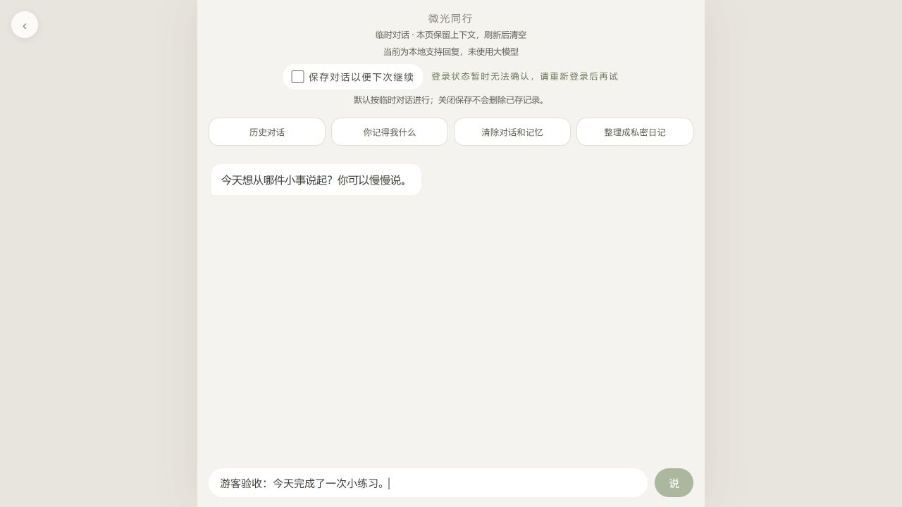

# CodeArts 六项收尾复验结果

日期：2026-11-13，北京时间。当前主仓库：`D:/微光同行/Glimmer`。本报告由 Codex 独立验证，不是 CodeArts 原始过程记录。

## 当前结论

**本轮已有明显进展，完整回归通过；R1 的异步身份核验仍有跨账号提交窗口，另引入了游客临时聊天回归，因此不能宣布完整验收通过，也未创建“验收通过”的 Git 提交。**

用户授权的顺序是“6 项检查无问题，再做完整页面验收、固定 Git 版本与真实模型验证”。本次已推进页面检查，但无问题前提尚未满足。用户另明确选择“先完成验收，模型配置稍后补”，因此真实模型步骤暂缓，未寻找其他项目凭证或调用外部模型。

## 版本与完整回归

- `chat-companion.js` SHA-256：`796EF67C8CADD90FE1ED489E406B584BB25C0E29C1F7DF8130EB0DBCD7406DD0`。
- 最终复核的磁盘文件与 8081 实际提供的脚本一致，中断前后哈希一致。
- Git 仓库存在，HEAD 为 `3086f72`，业务改动仍未提交。CodeArts 本轮记录中的“非 Git 仓库”不适用于本地实际工作区；保留其原记录，并在此纠正事实。
- 本次未修改业务源码、原有测试、模型配置或数据库结构。

| 检查 | 独立执行结果 |
|---|---|
| `npm run test:competition` | 退出 0；105 项 Node、18 组草稿集成、71 项审核、66 项聊天机器人检查通过 |
| `npm run test:merge24` | 退出 0；23 项 Node、13 组社交、3 组禁言检查通过 |
| 新增 19 条 `EDGE-*` | 包含在本次完整命令中，全部通过 |
| 数据库 | 健康接口连接正常，MySQL 8.4.13；项目端口 3307 |
| 模型 | `configured=false`，仍为本地支持模式 |
| `git diff --check` | 退出 0；只有 Git 换行转换提示，没有空白错误 |

完整证据见 [regression-results.json](review/2026-11-13-final-acceptance/regression-results.json)、[competition.txt](review/2026-11-13-final-acceptance/competition.txt)、[merge24.txt](review/2026-11-13-final-acceptance/merge24.txt) 和 [source-hashes.json](review/2026-11-13-final-acceptance/source-hashes.json)。

## 六项原问题的复验状态

| 项 | 判断 |
|---|---|
| R1 草稿发送前身份绑定 | 同步发现换号的原场景已有保护；异步 `/auth/me` 期间再次换号仍不安全，见 F1，未关闭 |
| R2 清除中的记忆读取失效 | 当前实现有 clearEpoch/读取票据；原次序及保留草稿编辑器的正式测试通过 |
| R3 旧账号清除回调隔离 | 当前实现有清除操作归属；旧账号成功/失败和同账号关闭面板测试通过 |
| R4 发送锁归属 | 当前实现同步占位、仅拥有者解锁；旧请求结束、双击和换号失败测试通过 |
| R5 确认后关怀弹层 | 成功弹层内展示 care；直接确认和恢复确认测试通过 |
| R6 停止生成终态 | 停止分支替换表单，提供关闭/返回聊天；防重复和换号清理测试通过 |

R2–R6 的上述结论是代码路径和正式自动化回归范围，不代表本轮已完成所有真实浏览器与手机视口验收。

## F1 · P1 · 迟到身份核验仍能跨账号发送材料

位置：`前端参考/chat-companion.js:311` 的 `resolveIdentity()`，尤其 325–334；调用方 `prepareDraft()` 的 841–852。发送/确认/取消的相同调用模式也需检查。

稳定复现顺序：

1. A 页面已有合成聊天材料，打开并选中日记材料。
2. A 的 token 更新，触发 `/auth/me` 核验；保持该响应未返回。
3. 同源账号变成 B，并正常触发 `storage` 处理。此时页面 uid 已为 B，A 的材料/面板已经被清空。
4. 最早发出的 `/auth/me` 迟到返回 A。
5. 旧 prepare 继续执行，带着 await 前保存的 A 材料，使用当前 B 凭证发出请求。

根因：`resolveIdentity` 在 await 后没有复核发起时 token、身份代次和当前账号，反而把**当前** token 写到 `state.token`；prepare 在等待后把旧 owner 的身份代次重新赋为**当前**代次，且发请求之前没有确认该操作和面板仍有效。响应后的检查只能防止显示，不能撤回已经发出的材料。

验证方式：实际前端模块 + 提交内最小 DOM harness + 可控核验响应，断言页面已切 B、当前凭证为 B、prepare 正文仍含 A 的合成材料。没有使用真实账号，也没有把该材料发往外部模型。该缺陷在正常触发 storage 后仍能复现，不只是事件尚未触发的极小窗口。

修复要求：

- 核验应捕获并保留发起时的 token/账号/身份代次，await 后确认它们仍然有效；过期核验不能修改当前账号状态。
- 每个调用方在实际发请求前确认操作仍属于原账号、面板、会话和代次；不得通过赋值为最新代次让过期操作重新有效。
- 复核 prepare、confirm、cancel、send 和自动恢复的同类路径；有效的同账号 token 刷新仍应工作。
- 正式测试覆盖“核验期间换号且 storage 已处理”“关闭/切换面板后核验才返回”；旧材料不得被发送。

## F2 · P2 · 未登录临时聊天被新身份逻辑拦截

位置：`前端参考/chat-companion.js:319`–320 和 `sendMessage():1264`–1269。

真实页面复现：在未登录的 `http://127.0.0.1:8081/chat.html` 输入合成句子后点击“说”，页面显示“登录状态暂时无法确认，请重新登录后再试”，输入保留但没有聊天气泡或回复。



独立接口核对：不带 Authorization 调用后端 `/api/ai/chat`，明确传 `remember:false`，返回 code=0、saved=false 和本地回复。接口与需求原本允许匿名临时聊天，只有保存历史/记忆与草稿等能力要求登录。根因是所有 send 都先要求 `resolveIdentity` 返回 consistent，而无 token 一律 unconfirmed。

修复要求：明确区分“从一开始就是匿名临时会话”与“原登录会话失效/退出”。前者允许以 `remember:false` 发送，刷新清空；后者先隔离旧账号内容和旧请求，不能为恢复游客入口而携带前账号上下文。保存和草稿权限保持登录要求。

## 复现脚本与证据含义

从 Glimmer 根目录执行：

```powershell
node docs/review/2026-11-13-final-acceptance/identity-boundary-repro.cjs
```

脚本见 [identity-boundary-repro.cjs](review/2026-11-13-final-acceptance/identity-boundary-repro.cjs)，输出见 [identity-boundary-repro.txt](review/2026-11-13-final-acceptance/identity-boundary-repro.txt)。两个 REPRO 和退出码 0 表示**缺陷存在的断言成立**，不是通过验收。修复时需把场景写成“正确行为”的正式回归，不删除断言掩盖问题。

## 后续顺序

1. 用 [给CodeArts的身份核验与游客聊天补修指令.md](给CodeArts的身份核验与游客聊天补修指令.md) 修复这两项；已有 R2–R6 的有效实现保留。
2. 复验通过后继续第二步：合成双账号、清除/刷新、发送并发、草稿确认/取消/冲突/过期/恢复、393×852 关怀弹层完整验收，再形成 Git 提交。
3. 第三步按用户决定等待模型配置；届时继续真实对话、摘要、草稿、失败降级和延迟验证，不将本地支持模式当成真实模型效果。

此次没有创建新的合成数据库账号；完整回归的临时数据由其自身清理流程处理。没有提交或推送 Git，也没有修改 CodeArts 的历史过程记录。
